# Assurance argument (M31, T31.4, T31.5)

A goal / strategy / evidence tree in the style of GSN (Goal Structuring Notation): goals
**G**, strategies **St**, context **C**, evidence (solutions) **S**, undeveloped goals marked
◇. Every evidence leaf names a file of the repo. `python tools/safety_case.py --check`
(in `make ci`) fails when a leaf of the tree has no row in the evidence table, or when a
path of that table, or a link of `docs/safety/`, no longer exists.

The argument is honest about its state: most branches end on evidence that shows the goal is
**not met yet**. The tree says where the proof stands. It is not a claim that the function is
safe.

## Tree

```mermaid
graph TD
  G0["G0: the zone monitor reports a person within 0.5 s (N = 5 frames)<br/>with a dangerous failure rate below the target, inside the ODD"]
  C1["C1: ODD (odd.md)"]
  C2["C2: dreaded event E1 and SR-01..13 (requirements.md)"]
  C3["C3: target PFH 1e-6 /h (SIL 2), to be confirmed by ARCYS"]
  G0 --- C1
  G0 --- C2
  G0 --- C3
  St0["St0: argue over the three families of causes of E1 (T25.10),<br/>then combine their rates (T31.3)"]
  G0 --> St0

  G1["G1: perception errors are rare enough or flagged"]
  G2["G2: execution anomalies are detected"]
  G3["G3: missed deadlines are detected"]
  G4["G4: the combined rate meets the target"]
  St0 --> G1
  St0 --> G2
  St0 --> G3
  St0 --> G4

  St1["St1: argue over the detector, the monitor and the vote"]
  G1 --> St1
  G11["G1.1: recall ≥ 95 % at 0.1 FPPI inside the ODD (SR-01, SR-03)"]
  G12["G1.2: the integer chain behaves as the validated model (SR-02)"]
  G13["G1.3: the monitor flags the misses and the out-of-ODD inputs (SR-05, SR-13)"]
  G14["G1.4 ◇: the temporal vote cuts the bursts of misses (SR-06)"]
  St1 --> G11
  St1 --> G12
  St1 --> G13
  St1 --> G14
  S1["S1: three-stage recall, degradations, bursts"]
  S2["S2: equivalence matrix"]
  S3["S3: SMT proof of the scalar kernels"]
  S4["S4: monitor comparison"]
  S5["S5: learned failure prediction"]
  S6["S6: unflagged misses"]
  G11 --> S1
  G12 --> S2
  G12 --> S3
  G13 --> S4
  G13 --> S5
  G13 --> S6

  G21["G2.1: accelerator faults are caught by the ABFT (SR-07)"]
  G22["G2.2 ◇: the blind spots (requantized tile, narrow input tiles) are protected (T25.4)"]
  G23["G2.3: post-processing is order independent (SR-12)"]
  G2 --> G21
  G2 --> G22
  G2 --> G23
  S7["S7: HLS buffer fault campaign"]
  S8["S8: ABFT tests"]
  S9["S9: post-processing properties"]
  G21 --> S7
  G21 --> S8
  G23 --> S9

  G31["G3.1: the frame time is bounded (SR-08)"]
  G32["G3.2 ◇: a late, missing or start-up frame gives UNSAFE (SR-08, SR-10, SR-11, T29.5)"]
  G33["G3.3 ◇: the reaction time of the chain ≤ 0.5 s (SR-09, T30.4)"]
  G3 --> G31
  G3 --> G32
  G3 --> G33
  S10["S10: static latency bound"]
  G31 --> S10

  G41["G4.1: budget per hour with written assumptions (SR-04)"]
  G4 --> G41
  S11["S11: failure budget"]
  S12["S12: failure budget tool and tests"]
  G41 --> S11
  G41 --> S12
```

## Evidence

The path is relative to the root of the repo. **Supports** says whether the evidence shows the
goal met, or measures how far it is.

| Leaf | Evidence | Path | Supports |
|---|---|---|---|
| S1 | R@0.1 per stage, per height, per degradation; dreaded-event bursts (T27.1-T27.5) | `results/person_safety.md` | not met: 90.1 % integer, degraded axes below 85 % |
| S2 | integer == golden == C-sim byte for byte, fake-quant → integer ≤ 1 LSB (T28.0) | `results/equivalence.md` | met up to C-sim |
| S3 | 95 SMT obligations of the requantization and output stage (T28.2) | `tools/prove_kernels.py` | met (scalar kernels) |
| S4 | six monitors, shift AUROC (T25.5, T29.0) | `results/ood_monitor.md` | not met: 0.81 / 0.93 |
| S5 | monitors and learned head against missed persons (T29.1 reduced, T39) | `results/failure_prediction.md` | not met: 9-12 % at 5 % alarms |
| S6 | unflagged misses, Clopper-Pearson (T27.7) | `results/person_safety.md` | detector-alone row only: 9.4 % of persons, 3 / 4 episodes |
| S7 | 2,200 C-sim flips in the HLS buffers (T25.7) | `results/faults.md` | partial: `w`, `out` covered; `q`, narrow `in` silent |
| S8 | ABFT identity in Python and golden (T25.2) | `python/tests/test_abft.py` | met (identity) |
| S9 | capacity, overflow, order properties of the NMS (T28.6) | `python/tests/test_postproc_props.py` | not met for the order (unsorted stream) |
| S10 | static frame bound and watchdog (T30.0, T30.1) | `results/latency_bound.md` | met for Tiny-YOLOv2 (92 ms); v3 / v4 dominated by the uncapped NMS |
| S11 | dangerous failure rate per hour against SIL / PL (T31.3) | `results/failure_budget.md` | not met: +7.4 orders above SIL 2 |
| S12 | budget computation and its tests | `python/tests/test_failure_budget.py` | — |

## Undeveloped goals (open work)

| Goal | What is missing | Task |
|---|---|---|
| G1.1 | recall target not met; fine-tune on industrial data inside the ODD; CrowdHuman / ExDark / ARCYS images | T27.1-T27.3 runs, M41-M43 |
| G1.3 | monitor measured on full runs, at the operating point of T27.2, against the six degradations; monitor rows of T27.7 | T29.1, T29.2, T27.7 |
| G1.3 | monitor inside the integer chain and the kernel; its own faults | T29.4, T25.9 |
| G1.4 ◇ | temporal vote not written | T29.3 |
| G2.2 ◇ | protection of the requantized tile and narrow input tiles; sensitivity campaign | T25.4, T25.1, T25.6 |
| G2 | the three-family table (which mechanism sees which event) | T25.10 |
| G3.2 ◇ | fallback state machine (`CLEAR` / `PERSON` / `UNSAFE`), start-up and missing frame | T29.5 |
| G3.3 ◇ | reaction delay of the chain; board latency and non-determinism | T30.4, T30.2, T30.3 |
| G3.1 | candidate cap of the v3 / v4 NMS so that the watchdog is meaningful | M30 finding |
| G4.1 | the inputs marked provisional / missing in the budget; device fault rate | T31.3 regenerated |
| all | early alerts and learned failure prediction on full runs | M39, M40 |
| C3 | target standard and SIL / PL; the standards themselves (columns "to read" of [objectives.md](objectives.md)) | ARCYS |

## Perspectives (T31.5)

- **Continual learning under certification.** EASA MOC LM-02 forbids online learning today.
  An admissible path: a frozen backbone, a small adapted head trained offline on site data, an
  embedded non-regression test (fixed reference images, recall and FPPI bounds, run before
  activation) and a rollback to the previous head on failure.
  - Needed in the repo: head-only fine-tuning in `python/yolo/train/`; a frozen reference set
    with expected detections; a non-regression check in the integer chain (as for the T39.5
    head, integer == C-sim); two head slots and a switch in the driver.
- **Adversarial patches against person detection.** Thys 2019 hides a person from YOLOv2
  with a printed patch. Whether int8 quantization weakens or strengthens such a patch is
  open.
  - Needed: patch optimisation against the float model (gradients exist in the NumPy
    framework); transfer measured at the integer and C-sim stages with R@0.1 of T27.1; the
    T29.0 / T39 monitors on patched images.
- **Tracking and re-identification on the SoC.** A track per person would make the temporal
  vote a per-person persistence and give the reaction time a meaning per person.
  - Needed: IoU / Kalman tracking after the NMS on the ARM (T29.3 is the first step, without
    Re-ID); a small embedding head for Re-ID (cost with `perf_model`); MOT17 or PREWID
    sequences with identities to measure identity switches.
