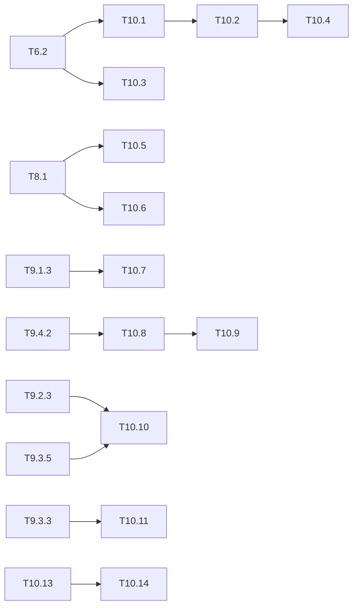

# M10 — Improvements (optional)

Goal: gather the engineering improvements spotted during M6 to M9 and make them plannable.
Starting point: the C-sim projection of Tiny-YOLOv2 (206.5 ms accelerator, 4.8 img/s,
33.8 GOPS, MAC efficiency 11.0 %). Targets: the compute bound (41.1 ms), then the KV260
roofline point (31.9 ms). Each task keeps the contract **C-sim == golden to the byte**.

The costed gains come from `tools/perf_model.py` (`make perf-model`) and from
[rapport.md §3](../../results/rapport.md). Gains that do not appear there are marked "to
estimate". M9 gathers the research extensions; M10 the optimisations and the tooling.
Before taking up a direction, rank it by gain / effort with the PC profiles of
[T12.8](M12-profils-pc.md#-t128--performance-estimée-m6-m8-m94-m10).

## A. Single-engine kernel

### [ ] T10.1 — 64-bit m_axi ports
- **Spec**: §10.2 · **Depends on**: T6.2 · **Size**: L
- **Deliverables**: `in_buf` loaders (row reads) and `w_buf` loaders (weights in tile
  order) in 64-bit words in `hls/kernels/conv_pe.cpp`; `out_buf` written in 64 bits;
  weight reordering, done once by the driver (`sw/driver/program.cpp`); arena aligned on
  8 bytes
- **Acceptance**: C-sim == golden (v2, v3, 3 images, KV260 and Zybo tiles); C-sim cycles
  == "64-bit ports" scenario of `perf_model` (Tiny-YOLOv2: 41.30 → 11.89 Mcycles,
  206.5 → 59.4 ms, 16.8 img/s)
- **Notes**: the direction with the largest gain (×3.5). The four ports read one byte per
  cycle (0.2 GB/s per bundle) while the roofline assumes 13.4 GB/s. Moving to 128 bits
  brings almost nothing more (58.3 ms with trim): the bottleneck moves to the output stage
  (T10.2). The second input segment (route) and the `up` addressing (T6.4) must stay
  correct when a row is not aligned on 8 bytes (w = 13, 26).
- **Done**:
  - `act_in`, `act_out` and `wts` ports in words of `ACC_WORD_BYTES` = 8 bytes
    (`hls/kernels/accel_config.hpp`). `in_buf` is loaded row by row, with
    `row_words(IC)` = 3 words per (lane, row) whatever the alignment (unaligned rows,
    second route segment, `up` address divided by 2).
  - Weights reordered once in tile order (`hls/kernels/weight_layout.hpp`,
    `Program::weights`). The weight tile is a contiguous block, read in full words.
  - Output writes in words, row by row, with a byte mask on the border words. Margin
    `ARENA_SLACK` after the arena.
  - **Realistic, row-by-row** cycle model, identical in `count_cycles` and
    `tools/perf_model.py`. With `ACC_WORD_BYTES=1` and the other directions switched off,
    the C-sim gives back the M6 counters exactly.
  - Tiny-YOLOv2, 64-bit ports alone: 41.30 → 12.27 Mcycles, 206.5 → 61.3 ms
    (16.3 img/s). The ideal model `cdiv(bytes, 8)` announced 59.4 ms.
  - C-sim == golden and dumps (v2, v3, 3 images; KV260 and Zybo tiles, `tb_net_pow2`);
    `perf_model --check`: 0 differences.
- **Remaining**:
  - synthesis and co-sim (Vitis);
  - byte mask (WSTRB) of the partial writes; possible fallback: 8-bit output port widened
    by `m_axi_max_widen_bitwidth`;
  - II of the loader in upsample (2·WORD columns per word, L21 of v3).

### [ ] T10.2 — Parallel requantization
- **Spec**: §9.3, §10.3 · **Depends on**: T10.1 · **Size**: M
- **Deliverables**: `store_tile` (`hls/kernels/output_stage.hpp`) with 8 acc·M0
  multipliers; `requant` parameter of the cycle model tied to a constant of the kernel
- **Acceptance**: C-sim == golden; cycles == "128-bit ports + trim + requant ×8" scenario
  (8.62 Mcycles, 43.1 ms, 23.2 img/s, 52.6 %), i.e. 5 % from the compute bound
- **Notes**: today, a single 32 × 31-bit multiplier (4 DSP) handles the Tm channels one
  after the other, i.e. Tm × 169 cycles per tile. Moving to 8 multipliers costs +28 DSP,
  while 896 DSP out of 1,248 are used.
- **Done**:
  - `store_tile` requantizes `ACC_RQ` = 8 channels per cycle, with 8 unrolled calls of
    `golden::requantize`;
  - the model reads `requant` from `accel_config.hpp`;
  - 64-bit ports + trim + requant ×8: 9.29 Mcycles, 46.4 ms (21.5 img/s, 48.9 %).
- **Remaining**: DSPs actually added and frequency met (synthesis).

### [ ] T10.3 — Valid channels only (trim)
- **Spec**: §10.2 · **Depends on**: T6.2 · **Size**: S
- **Acceptance**: C-sim == golden; cycles == "trim" scenario (−21 % on the current
  kernel: 163.3 ms)
- **Notes**: L00 has cin = 3 but the kernel loads Tn = 24 channels, so 87 % of its load is
  useless. The gain becomes almost zero after T10.1: only do this task if T10.1 is
  postponed (Vitis missing).
- **Done**:
  - `ACC_TRIM`: only the valid lanes of the last ti tile are loaded; the lanes beyond are
    masked in `compute` (one mux per lane);
  - with the 64-bit ports, the gain is almost zero (12.27 → 12.27 Mcycles on v2);
  - trim stays on because it reduces the size of the reordered weights.

### [ ] T10.4 — Tiling losses
- **Spec**: §10.2 · **Depends on**: T10.2 · **Size**: L
- **Deliverables**: a PE dedicated to L00, or a smaller Tn for this layer; tiles
  Tr = Tc = 12 or 14 for the pooled layers; matching scenarios in `perf_model`
- **Acceptance**: C-sim == golden; C-sim cycles == model; gap to the compute bound
  (41.1 ms) and to the roofline point (31.9 ms) reported
- **Notes**:
  - L00 uses 6 % of the 768 multipliers: 1.86 Mcycles, i.e. 23 % of the compute bound for
    2 % of the MACs. The 3×3 PE of 2025-kim is a possible model.
  - With a 2×2/2 pooling and Tr = Tc = 13, each tile only gives 12 × 12 useful outputs.
  - The gain is to be estimated with `perf_model` before writing any HLS code.
- **Done**:
  - `perf_model` estimate first: folding of L00 −10 %; tile 12 −6 %; tile 14 −11 %. Tile
    14 is selected.
  - **Folding** (`ACC_FOLD`) instead of a dedicated PE: when cin·k ≤ Tn (L00), the lanes
    carry (channel, kernel row) and the conv becomes 1 × k, hence a compute of L00 3 times
    shorter.
  - **Per-layer tile**: new `tr`, `tc` and `fold` fields of `LayerDesc` (30 words), chosen
    by `driver::conv_desc`. Tr = Tc = 14 for the convs followed by a stride-2 maxpool (whole
    tile useful); 13 elsewhere, L11 of v3 (stride 1) included.
  - Current kernel, Tiny-YOLOv2: 7.44 Mcycles, **37.2 ms, 26.9 img/s, 187 GOPS, 61.0 %**.
    This is below the old compute bound (41.1 ms), because the folding and the 14 tile lower
    the bound itself (31.6 ms). The gap to the roofline point (31.9 ms) is 5.3 ms.
    Tiny-YOLOv3: 36.1 ms, 27.7 img/s.
- **Remaining**:
  - L00 stays limited by the store (requant of 2 groups + writes ≈ compute);
  - the 1×1 convs load IR rows per lane instead of Tr;
  - 14 × 14 buffers: BRAM to be confirmed in synthesis.

## B. ARM software

### [ ] T10.5 — Inter-image pipeline
- **Spec**: §10.4 · **Depends on**: T8.1 · **Size**: M
- **Deliverables**: `--pipeline` option of `yolo_bench` and `yolo_app`: two threads and
  two arenas. The preprocessing of image i + 1 overlaps the accelerator of image i.
- **Acceptance**: detections identical to the sequential mode (sim backend); measured
  throughput ≈ max of the stages instead of their sum
- **Notes**: the gain is to be estimated with the `pre` times measured on the KV260. It
  grows after T10.1-T10.2, because the accelerator then stops dominating.
- **Done**:
  - `Accelerator(dev, m, n_arenas)`: several arenas in the same u-dma-buf, and relative
    descriptors, shared by all the arenas;
  - `--pipeline` in `yolo_bench`: a producer thread prepares image i + 1 (reading,
    preprocessing, `load_input`) in the free arena while the main thread runs the
    accelerator and the post-processing of image i; images are returned in order;
  - `--pipeline` in `yolo_app`: the copy of the next pass overlaps the accelerator, with
    `--repeat`;
  - `yolo_bench` prints the measured throughput next to the expected ones (sum and max of
    the stages);
  - ctests `yolo_bench_pipeline` (detections identical to the sequential mode, 3 images)
    and `yolo_app_pipeline`.
- **Remaining**: the throughput gain, measurable only on the KV260. In C-sim, the
  accelerator takes 8 s per image and hides everything.

### [ ] T10.6 — Cached DMA buffer
- **Spec**: §10.4 · **Depends on**: T8.1 · **Size**: S
- **Deliverables**: `uio_device.cpp` opens u-dma-buf without `O_SYNC`; `sync_for_cpu` and
  `sync_for_device` are called around each access
- **Acceptance**: output == golden on the board; copy and post-processing times compared
  with the uncached mode
- **Notes**: to do only if `yolo_bench` shows that the DDR copy or the post-processing
  weigh.
- **Done**:
  - `--cached` option: u-dma-buf opened without `O_SYNC`;
  - `Device::sync_for_device` and `sync_for_cpu` take a range, written to the u-dma-buf
    sysfs (`sync_offset`, `sync_size`, `sync_direction`), under a mutex for the pipeline;
  - `Accelerator` now only syncs the arena of the slot (after `load_input`, after the
    kernel), the `yolo_post` table and its result, instead of the whole buffer at every
    layer;
  - the uio backend builds (`make sw-board` on the PC).
- **Remaining**: output == golden on the board, copy and post-processing times compared
  with the uncached mode.

### [ ] T10.7 — Chaining conv → post without the ARM
- **Spec**: §10.3 · **Depends on**: T9.1.3 · **Size**: S
- **Deliverables**: `Accelerator` starts `yolo_post` as soon as the last conv ends. The
  head is read directly in the arena, and the ARM waits for a single IRQ per image.
- **Acceptance**: boxes == golden `hw_postproc` (sim backend); ARM time per image reported
- **Done**:
  - sequencer in `yolo_conv`, new arguments `descs` and `n_calls`:
    - with `n_calls > 0`, the kernel reads the descriptors in DDR and chains all the
      convs: a single completion, a single IRQ;
    - with `n_calls = 0`, the register mode is unchanged;
  - `regmap.hpp`: `DESCS` and `N_CALLS` added, offsets to be checked by
    `make check-regmap`;
  - `Accelerator::run_all` starts the pass, then `run_post` reads the heads directly in the
    arena: 2 IRQs per image instead of N + 1;
  - `yolo_bench` and `yolo_app` go through the sequencer; `arm_ms` column (CPU time of the
    thread during acc + post);
  - ctest `run_compare_chain`: heads == dumps and `yolo_post` boxes == golden
    `hw_postproc` (v2, v3).
- **Remaining**:
  - real register offsets (Vitis header);
  - ARM time per image measured on the board: in C-sim, the kernel runs in the calling
    thread.

## C. Streaming (follow-up of M9.4)

### [ ] T10.8 — Synthesizable `yolo_stream`
- **Spec**: §10.1 · **Depends on**: T9.4.2 · **Size**: L
- **Deliverables**: on-chip weights initialised as ROM (today m_axi pointers in C-sim);
  "outer PE" order of L12-L13 in hardware; FIFO depths
- **Acceptance**: synthesis: DSP, LUT, BRAM/URAM and frequency reached, compared with the
  plan of T9.4.1 (968 DSP, 32.1 img/s); co-sim of the DATAFLOW without deadlock
- **Notes**: the PE × SIMD loops unrolled by 256 are a timing risk.
- **Done**:
  - **ROM**: `tools/gen_stream_rom.py` writes `stream_rom.{hpp,cpp}` from the export, for
    the 7 stages that the plan keeps on chip (1.62 MB). Layout
    `[og][ig][i][j][pe·SIMD + s]`: one word of PE·SIMD bytes per cycle, with
    `ARRAY_RESHAPE cyclic` (`STREAM_ROM_PRAGMAS`). The script refuses a plan that differs
    from the tables of `yolo_stream.hpp`.
  - **Outer PE** for L12 and L13 (FRAME stages):
    - the weights of a group (PE × C_in × K² bytes) are read once from DDR into a local
      buffer, then the whole map is swept;
    - L12 passes to L13 channel by channel (CHW), without an output map;
    - L13 keeps its output map and emits it in HWC for L14.
  - **Model** (`stream_model`):
    - it now counts the output map and the FIFOs;
    - the allocation starts from "everything on chip" and moves the largest weights to
      DDR;
    - same plan (32.1 img/s, L12 and L13 in DDR), on-chip memory 1.94 → 2.15 MB out of
      2.31.
  - **FIFOs**: one output row of the producer (`stream_model.fifo_depths`), in the
    `FIFO_DEPTH` table and the `#pragma HLS STREAM`. Linear chain: the depth sets the
    throughput, not the deadlock. The shim measures its maximum occupancy (informative in
    sequential C-sim).
  - The template arguments come from the tables `STAGE_PE`, `STAGE_SIMD`, `STAGE_FRAME` and
    `STAGE_OUT_CHW`.
  - Vitis scripts `synth_stream.tcl`, `cosim_stream.tcl` and `export_stream.tcl`, with
    `make hls-synth-stream | hls-cosim-stream | hls-export-stream`.
  - **Verification**:
    - `tb_stream` (pointers) and `tb_stream_rom` (ROM): each stage == dumps to the byte on
      3 images, cycles unchanged == model;
    - `test_stream_model.py`: FIFOs, pragmas and tables == model.
- **Remaining**:
  - synthesis (DSP, LUT, BRAM/URAM, frequency) and co-sim of the DATAFLOW (Vitis missing);
  - check that Vitis accepts the 1.2 MB ROM of L10 in `ARRAY_RESHAPE` (otherwise, split by
    og group).

### [ ] T10.9 — Integration of the streaming design
- **Spec**: §10.5 step 5 · **Depends on**: T10.8, T7.1 · **Size**: L
- **Deliverables**: AXI-Stream ↔ DMA in the block design, driver backend, `yolo_bench`
- **Acceptance**: output == golden on the board; throughput and latency measured against
  [streaming.md](../../results/streaming.md)
- **Done**:
  - `in` and `out` ports in one-byte AXI-Stream with TLAST on the last value of the head
    (`hls::axis` in synthesis, an equivalent structure in C-sim). `tb_stream` checks for a
    single TLAST.
  - `StreamDesc` in `hls/stream/stream_desc.hpp`, shared with the driver. Library
    `accel_stream`.
  - Driver:
    - `stream_regmap.hpp` (offsets of `yolo_stream` and of the AXI DMA PG021 in direct
      mode);
    - `Device` (`stream_*`, `dma_*`, `dma_wait_done`);
    - `StreamAccelerator` (HWC input, ap_start, S2MM then MM2S, wait for the end of S2MM,
      HWC → CHW head).
  - Sim backend: DMA emulated through its registers (RS, LENGTH, IOC, TLAST, received
    length).
  - Uio backend: `--uio-stream` and `--uio-dma` windows, `--uio none` without
    `yolo_conv`. Builds (`make sw-board`).
  - `yolo_bench --engine stream` (pipeline included). `sw::detect` on a head in memory.
  - Ctests `yolo_bench_stream_00000{1,2,3}`: detections == dumps. With `--pipeline`, the
    same detections as in sequential mode.
  - Block design: `build.tcl -tclargs <jobs> stream` (`make vivado-build ENGINE=stream`),
    `yolo_stream` + 8-bit AXI DMA; overlay `pl_stream.dtsi` (`ENGINE=stream make
    fpga-firmware`). Written, Tcl syntactically complete, **not run** (Vivado missing).
- **Remaining**:
  - export of the IP, block design and bitstream;
  - real register offsets and names of the AXIS ports (`in_r`, `out_r`);
  - output == golden, throughput and latency on the board.

## D. Model and quantization

### [ ] T10.10 — Per-layer mixed precision
- **Spec**: §9.2, §9.3 · **Depends on**: T9.2.3, T9.3.5 · **Size**: L
- **Deliverables**: choice of 4, 6 (powers of 2) or 8 bits per layer, guided by a
  sensitivity measurement (mAP when a single layer moves to low bit); 2 × 4-bit packing in
  memory (excluded from T9.3.1)
- **Acceptance**: Pareto front mAP / (DSP, weight bytes) against INT8 and all-4-bit;
  golden and C-sim to the byte for the selected configuration
- **Done**:
  - `uniform4` type (±7) in `pow2.KINDS`, weights packed two per byte (low nibble = even
    index):
    - `wbits` field of the manifest and of the schema;
    - `export.pack4` / `unpack4`;
    - C++ golden model: unpacking at load time;
    - driver: `reorder_weights` packs the tile blocks;
    - kernel: `wbits` word of `LayerDesc` (31 words, regmap shifted), `w_buf` loader with
      2·WORD weights per word;
    - `perf_model`: 4-bit weights at half a byte.
  - `stream_model.plan` accepts bits per layer.
  - `tools/mixed_precision.py`: sensitivity (27 evaluations on 500 images), greedy front
    (loss / bits gained) and full mAP of the selected configuration.
  - **Results** ([precision_mixte](../../results/precision_mixte.md)):
    - the first three convs are sensitive; the tail (98 % of the weights) loses less than
      0.3 point in 4 bits;
    - selected: L10, L12 and L13 in 4 bits, L02 and L08 in 6 bits;
    - **54.68** mAP against 55.69 for projected INT8 (−1.01); weights 15.86 → 8.19 MB;
    - streaming: **64.2 img/s** (L13 in 4 bits lifts the bottleneck), against 43.19 for
      all-4-bit in PTQ.
  - Golden == C-sim == dumps to the byte on 3 images: conditional ctest `tb_net_mixed`
    (`build/m10/models/tiny-yolov2-voc-mixed`).
  - The cycles of the single engine are unchanged (compute-limited).
- **Remaining**:
  - per-layer QAT (global `qat_from_steps`) to get back under 1 point;
  - 2 4-bit MACs per DSP in the kernel;
  - synthesis of the packed loader.

### [ ] T10.11 — Channel pruning
- **Spec**: §10.4 · **Depends on**: T9.3.3 · **Size**: L
- **Deliverables**: structured pruning by filter norm, then fine-tuning
  (`tools/train.py`) and export of a manifest with reduced channels
- **Acceptance**: VOC2007 test mAP and `perf_model` cycles for several rates; a comparison
  with 2026-fata (pruned by 70 %, 24.3 img/s, KV260) and 2023-zhai (pruned) that is no
  longer skewed by the pruning
- **Notes**: when cout is not a multiple of Tm, the tiling loss can cancel the gain. Prune
  by multiples of Tm (32) and Tn (24).
- **Done**:
  - `python/yolo/prune.py` (tested):
    - L1 norm of the filter after BN folding;
    - filters kept at a multiple of Tm = 32 (Tn = 24 is not held: lcm 96 too coarse);
    - prunable convs: chain conv → (maxpool) → conv; `--layers` to prune only some of
      them.
  - `tools/prune.py` writes a reduced `.cfg` and `.weights`.
  - `calibrate.py`, `export_model.py` and `eval_quant.py` accept a `.cfg` (`--net` path,
    `--weights`).
  - `perf_model.py --manifest` gives the cycles of the current kernel for any export.
  - `tools/prune_study.sh` (tier M): pruning, mAP without fine-tuning, fine-tuning of 300
    iterations, calibration, mAP on 500 images, export, cycles.
  - **Results** ([elagage](../../results/elagage.md)):
    - 30 / 50 / 70 %: 44.6 / 60.5 / 82.5 img/s projected (against 26.9);
    - but mAP 11.9 / 8.0 / 1.6 after fine-tuning, against 57.8 on these 500 images;
    - 300 iterations are not enough to recover from the pruning;
    - the MAC efficiency drops (61 → 36 %): less filled tiles.
  - r30 export: golden == C-sim == dumps to the byte, C-sim cycles == model.
- **Remaining**:
  - long fine-tuning (tier N) and full mAP;
  - sensitivity-guided or progressive pruning;
  - comparison with 2026-fata at equal mAP.

### T10.12 — Own weights (pointer)
This is not a new task: see [T2.9](M2-cibles-perte-entrainement.md) (fine-tuning on VOC).
It becomes necessary if T10.11 or another dataset requires breaking free from the Darknet
weights.

T10.11 makes it necessary: the pruning does not recover with a short fine-tuning (see
[elagage](../../results/elagage.md)), and the long fine-tuning goes through the training
loop of T2.9.

## E. Verification and tooling

### [ ] T10.13 — Continuous integration
- **Spec**: §11 · **Depends on**: — · **Size**: S
- **Deliverables**: CI workflow (for example `.github/workflows/ci.yml`): `make lint`,
  `make test`, `make golden-check`, `make csim-gcc`, ctest of `sw/` with the sim backend
- **Acceptance**: the CI is green on `main`; a one-byte difference from the golden model
  makes it fail
- **Notes**: nothing that needs Vitis, the board or the full VOC. The weights and dumps
  needed are cached, or reduced to a versioned subset.
- **Done**:
  - `.github/workflows/ci.yml` (ubuntu, Python 3.11): `make ci-model ci`.
  - **Synthetic export** instead of versioned weights: `tools/make_ci_model.py`.
    - He weights and random BN with a fixed seed, calibration on 8 synthetic images,
      export and dumps of 3 inputs named 000001 to 000003 (≈ 20 s, neither VOC nor
      `.weights`).
    - Same shapes as the real networks: golden == C-sim to the byte and cycles == model
      keep their full meaning.
    - The script fails if a layer outputs only zeros.
  - `make ci` chains `lint`, `test-cpp`, `golden-check`, `csim-gcc`, `perf-model`,
    `sw-sim` and `test-py`. Pytest runs last, once the binaries are built.
  - **Anti-skip guard** `YOLO_REQUIRE_MODEL=1`: a missing export makes the HLS and sw
    testbenches (`tb_common.hpp`), Catch2 (`REQUIRE_MODEL`) and pytest (`conftest.py`)
    fail, instead of skipping them. Skips tied to the Darknet weights or to VOC remain
    allowed.
  - `pyyaml` added to the `dev` extra, for `tools/roofline.py`.
  - Checked in a clean copy (without `model/`, `data/` or `weights/`):
    - everything is green (pytest: 298 passed; 7 skipped for Darknet weights, VOC, or
      synthetic export);
    - one byte changed in a dump makes `golden-check` fail.
  - Only test skipped on the synthetic export (marker file `SYNTHETIC`): the hardware /
    float post-processing gap of `test_hw_postproc`. It compares the order of the
    detections, and random heads have too many nearly equal scores.
- **Remaining**: first run on GitHub (push `main`).

### [ ] T10.14 — Cycle non-regression
- **Spec**: §10.4 · **Depends on**: T10.13 · **Size**: S
- **Deliverables**: `make perf-model` (`perf_model.py --check` against
  `build/hls/cycles_conv.csv`) added to the CI
- **Acceptance**: the CI fails if the cycle model and the C-sim counters diverge. This
  check keeps the gains announced by T10.1-T10.4 reliable.
- **Done**: `perf-model` (`hls-cycles`, then `perf_model.py --check`) in `make ci`.
  Checked: one cycle changed in `cycles_conv.csv` (L06 of v2) gives "1 écarts" and exit
  code 1. The model also reads the `wbits` field of the manifest (4-bit weights, T10.10).

## F. Research directions (pointers)

- Online learning on FPGA: [T9.5](M9-extensions.md).
- 2×2 maxpool with stride 1: the base does not cover it (gap of §12 of the spec), but it is
  handled here (T6.3 by border replication, T9.4.2 in the stream). It is a contribution to
  write up in the report.

## Recommended order and dependencies

T10.13 → T10.1 → T10.2 → T10.5, by decreasing gain as in `rapport.md`. After T10.1 and
T10.2, the projected Tiny-YOLOv2 reaches ≈ 23 img/s and ≈ 160 GOPS. That is the level of
2026-fata in compute throughput, without pruning.

