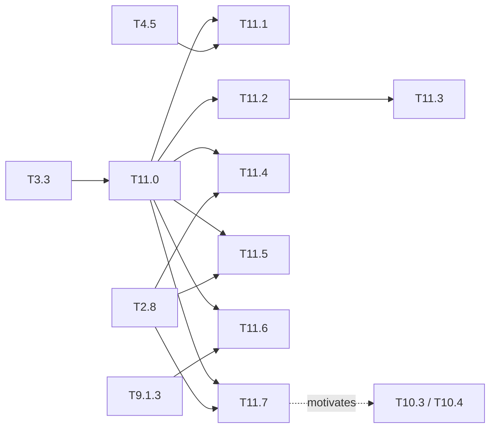

# M11 — Other datasets (optional)

Goal: take the chain beyond PASCAL VOC, today its only test bench (VOC2007 test: 56.30 in
float, 55.66 in integer and on FPGA in C-sim). Each proposed dataset stresses a precise
part of the chain: INT8 calibration, hardware NMS, the 13×13 grid, a non-square input,
single-channel L00 or the domain shift. Variety for its own sake is not a criterion.

Starting point:
- `python/yolo/data/voc.py` and `tools/eval_voc.py` hard-code `VOC_CLASSES`;
- `model/tiny-yolov3-coco` is calibrated on 500 VOC2007 trainval images
  ([calibration](../../results/calibration_tiny-yolov3-coco.md)) and has never been
  evaluated on COCO.

## Summary

The counts of VOC, VisDrone, CrowdHuman, ExDark and FLIR are **measured** by
`tools/data_stats.py` ([stats-jeux.md](stats-jeux.md), M16); those of COCO and KITTI, whose
data is missing on the PC, and the licences come from the dataset pages. A non-commercial
licence is enough for this project, which does not publish weights.

| Dataset | Annotated images | Classes | Typical resolution | Licence | What it stresses | Task |
|---|---|---|---|---|---|---|
| COCO val2017 | 5,000 | 80 | ≈ 640×480 | CC BY 4.0 (annotations) | `tiny-yolov3-coco` in its own domain, AP@[.5:.95], calibration | T11.1 |
| ExDark | 7,363 (3,000 train, 1,800 val, 2,563 test) | 12 (close to VOC) | variable | research | INT8 calibration in low light | T11.3 |
| KITTI 2D object | 7,481 (train) | 8 | ≈ 1242×375 | CC BY-NC-SA 3.0 | non-square input, letterbox, anchors | T11.4 |
| VisDrone2019-DET | 6,471 + 548 (train + val) | 10 | up to 2000×1500 | research | small objects, 13×13 grid, resolution | T11.5 |
| CrowdHuman | 15,000 + 4,370 (train + val) | 1 (person) | variable | research | dense NMS, 256 slots, overflows | T11.6 |
| FLIR ADAS v2 (thermal) | 10,742 + 1,144 (train + val) | 15 kept | 640×512 | research | single-channel input, L00 | T11.7 |

Four datasets seen from a drone (AU-AIR, DroneVehicle, thermal HIT-UAV, UAVDT) follow the
same pattern; their preprocessing and their tasks are in [M18](M18-jeux-drone.md).

The CPU cost comes from the rate measured in T2.7, ≈ 0.45 s/image at 416 in training. An
epoch on 7,000 images therefore takes ≈ 1 h. An inference-only evaluation costs much
less. For comparison, the FPGA stage of M8 in C-sim (`make bench-sim`) takes ≈ 40 min for
4,952 images.

## Tasks

### [x] T11.0 — Generic dataset adapter
- **Spec**: §5, §8.3 · **Depends on**: T3.3 · **Size**: M
- **Deliverables**: `python/yolo/data/datasets.py` (registry `{name: (classes, loader)}`);
  each loader returns the same dict as `voc.parse_annotation` (`boxes`, `xyxy`, `labels`,
  `difficult`, `width`, `height`); `--dataset` option in `tools/eval_voc.py`,
  `tools/eval_quant.py`, `tools/calibrate.py`, `tools/kmeans_anchors.py`,
  `tools/make_inputs.py`, `tools/train.py`
- **Acceptance**: with `--dataset voc`, the VOC2007 test mAP is unchanged to the decimal
  (56.30 / 55.66); tests of a loader on a dummy annotation of each format
- **Notes**: prerequisite of all the following tasks. The formats to cover are COCO JSON,
  KITTI txt, VisDrone txt, CrowdHuman odgt and ExDark bbGt. An explicit class mapping
  (`{source class: model class}`) serves T11.2.
- **Done**: `python/yolo/data/datasets.py` (registry `DATASETS`, loaders for VOC, COCO,
  KITTI, VisDrone, CrowdHuman, ExDark and FLIR, `MAPPINGS`, `eval_view`); common options
  `--dataset`, `--data-root` (alias `--devkit`) and `--split`, also in
  `tools/map_stades.py`, and a choice of metric (`--metric voc|coco`); tests
  `test_datasets.py`.
  - Regions without a class (`DontCare` of KITTI, ignored regions of VisDrone) are
    removed.
  - Objects to ignore from a known class (`iscrowd` of COCO, `mask` of CrowdHuman) are
    marked `difficult`.
  - KITTI: 80/20 train/val split with a fixed seed.
  - Data: `tools/get_datasets.sh` (COCO and KITTI; instructions for the other datasets);
    profiles: `tools/m11.sh`.
  - Kaggle versions of CrowdHuman, VisDrone and ExDark: `tools/get_datasets.sh kaggle`
    links them by symlinks to the expected trees. CrowdHuman has its val images in
    `Images_val/`, which the loader also reads. ExDark on Kaggle only has the images:
    `ExDark_Annno/` and `imageclasslist.txt` come from the GitHub repository
    (Groundtruth/).
- **Acceptance checked**: `tools/m11.sh voc-regress` gives on VOC2007 test, stretch, an mAP
  of 56.30 in float (`eval_voc.py`, then `eval_quant.py`) and of 55.66 in integer,
  unchanged.

### [ ] T11.1 — COCO val2017
- **Spec**: §8.3, §10.4 · **Depends on**: T11.0, T4.5 · **Size**: M
- **Deliverables**: `python/yolo/infer/coco_eval.py` (AP@[.5:.95], AP50, AP75, AP per
  size, 101-point interpolation); `results/map_coco.md`
- **Acceptance**:
  - the NumPy metric equals pycocotools (to within 1e-4) on a subset, and pycocotools is
    only used in tests;
  - mAP of `tiny-yolov3-coco` in float, integer and FPGA C-sim, with image-by-image
    equality between integer and FPGA (as in T8.2);
  - effect of the calibration, current VOC against 500 COCO train2017 images.
- **Notes**: the only direct comparison with the YOLOv3-tiny literature (2026-fata,
  2023-zhai), provided the pruning and the metric are flagged. An AP50 close to the value
  published by Darknet for this network (≈ 33) is expected; it serves as an external
  reference and must be reported **with its source**.
- **Prepared**: `python/yolo/infer/coco_eval.py`, equal to pycocotools to 1e-4 on random
  data (`test_coco_eval.py`, `coco` extra of `pyproject.toml`); `tools/coco_subset.py`
  (500 train2017 images → split `calib2017`). Profiles `tools/m11.sh coco-float |
  coco-int | coco-calib | coco-fpga`.
- **Progress (2026-10-19, M24)**: COCO val2017 and `calib2017` on the PC. Float AP of
  `tiny-yolov3-coco` in [map_coco.md](../../results/map_coco.md) (AP 16.7, AP50 37.2 in
  stretch; 33.1 published, gap discussed there). Remaining: integer and FPGA stages of
  `tiny-yolov3-coco`, and the VOC against COCO calibration study.
- **Remaining**: the integer and FPGA C-sim stages (`tools/m11.sh coco-int | coco-calib |
  coco-fpga`), the image-by-image comparison and the calibration study in
  `results/map_coco.md`.

### [ ] T11.2 — Domain shift without retraining
- **Spec**: §9.2, §11 · **Depends on**: T11.0 · **Size**: S
- **Deliverables**: `results/hors_domaine.md`
- **Acceptance**: mAP of the VOC and COCO weights, without fine-tuning, on the shared
  classes of ExDark, KITTI (car, person, bicycle…) and VisDrone, in float and in integer;
  the float → integer gap there is compared with that of VOC (−0.64)
- **Notes**: it is the cheapest step, to do before any fine-tuning. It answers a precise
  question: does the calibration done on VOC remain valid out of domain? If the float →
  integer gap widens, the problem comes from the quantization, not from the weights.
- **Prepared**: `MAPPINGS` of `datasets.py`, to be reread at download time:
  - Van counted as car, Cyclist without an equivalent;
  - people and pedestrian of VisDrone counted as person.

  Profile `tools/m11.sh hors-domaine` (ExDark, KITTI and VisDrone, VOC and COCO weights,
  float and integer).
- **Remaining**: data, measurements, `results/hors_domaine.md`.

### [ ] T11.3 — ExDark (low light)
- **Spec**: §9.2 · **Depends on**: T11.2 · **Size**: S
- **Deliverables**: section in `results/hors_domaine.md`, calibration reports
  `results/calibration_*-exdark.md`
- **Acceptance**: integer mAP with the VOC calibration against an ExDark calibration;
  activation histograms of L00-L04 on both datasets
- **Notes**: dark images narrow the activations of the first layers. With scales
  calibrated on VOC, the 256 int8 levels are then poorly used. 4 bits (M9.3) should be
  more fragile there: to measure as soon as T9.3.5 is done.
- **Prepared**:
  - `tools/calibrate.py --dataset exdark` → `calib-exdark.json` and
    `results/calibration_<net>-exdark.md`;
  - `tools/act_hist.py`: histograms of |x|/s from L00 to L04, clipped share and int8
    levels used, per dataset;
  - profile `tools/m11.sh exdark`;
  - optional fine-tuning: profiles `exdark-prep` and `exdark-train` (`train` split of
    `imageclasslist.txt`), notebooks `tiny-yolov3-exdark_{train,sweep,infer}` (T15.14).
- **Remaining**: the measurements (`tools/m11.sh exdark`); ExDark is in `data/exdark`
  (images, `ExDark_Annno/`, `imageclasslist.txt`).

### [ ] T11.4 — KITTI 2D (automotive, non-square input)
- **Spec**: §5.2, §10.2 · **Depends on**: T11.0, T2.8 · **Size**: L
- **Deliverables**: train/val split of KITTI (the test set has no public annotations);
  recomputed anchors (`tools/kmeans_anchors.py --dataset kitti`); fine-tuned weights;
  manifest with a non-square input, for example 640×192; `results/kitti.md`
- **Acceptance**:
  - mAP with a 416×416 letterbox against the native non-square input;
  - golden and C-sim == Python to the byte for the non-square input;
  - `perf_model` cycles at both resolutions.
- **Notes**:
  - With a 416×416 letterbox, a 1242×375 image only fills ≈ 30 % of the input, so about
    70 % of the MACs are spent on padding.
  - `LayerDesc` already separates `h` and `w`. What remains to check is the manifest, the
    golden model, the border tiles and the decoding, which assumes a square grid.
  - BDD100K (1280×720, 10 classes) is the larger alternative, for the same use.
- **Prepared**:
  - train/val split (`datasets.kitti_ids`);
  - `tools/kmeans_anchors.py --dataset kitti`;
  - `tools/make_cfg.py`, a Tiny-YOLOv3 cfg with N classes and its anchors;
  - `tools/train.py --dataset kitti --init coco`;
  - profiles `kitti-prep` and `kitti-train`.

  **Non-square input, from Python to HLS** (convention: [conventions.md](../conventions.md)).
  - Anchors in pixels of the cfg's `width × height` input (`targets.anchor_ref`). A square
    network keeps 416 × 416.
  - `(S_h, S_w)` grids in the decoding, the targets and the loss. Letterbox, preprocessing
    and augmentation accept `(H, W)`.
  - In multi-scale, the aspect ratio is kept (`trainer.scaled_input`).
  - `--size WxH` in all the tools, defaulting to the cfg input. `make_cfg --size`,
    `kmeans_anchors --size`.
  - Hardware post-processing: `hw_postproc.py`, `hwpp` of the golden model, `yolo_post`
    kernel (`PD_GRID_H`/`PD_GRID_W`) and driver. A stride common to both axes is checked.
  - Golden model: `postproc.hpp` and `engine`.
  - ARM: `preprocess_stretch` in H × W. `yolo_app` and `yolo_bench` no longer require a
    square input.
  - Tests (`test_nonsquare.py`): 128 × 64 synthetic network, exported then run through the
    C++ golden model, `tb_net` and `tb_post` (C-sim), `yolo_bench --hw-post` and
    `perf_model`. Everything equals the Python to the byte. The `hls/stream/` streaming
    design stays at 416 × 416.

  Profiles: `SIZE=640x192 tools/m11.sh kitti-prep | kitti-train`. The anchors are written
  to `results/anchors_kitti_640x192.md`, and the cfg to
  `build/m11/cfg/tiny-yolov3-kitti-640x192.cfg`. The fine-tuning has not been started.
- **Remaining**: the fine-tunings (416 × 416 letterbox and 640 × 192) and the
  measurements, namely the mAP, the golden model and the C-sim on the real export, and
  `perf_model` at both resolutions.

### [ ] T11.5 — VisDrone-DET (drone, small objects)
- **Spec**: §3, §10.2 · **Depends on**: T11.0, T2.8 · **Size**: L
- **Deliverables**: fine-tuned weights (Tiny-YOLOv3); `results/visdrone.md`
- **Acceptance**:
  - AP per object size of Tiny-YOLOv2 (one 13×13 head) against Tiny-YOLOv3 (13×13 and
    26×26 heads);
  - effect of a 608 or 832 input on the mAP, the latency (`perf_model`) and the roofline
    placement.
- **Notes**:
  - The objects are often only a few pixels wide. A 13×13 cell covers 32 × 32 pixels at
    416, which makes it blind to these objects.
  - This dataset gives a quantified argument for a third head or a larger input.
  - At higher resolution, the on-chip room of the line buffers of `hls/stream/` (M9.4)
    must also be checked.
- **Prepared**:
  - profiles `visdrone-prep`, `visdrone-train` and `visdrone-size` (416, 608 and 832,
    with `--metric coco` for the AP per size, the area being the w·h of the boxes);
  - Tiny-YOLOv2: `NET=tiny-yolov2 tools/m11.sh visdrone-prep | visdrone-train |
    visdrone-size`, with 5 anchors and a `[region]` cfg.
  - The fine-tuning starts from the VOC weights without the head (`train.py --init
    <.weights> --init-net tiny-yolov2-voc`, partial copy by `copy_matching`).

  The fine-tuning has not been started.
- **Remaining**:
  - the fine-tunings and the measurements;
  - `perf_model` and roofline at large inputs (cfg with `--size 608` or `832`, then
    export);
  - the ignored regions of VisDrone, removed rather than marked: a detection that falls
    into one counts as a false alarm.

### [ ] T11.6 — CrowdHuman (dense scenes, hardware NMS)
- **Spec**: §8.2, §10.3 · **Depends on**: T11.0, T9.1.3 · **Size**: M
- **Deliverables**: `results/nms_dense.md`
- **Acceptance**:
  - overflows of the 256-slot selection of `yolo_post`;
  - NMS cycles against the measured worst case, 342,375 cycles i.e. 1.7 ms
    ([postproc_hw.md](../../results/postproc_hw.md));
  - gap of the unsorted NMS to the sorted reference NMS, reported in AP and in recall.
- **Notes**:
  - On VOC, the gap is −0.10 and the selection only overflows 50 times over 4,952 images
    (threshold 0.005). With ≈ 23 people per image on average, the unsorted NMS (a box
    removed by a box that is itself replaced does not come back) and the fixed capacity
    will really be put to work.
  - No fine-tuning needed for a first measurement: the VOC and COCO weights have the
    person class.
- **Prepared**: profile `tools/m11.sh crowdhuman`. It runs `int` and `int-hwpp` at
  capacities 256 and 1,024 and measures the AP, the final recall per class (new `recall`
  field of the `eval_quant` JSON files) and the lost candidates. NMS cycles per image:
  with `--hw-post`, `yolo_bench` adds the columns `overflow`, `post_cycles`, `nms_cycles`,
  `candidates` and `survivors` to the `--times` CSV. The cycles come from the C-sim
  estimate on the sim backend. The `crowdhuman-cycles` profile (`N` images, 200 by
  default) chains `make_inputs` and `bench_sim.sh`. Optional fine-tuning (single class
  `person`): profiles `crowdhuman-prep` and `crowdhuman-train` (`annotation_train.odgt`
  and train images in `Images/`), notebooks `tiny-yolov3-crowdhuman_{train,sweep,infer}`
  (T15.14).
- **Remaining**: bring CrowdHuman back to the PC (`tools/get_datasets.sh pull crowdhuman`,
  11 GB: `data/crowdhuman` is missing, the archive is only on the Drive), then the
  measurements.

### [ ] T11.7 — FLIR ADAS (thermal, single channel)
- **Spec**: §10.2 · **Depends on**: T11.0, T2.8 · **Size**: L
- **Deliverables**: manifest with a single-channel input; fine-tuned weights (L00
  reinitialised or averaged over the 3 channels); `results/thermique.md`
- **Acceptance**:
  - mAP in float, in integer and in FPGA C-sim, with integer == FPGA to the byte;
  - cycles of L00 at cin = 1, against cin = 3.
- **Notes**:
  - With cin = 1, L00 only uses 1/24 of the Tn loaded channels: the tiling loss of L00
    gets worse. It is the use case that justifies T10.3 (trim) and the dedicated PE of
    T10.4.
  - The ARM preprocessing gets simpler (no RGB conversion).
- **Prepared**:
  - FLIR v2 loader (COCO JSON, classes by name);
  - single-channel input: `channels` argument of `preprocess`, of the letterbox and of
    the augmentation (exposure only), read from the cfg by all the tools and the loader;
  - `make_cfg --channels 1`;
  - L00 copied from the RGB weights by summing over the channels (`copy_matching`), which
    is exact for a grey image copied onto R, G and B;
  - manifest with `C = 1` (schema), export dumps drawn from the chosen dataset
    (`export_model --dataset`), `make_inputs` in C × H × W;
  - ARM preprocessing with C channels;
  - golden model, `tb_net` (conv engine at cin = 1) and `perf_model` equal to the byte and
    to the cycle on the synthetic network of `test_nonsquare.py`.

  Profiles: `CH=1 tools/m11.sh flir-prep | flir-train` (cfg `tiny-yolov3-flir-c1.cfg`).
  Without `CH`, the fine-tuning stays at 3 channels. The fine-tuning has not been started.
- **Remaining**: download of FLIR, fine-tuning, measurements (mAP and cycles of L00 at
  cin = 1 against cin = 3).

### T11.8 — VOC07+12 fine-tuning (pointer)
This is not a new task: VOC07+12 trainval remains the reference fine-tuning dataset, see
[T2.9](M2-cibles-perte-entrainement.md).

## Out of scope

- Oriented boxes (DOTA) and segmentation: the YOLOv2/v3 head does not produce them.
- Open Images and Objects365: too large for NumPy training on a CPU, and they stress
  nothing that COCO does not already stress.

## Recommended order and dependencies

T11.0 → T11.1 → T11.2 → T11.6: these tasks need no retraining and cost little. The
fine-tunings (T11.3, T11.4, T11.5, T11.7) come next, depending on the CPU time available.

