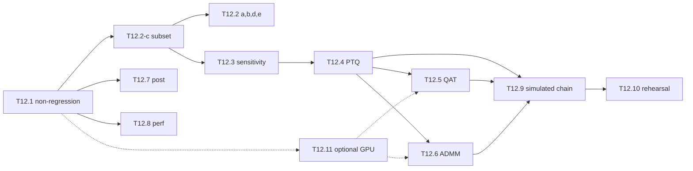

# M12 — Test profiles on the PC (before the board)

Goal: exhaust what can be measured on the PC before moving to the KV260. For each
evaluation already in place (M3 to M9.4), **profiles** are set: which settings to vary,
what it costs, the quantified criterion and the decision to take depending on the result.
The board then only has to **confirm** figures already known in simulation: 0 differences
with the C-sim, and times to set against the cycle model.

## Shared conventions

### Cost tiers

| Tier | Duration | Typically |
|---|---|---|
| **R** (rapid) | < 5 min | unit tests, 3 dumps, `--subset 100`, analytical models |
| **M** (medium) | < 1 h | `--subset 500`, short training (300 iterations) |
| **N** (night) | several hours | full VOC2007 test (4,952 images), `make bench-sim`, ≥ 600 iterations |

Measured landmarks (logs of `build/`):

| Measurement | Duration |
|---|---|
| full `eval_quant.py` `--variants int`, 8 jobs | ≈ 120 ms/image, ≈ 10 min |
| full `eval_quant.py` `--variants float,int` | ≈ 150-300 ms/image, 12-25 min |
| `make bench-sim`, 22 threads | ≈ 40 min |
| QAT, batch 8, CPU | ≈ 0.45 s/image (≈ 36 min for 600 iterations) |
| ADMM | ≈ 50 min for 600 iterations |
| QAT / ADMM on GPU (`--device gpu`, T12.11) | to measure (T12.11-e) |

### Profile datasheet

Each profile is written like the ADMM diagnosis (T12.6), in this order:

1. **Diagnosis / hypothesis**: what is observed or sought, with a figure.
2. **Fixed settings**: what does not move (network, `--resize`, thresholds, calibration).
3. **Grid**: the values tested, one row per run.
4. **Command**: an exact command per grid point.
5. **Cost**: the tier and an estimated duration.
6. **Measurement**: the file produced and the quantity read.
7. **Criterion**: the quantified success threshold.
8. **Decision**: what to do if the criterion is met, and what to do otherwise. Documenting
   a failure as "not converged" or "rejected" is a valid decision.

### Rules

- **Subset**: an mAP on 500 images (`--subset 500`) only serves to **rank** variants. A
  figure reported in `results/` always comes from the 4,952 images. T12.2-c checks that
  this ranking is reliable.
- **Reference settings**: unless stated otherwise, Tiny-YOLOv2 VOC, `--resize stretch`
  (PIL), `--conf 0.005`, NMS 0.45, calibration `build/quant/tiny-yolov2-voc/calib.json`.
  Reference figures: float **56.30**, INT8 **55.66**
  ([map_stades](../../results/map_stades.md)).
- **Outputs**: `build/m12/<profile>/` (log, mAP JSON from `--out`, CSV). Only the figures
  validated on the 4,952 images are copied into `results/`.
- **Running**: `tools/m12.sh <profile>` runs a profile (list at the top of the script),
  and `tools/m12_report.py` produces the summary tables (mAP, loss, ADMM, equality of the
  detections).
- **Training backend**: `--device cpu` (default, reference) or `--device gpu` only on
  request (T12.11, option of `tools/train.py`). The evaluations (mAP, integer, golden,
  C-sim) always stay on the CPU.
- **One variable at a time** against the reference, except for announced crossed grids.

---

### [ ] T12.1 — Functional non-regression
- **Spec**: §10.5 · **Depends on**: M5, M6, M7 · **Size**: S · **Tier**: R
- **Deliverables**: execution order and times recorded, in the notes of this task
- **Acceptance**: each of the three profiles passes with 0 byte differences; time of each
  recorded
- **Profiles**:

  | Profile | Contents | When |
  |---|---|---|
  | *Smoke* | `make test-py` (without `-m slow`) + `make test-cpp` | after any change |
  | *Bit-exact* | `make golden-check` (v2, v3, 3 dumps) + `make csim-gcc` (tb_conv, tb_net, tb_post, tb_stream, tb_net_pow2) + `make sw-sim` (run_compare, run_compare_hw_post, yolo_app, yolo_bench) | after a change of the integer contract, the kernel or the driver |
  | *Before board* | *Bit-exact* + `make test-slow` + `make perf-model` (cycles == C-sim) + `make check-regmap` (if the Vitis header exists) | before producing a bitstream |

- **Decision**: if a difference appears, `run_compare --layer N` locates the faulty layer,
  then `tools/compare_dumps.py` on that layer. No M or N profile is run while *Bit-exact*
  is not green.

- **Done (code)**: `tools/m12.sh fumee | bitexact | avant-carte` (log and durations in
  `build/m12/regress/log.txt`). To run.

### [ ] T12.2 — Float and integer mAP (M3, M4)
- **Spec**: §8.3, §9.2 · **Depends on**: T4.5, T8.2 · **Size**: M · **Tier**: M then N
- **Deliverables**: `build/m12/map/*.json`, and a summary table in the notes
- **Acceptance**: the five profiles below have a figure and a decision

**a) Preprocessing**
- Diagnosis: the integer model loses 2 points in `letterbox` (53.68) compared with
  `stretch` (55.66), while the calibration is done in letterbox.
- Grid:
  - `--resize letterbox | stretch`;
  - `--interp pil | darknet` (with `eval_voc.py` only).
- Command: `python tools/eval_quant.py --variants float,int --resize <r> --subset 500 --out build/m12/map/pre_<r>.json`
- Criterion: measure the float/integer gap (about 0.5 point in the reference).
- Decision: if the integer gap grows in letterbox, recalibrate in `stretch` (link with
  T12.2-d).

**b) Thresholds**
- Grid:
  - `--conf 0.005 | 0.01 | 0.25`;
  - `--iou 0.40 | 0.45 | 0.50`.
- Criterion: mAP and number of detections per image. At 0.25, the mAP drops; this
  threshold is for the demo, not for the mAP.
- Decision: keep 0.005 / 0.45, unless another pair gains more than 0.3 point on 500
  images *and* on 4,952 images.

**c) Faithfulness of the subset** (to do first)
- Grid:
  - `--subset 100 | 500 | 1000 | 0` (0 = all images);
  - models: INT8 (`--variants int`) and pow2 mixed6 in PTQ
    (`--model-dir build/m9/models/tiny-yolov2-voc-pow2-ptq`).
- Criterion: on 500 images, the gap to the full mAP stays under 1 point, and the order
  INT8 > pow2 is kept.
- Decision: if the criterion holds, 500 images become the M tier of the whole milestone.
  Otherwise, move to 1,000 images and adjust the durations.

**d) Calibration**
- Grid:
  - `tools/calibrate.py --choice mse | p99 | p99.9 | p99.99 | max`;
  - `--images 100 | 500 | 2000`;
  - `--seed 0 | 1 | 2`, with `--out build/m12/calib/<…>`;
  - then `eval_quant.py --variants int --calib <…>/calib.json --subset 500`.
- Measurement: mAP and standard deviation across seeds.
- Criterion: the reference (mse, 500 images) stays within 0.3 point of the best variant.
- Decision: change the calibration only if the gain exceeds the standard deviation
  measured across seeds.

**e) Head scale**
- Grid: `tools/calibrate.py --head-scale` around the default value (×0.5, ×1, ×2).
- Criterion: integer mAP and saturation of the head.

- **Done (code)**: `tools/m12.sh map-c` (to run first), then `map-a`, `map-b`, `map-d`
  and `map-e`. `SUBSET=1000` moves the whole milestone to 1,000 images if T12.2-c
  requires it.
  - The JSON of `eval_quant.py --out` now gives `dets_per_image` per variant (b), as well
    as `conf`, `iou` and `model_dir`.
  - d) varies a single variable around mse / 500 images / seed 0: 5 choices, 100 and
    2,000 images, seeds 1 and 2. The calibrations go into `build/m12/calib/<run>/`, and
    `--markdown` keeps them out of `results/`.
  - e) tests `--head-scale` 1/16, 1/8 (default) and 1/4.
  - Summary: `python tools/m12_report.py map build/m12/map/<pattern>*.json`. To run.

### [ ] T12.3 — Per-layer sensitivity
- **Spec**: §9.2, §10.5 step 2 · **Depends on**: T12.2-c · **Size**: M · **Tier**: M
- **Deliverables**: `build/m12/sens/`; ranking of the layers (layer × scheme table)
- **Acceptance**: for each conv (0, 2, 4, 6, 8, 10, 12, 13, 14) and each scheme, the mAP
  loss on 500 images against the projected INT8 reference
- **Grid**:
  - a single layer moves to `mixed6`, `uniform6` or w4, and the others stay in `int8`;
  - this is the model of `build/m9/run_sensitivity.sh`, extended to three schemes.
  - Fake-quant complement: `eval_quant.py --variants float,fq:all,fq:each --subset 500`.
- **Cost**: 9 layers × 3 schemes, i.e. 27 evaluations on 500 images (≈ 1 min each with
  8 jobs, plus the export). Plan for less than 1 h.
- **Decision**: the layers that lose more than 1 point stay in INT8 in the mixed plans of
  T12.4. The ranking also feeds T10.10.
- **Done (by T10.10)**: layer × {uniform4, uniform6, mixed6} grid measured by
  `tools/mixed_precision.py sens`. Outputs in `build/m10/mixed/sensitivity.csv` (not
  `build/m12/sens/`), table in [precision_mixte](../../results/precision_mixte.md). More
  than 1 point of loss: L00 (all three schemes), L02 and L04 in 4 bits. The fake-quant
  complement remains to be done.

- **Done (code)**: `tools/m12.sh fq` (fake-quant complement, `build/m12/sens/fq.json`). To
  run.

### [ ] T12.4 — Low-precision PTQ (M9.2, M9.3)
- **Spec**: §9.2, §9.3 · **Depends on**: T12.3 · **Size**: M · **Tier**: M then N
- **Deliverables**: `build/m12/ptq/map_*.json`; an mAP × scheme table
- **Acceptance**: each variant is placed against the pow2 PTQ floor (52.46) and INT8
  (55.66). The `w8a8` control gives back 55.66 to within 0.1
- **Diagnosis**: `w4a4` in PTQ collapses (17.06). We need to know whether the cause lies
  in the weights or in the activations.
- **Grid**:

  | Variant | `quant_lowbit.py` command | Role |
  |---|---|---|
  | w8a8 | `--scheme w8a8` | tool check |
  | w8a4 | `--scheme w8a4` | isolates the activations |
  | w4a8 | `--scheme w4a8` | isolates the weights |
  | w4a4 | `--scheme w4a4` | reference (17.06) |
  | uniform6 | `--weights pow2 --weights-plan build/m9/plan_uniform6.json` | 6-bit equidistant |
  | mixed6 | `--weights pow2` | REQ-YOLO (52.46) |
  | mixed6 except the sensitive layers | `--weights pow2 --weights-plan <T12.3 plan>` | mixed plan |
  | w4a4, first and last layer in INT8 | to describe by a plan (if the tool allows it) | usual 4-bit rule |

  For each variant: `--out build/m12/ptq/<v>`, then
  `eval_quant.py --model-dir build/m12/ptq/<v> --variants int --subset 500`.
- **Decision**:
  - if w8a4 ≪ w4a8, the QAT effort (T12.5) goes first to the activation steps;
  - the two best variants move to the 4,952 images (N).

- **Done (code)**:
  - New option `quant_lowbit.py --int8-layers 0,14` (`lowbit.layer_qmax`): weights and
    output of these convs stay in INT8 in a wXaY scheme. It covers the last row of the
    grid.
  - `tools/m12.sh ptq` covers the 8 variants, with the T12.3 plan = `{"0": "int8"}` (only
    L00 loses more than 1 point in mixed6); then `tools/m12.sh ptq-full <v1> <v2>` (tier
    N).
  - To run.

### [ ] T12.5 — 4-bit QAT
- **Spec**: §7.1, §9.2 · **Depends on**: T12.4 · **Size**: M · **Tier**: M then N
- **Deliverables**: `build/m12/qat/<run>/` (loss.csv, checkpoint, mAP)
- **Acceptance**: the loss decreases; the mAP on 500 images after export clearly exceeds
  the w4a4 PTQ
- **Diagnosis**: the current run (600 iterations, lr 1e-4, batch 8) ends with a noisy
  loss, between 6 and 13 over the last iterations. The trend cannot be seen without a
  moving average, and no mAP has been measured yet after export.
- **Fixed settings**: `--init weights/yolov2-tiny-voc.weights`, `--burn-in 50`,
  `--qat-steps build/m9/models/tiny-yolov2-voc-w4a4-ptq/steps.json`.
- **Grid**, one variable at a time:
  - `--lr 1e-4 | 3e-4 | 1e-3`;
  - `--iters 300 | 600 | 2000`;
  - `--batch 8 | 16`;
  - `--qat-steps`: PTQ steps, or absent.
- **Command**:
  - `python tools/train.py --net tiny-yolov2-voc --qat w4a4 … [--device gpu] --out build/m12/qat/<run>`;
  - then `python tools/quant_lowbit.py --scheme w4a4 --checkpoint build/m12/qat/<run>/checkpoint.npz --out build/m12/qat/<run>/model`;
  - then `eval_quant.py --model-dir … --variants int --subset 500`.
- **Cost**: about 18 min for 300 iterations and about 36 min for 600 (batch 8). 2,000
  iterations belong to tier N on CPU, and can move to tier M on GPU if T12.11 is
  validated.
- **Measurement**: moving average over 50 iterations of `loss.csv` (start against end),
  then mAP.
- **Decision**:
  - if the loss does not go down at lr 1e-4, try 3e-4;
  - if the mAP stays under 40 on 500 images after 600 iterations, document "short QAT
    insufficient" and cost 2,000 iterations or more before running them.

- **Done (code)**: `tools/m12.sh qat <run>`, with the run among `ref`, `lr3e-4`, `lr1e-3`,
  `it300`, `it2000`, `b16` and `nosteps`. The script chains training, export, mAP on 500
  images and `m12_report.py loss` (moving average over 50 iterations, start against end).
  `DEVICE=gpu` adds `--device gpu`. **No training run.**

### [ ] T12.6 — REQ-YOLO ADMM
- **Spec**: §9.2 · **Depends on**: T12.4, T9.2.3 · **Size**: M · **Tier**: M
- **Deliverables**: `build/m12/admm/<run>/` (admm.csv, checkpoint, mAP)
- **Acceptance**: residual ‖W − Z‖/‖W‖ < 0.01 on all layers at the end, and mAP after the
  final projection > 52.46 (pow2 PTQ)
- **Diagnosis**: the ADMM does not converge with the current settings
  (`--admm-rho 1e-3 --admm-every 50`, 600 iterations). The per-layer residual should tend
  to 0. Instead, it rises from 0.05-0.06 (iteration 50) to about 0.087
  (`build/train/admm-mixed6/admm.csv`). The penalty ρ, which pulls the weights towards the
  levels, stays too weak: it only reaches 0.023 at iteration 600 (1e-3 × 1.3¹²). The
  weights are therefore not really attracted to the levels, and the final result will be
  close to the direct projection without retraining (52.46).
- **Grid**:

  | Run | ρ₀ | `growth` | `rho_max` | `--admm-every` | Iterations | final ρ |
  |---|---|---|---|---|---|---|
  | ref | 1e-3 | 1.3 | 1 | 50 | 600 | 0.023 |
  | A | 1e-2 | 1.3 | 1 | 50 | 600 | 0.23 |
  | B | 5e-2 | 1.3 | 1 | 50 | 600 | 1 (cap) |
  | C | 5e-2 | 1.3 | 1 | 25 | 300 | 1 (cap) |
  | D | 1e-1 | 1.5 | 1 | 50 | 300 | 1 (cap) |
  | E | 5e-2 | 1.3 | 1 | 100 | 600 | 0.2 |

- **Prerequisite**: `growth` and `rho_max` exist in `python/yolo/train/admm.py` (1.3 and
  1.0), but `tools/train.py` does not expose them. Runs A, B, C and E work with the
  current options. D needs an `--admm-growth` option.
- **Command**: `python tools/train.py --net tiny-yolov2-voc --init weights/yolov2-tiny-voc.weights --admm build/m9/plan_mixed6.json --admm-rho <ρ₀> --admm-every <k> --lr 1e-4 --burn-in 50 --batch 8 --iters <n> [--device gpu] --out build/m12/admm/<run>`,
  then `quant_lowbit.py --weights pow2 --checkpoint …`, then `eval_quant.py … --subset 500`.
- **Cost**: about 25 min for 300 iterations and about 50 min for 600. Runs C and D fit in
  tier M; they can run in parallel with the evaluations. On GPU (T12.11), the whole grid
  becomes feasible in one evening.
- **Measurement**: the last row of `admm.csv` (`res_*` columns), and the slope of the
  residual between two Z / U steps.
- **Decision**:
  - if the residual goes under 0.01, run the mAP on the 4,952 images;
  - if a strong ρ makes the loss diverge (penalty crushing the detection loss), go back
    to run A;
  - otherwise, document the "not converged" result in T9.2.3 with the table above.

- **Done (code)**: `tools/train.py --admm-growth` exists, so run D is possible.
  `tools/m12.sh admm <run>` runs one of the runs `ref`, `A`, `B`, `C`, `D` or `E` of the
  table: training, projection, mAP on 500 images, then `m12_report.py admm` (last row, max
  residual, slope). **No training run.**

### [ ] T12.7 — Hardware post-processing (M9.1)
- **Spec**: §8.2, §10.3 · **Depends on**: T9.1.3 · **Size**: S · **Tier**: R then M
- **Deliverables**: `build/m12/hwpp/`; capacity × overflows × mAP table
- **Acceptance**: 0 differences between Python, golden and C-sim; mAP loss of the selected
  variant < 0.2 against `int`
- **Grid**:
  - **capacity**: `eval_quant.py --variants int,int-hwpp --hw-cap 64 | 128 | 256 | 1024 --subset 500`.
    The lost candidates printed are read; the current reference is 256, with 50 overflows
    over 4,952 images and 55.56 mAP.
  - **threshold**: `--conf 0.005 | 0.25`. The unsorted NMS departs from the sorted NMS
    mostly at a low threshold.
  - **robustness**: `tb_post` (ctest). The number of random heads is fixed in the code
    (800 for v2, 200 for v3). Making it an option would allow a night run at 10⁵ cases.
  - **worst case in cycles**: all 845 candidates of v2 pass, with a capacity of 64, 128
    or 256. The cycles are compared with the 342,000 of
    [`postproc_hw.md`](../../results/postproc_hw.md).
- **Decision**: keep the smallest capacity whose loss stays under 0.05 point. The cost in
  cycles and BRAM of the capacity is noted for T10.7.

- **Done (code)**:
  - `tb_post --random N` sets the number of random heads (default 800 / 200), for the
    night run at 10⁵ cases.
  - `-DHWPP_CAP=N` (`golden/hw_postproc.hpp`) builds the kernel and the golden model at
    another capacity, for the worst-case cycles.
  - `eval_quant.py` writes the lost candidates (`overflow`) to the JSON.
  - `tools/m12.sh hwpp`: capacity × threshold on 500 images, then `tb_post` built at 64,
    128 and 256 in `build/m12/hwpp/build_cap<N>`. `RANDOM_HEADS=100000` runs the long
    version.
  - To run.

### [ ] T12.8 — Estimated performance (M6, M8, M9.4, M10)
- **Spec**: §10.2, §10.4 · **Depends on**: T8.1, T9.4.1 · **Size**: S · **Tier**: R
- **Deliverables**: a table of the expected gains per direction, to be confirmed on the
  board
- **Acceptance**: `make perf-model` green (cycles equal to the C-sim, cycle for cycle);
  each direction of M10 has a projected figure
- **Grid**:
  - **single engine**: `make hls-cycles` then `make perf-model` (scenarios: 64- and
    128-bit ports, valid channels, parallel requantization). Reference: 206.5 ms, i.e.
    4.8 img/s.
  - **roofline**: `make roofline` (all the boards of `hw/boards/`). Check that the point
    Tm = 32, Tn = 24 stays the best under the KV260 budget.
  - **streaming**: `tools/stream_model.py --board kv260 --wbits 8|4 --abits 8|4`, plus
    `--net tiny-yolov3-voc`. References: 32.1 img/s in 8 bits and 64.2 img/s in 4 bits.
  - **sensitivity to the network**: the same commands on `tiny-yolov3-coco`.
- **Decision**: rank the directions of M10 by gain divided by effort. The board /
  projection gaps of T8.1 will be read against this table.

- **Done (code)**: `tools/m12.sh perf` runs perf-model, roofline (`--out
  build/m12/perf`), `stream_model` (8/4 bits, weights and activations) and the other
  networks if they are exported. To run.

### [ ] T12.9 — Simulated board chain
- **Spec**: §11 · **Depends on**: T12.1, T8.2 · **Size**: M · **Tier**: M then N
- **Deliverables**: `build/m12/sim/<variant>/` (dets, times); `make map-stades` rerun
- **Acceptance**: for each variant, identical images between the integer model and the
  C-sim, with a difference of 0
- **Grid**:

  | Variant | What changes | Tier |
  |---|---|---|
  | image tiers | `yolo_bench --start 0 --count 100`, then 500, then `make bench-sim` | R → M → N |
  | `ap_int` against `ACC_NO_APINT` | `BENCH=build/sw/yolo_bench` (ap_int) against `build/sw-fast` on 500 images | M |
  | hardware post-processing | `yolo_bench --hw-post` against software; comparison with `eval_quant --variants int-hwpp --save-dets` | M |
  | low-precision models | `--model` on a model exported by T12.4 / T12.5 / T12.6 (if `tb_net_pow2` / lowbit are green) | M |

- **Decision**: a single difference blocks the board. It is located with `run_compare` on
  the image concerned before any other measurement.

- **Done (code)**:
  - `tools/bench_sim.sh` accepts `COUNT=N` (first N images), `OUT=<folder>` and
    `EXTRA="--hw-post"`.
  - `eval_quant.py --save-dets` accepts `int-hwpp` evaluated alone.
  - `m12_report.py dets REF GOT…` checks exact equality on the images present.
  - `tools/m12.sh sim` covers:
    - the 100 and 500 tiers (ap_int);
    - `ACC_NO_APINT` on 500;
    - `--hw-post` against `int-hwpp`;
    - the low-precision models (`MODELS="dir…"`, 100 images).
  - `make bench-sim` stays the N tier. To run.

### [ ] T12.10 — Dress rehearsal of the board protocol
- **Spec**: §10.4 · **Depends on**: T12.9 · **Size**: S · **Tier**: M
- **Deliverables**: the output files of the protocol produced on the PC (sim backend) and
  read by the report tools
- **Acceptance**: the whole of [`protocole.md`](../../results/protocole.md) runs on the PC,
  except the power and the absolute times. On the board, all that remains is to switch
  backends (`sw-board`, `--backend uio`).
- **Profiles**:
  - **JPEG**: `yolo_bench --images <dir> --count 1000 --warmup 5 --times … --dets …`, with
    stb decoding. Then compare with the `--inputs` detections (PIL preprocessing). This
    measures the mAP gap between stb and PIL, which will also show on the board.
  - **Reading the outputs**: `tools/bench_report.py` and `tools/map_stades.py` read the
    produced files without changes (formats, column names, simulated
    `board/dets_*.jsonl` paths).
  - **Times**: the per-stage times on the PC have no absolute value. Only check that
    `pre`, `load`, `acc` and `post` are all filled in and that p99 is computed.
- **Decision**: any broken format or path is fixed before the board, not on the board.

- **Done (code)**: `tools/m12.sh repetition` (`COUNT=100` by default) covers:
  - JPEG decoded by stb against PIL inputs, with the detections in
    `build/m12/repetition/board/`;
  - the reading of the times by `bench_report.py`, in `build/m12/repetition/`.

  `map_stades.py` needs the 4,952 images. On a subset, the equality is checked by
  `m12_report.py dets`. To run.

### [ ] T12.11 — Training on CPU or GPU (by choice)
- **Spec**: §7.1 · **Depends on**: T2.7, T9.3.3 · **Size**: M · **Tier**: M
- **Deliverables** (code, to come):
  - a backend module (`python/yolo/backend.py` or equivalent) that provides `xp`, that is
    `numpy` or `cupy`, chosen once at start-up;
  - the option `tools/train.py --device cpu|gpu`, `cpu` by default;
  - GPU tests skipped when CuPy is missing (`pytest.importorskip("cupy")`).
- **Acceptance**: the CPU / GPU equivalence profile below passes (a to f), and the speed
  gain is measured
- **Context**: training (fine-tuning, QAT T9.3.3, ADMM T9.2.3) runs in NumPy on the CPU, at
  about 0.45 s per image, i.e. 36 to 50 min for 600 iterations. This duration limits the
  grids of T12.5 and T12.6. The PC has an NVIDIA RTX 1000 Ada Laptop GPU (6 GB, seen by
  `lspci`).
- **Choice**: **CuPy**, which keeps the NumPy API and therefore the "hand-written layers"
  style (`forward` / `backward`) of the specification. PyTorch would bring its own
  autograd and a second computation path.
- **Expected behaviour**:
  - The **CPU stays the default and the reference**. The GPU is used **only if the user
    asks for it** (`--device gpu`).
  - **No silent fallback**: `--device gpu` without CuPy, without a driver or without a GPU
    stops with a clear message.
  - CuPy is imported **only** by `--device gpu`. Without this option, `python/yolo/` still
    has no dependency other than NumPy.
  - The data, the augmentation and the targets (`python/yolo/data/`) stay computed on the
    CPU. Only the batch is copied to the GPU.
  - The checkpoints are saved in NumPy (`.get()` before `np.savez`), hence readable by both
    backends. An **exact** resume is only guaranteed on the same backend.
  - Everything that is integer or bit-exact (`IntNetwork`, `eval_quant.py`, export,
    golden, HLS) stays on the CPU, unchanged.
- **Code touched** (to check at implementation time):
  - `python/yolo/layers/`: `conv.py` uses `sliding_window_view` and `np.tensordot`;
    `pool.py` uses `np.add.at`, which becomes `cupyx.scatter_add`;
  - `models/graph.py`;
  - `train/loss.py`, `optim.py`, `trainer.py`, `admm.py`;
  - `quant/fake_quant.py`, `quant/pow2.py`.
- **Machine prerequisites**:
  - NVIDIA driver and CUDA installed (today, `nvidia-smi` is missing);
  - `pip install cupy-cuda12x` (in the project's Python environment, not in
    `python/yolo/`);
  - check: `python -c "import cupy; print(cupy.cuda.runtime.getDeviceCount())"` must print
    at least 1.
- **CPU / GPU equivalence profile**:

  | Point | Measurement | Criterion |
  |---|---|---|
  | a) gradcheck | `yolo.testing.gradcheck` in float64 on GPU | ≤ 1e-7, as in `conventions.md` |
  | b) layers | GPU against CPU forward and backward passes, same inputs | float64 ≤ 1e-12; float32, relative error ≤ 1e-5 |
  | c) overfitting | T2.8 (`make test-slow`) on GPU | converges, as on CPU |
  | d) short training | 50 iterations with the same seed, QAT w4a4 then ADMM | mean GPU loss within 1 % of the CPU loss |
  | e) speed | s/image and largest batch that fits in 6 GB, at 416×416 | gain quantified against 0.45 s/image |
  | f) CPU non-regression | 10 iterations with `--device cpu` (and without the option) | checkpoint identical to the byte to the previous one |

- **Notes**:
  - The rule "no dependency other than NumPy" of `docs/conventions.md` is to be amended at
    implementation time: "CuPy optional, imported only by `--device gpu`".
  - TF32 disabled (strict float32), so that point b) makes sense.
  - `sliding_window_view`: check that it exists in the installed CuPy version, otherwise go
    through `as_strided`.
  - Memory: the im2col view of the first conv is the largest. Measure it before raising
    the batch.
  - A figure published in `results/` from a trained weight states the backend used.
- **Decision**:
  - if the gain is at least 5×, the long grids of T12.5 and T12.6 move to the GPU (tier M
    instead of N), with an explicit `--device gpu` in each command;
  - otherwise, the GPU stays an option and the measured gain is documented.

- **Done (code)**:
  - `python/yolo/backend.py`: `use("cpu" | "gpu")`, with a clear stop without CuPy, CUDA
    or GPU. It also provides `get_xp`, `to_device`, `to_numpy`, `copy_into`,
    `sliding_window_view` (fallback `as_strided`) and `add_at` (`cupyx.scatter_add`).
  - The layers take the module of their inputs, so a NumPy array stays computed by NumPy.
  - Code touched:
    - `layers/`;
    - `models/graph.py` (`Network.to_device` / `to_numpy`);
    - `train/trainer.py`: batch copied to the GPU; loss and targets **on the CPU**, on the
      outputs of the heads; checkpoints in NumPy;
    - `train/optim.py`;
    - `train/admm.py`: Z and U on the GPU, projection Π_S on the CPU;
    - `quant/fake_quant.py`, `quant/quantize.weight_scales`;
    - `testing/gradcheck.py`.
  - `loss.py`, `pow2.py` and `data/` are unchanged.
  - `tools/train.py --device cpu|gpu`, with `cpu` by default.
  - `docs/conventions.md` is amended.
  - Tests, `python/tests/test_backend.py`:
    - Point f: 6 iterations on the test network, ADMM included. Parameters, state,
      velocities and checkpoint are identical to the byte with or without `use("cpu")` /
      `to_device()`.
    - Points a, b and d (reduced): skipped while CuPy is missing. Their body has been
      checked with NumPy in place of CuPy.
  - Point c: `make test-slow-gpu` (`YOLO_DEVICE=gpu`) runs T2.8
    (`python/tests/test_overfit.py`) on the GPU, with the same criteria. The test is
    skipped without CuPy or without a GPU; without the variable, it stays on the CPU as
    before.
  - Remaining on the machine:
    - NVIDIA driver and `pip install cupy-cuda12x`;
    - `make test-py` (a, b, d), point c (`make test-slow-gpu`) and point e (speed) before
      any decision.

---

## Suggested order

- **In parallel**, on a machine with 22 threads:
  - T12.5 and T12.6 run together, each with 8 BLAS threads (as in
    `build/m9/run_train_short.sh`);
  - an evaluation on 500 images can be added with `--jobs 4`;
  - on GPU (T12.11), T12.5 and T12.6 run one after the other (a single 6 GB GPU), while
    the evaluations keep the CPU busy.
- **At night**: the full T12.9 (`make bench-sim`) alone, then the evaluations of the
  selected variants on the 4,952 images.
- **Nothing in M12 needs Vitis or the board.** Synthesis and co-simulation stay in M6 and
  M9.x; the board steps that these profiles prepare are gathered in
  [deferred/](deferred/README.md).
