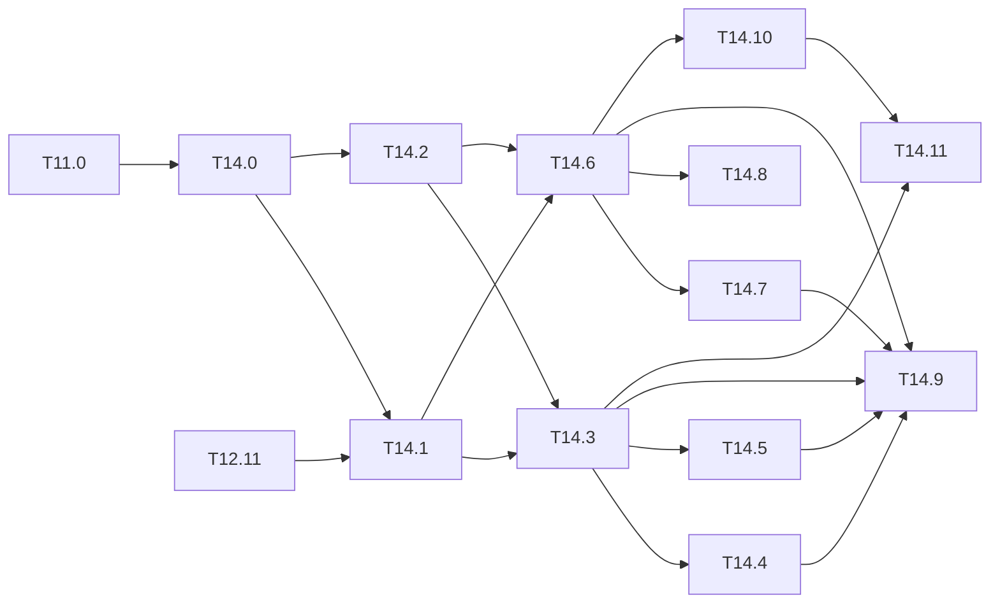

# M14 — Training and inference notebooks (optional)

Goal: one Jupyter notebook per **model × dataset** pair and per role (**training** or
**inference**), generated from a template and runnable locally as well as on Colab (GPU).

Starting point:
- the chain can only be driven from the command line: `tools/train.py`,
  `tools/detect.py`, `tools/eval_voc.py`, `tools/calibrate.py`, `tools/eval_quant.py`, and
  the profiles `tools/m11.sh` and `tools/m12.sh`;
- the repository contains no `.ipynb`;
- the fine-tunings outside VOC (T11.4, T11.5, T11.7) cost hours on CPU (≈ 0.45 s/image,
  [M12](M12-profils-pc.md#cost-tiers)); a remote GPU (Colab) makes them practical,
  provided the chain installs there in one cell.

A notebook brings **no new computation**: it chains the existing tools, shows the images,
the curves and the tables, and keeps a record of the parameters. Like the figures of
[M13](M13-figures.md), it **calls the repository code** (`python/yolo/` and the `main()`
functions of `tools/`), never a rewrite.

**State** (2026-10-07): 8 tasks done out of 12 (T14.0 to T14.4, T14.7, T14.10, T14.11).
The `_infer` and `_sweep` notebooks of the six datasets (VOC, VisDrone, KITTI, FLIR,
ExDark, CrowdHuman) ran on a Colab GPU at tier R and are versioned with their outputs
([resultats-balayages.md](resultats-balayages.md)). The other tasks are implemented; what
they lack is a tier N run, a comparison with `tools/m11.sh`, a measurement on Colab or the
execution of the `_train` notebooks ("Remaining" of each task):

| task | remaining |
|---|---|
| T14.5 | out-of-domain mAP of the notebooks against `tools/m11.sh hors-domaine`, same parameters |
| T14.6 | run at least one `_train` notebook end to end (kitti first) |
| T14.8 | resume of a kitti fine-tuning after a Colab disconnect; GPU gain (s/image, max batch) to T12.11-e |
| T14.9 | `coco_stats` fails in the smoke run (train2017 pixels read, T16.13); the 25 `_train` notebooks pass (2026-10-27) |

## Shared conventions

### Tooling

- **Package**: `tools/notebooks/`. It contains:
  - `matrice.py`, the notebook registry (model × dataset × role, see below);
  - `gabarits.py`, the shared cells and the `infer` and `train` templates;
  - `__main__.py`, the command line.
- **Commands**:
  - `python -m tools.notebooks <name|dataset|role|all>` writes the requested notebooks,
    the viewer `notebooks/figures_live.ipynb` and the index; a notebook executed in full
    without error is kept ("gardé" in the output);
  - `python -m tools.notebooks --list` prints the registry;
  - `python -m tools.notebooks --check` fails if a versioned notebook differs from what the
    generator would produce, outputs and kernel metadata aside, or if it carries a partial
    or failed execution (see [Rules](#rules));
  - `make notebooks` regenerates everything; `make ci` runs `--check`.
- **Format**: nbformat 4 JSON written with the standard library `json`. `nbformat` is not a
  required dependency; it only validates the schema in the test, which is skipped if it is
  missing.
- **Dependencies**: extra `notebooks = ["jupyter", "matplotlib>=3.7", "pillow>=10"]` in
  `python/pyproject.toml`. The `yolo` package stays pure NumPy
  ([ADR 0001](../adr/0001-numpy-pur.md)): neither Jupyter nor matplotlib is imported from
  `python/yolo/`.

### Outputs

- **Notebooks**: `notebooks/<dataset>/<model>_<role>.ipynb`, for example
  `notebooks/voc/tiny-yolov2-voc_infer.ipynb` or
  `notebooks/kitti/tiny-yolov3-kitti_train.ipynb`.
- **Index**: `notebooks/README.md`, rewritten from the registry like
  [results/figures.md](../../results/figures.md). One row per notebook: dataset, model,
  role, cost tier, required weights, "Open in Colab" badge.
- **Viewer**: `notebooks/figures_live.ipynb`, outside the model × dataset registry,
  generated with the index (`gabarits.viewer`). Display only and **without execution**: the
  versioned PNGs (`docs/tasks/figures/`, `results/figures/`) in Markdown cells, links
  ``, visible on opening in VS Code as on GitHub. They are sorted by family of the
  `tools/figures/` registry (a section opened by a context paragraph, `FAMILY_INTROS`, and
  the list of figures), then by figure: task T13.x, caption, source, command
  (`EXTRA_PREFIXES` attaches the PNGs to the name of another figure). A PNG that no figure
  claims falls into "Autres figures". The list is read from disk at generation time: after
  `make figures`, run `make notebooks` (otherwise `--check` flags the viewer). The PNGs of
  `build/` (not versioned) are shown by the last cell, with a local kernel.
- **Sweep analysis**: `notebooks/analyse_balayages.ipynb`, outside the registry, generated
  with the index (`gabarits.analysis`). It compares the batch × subset sweeps of all the
  datasets by rereading the versioned outputs of the `_sweep` and `_infer` notebooks:
  neither GPU nor data. Reading and statistics in `tools/notebooks/balayages.py` (CLI
  `python -m tools.notebooks.balayages --runs`), figures in `tools/figures/balayages.py`
  (`python -m tools.figures balayages`). Versioned executed; after a new sweep, rerun it in
  full.
- **Run results**: `build/notebooks/<dataset>/<model>/` (checkpoints, mAP JSON,
  figures). A notebook **never** writes to `results/`.

### Rules

- **Versioned without outputs, or executed in full without error**: a versioned notebook
  has the cells of the generator, and either no output (neither `outputs` nor
  `execution_count`), or **all** its code cells executed without an error output; its
  outputs are then visible on GitHub. The kernel metadata (`kernelspec`, `language_info`)
  is ignored. A partial or failed execution is not versioned: `--check` refuses it and
  `make notebooks` replaces it with the empty notebook. A complete execution is kept by
  `make notebooks` as long as the template does not change; a cell added or edited by hand
  is refused in both cases.
- **Archives**: before a template change, `python -m tools.notebooks <targets> --archive`
  freezes the complete and up-to-date executions (fingerprint without outputs in
  `notebooks/archives.json`). An archive stays kept by `make notebooks` and accepted by
  `--check` ("archivé") as long as its fingerprint does not change; an edit makes it
  refused. `--force` regenerates the target from the current template and removes the
  archive. Used for the outputs read by `tools/notebooks/balayages.py` (12 fine-tuned
  `_sweep` and `_infer` notebooks archived for M15).
- **Fixed structure** of each notebook, in this order:
  1. title, role, M12 cost tier, links to the relevant M11/M2/M9 task;
  2. **parameter cell** (tag `parameters`, compatible with papermill without requiring
     it): `NET`, `DATASET`, `SPLIT`, `WEIGHTS`, `DEVICE`, `SUBSET`, `SIZE`, `RESIZE`, and
     for training `ITERS`, `BATCH`, `LR`, `INIT`, `QAT`, `ADMM`;
  3. **environment cell** (T14.1);
  4. body of the `infer` or `train` template;
  5. summary: mAP table, output paths, equivalent CLI command.
- **Equivalent command**: each step prints the `python tools/… ` command it runs. A
  notebook result can therefore be reproduced from the CLI, and the other way round.
- **Cautious default parameters**: a small `SUBSET` (tier R) for a first run. The rules of
  [M12](M12-profils-pc.md#rules) apply: an mAP on `--subset` is never published in
  `results/`.
- **GPU**: `DEVICE = "gpu"` (default of the `_train` and `_sweep` notebooks, made for
  Colab; `"cpu"` on a PC without a GPU) passes `--device gpu` to `tools/train.py` (T12.11).
  No silent fallback: without CuPy or without a GPU, the cell stops with the message of
  `yolo.backend`. Everything integer (`eval_quant.py`, export) stays on the CPU.
- **Figures**: those of the automatic mode of M13 (`tools/figures/auto.py`), shown from
  `build/notebooks/…`; no ad hoc plot that would duplicate a generator.
- **Shared acceptance** (all tasks):
  - the notebook is produced by `make notebooks` and listed in `notebooks/README.md`;
  - `--check` passes;
  - the smoke test runs it end to end with minimal `SUBSET` and `ITERS` (T14.9).

### Notebook matrix

The registry is built from the code: `NETWORKS` and the cfgs of
`python/yolo/models/tiny_yolo.py`, `DATASETS` and `MAPPINGS` of
`python/yolo/data/datasets.py`. Adding a dataset to the `DATASETS` registry adds its
out-of-domain inference notebooks without touching the generator.

| Dataset | Inference | Training | Source task |
|---|---|---|---|
| voc | `tiny-yolov2-voc` (Darknet weights), `tiny-yolov3-coco` (through `MAPPINGS`), `tiny-yolov3-voc` (fine-tuned weights) | `tiny-yolov3-voc` (VOC07+12 fine-tuning, QAT, ADMM) | T2.9, T3.4, T4.5, T9.2, T9.3 |
| coco | `tiny-yolov3-coco` | — (train2017 too large for NumPy) | T11.1 |
| kitti | `tiny-yolov2-voc`, `tiny-yolov3-coco` (out-of-domain), `tiny-yolov3-kitti` | `tiny-yolov3-kitti` | T11.2, T11.4 |
| visdrone | same, `tiny-yolov3-visdrone` | `tiny-yolov3-visdrone` | T11.2, T11.5 |
| flir | same, `tiny-yolov3-flir` | `tiny-yolov3-flir` | T11.7 |
| exdark | `tiny-yolov2-voc`, `tiny-yolov3-coco` (out-of-domain), `tiny-yolov3-exdark` | `tiny-yolov3-exdark` | T11.2, T11.3, T15.14 |
| crowdhuman | `tiny-yolov2-voc`, `tiny-yolov3-coco`, `tiny-yolov3-crowdhuman` | `tiny-yolov3-crowdhuman` | T11.6, T15.14 |
| voc, recent networks ([M37](M37-notebooks-recent-models.md)) | `yolov5n-coco`, `tiny-yolov7-coco`, `yolov8n-coco` (through `MAPPINGS`); `yolov5n-voc`, `tiny-yolov7-voc`, `yolov8n-voc` (fine-tuned weights) | `yolov5n-voc`, `tiny-yolov7-voc`, `yolov8n-voc` (`tools/train_v5.py`, no `_sweep`) | T33.7, T34.4, T35.6 |
| coco, recent networks (M37) | `yolov5n-coco`, `tiny-yolov7-coco`, `yolov8n-coco` (`--preset v5` / `v8`) | — | T33.4, T34.2, T35.3 |

The `tiny-yolov3-<dataset>` models are the cfgs produced by `tools/make_cfg.py`
(`build/m11/cfg/tiny-yolov3-<dataset>.cfg`). Each dataset of the Training column also has
a **sweep** notebook `<model>_sweep` (batch × subset, T14.10). The inference notebook of
these models picks the weights among the runs of `_train` and `_sweep` (`RUN`, T14.11) and
says so at the top if there are none.

### Training runs

`build/notebooks/<dataset>/<model>/` (`RUNS_DIR`, `tools/notebooks/runs.py`):

```
final.weights, loss.csv, run.json …   "train" run (_train notebook)
runs/b16-sall/                        sweep: batch 16, the whole training split
runs/b8-s500/                         batch 8, first 500 images
eval/<run>/                           evaluations of the inference notebooks
```

A run counts as soon as it has a `final.weights` (or a `final.npz`, the state dict that
`tools/train_v5.py` writes for YOLOv5n and YOLOv8n, M37); `run.json` gives batch, subset,
iterations, backend and revision. On Colab, `colab.sync_outputs` copies the whole folder,
`runs/` included, into `<DRIVE_DIR>/runs/`.

---

<a id="données-sur-colab"></a>

### Data on Colab

The datasets go neither through git nor through the repository (33 GB). On Colab,
`tools/notebooks/colab.py:prepare_data(dataset, DRIVE_DIR)` puts them in `data/` (local
disk of the session) by trying, in order:

1. the marker file of the dataset (`tools/get_datasets.sh ready <dataset>`);
2. the archive `<DRIVE_DIR>/data/<dataset>.tar` on Google Drive;
3. the same archive through rclone (`tools/get_datasets.sh pull <dataset>`), on a PC
   without the dataset;
4. the direct download: `get_voc.sh`, `get_datasets.sh coco|kitti`, or the Kaggle API
   (`get_datasets.sh kaggle-download crowdhuman|visdrone|flir`, with a token in
   `<DRIVE_DIR>/access_token` (`KGAT_…` token) or the Colab secrets (`KAGGLE_API_TOKEN`),
   which a Colab kernel under VS Code cannot read).

Drive is only used for what cannot be downloaded: ExDark (the annotations are not on
Kaggle), or a dataset one does not want to download again. The free Drive (15 GB) would
not hold the whole of `data/`.

```
tools/get_datasets.sh push exdark     # PC: pack (data_archives/exdark.tar), then rclone
```

Setting up rclone, exporting the other datasets and access depending on the environment:
[donnees-drive.md](donnees-drive.md). Running from VS Code on a Colab kernel (parameters,
resume, tracking through rclone): [colab-vscode.md](colab-vscode.md).

```
MyDrive/EmbeddedCV/
  data/   <dataset>.tar   one uncompressed tar per dataset, links followed (tree of data/)
  runs/                   outputs and checkpoints (colab.sync_outputs, restore_outputs; T14.8)
```

The images are never read through the Drive mount, which is slow for thousands of small
files: only the tar is read there, in one go, then it is extracted locally.

## A. Infrastructure

### [x] T14.0 — `tools/notebooks/` package, registry and check
- **Spec**: — · **Depends on**: T11.0 · **Size**: M
- **Deliverables**:
  - `tools/notebooks/__init__.py`, `__main__.py`, `matrice.py`, `gabarits.py`;
  - the `make notebooks` target and the call to `--check` in `make ci`;
  - `python/tests/test_notebooks.py`.
- **Acceptance**:
  - `make notebooks` is idempotent: two passes in a row change no byte;
  - the test generates all the notebooks in a temporary directory and checks for each one:
    valid JSON (nbformat 4 schema if `nbformat` is installed), no output, no
    `execution_count`, and each code cell passes `compile()` (the `!` and `%` lines are
    removed first);
  - `--check` fails on a notebook edited by hand.
- **Notes**:
  - sorted and indented JSON, final newline: a readable diff;
  - the cells are lists of lines, as Jupyter writes them, so that opening then saving
    without execution changes nothing.
- **Done**: `tools/notebooks/` (`__init__.py`, `__main__.py`, `matrice.py`, `gabarits.py`,
  plus `commandes.py`, the tool commands and the subprocess launcher, and `env.py`, the
  environment cell), 21 notebooks in `notebooks/` and `notebooks/README.md`.
  `make notebooks`, `make ci` (`--check` after the lint). `python/tests/test_notebooks.py`
  checks the idempotence, the Jupyter save format, the nbformat schema (if installed), the
  absence of outputs, the `compile()` of the cells and the failure of `--check` after an
  edit, and that the versioned notebooks are up to date. Since the rule on executed
  notebooks: `strip_outputs`, `executed_ok` and `state` of `__main__.py`; tests of a
  complete execution (accepted, kept by `make notebooks`), a failed one and a partial one
  (refused).

### [x] T14.1 — Environment and parameter cells (local and Colab)
- **Spec**: — · **Depends on**: T14.0, T12.11 · **Size**: M
- **Deliverables**: the shared cells of `gabarits.py`.
- **Expected behaviour**:
  - **Colab** (detected by `"google.colab" in sys.modules`):
    - clone of the repository (URL and revision as parameters),
      `pip install -e "python[data,plots]"`;
    - if `DEVICE == "gpu"`: `pip install cupy-cuda12x`, then the check of T12.11
      (`cupy.cuda.runtime.getDeviceCount() >= 1`);
    - weights: `tools/get_weights.sh`; data: `tools/get_voc.sh` or
      `tools/get_datasets.sh <dataset>`. For the datasets that need registration
      (VisDrone, CrowdHuman, ExDark, FLIR), the cell prints the source and the expected
      tree; everything goes through `colab.prepare_data(DATASET, DRIVE_DIR)` (see
      [Data on Colab](#data-on-colab)), already written with its tests
      (`python/tests/test_colab_data.py`).
  - **Local**: nothing is installed or downloaded. The cell only checks
    (`tools/get_datasets.sh check`, presence of the weights) and stops with the command to
    run if something is missing.
  - In both cases: `os.chdir` to the repository root, printing of the NumPy version, of the
    chosen backend and of the git revision, for traceability.
- **Acceptance**: locally, the cell runs in less than 5 s without network; on Colab, a VOC
  inference notebook starts from a blank environment and reaches the next cell without
  intervention.
- **Done**:
  - shared cells of `gabarits.py`, logic in `tools/notebooks/env.py`;
  - locally, check of the marker files of `tools/get_datasets.sh`
    (`matrice.DATA_MARKERS`, which the test compares with the script), of the weights and
    of the cfg, then stop (`env.Prerequis`) with the commands to run;
  - on Colab, clone reset to `REV` at each run (`git fetch` then `checkout FETCH_HEAD`,
    already imported `tools` and `yolo` modules forgotten): a clone from a previous session
    does not stay behind the notebook;
  - on Colab, hook into `colab.prepare_data(DATASET, DRIVE_DIR)`, with Drive mounted only
    for the datasets that cannot be downloaded;
  - GPU check by `yolo.backend.use`, without fallback; traceability by `env.trace`
    (revision, NumPy, backend).
- **Validated on Colab**: the `_infer` and `_sweep` notebooks of the six datasets started
  from fresh runtimes (revisions `1a967f4` to `35e949b`, outputs versioned); fixes coming
  from these runs: Drive mounted before `prepare_data`, clear stop without a GPU, CuPy wheel
  depending on the driver, fine-tuning cfg rebuilt by `env.restore_cfg`, Kaggle token for
  FLIR.

### [x] T14.2 — Model × dataset × role matrix and index
- **Spec**: — · **Depends on**: T14.0 · **Size**: S
- **Deliverables**: `tools/notebooks/matrice.py`; `notebooks/README.md`.
- **Acceptance**:
  - the registry reproduces the table [Notebook matrix](#notebook-matrix);
  - a test checks that each dataset of `DATASETS` has at least one inference notebook and
    that each out-of-domain pair has an entry in `MAPPINGS`;
  - the index gives for each notebook its tier and its prerequisites (weights, data, cfg).
- **Notes**: the tier comes from the split size and the role (rules of M12); it is not
  copied by hand.
- **Done**:
  - `matrice.py` builds 19 inference, 6 training and 6 sweep notebooks from `PRETRAINED`,
    `CFG_FILES`, `DATASETS` and `MAPPINGS`, with `TRAINABLE` as the only hand-written
    list;
  - the tier comes from `palier()` (rules of M12: R up to 100 images, M up to 500 images or
    fewer than 600 iterations, N beyond) and from the counts `SPLIT_IMAGES`;
  - the index gives for each notebook its tier, its prerequisites and the Colab badge;
  - the FLIR cfg is `tiny-yolov3-flir-c1.cfg` (single channel, T11.7).

## B. Inference

### [x] T14.3 — `infer` template: detection and float mAP
- **Spec**: §8 · **Depends on**: T14.1, T14.2, T3.4 · **Size**: M
- **Deliverables**: `infer` template in `gabarits.py`.
- **Contents**:
  1. building the network (`yolo.models.tiny_yolo.build`) and loading the weights
     (`yolo.io.darknet_weights.load_darknet_weights`);
  2. detection on 6 to 8 images of the split, boxes drawn with `tools/detect.py:draw`,
     through `yolo.infer.pipeline.preprocess` and `detect`;
  3. float mAP by `tools/eval_voc.py --dataset … --metric …`, with `--subset SUBSET`;
     per-class table and PR curves (automatic mode of M13);
  4. for an out-of-domain dataset, the `eval_view`: evaluated classes, ignored classes.
- **Acceptance**: `notebooks/voc/tiny-yolov2-voc_infer.ipynb` with `SUBSET = 0` and
  `RESIZE = "stretch"` gives back **56.30** (the reference of T11.0).
- **Notes**: the default metric is the dataset's (`Dataset.metric`); COCO and FLIR show
  AP@[.5:.95] and AP50.
- **Done**:
  - `infer` template: network, 6 detections drawn by `tools/detect.py:draw`,
    `eval_voc.py --markdown --out` into `OUT`, PR curves;
  - `tools/eval_voc.py` now puts its PR curves in `<out>/figures/` when `--out` is given;
  - smoke run of `voc/tiny-yolov2-voc_infer` with `SUBSET = 4`;
  - all the `_infer` notebooks executed on Colab with `SUBSET = 50` (tier R), except
    `coco/tiny-yolov3-coco_infer` (COCO missing): Tiny-YOLOv2 VOC gets 63.51 there.
- **Validated** (2026-10-07, Colab CPU, revision `214f269`): `voc/tiny-yolov2-voc_infer`,
  set to the full split by `gabarits.REFERENCE` (`SUBSET = 0`, `INT8 = True`,
  `JOBS = 16`), gives back **56.30** on 4,952 images (906 s, 181 ms/image).

### [x] T14.4 — Integer part: calibration and INT8 mAP
- **Spec**: §9 · **Depends on**: T14.3, T4.5 · **Size**: M
- **Deliverables**: "integer" section of the `infer` template, enabled by `INT8 = True`.
- **Contents**:
  - calibration by `tools/calibrate.py --dataset …` on the `calib` split of the dataset
    (output in `build/notebooks/…`, not in `results/`);
  - `tools/eval_quant.py --variants float,int`;
  - float / integer gap per class, and activation histograms if requested
    (`tools/act_hist.py`).
- **Acceptance**: on voc / `tiny-yolov2-voc`, `SUBSET = 0`, the integer mAP is **55.66**.
- **Notes**: tier N on the full dataset; the notebook announces it before starting.
- **Done**:
  - `INT8` section: `calibrate.py --out --markdown` into `OUT`, `eval_quant.py --variants
    float,int --calib`;
  - table of the gaps per class, figures of the automatic mode, `act_hist.py` if
    `ACT_HIST = True`;
  - smoke run on VOC (8 calibration images, 4 evaluated).
- **Validated** (same run): calibration on 500 trainval images (93 s), then
  `eval_quant.py --variants float,int --jobs 16` (337 s, 66 ms/image): float **56.30**,
  integer **55.66**, gap −0.64 point, identical to `results/map_int8.md`.

### [ ] T14.5 — Out-of-domain inference (T11.2)
- **Spec**: §8.3 · **Depends on**: T14.3 · **Size**: S
- **Deliverables**: inference notebooks of `tiny-yolov2-voc` and `tiny-yolov3-coco` on
  exdark, kitti, visdrone, crowdhuman and flir.
- **Acceptance**: the mAPs equal those of `tools/m11.sh hors-domaine` with the same
  parameters.
- **Notes**: the mapping table (`MAPPINGS`) is shown as it is, with the classes without an
  equivalent.
- **Done**:
  - out-of-domain notebooks of all the datasets, with the `MAPPINGS` table, the ignored
    classes and `eval_view`;
  - smoke run passed for ExDark, VisDrone and CrowdHuman;
  - COCO, KITTI and FLIR are skipped for lack of data;
  - since then, the six datasets executed on Colab (tier R, 50 images), tables in
    [resultats-balayages.md](resultats-balayages.md).
- **Compared** (2026-10-27, VOC, ExDark, VisDrone): with the same parameters, the
  notebook command (`tools/eval_voc.py`) gives the mAP of `tools/m11.sh hors-domaine`
  (`tools/eval_quant.py --variants float`) to the hundredth.
  - `tiny-yolov3-coco` VOC, 50 images: 68.45 = 68.45.
  - ExDark, 50 images: `tiny-yolov2-voc` 11.84 = 11.84, `tiny-yolov3-coco` 24.61 = 24.61.
  - VisDrone, full split: `tiny-yolov2-voc` 7.36 = 7.36; `tiny-yolov3-coco` 8.00 = 8.00.
  - The versioned `visdrone/tiny-yolov3-coco_infer` still shows 7.88: it was executed on
    2026-10-07, before T15.10 excluded the ignored regions (only `bus` moves, 5.4 → 6.0).
    It gets re-executed with the notebooks of T19.5.
  - Runs in `build/m14/t14.5/`.
- **Remaining**: KITTI, CrowdHuman and FLIR, once their data is on the PC
  (`HD_SETS=kitti tools/m11.sh hors-domaine`, [long-runs.md](long-runs.md)).

## C. Training

### [ ] T14.6 — `train` template: preparation, fine-tuning, evaluation
- **Spec**: §5-§7 · **Depends on**: T14.1, T14.2, T2.9 · **Size**: L
- **Deliverables**: `train` template in `gabarits.py`; `train` notebooks of the matrix.
- **Contents**:
  1. **preparation** (datasets other than VOC): anchors by
     `tools/kmeans_anchors.py --dataset …`, N-class cfg by
     `tools/make_cfg.py --base tiny-yolov3-voc --dataset …`, cell skipped if the cfg
     already exists;
  2. **target preview**: a few augmented images (`yolo.data.augment`) with their boxes, to
     check the annotations before starting hours of computation;
  3. **fine-tuning**: `tools/train.py --net <cfg> --dataset … --init coco --iters ITERS
     --batch BATCH --multiscale --device DEVICE --out build/notebooks/<dataset>/<model>`,
     with an automatic `--resume` if a `checkpoint.npz` exists;
  4. loss and learning-rate **curves** (automatic mode of M13, at each `--save-every`);
  5. **evaluation** of `final.weights` by the `infer` template (T14.3), at the end of the
     notebook.
- **Acceptance**: for kitti, the sequence of commands is identical, option by option, to
  `tools/m11.sh kitti-prep` then `kitti-train` (same cfg, same anchors, same default
  hyperparameters); a test compares the generated commands with those of the script.
- **Notes**:
  - training runs in a subprocess whose output is relayed line by line: an interruption of
    the kernel leaves a usable checkpoint;
  - the estimated duration is printed before the start (images × iterations × s/image of
    the chosen backend).
- **Done**:
  - `train` template: preparation (skipped if the cfg exists), target preview, estimated
    duration, `train.py` in a subprocess with an automatic `--resume`, curves, evaluation
    of `final.weights`;
  - the test compares, option by option, the kitti commands with `tools/m11.sh prep` and
    `train`: only the outputs are specific to the notebook (`OUT`, anchors in `OUT`);
  - the cells before the fine-tuning have been executed on VOC;
  - the fine-tuning command ran through the `_sweep` notebooks (same command up to
    `--batch` and `--subset`, T14.10): 6 cells × 6 datasets on a Colab GPU, 600
    iterations.
- **Remaining**: no `_train` notebook executed end to end (versioned without outputs);
  KITTI is now present, it can serve for the first run.

### [x] T14.7 — QAT and ADMM variants
- **Spec**: §9 · **Depends on**: T14.6, T9.2.3, T9.3.3 · **Size**: S
- **Deliverables**: parameters `QAT` (`wXaY` scheme, `--qat-steps`) and `ADMM` (constraint
  file, `--admm-rho`, `--admm-every`, `--admm-growth`) of the `train` template; notebooks
  `notebooks/voc/tiny-yolov3-voc_train.ipynb` with these options documented.
- **Acceptance**: with the parameters of T12.5 and T12.6, the generated command is that of
  the corresponding M12 profile.
- **Notes**: the final evaluation goes through `eval_quant.py` with the low-precision
  variants (`tools/quant_lowbit.py`), not through the float mAP alone.
- **Done**:
  - parameters `QAT`, `QAT_STEPS`, `ADMM`, `ADMM_RHO`, `ADMM_GROWTH` and `ADMM_EVERY`;
  - the notebook `voc/tiny-yolov3-voc_train` gives the settings of T12.5 and T12.6
    (`gabarits.M12_QAT`, `M12_ADMM`);
  - the test checks that the generated commands are those of `tools/m12.sh qat ref` and
    `admm ref`;
  - the evaluation goes through `quant_lowbit.py` then `eval_quant.py --variants int
    --model-dir`.

### [ ] T14.8 — Running on a Colab GPU
- **Spec**: — · **Depends on**: T14.6, T12.11 · **Size**: M
- **Deliverables**: options `DRIVE_DIR` (checkpoints and outputs copied to Google Drive)
  and resume after a session disconnect. `colab.sync_outputs` and `colab.restore_outputs`
  copy `build/notebooks/` to and from `<DRIVE_DIR>/runs/`; the `train` template calls them
  (see "Done").
- **Acceptance**:
  - an interrupted kitti fine-tuning (Colab session cut) resumes from the last checkpoint
    on Drive, to the iteration;
  - the measured GPU gain (s/image, largest batch that fits in memory) is noted in the
    notebook and sent to T12.11-e.
- **Notes**: an exact resume is only guaranteed on the same backend (T12.11). A figure
  coming from weights trained on GPU states the backend.
- **Done**:
  - `DRIVE_DIR` (default `colab.DRIVE_DIR`);
  - `colab.restore_outputs` before the fine-tuning, then `colab.sync_outputs` every 10 min
    and at the end of the cell, interruption included;
  - speed cell: s/image from `loss.csv`;
  - collection at the end of a command: `commandes.run` calls `colab.autosync` after each
    successful (or interrupted) `tools/train.py`, `eval_voc.py` or `eval_quant.py`; on
    Colab with Drive mounted, `summary.json` of the `--out` and `--markdown` folder
    (`runs.write_summary`: `run.json`, final loss and components, duration, mAP and AP per
    class) then a copy into `<DRIVE_DIR>/runs/`. It covers the evaluations of the
    `_sweep` and `_infer` notebooks, which the periodic copy did not see; no cell changed.
    `EMBEDDEDCV_AUTOSYNC=0` switches it off. On the PC: `make harvest` (rclone without
    weights);
  - observed duration: ≈ 10 min per batch-32 run (624 s for b32-sall, 600 iterations).
- **Remaining**: the kitti resume on Colab after a disconnect (to the iteration), and the
  GPU gain (s/image, largest batch that fits in memory) noted in the notebook and sent to
  T12.11-e ([M12](M12-profils-pc.md), "to measure" row).

## D. Sweeps and choice of the run

### [x] T14.10 — `_sweep` notebook: batch × training subset grid
- **Spec**: §7 · **Depends on**: T14.6 · **Size**: M
- **Deliverables**: `notebooks/<dataset>/<model>_sweep.ipynb` for voc, kitti, visdrone,
  flir, exdark and crowdhuman; `tools/notebooks/runs.py`.
- **Contents**:
  - parameters `BATCHES` (default `[8, 16, 32]`), `TRAIN_SUBSETS` (default `[500, 0]`,
    where 0 means the whole split, and n the first n images, `train.py --subset`), `ITERS`
    (600 per run), `SKIP_DONE`;
  - preparation and preview shared with `_train`;
  - plan table (images, effective epochs, estimated duration);
  - one run per cell in `runs/b<batch>-s<n|all>/` with `run.json`, `--resume` if
    interrupted, Drive synchronisation as in T14.8;
  - comparison: mAP on `SUBSET` images, final loss and s/image (`runs.table`), then
    overlaid curves (`plot_training`, M13).
- **Acceptance**: the command of a cell is that of the `_train` notebook up to `--batch`
  and `--subset` (test); a finished run is not restarted.
- **Notes**: the learning rate is not adjusted to the batch; an mAP on `SUBSET` images
  ranks the runs, it is not publishable (rules of M12).
- **Done**: notebooks and `runs.py`; tests of the command of a cell, of
  `find_runs`/`pick`/`table` and of `read_map` (VOC and COCO tables of `eval_voc.py`).
- **Run** on Colab (tier R) for the six datasets, VOC, VisDrone, KITTI, FLIR, ExDark and
  CrowdHuman: [resultats-balayages.md](resultats-balayages.md); cross-dataset analysis in
  [notebooks/analyse_balayages.ipynb](../../notebooks/analyse_balayages.ipynb).

### [x] T14.11 — Inference: choosing a run and comparing
- **Spec**: §8 · **Depends on**: T14.3, T14.10 · **Size**: S
- **Deliverables**: parameters `RUNS_DIR`, `RUN` and `COMPARE` of the inference notebooks
  of the fine-tuned models (`tiny-yolov3-voc`, `tiny-yolov3-<dataset>`).
- **Contents**:
  - `WEIGHTS = None` takes `final.weights` of the run `RUN` (None: the most recent;
    `'train'`, `'b16-sall'`…); on Colab, the runs are first restored from Drive;
  - without a run, stop at the top with the list and the notebook to run;
  - outputs in `RUNS_DIR/eval/<run>/`;
  - `COMPARE = True` evaluates each run on the same `SUBSET` images (mAP reused if already
    computed) and prints the table of the runs.
- **Acceptance**: with two runs present, the most recent is chosen by default and the
  table compares both.
- **Done**: checked end to end on two fake `tiny-yolov3-voc` runs (randomly initialised
  weights, without training): choice of the most recent, mAP of each, table.

## E. Validation

### [ ] T14.9 — Smoke run of all the notebooks
- **Spec**: — · **Depends on**: T14.3 to T14.7 · **Size**: S · **Tier**: M
- **Deliverables**: `slow` test in `python/tests/test_notebooks.py`, and the target
  `make notebooks-smoke`.
- **Acceptance**: each notebook whose data is present runs through
  `jupyter nbconvert --execute` with `SUBSET = 4`, `ITERS = 2`, `BATCH = 2`, outputs in
  `build/notebooks/smoke/`; the notebooks without data are skipped with a message, which
  is not an error.
- **Notes**: parameters injected by rewriting the `parameters` cell of a copy, so as not to
  depend on papermill.
- **Done**:
  - `test_fumee` (`slow`) and `make notebooks-smoke`;
  - parameters rewritten in a copy, under `build/notebooks/smoke/`;
  - 8 inference notebooks pass (1 min 44 s), 9 are skipped with a message.
- **Run** (2026-10-27, `make notebooks-smoke`, 35 min): 105 passed, 54 skipped, 1 failed.
  The 25 `_train` notebooks whose data is present pass (voc v3, v4, v7-tiny, v5n, v8n;
  visdrone, flir, exdark, prewid, pets, asl, auair, dronevehicle, hituav, uavdt in v3 and
  v4). The failure is `coco/coco_stats`: `tools/data_stats.py --dataset coco` reads
  `data/coco/train2017/*.jpg`, which is not on the PC (annotations only), see
  [T16.13](M16-presentation-jeux.md).
- **Remaining**: the `coco_stats` failure (T16.13).

---

## Out of scope

- HLS, Vivado or board notebooks (M6 to M8): these steps go through `make` and proprietary
  tools, with no point in wrapping them.
- Training on COCO train2017: too long in NumPy, even on GPU.
- Publishing trained weights.
- Any dependency on PyTorch or TensorFlow.

## Suggested order

T14.0 → T14.1 and T14.2 → T14.3 on VOC (reference 56.30 checkable right away) → T14.4 and
T14.5; then T14.6, first on kitti (the only dataset outside VOC downloaded), → T14.7 and
T14.8; T14.9 last.


