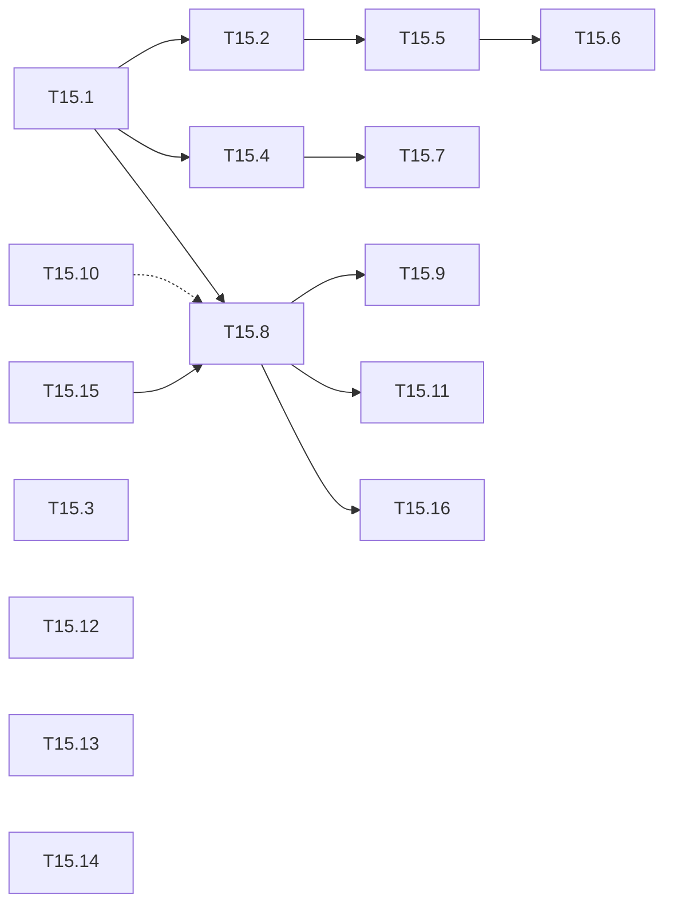

# M15 — Training campaign (optional)

Goal: move from the first sweeps of M14 to fine-tuned models whose mAP holds on the full
split, dataset by dataset. The milestone lists the runs to start and the tooling
improvements they need. VOC and VisDrone have results; the other datasets have a task
ready, to be filled in when their runs have completed.

Starting point ([resultats-balayages.md](resultats-balayages.md), tier R, 50 images,
600 iterations per run, rev. `1a967f4`):
- **VOC**: best run `b32-sall` (batch 32, whole split), mAP 36.27. The starting COCO
  weights get 68.45 on the same images: 600 iterations (1.16 epochs) are not enough to
  relearn the reinitialised heads.
- **VisDrone**: best run `b32-sall`, mAP 2.24; losses from 186 to 252, no run converged;
  only `car` takes off (AP 17.4). On the full split (T15.1), `b16-sall` moves ahead (2.61)
  and `b32-sall` falls to 1.37.
- **KITTI**: best run `b32-sall`, mAP 2.38, in 416×416 `stretch`; only `Car` takes off
  (AP 16.8), far from the out-of-domain COCO weights (20.55 on 4 classes, car 49.7).
- The ranking rests on 50 images: the gap between the two best VOC runs (1.6 points) is
  within the noise.
- Only the batch and the subset are swept; LR (0.001), burn-in (500 out of 600
  iterations) and input size are fixed.
- **FLIR** (single channel, rev. `4e47dbc`): no run learns, AP@[.5:.95] at most 0.7 and
  AP50 at most 2.9 (`b8-sall`, `b16-sall`); the ranking of the other datasets does not
  hold there. The out-of-domain COCO weights do better without fine-tuning: AP 3.7, AP50
  9.9 (Tiny-YOLOv2 VOC: 2.3 and 8.3), on 50 images (rev. `1723925`, `29a058a`).
- **ExDark** (rev. `35e949b`): best run `b32-sall`, mAP 13.29 (6.4 epochs on 3,000
  images); above the out-of-domain Tiny-YOLOv2 VOC (11.84, 11 classes), below the COCO
  weights (24.61, 12 classes).
- **CrowdHuman** (rev. `35e949b`): best run `b16-sall`, mAP 35.87, ahead of `b32-sall`
  (30.61, gap within the noise); the closest to the COCO weights (38.37; Tiny-YOLOv2 VOC
  26.29). A single class, k-means anchors much smaller than Darknet's.
- Over the six datasets, `b32-sall` reaches on average 91 % of the best run of each
  dataset, and the whole split beats 500 images in 15 cases out of 18
  ([analyse_balayages](../../notebooks/analyse_balayages.ipynb)).

Costs measured on Colab: GPU training ≈ 0.033 s/image (624 s for 600 iterations at batch
32, i.e. ≈ 1 s/iteration); evaluation on CPU ≈ 0.27 s/image, i.e. ≈ 22 min for VOC2007
test (4,952 images), ≈ 2.5 min for VisDrone val (548 images) and ≈ 7 min for KITTI val
(1,496 images).

**State**: 1 task done out of 16 (T15.3); T15.1 and T15.2 ready to run on Colab;
VisDrone (T15.8, T15.10, T15.15, T15.16): tooling ready, runs to start.

## Shared conventions

### Protocol per dataset

1. **Sweep** at tier R (`_sweep`, batch × subset, T14.10).
2. **Confirmation** of the ranking on the full split (`_infer`, `COMPARE = True`,
   `SUBSET = 0`).
3. **Long run** on the best configuration (`_train` or a one-cell `_sweep`).
4. **Dataset-specific axis**: input size (VisDrone, KITTI), channels (FLIR), etc.
5. **Integer part** (`INT8 = True`, T14.4) on the selected run.

### Rules

- The results of each step go into [resultats-balayages.md](resultats-balayages.md), one
  section per dataset, with the revision and the parameters.
- An mAP on `SUBSET` images ranks the runs, it is not published. Only an mAP on the full
  split (tier N) can go into `results/` (rules of [M12](M12-profils-pc.md#rules)).
- A gap between two runs only counts if it exceeds the noise measured in T15.2.
- **Harvest**: on Colab, each `tools/train.py` and `tools/eval_voc.py` started by a
  notebook writes its `summary.json` and goes to the Drive as soon as it ends
  (`colab.autosync`, [colab-vscode.md](colab-vscode.md#coupure-de-session)); at the end of
  a session, nothing is lost beyond the command in progress. On the PC, `make harvest`
  brings back logs, summaries, tables and figures into `build/notebooks/` (without
  weights), then `python -m tools.notebooks.balayages --runs` redoes the summary; only then
  report the figures here and in [resultats-balayages.md](resultats-balayages.md).
- The notebooks stay versioned without outputs ([M14](M14-notebooks.md#rules)); a change
  of a default parameter goes through `tools/notebooks/gabarits.py` and `make notebooks`.

---

## A. Reliable measurements (VOC, VisDrone, KITTI)

### [ ] T15.1 — Ranking on the full split
- **Spec**: §8 · **Depends on**: T14.11 · **Size**: S
- **Deliverables**: table of the 18 mAPs (6 runs × 3 datasets) in
  `resultats-balayages.md`
- **Acceptance**: each run of VOC, VisDrone and KITTI evaluated on the whole split; best
  run confirmed or replaced
- **Notes**: `_infer` notebooks of `tiny-yolov3-voc`, `tiny-yolov3-visdrone` and
  `tiny-yolov3-kitti` with `COMPARE = True`, `SUBSET = 0`. Count ≈ 2 h 15 for VOC
  (6 × 22 min), ≈ 15 min for VisDrone, ≈ 40 min for KITTI.
- **Prepared**:
  - the chosen run (`RUN`) is evaluated in `RUNS_DIR/eval/<run>/`, the cache of `COMPARE`
    and of the `_sweep`: it is no longer evaluated twice;
  - each evaluation goes to the Drive as soon as it ends (`colab.autosync`): after a
    disconnect, rerunning the notebook only redoes the missing runs;
  - reading: `make harvest` then `python -m tools.notebooks.balayages` prints the table
    "Split complet (T15.1)" (50-image score and full split, ranks, Spearman of the two
    rankings) from `build/notebooks/<dataset>/<model>/eval/<run>/summary.json`, or failing
    that the `éval. = tout` table of the versioned `_infer` notebook.
- **Colab procedure** (archived notebooks: regenerate them first,
  `python -m tools.notebooks <dataset>/tiny-yolov3-<dataset>_infer --force`):
  0. **TPU** runtime advised for the `_infer` notebooks: the TPU is not used (evaluation in
     NumPy), but the VM has dozens of CPU cores; `JOBS = None` (default) starts one
     `eval_voc.py --jobs` process per core, capped by the memory (1.5 GB each, a generous
     estimate not measured). Local measurement, 24 images: 168 → 86 ms/image from 1 to 3
     processes, identical mAP;
  1. `visdrone/tiny-yolov3-visdrone_infer`, then `kitti/tiny-yolov3-kitti_infer`:
     `SUBSET = 0`, `COMPARE = True`, `INT8 = False`, `DRIVE_DIR` set;
  2. `voc/tiny-yolov3-voc_infer`, same settings, **after** the sweep of T15.2: a single
     pass evaluates the 6 runs of the grid and the 4 seed runs (≈ 3 h 40 on CPU, automatic
     resume; several sessions possible).

### [ ] T15.2 — Noise of a run
- **Spec**: §7 · **Depends on**: T15.1 · **Size**: S
- **Deliverables**: standard deviation of the mAP over 3 seeds
- **Acceptance**: `b32-sall` and `b16-sall` of VOC rerun with `--seed 1` and `--seed 2`,
  evaluated on the full split; standard deviation reported
- **Notes**: ≈ 40 min of GPU for the 4 runs. The result serves as the significance
  threshold for all the comparisons of M15.
- **Prepared**: `SEEDS` parameter of the `_sweep` (`[0]` by default); a non-zero seed
  passes `--seed` to `train.py` (reinitialised heads, batch draws, multiscale) and suffixes
  the run (`b32-sall-g1`), seed 0 keeps the short name. `balayages.py` sets these runs
  apart (`seeds`, outside the grid statistics) and prints "Bruit d'un run (T15.2)": mean ±
  standard deviation (ddof = 1) per cell, full split and 50 images.
- **Colab procedure**: `python -m tools.notebooks voc/tiny-yolov3-voc_sweep --force`, then
  `voc/tiny-yolov3-voc_sweep` with `BATCHES = [16, 32]`, `TRAIN_SUBSETS = [0]`,
  `SEEDS = [1, 2]`, `SUBSET = 50` (4 runs ≈ 40 min of GPU; the 50-image comparison also
  re-evaluates the 6 existing runs, a few minutes); then step 2 of T15.1. The rerun
  notebook replaces the archive: its table lists the 10 runs.

### [x] T15.3 — GPU duration in the sweep plan
- **Spec**: — · **Depends on**: — · **Size**: S
- **Deliverables**: `S_PER_IMAGE["gpu"]` in `tools/notebooks/matrice.py` (≈ 0.033 s)
- **Acceptance**: the plan table of `_sweep` shows a GPU duration instead of "non
  mesurée"; `python -m tools.notebooks --check` passes
- **Notes**: `estimate` already reads `loss.csv` when a run exists; the constant is only
  used before the first run.

## B. VOC

### [ ] T15.4 — Long run of `tiny-yolov3-voc`
- **Spec**: §7.1 · **Depends on**: T15.1 · **Size**: M
- **Deliverables**: `long` run in `build/notebooks/voc/tiny-yolov3-voc/`; mAP /
  iterations curve
- **Acceptance**: mAP on the full VOC2007 test compared with the Tiny-YOLOv2 reference
  (56.30, [map_float.md](../../results/map_float.md)) and with the COCO weights (T2.9)
- **Notes**:
  - batch 32, whole split, 6,000 iterations (≈ 11.6 epochs, ≈ 1 h 45 of GPU),
    `--burn-in 200`, `--steps 4800,5400 --scales 0.1,0.1`, `SAVE_EVERY = 500`;
  - tier-R mAP of each checkpoint for the curve, full split on the last one;
  - if the curve is still rising at 6,000, extend with `--resume` towards 20,000 (example
    of `tools/train.py`).

### [ ] T15.5 — LR and burn-in axes in `_sweep`
- **Spec**: §7 · **Depends on**: T15.2 · **Size**: M
- **Deliverables**: parameters `LRS` and `BURN_INS` of the `_sweep` template
  (`tools/notebooks/gabarits.py`), run name extended in
  `tools/notebooks/runs.py:run_name` (e.g. `b32-sall-lr2e-3-bi100`)
- **Acceptance**:
  - by default, `LRS = [LR]` and `BURN_INS = [BURN_IN]`: current grid and run names
    unchanged (test);
  - `--check` passes;
  - VOC sweep LR {5e-4, 1e-3, 2e-3} × burn-in {100, 500} at batch 32, whole split, 600
    iterations (6 runs, ≈ 1 h of GPU), compared in the table.
- **Notes**: at 600 iterations, the burn-in of 500 takes up almost the whole training; it
  is the main hypothesis behind the poor score of `b8-sall`.

### [ ] T15.6 — Batch 64
- **Spec**: §7 · **Depends on**: T15.5 · **Size**: S
- **Deliverables**: batch-64 runs (LR ×2) and batch 32 at an equal number of images seen
- **Acceptance**: mAP of both runs on the full split; peak GPU memory noted
- **Notes**: check the memory of the Colab GPU (T4: 16 GB) in multi-scale at 608.

### [ ] T15.7 — Integer part of the selected run
- **Spec**: §9 · **Depends on**: T15.4 · **Size**: S
- **Deliverables**: float and INT8 mAP of the selected run
- **Acceptance**: float → INT8 gap on the full split, compared with that of Tiny-YOLOv2 VOC
  ([map_int8.md](../../results/map_int8.md))
- **Notes**: `_infer` with `INT8 = True`; calibration on 500 images of the `calib` split.

## C. VisDrone

### [ ] T15.8 — Long run of `tiny-yolov3-visdrone` at 416
- **Spec**: §7.1 · **Depends on**: T15.1 · **Size**: M
- **Deliverables**: `long` run in `build/notebooks/visdrone/tiny-yolov3-visdrone/`
- **Acceptance**: mAP on the full visdrone val; final loss clearly below 186
- **Notes**: same scheme as T15.4 (6,000 iterations ≈ 15 epochs at batch 16, ≈ 1 h 45 of
  GPU). Compare the AP of `car` with that of the out-of-domain COCO weights (21.5 on 50
  images). The runs of the sweep (600 iterations, burn-in 500) hardly ran at the nominal
  LR: 5/6 of the run in the ramp.
- **Prepared**: notebook `visdrone/tiny-yolov3-visdrone_train` set for this run
  (`gabarits.VISDRONE_TRAIN`: `ITERS = 6000`, `STEPS = '4800,5400'`,
  `SCALES = '0.1,0.1'`, `RESIZE_TRAIN = 'stretch'`, T15.15); `OUT` to set to
  `…/tiny-yolov3-visdrone/runs/long-416` so that `_infer` finds it.

### [ ] T15.9 — 608 and 832 inputs
- **Spec**: §3, §10.2 · **Depends on**: T15.8 · **Size**: L
- **Deliverables**: cfg and anchors at 608 and 832; long runs; AP per object size
- **Acceptance**: mAP and AP of small / medium / large objects (`--metric coco`) at 416,
  608 and 832; ties in with the acceptance of [T11.5](M11-jeux-de-donnees.md)
- **Notes**:
  - `SIZE = '608'` or `'832'` in `_sweep` or `_train`: the preparation cell redoes anchors
    and cfg at that size;
  - first try without retraining: profile `tools/m11.sh visdrone-size` (same weights,
    larger input);
  - cost per iteration ×2.1 at 608, ×4 at 832.

### [ ] T15.10 — Ignored regions of VisDrone
- **Spec**: §8.3 · **Depends on**: — · **Size**: M
- **Deliverables**: ignored regions (category 0 of the annotations) read by the VisDrone
  loader and excluded from the evaluation
- **Acceptance**: a detection whose centre falls into an ignored region counts neither as
  true nor as false (test); mAP before / after on the selected run
- **Notes**: "Remaining" of T11.5. So far, these detections counted as false alarms and
  underestimated the mAP.
- **Done (code)**: `load_visdrone` keeps the regions in `ignore_xyxy` (per image, outside
  the objects: training does not see them); `yolo.infer.metrics.eval_class(ignore=)` and
  `evaluate(use_ignore=True)`; `tools/eval_voc.py --no-ignore` for the "before" mAP. Tests:
  `test_metrics.py`, `test_datasets.py::test_visdrone`. The before / after mAP on the
  selected run (Colab) remains. The VisDrone mAPs from before this revision are "before".

### [ ] T15.11 — One head or two
- **Spec**: §3 · **Depends on**: T15.8 · **Size**: M
- **Deliverables**: long run of Tiny-YOLOv2 with 5 anchors (`NET=tiny-yolov2 tools/m11.sh
  visdrone-prep | visdrone-train`, VOC init without the head)
- **Acceptance**: AP per object size of Tiny-YOLOv2 (13×13) against Tiny-YOLOv3 (13×13
  and 26×26), same number of iterations

### [ ] T15.15 — Same geometry in training and in evaluation
- **Spec**: §1, §7.1 · **Depends on**: — · **Size**: S
- **Deliverables**: `train.py --resize stretch`; mAP of `b32-sall` in letterbox
- **Acceptance**: mAP of `b16-sall` and `b32-sall` (trained in letterbox) on the full val
  in `RESIZE = 'letterbox'` against `stretch` (2.61 and 1.37); the long run (T15.8) trains
  in the evaluation geometry
- **Notes**: the augmentation was always in letterbox, the evaluation of M11 in stretch.
  On VisDrone (1400×1050, 1360×765…), an object is 1.3 to 1.8 times taller at evaluation
  than in training. In stretch, 29 % of the objects are less than 8 px tall, against
  52.6 % in letterbox ([stats](../../build/notebooks/visdrone/stats/stats.md)).
- **Done (code)**: `yolo.data.letterbox.resize_params`, `augment(..., mode=)`,
  `VOCDataset(resize=)`, `train.py --resize`, `kmeans_anchors.py --resize`;
  `RESIZE_TRAIN` of the VisDrone `_train` notebook, `RESIZE_TRAIN` of `tools/m11.sh`. The
  evaluation caches have one name per geometry (`runs.eval_paths`:
  `map_float_sall_letterbox.md`). The anchors of the cfg stay those of the letterbox
  (same cfg for all the runs).
- **Colab procedure**: `visdrone/tiny-yolov3-visdrone_infer` with `SUBSET = 0`,
  `RESIZE = 'letterbox'`, `COMPARE = True` (the 6 runs, ≈ 15 min CPU).

### [ ] T15.16 — Tiles at 416
- **Spec**: §3 · **Depends on**: T15.8 · **Size**: M
- **Deliverables**: `long-416-crop640` run; mAP with tiles; ms/image
- **Acceptance**: at equal iterations, mAP on the full val of `long-416` (whole image),
  `long-416-crop640` (640 px tiles) and `long-608` (T15.9), with small-object AP
  (`--metric coco`) and CPU time per image
- **Notes**: network unchanged (416, compatible with the accelerator). In training, a
  640×640 crop of the original image (`train.py --crop 640`): median side seen by the
  network ≈ 17 px instead of 7 to 9. At inference, a grid of 640 px tiles (overlap 0.2)
  plus the whole image, per-class NMS on the lot: ≈ 7 passes for 1360×765.
- **Done (code)**: `yolo.data.augment.random_crop` (box kept if ≥ 50 % of its area
  remains), `VOCDataset(crop=)`, `train.py --crop`, `yolo.infer.tiles`,
  `eval_voc.py --tiles N --overlap --no-full`; `CROP` of the `_train` notebook, `TILES` and
  `OVERLAP` of the VisDrone `_infer` notebook. Tests: `test_tiles.py`.
- **Colab procedure**: `_train` with `CROP = 640`, `OUT = …/runs/long-416-crop640`; then
  `_infer` with `RUN = 'long-416-crop640'`, `TILES = 640`.

## D. Other datasets (waiting for results)

Each task follows the shared protocol. Its table fills up as the runs complete (50-image
mAP for the sweep, full split afterwards).

### [ ] T15.12 — KITTI
- **Spec**: §5.2, §10.2 · **Depends on**: T11.4 · **Size**: L
- **Deliverables**: long runs at 416×416 and at 640×192; sweep at 640×192
  (`SIZE = '640x192'` in `_sweep`)
- **Acceptance**: mAP on KITTI val (1,496 images) at both inputs; ties in with
  [T11.4](M11-jeux-de-donnees.md)
- **Notes**:
  - 416×416 `stretch` sweep done (rev. `1a967f4`, details in
    [resultats-balayages.md](resultats-balayages.md#kitti)): same best run as VOC and
    VisDrone. The `_sweep` notebook must be rerun in full ("Run All", runs skipped by
    `SKIP_DONE`) to be versioned with its outputs;
  - in 416×416 `stretch`, a 1242×375 image loses two thirds of its relative height; in
    letterbox it only fills ≈ 30 % of the input. At 640×192, it fills the whole input.

  | run | batch | images | input | mAP (50 images) | mAP (full) |
  |---|---|---|---|---|---|
  | b32-sall | 32 | all | 416×416 | 2.38 | |
  | b16-sall | 16 | all | 416×416 | 2.23 | |
  | b8-sall | 8 | all | 416×416 | 2.18 | |
  | b32-s500 | 32 | 500 | 416×416 | 2.02 | |
  | b16-s500 | 16 | 500 | 416×416 | 0.50 | |
  | b8-s500 | 8 | 500 | 416×416 | 0.49 | |
  | to fill in (640×192) | | | 640×192 | | |

### [ ] T15.13 — FLIR
- **Spec**: §10.2 · **Depends on**: T11.7 · **Size**: L
- **Deliverables**: FLIR on the Drive (`kaggle-download flir` on Colab, Kaggle mirror
  `samdazel/teledyne-flir-adas-thermal-dataset-v2`, then `tools/get_datasets.sh push
  flir`); sweep; long runs with 1 and 3 channels
- **Acceptance**: mAP (`--metric coco`, AP@[.5:.95] and AP50) with 1 channel against
  3 channels; ties in with [T11.7](M11-jeux-de-donnees.md)
- **Notes**: `CHANNELS = 1` in `_sweep` (cfg `tiny-yolov3-flir-c1.cfg`, L00 summed over
  the RGB channels).

  | run | batch | images | channels | AP (50 images) | AP50 (50 images) | AP (full) |
  |---|---|---|---|---|---|---|
  | b8-sall | 8 | all | 1 | 0.7 | 2.9 | |
  | b16-sall | 16 | all | 1 | 0.7 | 2.6 | |
  | b16-s500 | 16 | 500 | 1 | 0.6 | 1.5 | |
  | b32-sall | 32 | all | 1 | 0.4 | 1.7 | |
  | b32-s500 | 32 | 500 | 1 | 0.3 | 1.4 | |
  | b8-s500 | 8 | 500 | 1 | 0.3 | 1.3 | |
  | to fill in (3 channels) | | | 3 | | | |

  Published weights out of domain, on the same 50 images (shared classes only,
  `MAPPINGS`):

  | model | evaluated classes | AP (50 images) | AP50 (50 images) | AP (full) |
  |---|---|---|---|---|
  | `tiny-yolov3-coco` | 11 | 3.7 | 9.9 | |
  | `tiny-yolov2-voc` | 7 | 2.3 | 8.3 | |
  | `tiny-yolov3-flir` `b32-sall` | 15 | 0.4 | 1.7 | |

  Single-channel sweep done (rev. `4e47dbc`); inferences done (rev. `1723925` for the
  published weights, `29a058a` for the fine-tuned run). On a fresh Colab runtime, the
  single-channel cfg is rebuilt from the anchor table of the run (`env.restore_cfg`): the
  inference gets back the measurement of the sweep. The fine-tuned run stays below the
  published weights; only its person class (AP50 8.1) reaches COCO (7.6). Details:
  [resultats-balayages.md](resultats-balayages.md#flir). What remains is the comparison
  with 3 channels, the inference of the `b8-sall` and `b16-sall` runs (`COMPARE = True`)
  and the long runs.

### [ ] T15.14 — ExDark and CrowdHuman
- **Spec**: §8 · **Depends on**: T11.3, T11.6 · **Size**: M
- **Deliverables**: out-of-domain mAP on the full split (Tiny-YOLOv2 VOC and Tiny-YOLOv3
  COCO weights)
- **Acceptance**:
  - ExDark: gap to the VOC mAP per shared class; fine-tuning decision
    ([T11.3](M11-jeux-de-donnees.md));
  - CrowdHuman: AP and recall of `person`, NMS overflows
    ([T11.6](M11-jeux-de-donnees.md), profile `tools/m11.sh crowdhuman`).
- **Notes**: fine-tuning possible with `notebooks/<dataset>/tiny-yolov3-<dataset>_train.ipynb`
  and `_sweep.ipynb` (ExDark and CrowdHuman in `TRAINABLE`, `tools/notebooks/matrice.py`);
  fine-tuned weights evaluated by `tiny-yolov3-<dataset>_infer.ipynb`.

  | dataset | model | evaluated classes | mAP (50 images) | mAP (full) |
  |---|---|---|---|---|
  | ExDark | `tiny-yolov3-coco` | 12 | 24.61 | |
  | ExDark | `tiny-yolov2-voc` | 11 | 11.84 | |
  | ExDark | `tiny-yolov3-exdark` `b32-sall` | 12 | 13.29 | |
  | CrowdHuman | `tiny-yolov3-coco` | 1 | 38.37 | |
  | CrowdHuman | `tiny-yolov2-voc` | 1 | 26.29 | |
  | CrowdHuman | `tiny-yolov3-crowdhuman` `b32-sall` | 1 | 30.61 | |
  | CrowdHuman | `tiny-yolov3-crowdhuman` `b16-sall` | 1 | 35.87 (sweep) | |

  Sweeps and inferences done on 50 images (rev. `35e949b`, details:
  [resultats-balayages.md](resultats-balayages.md#exdark)); ExDark: fine-tuning useful
  against VOC, not against COCO. What remains is the full split, the inference of
  `b16-sall` (`COMPARE = True`) and, for CrowdHuman, the recall of `person` and the NMS
  overflows.

## Out of scope

- Training on COCO train2017 (too large, see [M14](M14-notebooks.md)).
- New architectures (third head, other backbone): M9.
- QAT and ADMM: T14.7 and [M9.2](M9.2-req-yolo.md), [M9.3](M9.3-quant-4bits.md).

## Suggested order

T15.3 and T15.10 are independent and short. Then confirm the ranking and the noise before
starting hours of GPU.

