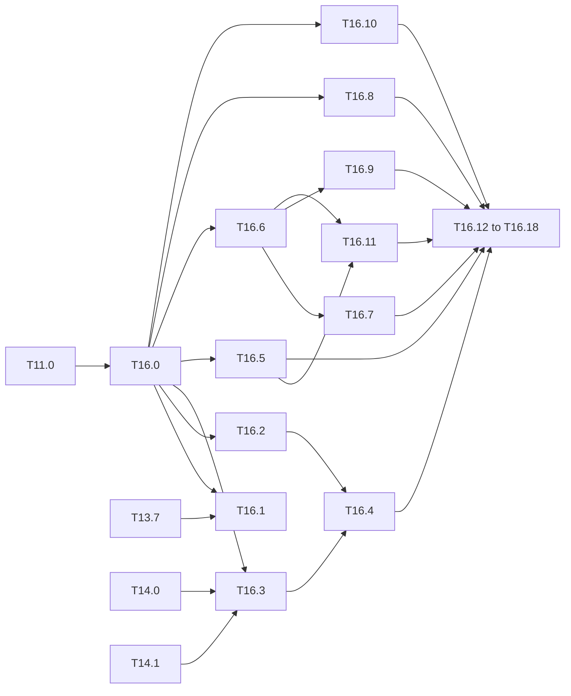

# M16 — Dataset presentation notebooks (optional)

Goal: one Jupyter notebook per dataset that **presents** it (origin, licence, sensor,
splits, classes) and gives its **statistical analysis** (counts, classes, box geometry,
density, images, anchors, annotation quality), read from the point of view of Tiny-YOLO and
of the embedded target (416 input, 13×13 and 26×26 grids, 256 slots of `yolo_post`, INT8).

Starting point:
- only VOC has statistics: `tools/voc_stats.py` (counts against the devkit figures, T0.6)
  and the figure `voc_stats.png` of [T13.7](M13-figures.md#x-t137--voc-dataset-statistics);
- the six other datasets of `DATASETS` (`python/yolo/data/datasets.py`) only have their
  loader; their counts come from the dataset pages, **to be checked**
  ([M11, Summary](M11-jeux-de-donnees.md#summary)), and `SPLIT_IMAGES` of
  `tools/notebooks/matrice.py` is still `None` for ExDark and FLIR;
- the first sweeps of [M15](M15-campagne-entrainement.md) give mAPs we cannot read yet: on
  VisDrone and KITTI, only the car class takes off. What is missing is the share of small
  objects after resizing, the class imbalance and the number of targets lost by collision
  in the grid;
- `tools/kmeans_anchors.py` computes the anchors of a dataset, but nothing compares them
  with those of the cfg on the dataset itself.

As in [M14](M14-notebooks.md), a notebook brings **no computation of its own**: the
statistics are computed by a repository tool (`tools/data_stats.py`) and plotted by a
figure generator (`tools/figures/donnees.py`). The notebook chains them, shows them and
comments on them. Every result of the notebook can be reproduced from the command line.

**State**: 17 tasks done out of 19. Tool, figures, datasheets, template and analyses in
place; VOC, VisDrone, FLIR, ExDark and CrowdHuman notebooks executed and versioned with
their outputs, summary in [stats-jeux.md](stats-jeux.md). Remaining: T16.13 (COCO:
`data/coco` missing from the PC) and T16.14 (KITTI: `training/` images missing, archive
`data_object_image_2.zip` incomplete); their notebooks are generated and will pass as they
are once the data is there.

## Shared conventions

### Tooling

- **Computation**: `tools/data_stats.py`, in pure NumPy, on the list of samples of the
  loaders (`DATASETS[dataset].load`). It only reads the pixels for the image statistics
  (T16.8), on a sample (`--sample`).
  ```
  python tools/data_stats.py --dataset kitti --split train,val --size 416 \
      --out build/notebooks/kitti/stats [--sample 500] [--markdown]
  ```
  Outputs: `stats.json` (all the quantities, one key per analysis), `stats.md` (summary
  tables), `figures/` (if `--figures`).
- **Figures**: `tools/figures/donnees.py`, one function per panel, called from
  `stats.json`. `plot_voc_stats` of `tools/figures/modeles.py` (T13.7) becomes the VOC case
  of this module: `make figures` still produces `voc_stats.png`.
- **Notebooks**: `stats` role added to the registry of `tools/notebooks/matrice.py` and
  template `stats_body` in `tools/notebooks/gabarits.py`. One notebook per dataset of
  `DATASETS`, without a model: `notebooks/<dataset>/<dataset>_stats.ipynb`. Adding a
  dataset to `DATASETS` adds its notebook without touching the generator.
- **Datasheet**: `FICHES` in `tools/data_stats.py`, the only hand-written part (source,
  version, licence, sensor, official counts per split), like `OFFICIAL` of
  `tools/voc_stats.py`.

### Outputs

- **Notebooks**: `notebooks/<dataset>/<dataset>_stats.ipynb`, listed in
  `notebooks/README.md` (tier, required data, Colab badge).
- **Run results**: `build/notebooks/<dataset>/stats/` (`stats.json`, `stats.md`,
  `figures/`, gallery). Nothing in `results/`.
- **Summary**: [stats-jeux.md](stats-jeux.md), one section per dataset (revision, splits,
  summary table), and a comparative table of the seven datasets. This document is filled
  from `stats.md`; it serves as the reference for the tasks of M11 and M15.

<a id="règles"></a>

### Rules

- The rules of [M14](M14-notebooks.md#rules) apply: notebooks versioned without outputs or
  executed in full without error, `--check`, equivalent CLI command printed at each step.
- **Fixed structure** of each notebook, in this order:
  1. title, datasheet of the dataset (T16.2), links to the M11 task and to the notebooks of
     the dataset;
  2. **parameter cell** (tag `parameters`): `DATASET`, `SPLITS` (default: `train` and
     `test` of the `Dataset`), `SIZE` (default: input of the dataset's cfg, otherwise
     416), `RESIZE` (`letterbox` or `stretch`), `SAMPLE` (images read for the pixels,
     default 200), `GALLERY` (gallery images, default 8), `SEED`;
  3. **environment cell** of T14.1, without weights or cfg to check;
  4. body of the `stats` template (sections B);
  5. summary: summary table, output paths, equivalent CLI command.
- **Exact or sampled statistics, always stated**: everything that comes from the
  annotations covers the whole split; what needs the pixels covers `SAMPLE` images drawn
  with `SEED`, and the title of the table or of the figure says so.
- **Explicit input size**: the quantities "seen by the network" (box size in input pixels,
  cells, collisions) are computed after `letterbox` or `stretch` to `SIZE`, by
  `yolo.data.letterbox`, never by a rewrite.
- **Tier**: annotations only → tier R or M depending on the number of images (image
  headers read for KITTI, VisDrone, CrowdHuman and ExDark); pixels → tier depending on
  `SAMPLE`. The notebook prints the tier before starting.
- **Shared acceptance**:
  - the notebook is produced by `make notebooks` and listed in `notebooks/README.md`;
  - `--check` passes;
  - the smoke run of T14.9 executes it with `SAMPLE = 8` and `GALLERY = 2`;
  - the image and object totals equal those of the datasheet, or the gap is explained in
    the datasheet (boxes removed by `make_sample`, `DontCare` regions, etc.).

<a id="questions-par-jeu"></a>

### Questions per dataset

Each notebook answers the shared analyses, plus a question specific to the dataset, which
points to the axis of M11 or M15.

| Dataset | Specific question | Pointer |
|---|---|---|
| voc | are the classes with a low AP (bottle, pottedplant) rare or small? | T13.7, T13.13 |
| coco | what share of the objects is small (< 32²) once reduced to 416? | T11.1 |
| kitti | `letterbox` or `stretch`: how many objects fall under 8 px of height? | T11.4, T15 |
| visdrone | share of objects smaller than a 26×26 cell; target collisions | T11.5, T15 |
| flir | distribution of the thermal levels, and what the INT8 of L00 keeps of it | T11.7 |
| exdark | luminance per lighting type, and gap to the VOC calibration images | T11.3 |
| crowdhuman | objects per image against the 256 slots; share of occluded objects | T11.6 |

---

## A. Infrastructure

### [x] T16.0 — `tools/data_stats.py` tool
- **Spec**: — · **Depends on**: T11.0 · **Size**: M
- **Deliverables**: `tools/data_stats.py` (pure functions + `main()`);
  `python/tests/test_data_stats.py`.
- **Expected behaviour**:
  - one function per analysis of section B, which takes the list of samples and returns a
    serialisable dict; `main()` calls them all and writes `stats.json` and `stats.md`;
  - `--split` accepts several splits separated by commas; each analysis is given per split,
    and for the whole;
  - the pixel reading (T16.8) is the only one that opens the images, and only if
    `--sample` is non-zero.
- **Acceptance**:
  - tests on synthetic samples (counts, areas, known collisions);
  - on VOC, the counts equal `OFFICIAL` of `tools/voc_stats.py`, which the tool replaces
    (`voc_stats.py` remains as a shortcut and calls `data_stats`).
- **Notes**: no pandas; the `yolo` package stays pure NumPy
  ([ADR 0001](../adr/0001-numpy-pur.md)) and the tool lives in `tools/`.

### [x] T16.1 — `tools/figures/donnees.py` figures
- **Spec**: — · **Depends on**: T16.0, T13.7 · **Size**: M
- **Deliverables**: `tools/figures/donnees.py`; `--figures` option of `data_stats.py`.
- **Acceptance**:
  - each panel of section B is plotted from `stats.json`, without rereading the dataset;
  - `voc_stats.png` (T13.7) is produced by this module and keeps its three panels and its
    totals;
  - shared style of `tools/figures/style.py`.

### [x] T16.2 — Datasheet of each dataset
- **Spec**: — · **Depends on**: T16.0 · **Size**: S
- **Deliverables**: `FICHES` in `tools/data_stats.py`, one entry per dataset of
  `DATASETS`.
- **Contents**: source (URL), version, licence, sensor and capture conditions, typical
  resolution, splits used by the repository (`test`, `calib`, `train`), official counts
  (images, objects) per split, peculiarities of the loader (classes removed, objects in
  `difficult`, in-house split of KITTI).
- **Acceptance**:
  - a test checks that each dataset of `DATASETS` has a datasheet, and that its classes are
    those of the `Dataset`;
  - `SPLIT_IMAGES` of `matrice.py` is filled for all the datasets (ExDark and FLIR
    included), from the measured counts, and the Summary table of M11 is corrected if
    needed.

### [x] T16.3 — `stats` role in the registry and template
- **Spec**: — · **Depends on**: T14.0, T14.1, T16.0 · **Size**: M
- **Deliverables**: `stats` role in `tools/notebooks/matrice.py`; `stats_body` in
  `tools/notebooks/gabarits.py`; 7 notebooks `notebooks/<dataset>/<dataset>_stats.ipynb`.
- **Acceptance**:
  - a test checks that each dataset of `DATASETS` has exactly one `stats` notebook;
  - the index puts these notebooks at the top of each dataset;
  - the commands printed are those of `data_stats.py`, option by option.
- **Notes**: no weights or cfg in the prerequisites; on Colab, the data goes through
  `colab.prepare_data` as in M14.

## B. Analyses (sections of the template)

### [x] T16.4 — Presentation and gallery
- **Spec**: — · **Depends on**: T16.2, T16.3 · **Size**: S
- **Contents**:
  - the datasheet (T16.2) as a table, then the list of classes with their VOC and COCO
    correspondences (`MAPPINGS`);
  - gallery: `GALLERY` images drawn with `SEED` per split, boxes drawn by
    `tools/detect.py:draw`;
  - one image per class, at least one box of the class.
- **Acceptance**: with a fixed `SEED`, the gallery does not change from one run to the
  next.

### [x] T16.5 — Counts and classes
- **Spec**: §8.3 · **Depends on**: T16.0 · **Size**: S
- **Contents**:
  - images, objects, `difficult` or `crowd` objects, images without objects, per split;
  - objects per class and images containing the class, per split; ratio between the most
    and the least frequent class;
  - class co-occurrence matrix (images where two classes appear together).
- **Acceptance**: totals equal to the datasheet (see Shared acceptance).

### [x] T16.6 — Box geometry and input size
- **Spec**: §5.1, §8.3 · **Depends on**: T16.0 · **Size**: M
- **Contents**:
  - width, height, relative area and aspect ratio of the boxes, in original pixels and in
    input pixels at `SIZE`;
  - COCO categories (small < 32², medium < 96², large) before and after resizing;
  - share of objects smaller than a cell of each head (32 px for 13×13, 16 px for 26×26);
  - heat map of the box centres (position in the image);
  - `letterbox` / `stretch` comparison for the datasets with non-square images.
- **Acceptance**: a test checks the conversion to input pixels against
  `yolo.data.letterbox.boxes_to_letterbox`.

### [x] T16.7 — Density and target collisions
- **Spec**: §5.1, §10.3 · **Depends on**: T16.6 · **Size**: M
- **Contents**:
  - objects per image (histogram, median, maximum);
  - **collisions**: objects that fall on the same cell and the same anchor of a head, so
    that only one of them receives a target; counted by
    `yolo.data.targets.build_targets` with the anchors of the dataset's cfg;
  - images beyond the 256 slots of `yolo_post` (and 1,024, as in T11.6).
- **Acceptance**: the number of lost targets equals, on a batch, the gap between objects
  and positive targets of `build_targets`.

### [x] T16.8 — Images: resolution, channels, intensity
- **Spec**: §9 · **Depends on**: T16.0 · **Size**: S · **Tier**: depending on `SAMPLE`
- **Contents**:
  - resolutions and aspect ratios (from the headers, whole split);
  - on `SAMPLE` images: number of channels, mean and standard deviation per channel,
    intensity histogram, mean luminance per image;
  - comparison with VOC (same computation on `SAMPLE` images of VOC2007 test), which was
    used for the INT8 scales of M4.
- **Notes**: for FLIR, the 8-bit images of the dataset; a 16-bit analysis is out of scope.

### [x] T16.9 — Anchors of the dataset
- **Spec**: §5.2 · **Depends on**: T16.6 · **Size**: S
- **Contents**:
  - (width, height) cloud of the boxes in input pixels, with the anchors of the cfg and
    those of `tools/kmeans_anchors.py --dataset`;
  - mean best-anchor IoU (`yolo.data.anchors.mean_best_iou`) for the VOC, COCO and
    dataset anchors;
  - mean IoU curve as a function of k (like `ancres_k` of T13).
- **Acceptance**: the anchors shown are those that `kmeans_anchors.py` writes with the
  same `--size` and `--seed`.

### [x] T16.10 — Annotation quality
- **Spec**: — · **Depends on**: T16.0 · **Size**: S
- **Contents**:
  - boxes removed or clipped by `make_sample` (outside the image, empty);
  - degenerate boxes (side < 2 px), duplicates (IoU > 0.95, same class);
  - regions removed by the loader (`DontCare` of KITTI, ignored regions and `others` of
    VisDrone), counted from the raw files;
  - list of the 10 most suspicious images, shown in the notebook.
- **Notes**: the analysis reports, it does not correct; a loader correction goes through
  an M11 task.

### [x] T16.11 — Gap between splits and out-of-domain coverage
- **Spec**: §8.3 · **Depends on**: T16.5, T16.6 · **Size**: S
- **Contents**:
  - train and test distributions overlaid (classes, sizes, density), with a simple distance
    per quantity (gap of the shares per class, distance between histograms);
  - coverage of `MAPPINGS`: share of the objects of the dataset that have a VOC or COCO
    class, that is what the out-of-domain notebooks of T14.5 evaluate.
- **Acceptance**: the coverage given equals the number of objects evaluated by
  `eval_voc.py` out of domain on the same split.

## C. Run per dataset

Each task runs the notebook of the dataset on the full splits (default `SAMPLE`), fills its
section of [stats-jeux.md](stats-jeux.md), and answers the question specific to the
dataset ([Questions per dataset](#questions-per-dataset)).

### [x] T16.12 — VOC
- **Depends on**: T16.4 to T16.11 · **Size**: S
- **Acceptance**: counts of VOC2007 test, VOC2007 trainval and VOC2012 trainval equal to
  the devkit figures (`OFFICIAL`); AP per class of T13.13 set against the number and the
  size of the objects.

### [ ] T16.13 — COCO val2017
- **Depends on**: T16.4 to T16.11 · **Size**: S
- **Acceptance**: 5,000 images, 36,781 objects (including `iscrowd`); small, medium and
  large shares before and after reduction to 416.
- **Notes**: train2017 is limited to the annotations (no pixel reading); the `calib2017`
  split of `tools/coco_subset.py` is compared with val2017.
- **Remaining**: `data/coco` missing from the PC; run `tools/get_datasets.sh coco` then the
  notebook `notebooks/coco/coco_stats.ipynb`.

### [ ] T16.14 — KITTI
- **Depends on**: T16.4 to T16.11 · **Size**: S
- **Acceptance**: counts of the `kitti_ids` split (5,985 train, 1,496 val); object sizes
  in `letterbox` and `stretch` at 416, and at the non-square input of T11.4.
- **Remaining**: only the `testing/` images are on the PC (`data/kitti dataset/`), and
  `data/kitti/data_object_image_2.zip.part` is incomplete; finish the download of
  `training/image_2`, then run `notebooks/kitti/kitti_stats.ipynb` (the specific question
  redoes the geometry at 640x192).

### [x] T16.15 — VisDrone
- **Depends on**: T16.4 to T16.11 · **Size**: S
- **Acceptance**: 6,471 + 548 images; share of objects under 16 px at 416 and targets lost
  by collision, set against the per-class mAPs of M15.

### [x] T16.16 — FLIR
- **Depends on**: T16.4 to T16.11 · **Size**: S
- **Acceptance**: measured counts of version v2 (the repository does not have them yet);
  thermal histogram on one channel, against the INT8 input scale of L00.

### [x] T16.17 — ExDark
- **Depends on**: T16.4 to T16.11 · **Size**: S
- **Acceptance**: counts per split of the official split; mean luminance per lighting type
  (column of `imageclasslist.txt`), against VOC.
- **Notes**: the lighting type is not read by the loader; `data_stats.py` reads it from
  `imageclasslist.txt` without changing `load_exdark`.

### [x] T16.18 — CrowdHuman
- **Depends on**: T16.4 to T16.11 · **Size**: S
- **Acceptance**: 15,000 + 4,370 images; share of images beyond 256 and 1,024 objects;
  share of the boxes in `difficult` (`ignore`, `mask`).

### [x] T16.19 — Cross-dataset comparison
- **Depends on**: T16.12 to T16.18 · **Size**: M
- **Acceptance**: `notebooks/analyse_jeux.ipynb` reads the executed `_stats` notebooks (no
  data, no GPU) and compares every dataset: scale and density, object size after
  letterbox, objects under a grid cell, lost targets split into "best anchor in no head"
  and real cell collisions, class balance, pixels against VOC, anchors (in use vs
  k-means), train ↔ test gap, VOC / COCO coverage, annotation quality and a difficulty
  overview. Parsing: `tools/notebooks/jeux.py`; figures: `tools/figures/jeux.py`; tests:
  `python/tests/test_jeux.py`.
- **Notes**: with the Tiny-YOLOv3 COCO masks (3,4,5 / 1,2,3), anchor 0 is in no head: most
  "lost targets" of the small-object datasets come from it, not from crowding. The
  statistics notebooks run on Colab without `build/m11/cfg/` fall back to these anchors;
  the notebook says which.

---

## Out of scope

- Cleaning or re-annotating the datasets.
- Statistics on the detections of a model (they belong to `eval_voc.py` and M14).
- Analysis of the 16-bit thermal images of FLIR, and of the paired RGB images.
- Any dependency on pandas, seaborn or a dataset analysis library.

## Suggested order

T16.0 → T16.2 and T16.1 → T16.3 → sections B in order, each checked on VOC; then T16.12
(VOC, where everything can be checked against the devkit), T16.15 and T16.14 (datasets
swept in M15), and the other datasets as they reach the Drive.


