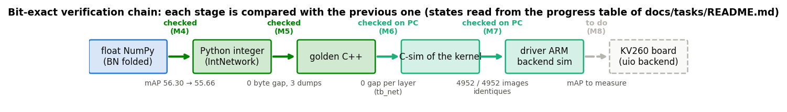

# M17 — Article (optional)

Goal: a **paper-style article, in French**, that reports the work of the repository: a
Tiny-YOLO detector rewritten from scratch in NumPy, quantized to INT8, checked bit-exact
in C++ then on an HLS accelerator driven by the ARM of a SoC, with its extensions
(low-precision formats, hardware post-processing, streaming, other datasets). The article
must **follow the project without rewriting**: numbers, tables, figures and milestone
status are **generated in tagged blocks**, only the narrative is written by hand.

Starting point:
- the [specification](../../yolo-embarque-de-zero.md) is a **method** document (what to
  implement and why, sourced in the paper base), not a report of what was done or of what
  it gives;
- the results are scattered in `results/`: [map_stades.md](../../results/map_stades.md)
  (VOC2007 test, float 56.30, integer 55.66, C-sim 55.66, 4,952 identical images),
  [map_int8.md](../../results/map_int8.md), [rapport.md](../../results/rapport.md)
  (projection 37.2 ms, 187.3 GOPS on KV260), [quant_4bits.md](../../results/quant_4bits.md),
  [req_yolo.md](../../results/req_yolo.md), [postproc_hw.md](../../results/postproc_hw.md),
  [streaming.md](../../results/streaming.md), [benchmarks.csv](../../results/benchmarks.csv),
  and in [resultats-balayages.md](resultats-balayages.md) for the datasets other than VOC;
- about 80 figures are published in `results/figures/` by the registry of `tools/figures`
  ([M13](M13-figures.md)), each with its caption, its source and its command;
- some of the numbers are **projections** or **C-sim**: the KV260 and Vitis are not
  available yet (M6-M8). The article must say so number by number, and switch over when
  the measurements arrive;
- M15 and M16 are open: the "beyond VOC" section will still change.

As in [M14](M14-notebooks.md) and [M16](M16-presentation-jeux.md), the article brings **no
computation of its own**: every number comes from a repository tool and is regenerated
from the command line.

**State**: 17 tasks done out of 21 (T17.0 to T17.16); T17.17 to T17.20 remain.

**Update v2 (2026-10-20).** The article and the slides follow M23 to M26: two MACs per DSP
and the Winograd study (§7, `pack.*`, `winograd.table`), YOLOv4-tiny on COCO (§3, §4, §5,
`model.v4.*`, `map.coco.*`), a new §10 Dependability (faults, ABFT, OOD monitor,
`ood.*`) and YOLOv7-tiny as work in progress (`model.v7.*`). The new section moves the
sections checked for hand-typed numbers to 4 to 11 (`RESULT_SECTIONS`). The slides gain a
YOLOv4/v7 frame, a COCO frame, three packing frames, a Winograd frame and a Dependability
section.

**Update v3 (2026-10-22).** The article follows M25, M28, M30 and M33: §10 Dependability has
the ABFT lane in the HLS kernel and the faults in the kernel buffers (`abft.hls.*`, C-sim);
a new §11 Safety evidence gives the equivalence matrix, operator tests, SMT proof and
traceability (`equiv.table`, `equiv.smt.proved`) and the static latency bound
(`wcet.v2.acc.ms`, `wcet.v2.frame.ms`, `wcet.v2.watchdog.ms`); §3 mentions YOLOv5n read
without PyTorch. The new section moves the sections checked for hand-typed numbers to 4 to
12 (`RESULT_SECTIONS`); Beyond VOC is now §12, Limitations §13, Reproducibility §14.

**Slides up to M36 (2026-10-22).** `presentation.tex` gains a "Safety evidence" section
(M28 equivalence, M30 static latency bound, cited from `results/equivalence.md` and
`results/latency_bound.md`); the work plan lists M27-M36 with their state, the fault frame
has the ABFT lane in the HLS kernel (T25.3, C-sim), and the limitations point to
[long-runs.md](long-runs.md) and the status deck below. The article covers M28 and M30
since v3.

**Status slides (2026-10-22).** A second deck, `docs/presentation/status.tex`
(`make status-pdf` → `docs/presentation/status.pdf`), gives the state of the project
rather than its method: progress per milestone (`\articleetat`, `projet/avancement.png`),
current results through the same `\chiffre` and `\articletable` keys, then the training,
evaluation and C-sim campaigns still open, their dependencies, a 4-week schedule and the
risks, with links to the plot folders on GitHub. Its durations are plans copied from
[long-runs.md](long-runs.md), marked "(estimates)" and cited on each frame. When a long
run is done, update long-runs.md first, then the deck.

**Glossary and links (2026-10-22, article v4).** `docs/article/glossary.tex` holds the
glossary of acronyms (`\newabbreviation`) and the lexicon (`\newglossaryentry`, variants in
`user1`), printed before the references (glossaries-extra, `\makenoidxglossaries`: no
external indexer, pdflatex and xelatex alike). Every occurrence in the prose is a link: a
term is `\gls{key}` (to its entry, which lists the pages back), a milestone or task id is
`\ms{M28}` / `\ms{T28.0}` (its task file on GitHub, the task anchor for a task), a path of
the repository in `\texttt` is `\repo{results/x.md}`; citations link to the references,
which link back to the citing pages (`backref`). `python -m tools.article link` wraps the
bare occurrences, `--check` (make ci) rejects them. Headings, captions of the figure
registry and generated tables are not linked.

**LaTeX (2026-10-07).** The source is now `docs/article/article.tex`, compiled by xelatex
and bibtex (`make article-pdf`) into `docs/article/article.pdf`. LaTeX comments run to the
end of the line, so the inline blocks below are replaced by macros: the hand-written
`article.tex` uses `\chiffre{<key>}`, `\articletable{<key>}`, `\articlefig{<name>[/<file>]}`,
`\articleetat`, `\articleetatresume`, `\articlestatuslist` and `\articlerev`, all defined
in `docs/article/generated.tex`, which `render` rewrites and `--check` compares (it never
needs LaTeX). References are in `docs/article/refs.bib` (§12 of the specification), cited
with their chunk, `\cite[\#013.1]{2024-zhang}`; `refs.md` and `article.md` are gone.
Tables and figures are numbered and referenced by LaTeX (`\ref{tab:…}`, `\ref{fig:<name>}`).

**Done (2026-10-07), in English.** Following the M19 rule (everything new is written in
English from 2026-10-07), the article, its generated text and the messages of
`tools/article.py` are in English, with English number formatting (decimal point, comma
thousands separator, minus sign −). Differences from the plan below:
- statuses are named `measured`, `csim`, `projection`, `estimate`, `tier-R`, `published`
  (for `mesure`, `csim`, `projection`, `estimation`, `palier-R`, `publie`); the mark is a
  superscript (`<sup>proj.</sup>`), none for `measured`;
- `collect` reads the published tables of `results/` (and `build/m8/<net>/map_stades.json`
  when present); performance comes from `results/mesures.md` and `rapport.md`, which
  `make perf-model bench-report` write, and sweeps from
  [resultats-balayages.md](resultats-balayages.md), which `make harvest` refreshes;
- the result sections checked for stray numbers are the abstract and §4 to §12; a decimal
  inside code, maths, a citation or a link is ignored;
- the `rev` block shows the revision stored in `chiffres.json` (`_rev`), stamped by
  `render` only when the article changes, so `--check` does not depend on the current
  commit; `list:status` lists the keys still `projection`, `estimate`, `tier-R` or `csim`;
- figure captions come from `tools/figures` and stay in French until M19 translates them;
  the sweep figures (`balayage`, `balayages`) are not in `results/figures/` yet and are not
  cited;
- `make article-pdf` compiles `build/article/article.pdf` (latexmk -xelatex) and copies it
  to `docs/article/article.pdf`, the one exported file kept in git. Without xelatex it falls
  back to pdflatex: the preamble loads `fontspec` under xelatex and `inputenc` / `fontenc` /
  `lmodern` under pdflatex (`iftex`), so the same source compiles with both.

## Shared conventions

### Files

- **Source**: `docs/article/article.md`, a single Markdown file (inline LaTeX `$…$` like
  the specification).
- **Numbers**: `docs/article/chiffres.json`, a **versioned** snapshot of all the numbers
  and tables of the article. One entry per key:
  `{"valeur": …, "statut": …, "source": …, "commande": …, "rev": …, "date": …}`.
- **References**: `docs/article/refs.md`, taken from §12 of the specification; citations in
  the format of the paper base (`[2024-zhang#013.1]`, checkable with `bin/pdb verify`, a
  tool of the base, outside the repository).
- **Export** (optional): `build/article/article.pdf` and `.html` by pandoc; nothing
  exported is versioned.
- **Tool**: `tools/article.py` (`python -m tools.article`), in pure Python, outside the
  `yolo` package ([ADR 0001](../adr/0001-numpy-pur.md)).

### Generated blocks

A block is delimited by two HTML comments, invisible when rendered:

```markdown
La mAP entière vaut <!-- article:n:map.voc.int8 -->55,66<!-- /article --> points.

<!-- article:table:map.stades -->
| Stade | mAP | Statut |
|---|---|---|
| … | … | … |
<!-- /article -->

<!-- article:fig:chaine_verif -->

*Figure — …* <!-- python -m tools.figures chaine_verif -->
<!-- /article -->
```

| Type | Contents | Origin |
|---|---|---|
| `n` | a number, in French format (decimal comma, thin space as the thousands separator) | key of `chiffres.json` |
| `table` | a Markdown table | key of `chiffres.json` (list of rows) |
| `fig` | image, caption `Figure.caption`, command in a comment; `fig:<name>` or `fig:<name>/<file>` when the generator produces several images | `FIGURES` registry of [tools/figures/__init__.py](../../tools/figures/__init__.py) |
| `etat` | progress of the milestones | **Suivi** table of [README.md](README.md) |
| `rev` | git revision and date of the last `render` | `git rev-parse --short HEAD` |

Rules:
- the contents of a block are **never edited by hand**: they are rewritten by `render`;
- everything outside a block (the narrative) is **never touched** by the tool;
- a number cited in the narrative outside a block is a mistake: `--check` reports the
  decimal numbers outside blocks in the result sections (allow list for the network
  constants: 416, 13×13, 0.1 of the leaky, etc.);
- the figures are cited **by registry name**, never by path: renaming a figure in
  `tools/figures` breaks `--check`, not the article silently.

### Two-step collection

1. **`collect`**: a `CLES` registry in `tools/article.py` maps each key to a reader, a
   source and a status. The reader reads the source (JSON from `build/`, CSV or Markdown
   table from `results/`). If the source is missing, the value of `chiffres.json` is
   **kept** and reported, like `MissingSource` of the figures. `collect` rewrites
   `chiffres.json` with the current revision for each value that changed.
2. **`render`**: rewrites the blocks of `article.md` from `chiffres.json` and the figure
   registry, without reading `build/`.

The article can therefore be regenerated anywhere (CI, Colab, a machine without `build/`),
and the diff of `chiffres.json` shows exactly which results moved between two versions.

### Status of each number

Each key carries a status, rendered as a superscript or in a "Status" column of the
tables:

| Status | Meaning | Example |
|---|---|---|
| `mesure` | measured on the board or on the full dataset | integer mAP VOC2007 test |
| `csim` | computed by the HLS kernel in C-sim | FPGA mAP 55.66 |
| `projection` | cycle or resource model, without synthesis | 37.2 ms, 187.3 GOPS |
| `estimation` | analytical model outside synthesis | resources of the streaming design (M9.4) |
| `palier-R` | subset (50 images, M12 rule) | M15 sweeps |
| `publie` | number from a paper of the base | rows of `benchmarks.csv` other than "this work" |

The article **never presents a projection as a measurement**: the abstract and the
conclusions cite the status next to each key number.

### Rules

- `make article` = `collect` then `render`; `make article-pdf` also exports.
- `python -m tools.article --check` (in `make ci`) fails if:
  - a block differs from what `render` would produce;
  - a block cites a key missing from `chiffres.json` or a figure missing from `FIGURES`;
  - a cited image does not exist in `results/figures/`;
  - a result section contains a number outside a block (allow list aside).
- The keys are stable and hierarchical: `<dataset>.<quantity>.<variant>` (`map.voc.int8`,
  `perf.kv260.m10.ms`, `balayage.visdrone.meilleur.map`). Renaming a key is done in `CLES`
  and in the article in the same commit.
- Language and typography: those of [conventions.md](../conventions.md) and of the
  specification (French, decimal comma, "hors base" for what is not sourced).

### Update at each milestone

When a task that produces a result is closed (or at least at each milestone):

1. `make article`;
2. reread the diff of `chiffres.json` and of the blocks (`git diff docs/article/`);
3. reread the narrative of the sections where a number or a status changed (**Sections**
   table below) and correct it; set their state to "up to date at rev. X";
4. add an entry to the **version log** (appendix of the article): revision, date, what
   changed, in one or two lines;
5. `--check` green, commit `M17 : article à jour (<milestone>)`.

## Outline of the article

Each section gives the milestones it covers and its main blocks. The table also tells
**which section to reread** when a milestone moves forward.

| § | Section | Milestones | Main blocks (keys, figures) |
|---|---|---|---|
| 0 | Abstract | all | `n`: float / integer / C-sim mAP, projected ms and GOPS, MACs; `rev` |
| 1 | Introduction and contributions | — | list of contributions; summary `etat` |
| 2 | Related work | §10.4 of the spec | `table:benchmarks` (`benchmarks.csv`), `fig:etat_art` |
| 3 | Networks and NumPy building blocks | M0-M2 | `fig:graphe/graphe_tiny-yolov2-voc`, `fig:fiche/fiche_tiny-yolov2-voc`, `fig:convolution`, `fig:retropropagation`, `fig:perte`; `n`: MACs, parameters, gradcheck |
| 4 | Inference and evaluation | M3 | `table:map.voc.float` (preprocessings), `fig:pr/pr_variantes`, `fig:nms_map` |
| 5 | INT8 quantization | M4 | `table:map.voc.int8`, `fig:calibration/calibration_tiny-yolov2-voc`, `fig:erreur_couches/erreur_couches_tiny-yolov2-voc`, `fig:quantification`, `fig:entier` |
| 6 | C++ golden model and verification chain | M5 | `fig:chaine_verif`; `n`: differences (0), number of dumps compared |
| 7 | HLS accelerator and SoC integration | M6, M7, M10 | `fig:moteur`, `fig:tuilage`, `fig:soc`, `fig:roofline_couches`, `fig:cascade_m10`, `fig:cycles_couches` |
| 8 | Results | M8 | `table:map.stades`, `table:perf.kv260`, `fig:map_stades`, `fig:ressources`; statuses `csim` / `projection` |
| 9 | Extensions | M9.1-M9.4 | `table:map.formats` (INT8, powers of 2, 4 bits), `fig:map_formats`, `fig:hw_postproc`, `fig:streaming` |
| 10 | Beyond VOC | M11, M15, M16 | `table:balayages.meilleurs` (per dataset), `fig:balayages/balayages_*`, `fig:detections`; status `palier-R` |
| 11 | Limitations and future work | all | detailed `etat`; generated list of the numbers still `projection` / `estimation` |
| 12 | Reproducibility | M0, M12-M14 | `make` commands, notebooks, `fig:tests`, `fig:code`; `rev` |
| — | References | — | `refs.md` |
| A | Appendix: version log | — | written by hand, one entry per update |

---

## A. Infrastructure

### [x] T17.0 — Skeleton of the article
- **Spec**: — · **Depends on**: — · **Size**: S
- **Deliverables**: `docs/article/article.md` (title, authors, sections of the outline, one
  empty block per planned block, "version log" appendix); `docs/article/refs.md`; empty
  `docs/article/chiffres.json` (`{}`).
- **Acceptance**: the skeleton reads as Markdown (GitHub and VS Code); each section of the
  outline is there, with its tagged blocks and a "to write" line.

### [x] T17.1 — Block engine `tools/article.py`
- **Spec**: — · **Depends on**: T17.0 · **Size**: M
- **Deliverables**: `tools/article.py` (`parse`, `render`, `main`);
  `python/tests/test_article.py`.
- **Expected behaviour**:
  - `parse` finds the blocks `<!-- article:<type>:<key> -->…<!-- /article -->`, inline or
    over several lines; a block not closed properly is an error with a line number;
  - `render` replaces the contents of each block and leaves the rest of the file byte for
    byte;
  - French number formatting (decimals fixed per key);
  - `--check`: see **Rules**; readable output (line, key, expected, found).
- **Acceptance**:
  - tests: idempotence (`render` twice = once), text outside blocks unchanged, unknown or
    unclosed block refused, `--check` red on a block edited by hand, number outside a block
    detected;
  - no dependency outside the standard library.
- **Notes**: reuse the `--check` scheme of `tools/notebooks/__main__.py`.

### [x] T17.2 — Collecting the numbers (`collect`)
- **Spec**: — · **Depends on**: T17.1 · **Size**: M
- **Deliverables**: `CLES` registry and readers in `tools/article.py`; first
  `docs/article/chiffres.json`.
- **Readers** (one per family of sources, reusing the existing readers rather than
  rereading the files):
  - mAP at the stages: `build/m8/<net>/map_stades.json` (`tools/map_stades.py --json`),
    fallback on the table of `results/map_stades.md`;
  - float / integer: `build/m8/<net>/eval_float_int.json`, tables of `map_float.md` and
    `map_int8.md`;
  - formats: `build/m9/map_*.json`, tables of `quant_4bits.md` and `req_yolo.md`;
  - performance: `tools/perf_model.py` (projection) then, when they exist, the
    measurements of `results/mesures.md`;
  - state of the art: `results/benchmarks.csv`;
  - sweeps: `tools/notebooks/balayages.py` (outputs of the `_sweep` and `_infer`
    notebooks);
  - model: MACs and parameters from `make count-macs`.
- **Acceptance**:
  - each key has a source, a command and a status;
  - without `build/`, `collect` keeps the existing values and lists the keys not
    refreshed, without failing;
  - test: a modified source changes the value and the revision of its key only.

### [x] T17.3 — `fig`, `etat` and `rev` blocks
- **Spec**: — · **Depends on**: T17.1 · **Size**: S
- **Deliverables**: rendering of the three types in `tools/article.py`.
- **Acceptance**:
  - `fig`: relative path from `docs/article/`, caption = `Figure.caption`, command in a
    comment; a `subset=True` figure (in `build/`) is refused, the article only cites
    published figures;
  - `etat`: milestone / tasks / done table read from the **Suivi** table of
    [README.md](README.md), variants `etat` (full) and `etat:resume` (one sentence);
  - `rev`: short revision and date, suffix `+modifs` if the working tree is dirty.

### [x] T17.4 — `make` targets and CI
- **Spec**: — · **Depends on**: T17.2, T17.3 · **Size**: S
- **Deliverables**: `article` and `article-pdf` targets of the `Makefile`; `--check` added
  to `ci`; line in `make help`.
- **Acceptance**: `make article` then `make ci` pass; `make article-pdf` produces
  `build/article/article.pdf` if pandoc is installed, otherwise a clear message (no
  failure of `ci`).

## B. Writing

Shared acceptance of the writing tasks:
- the section is written in the tone of an article (an account of what was done, choices
  and results), not of documentation;
- all its result numbers are in blocks, all its figures are cited through the registry;
- statements about the method point to citations of the base, or are marked "outside the
  base" as in the specification;
- `--check` passes; the state of the section moves to "draft" in the **Sections** table.

### [x] T17.5 — §0 Abstract
- **Depends on**: T17.6-T17.16 · **Size**: S
- **Notes**: written last; 200 words; each number with its status.

### [x] T17.6 — §1 Introduction and contributions
- **Depends on**: T17.0 · **Size**: S
- **Notes**: candidate contributions: complete chain without a deep learning library;
  bit-exact from the NumPy float model to the HLS kernel (4,952 identical images); a single
  parameterised engine for v2 and v3; comparison of formats (INT8, powers of 2, 4 bits) on
  the same model; reproducible tooling (profiles, figures, notebooks).

### [x] T17.7 — §2 Related work
- **Depends on**: T17.2 · **Size**: M
- **Notes**: build on §10.4 of the specification and on the "what prevents a direct
  comparison" column of [rapport.md](../../results/rapport.md).

### [x] T17.8 — §3 Networks and NumPy building blocks
- **Depends on**: T17.3 · **Size**: M
- **Notes**: Tiny-YOLOv2/v3 layer by layer (spec §3), forward and backward passes,
  gradcheck ([M1](M1-briques-numpy.md)), loss and training
  ([M2](M2-cibles-perte-entrainement.md)).

### [x] T17.9 — §4 Inference and evaluation
- **Depends on**: T17.2 · **Size**: S
- **Notes**: effect of the preprocessing (stretch, letterbox, Darknet interpolation) on the
  reference mAP ([M3](M3-inference-evaluation.md)).

### [x] T17.10 — §5 INT8 quantization
- **Depends on**: T17.2 · **Size**: M
- **Notes**: BN folding, calibration, M0/shift, leaky 13/128, LUT of the heads; gap under
  1 point, QAT not needed ([M4](M4-quantification.md)).

### [x] T17.11 — §6 C++ golden model and verification chain
- **Depends on**: T17.3 · **Size**: S
- **Notes**: how equality is checked at each step ([M5](M5-golden-cpp.md),
  `make golden-check`).

### [x] T17.12 — §7 HLS accelerator and SoC integration
- **Depends on**: T17.3 · **Size**: L
- **Notes**: choice of the board ([ADR 0003](../adr/0003-choix-carte.md)), roofline,
  tiling, single engine, register map, ARM driver ([M6](M6-accelerateur-hls.md),
  [M7](M7-integration-soc.md)); optimisation cascade of [M10](M10-ameliorations.md).

### [x] T17.13 — §8 Results
- **Depends on**: T17.2 · **Size**: M
- **Notes**: the section most exposed to updates: the sentences repeat no number, they
  comment on the tables. Plan both wordings (before and after the board measurement) in
  T17.19.

### [x] T17.14 — §9 Extensions
- **Depends on**: T17.2 · **Size**: M
- **Notes**: hardware post-processing ([M9.1](M9.1-postproc-materiel.md)), REQ-YOLO and
  ADMM not converged ([M9.2](M9.2-req-yolo.md)), 4 bits ([M9.3](M9.3-quant-4bits.md)),
  streaming as an estimate ([M9.4](M9.4-streaming.md)). Negative or partial results are
  reported as such.

### [x] T17.15 — §10 Beyond VOC
- **Depends on**: T17.2 · **Size**: M
- **Notes**: datasets of [M11](M11-jeux-de-donnees.md), sweeps and inferences of
  [M15](M15-campagne-entrainement.md) ([resultats-balayages.md](resultats-balayages.md)),
  statistics of [M16](M16-presentation-jeux.md) when they exist. The section most likely
  to grow: one subsection per dataset, in the order of M15.

### [x] T17.16 — §11 Limitations and §12 Reproducibility
- **Depends on**: T17.3 · **Size**: S
- **Notes**: §11 generated list of the keys still `projection`, `estimation` or
  `palier-R`; §12: `make` commands, R/M/N profiles ([M12](M12-profils-pc.md)), notebooks
  ([M14](M14-notebooks.md)), revision.

### [x] T17.17 — References and full proofreading
- **Depends on**: T17.5-T17.16 · **Size**: M
- **Deliverables**: complete `refs.md`; proofreading (consistency of the notation with the
  specification, a single definition per acronym, figures called out in the text).
- **Acceptance**: each `[chunk_id]` citation passes `bin/pdb verify`; all the sections in
  the "proofread" state.
- **Done** (2026-10-27):
  - **Citations**: the 32 chunks cited in `article.tex` each pass `bin/pdb verify` (OK,
    1.00) with the quote that carries the claim. Five chunks did not carry it and were
    replaced: 2023-zhai INT16 and pruning (#004.1 → #002.0), its Winograd count
    (#004.0 → #036.1), 2024-zhang packing (#011.0 → #008.0, twice), 2026-fata pruned at
    70 % (#014.4 added), YOLOv2 multi-scale training (#003.2 → #003.3).
  - **Proofreading** of every section: the state of YOLOv5n, YOLOv7-tiny, YOLOv8n (float
    COCO accuracy and NumPy training now exist), M27 (PREWID measured), M31 (written,
    provisional) and M36 (code and a VOC run) was stale in §3 and §13, now up to date;
    `fig:etat_art` was never called out; long lines reflowed; v5 entry in the version
    log. Every figure and table is called out; acronyms are defined once, in
    `glossary.tex`, and used through `\gls`.
  - **Left as known**: the figure captions come from the figure registry and are still in
    French (T19.7); the PDF was not rebuilt (no xelatex on this PC), `python -m
    tools.article --check` passes.

## C. Maintenance

### [ ] T17.18 — First version and log
- **Depends on**: T17.17 · **Size**: S
- **Deliverables**: "v0" entry of the version log; procedure **Update at each milestone**
  applied once end to end.
- **Acceptance**: a milestone that moves (for example a row of M15) is reflected in the
  article by `make article` and a proofreading of the relevant section only.
- **Remaining**: the v0 entry of the version log is written; the update procedure has not
  yet been applied to a milestone that moved.

### [ ] T17.19 — Switch "projection → measurement" (board)
- **Depends on**: T7.4, T8.1-T8.3 on the board · **Size**: M
- **Deferred** (board): [deferred/M17](deferred/M17-article.md) — T17.19, deliverables and acceptance.

### [ ] T17.20 — Frozen version for submission
- **Depends on**: T17.18 · **Size**: S
- **Deliverables**: git tag `article-vN`, `build/article/article.pdf`, log entry.
- **Acceptance**: from the tag, `make article` changes nothing (`--check` green) and the
  PDF export is reproducible.

## Sections

Writing state of each section, updated by the update procedure: *to write*, *draft*,
*proofread*, *up to date at rev. X*.
The numbering is the one of `article.tex` (§0 = abstract); Dependability and Safety
evidence came with M25 and M28.

| § | Section | State |
|---|---|---|
| 0 | Abstract | proofread (2026-10-27, T17.17) |
| 1 | Introduction and contributions | proofread (2026-10-27, T17.17) |
| 2 | Related work | proofread (2026-10-27, T17.17) |
| 3 | Networks and NumPy building blocks | proofread (2026-10-27, T17.17) |
| 4 | Inference and evaluation | proofread (2026-10-27, T17.17) |
| 5 | INT8 quantization | proofread (2026-10-27, T17.17) |
| 6 | Golden C++ model and verification chain | proofread (2026-10-27, T17.17) |
| 7 | HLS accelerator and SoC integration | proofread (2026-10-27, T17.17) |
| 8 | Results | proofread (2026-10-27, T17.17) |
| 9 | Extensions | proofread (2026-10-27, T17.17) |
| 10 | Dependability | proofread (2026-10-27, T17.17) |
| 11 | Safety evidence | proofread (2026-10-27, T17.17) |
| 12 | Beyond VOC | proofread (2026-10-27, T17.17) |
| 13 | Limitations and future work | proofread (2026-10-27, T17.17) |
| 14 | Reproducibility | proofread (2026-10-27, T17.17) |
