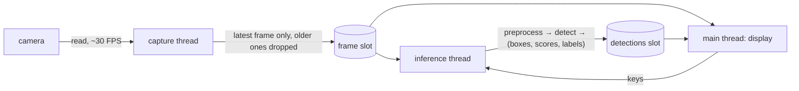

# M20 — Live webcam demo (optional)

Goal: a desktop program that opens the webcam, lets the user pick a model, shows the
live camera image, runs YOLO inference on the captured frames in a continuous loop, and
displays each frame with its boxes, class names and scores. It is the live counterpart
of `tools/detect.py` (T3.4), which annotates still images, and it reuses the same
pipeline: `preprocess` → `detect` / `detect_int` → `draw`.

The demo runs on the PC first (NumPy models, float or integer). Running it on the board
(KV260, USB camera, FPGA accelerator) is an outlook task (T20.9). It does not block the
PC version.

User guide of the finished tool: [docs/webcam.md](../webcam.md).

**State**: 9 of 10 tasks done (2026-10-11). `tools/webcam.py`, `make webcam` and
`python/tests/test_webcam.py` are in place and measured live (T20.8). T20.9 (board) is a
plan with a projected budget, waiting for the M8 board measurements.

## User guide (target behaviour)

This section says what the finished tool does. The tasks below build it.

### 1. Launch the program

```bash
pip install -e "python[webcam]"     # opencv-python + pillow (T20.0)
make get-weights                    # Darknet weights in weights/ (T1.9), once
make webcam                         # = python tools/webcam.py
```

Useful options:

```bash
python tools/webcam.py --camera 0                 # device index (/dev/video0), default 0
python tools/webcam.py --source clip.mp4          # a video file or an image folder instead of a camera
python tools/webcam.py --resolution 640x480       # capture size requested from the camera
python tools/webcam.py --conf 0.25 --iou 0.45     # thresholds (defaults of the demo, conventions.md)
python tools/webcam.py --no-window --save build/webcam/   # headless: annotated frames to disk
python tools/webcam.py --list                     # list cameras and available models, then quit
```

On Linux the user must be allowed to read `/dev/video*` (group `video`). If the camera
does not open, `--list` says which devices exist and which ones answer.

### 2. Choose the model

A model is chosen with `--model`, or from a menu printed at start-up when `--model` is
not given. The menu only shows the models whose files are present.

| `--model` | Network | Files read | Classes | Measured forward time on the PC (*) |
|---|---|---|---|---|
| `tiny-yolov2-voc` (default) | Tiny-YOLOv2, float | `weights/yolov2-tiny-voc.weights` | VOC (20) | ≈ 190 ms |
| `tiny-yolov3-coco` | Tiny-YOLOv3, float | `weights/yolov3-tiny.weights` | COCO (80) | ≈ 200 ms |
| `int:tiny-yolov2-voc` | Tiny-YOLOv2, integer (M4) | `model/tiny-yolov2-voc/` (`make export`) | VOC (20) | ≈ 300 ms |
| `int:tiny-yolov3-coco` | Tiny-YOLOv3, integer (M4) | `model/tiny-yolov3-coco/` | COCO (80) | — |
| `ckpt:<path>.npz --cfg <cfg> --dataset <name>` | fine-tuned network (M15, M18) | trainer checkpoint + its cfg | those of `DATASETS[<name>]` | — |

(*) One 416×416 forward pass, NumPy, 22 threads, measured on 2026-10-11. Pre- and
post-processing are extra. Expect about 3 to 5 inferences per second.

The class names come from the model (VOC, COCO or the dataset of the checkpoint), never
from a fixed list. `tools/detect.py` always uses `VOC_CLASSES`, which gives wrong names
with `tiny-yolov3-coco` (T20.1 fixes this for both tools).

Keys while the program runs:

| Key | Action |
|---|---|
| `q` / `Esc` | quit |
| `Space` | pause / resume (the last annotated image stays on screen) |
| `m` | next model in the menu (reloaded without closing the window) |
| `+` / `-` | confidence threshold ± 0.05 |
| `s` | save the current annotated frame to `build/webcam/` |
| `d` | show / hide the boxes (raw camera image) |

### 3. Display the webcam image

The window (`cv2.imshow`) shows the camera image at the camera's own frame rate, even
while an inference is running. An overlay in the top left corner shows the model name,
the confidence threshold, the display FPS, the inference FPS and the latency of the last
inference.

### 4. Continuous loop: capture, then inference

Inference (≈ 200 ms) is much slower than capture (≈ 33 ms at 30 FPS). If the two ran in
one sequential loop, the display would freeze and the camera's buffer would fill with
old frames, so the boxes would lag several seconds behind the scene. The loop is
therefore split into three parts that share only the **latest** frame:



1. **Capture thread**: `cv2.VideoCapture.read()` in a loop. It overwrites one slot with
   the newest frame, so the queue never grows.
2. **Inference thread**: takes the newest frame, converts BGR → RGB → PIL, runs
   `preprocess(img, size, "letterbox", "pil", channels)`, then `detect` (float) or
   `detect_int` (integer), and stores `(frame id, boxes, scores, labels, latency)`.
   It then starts again on the newest frame. The frames captured meanwhile are skipped.
3. **Main thread** (OpenCV needs the window in the main thread): reads the newest frame,
   draws the newest detections, shows the image, reads the keys.

Two display modes (`--sync`):

- **live** (default): the camera image is live and the boxes are those of the last
  finished inference. They can be up to one inference late on moving objects.
- **sync**: the window shows the exact frame that was analysed, with its boxes. The image
  is updated at the inference rate (3-5 FPS), but boxes and image always match. This is
  the mode for screenshots and for checking the model.

### 5. Display the image with boxes and classes

Boxes come out of `detect` as normalised `(cx, cy, w, h)` in the original frame
(letterbox already undone, §8.1). They are scaled to pixels and drawn with OpenCV:
a rectangle in the class colour, then a filled label `name score` above it. The colours
are the per-class `COLORS` of `tools/detect.py`, so the webcam and the still-image demo
look the same. Drawing uses OpenCV rather than PIL (`draw` of `detect.py`) to avoid a
PIL ↔ NumPy conversion per displayed frame.

## Tasks

### [x] T20.0 — Webcam dependency and camera check
- **Spec**: — · **Depends on**: M0 · **Size**: S
- **Deliverables**: `webcam = ["opencv-python>=4.8", "pillow>=10"]` in the optional
  dependencies of `python/pyproject.toml`; `python tools/webcam.py --list`.
- **Acceptance**: `--list` prints the cameras that open (index, resolution, FPS read
  back) and the models whose files are present; it exits with an error message, not a
  traceback, when no camera opens.
- **Notes**: `yolo/` must never import `cv2`, as for matplotlib (M13). Only `tools/`
  does. OpenCV is not installed on the PC yet (2026-10-11), and `/dev/video0` and
  `/dev/video1` exist. A UVC camera often shows two nodes, and the second one is metadata
  only. Under a headless environment use `opencv-python-headless` with `--no-window`.
- **Done**: extra `webcam` in `python/pyproject.toml` (OpenCV 5.0.0 installed). `--list`
  on this PC: `/dev/video0` 640×480 at 30 FPS, `/dev/video1` does not open (metadata node).
  The user is not in group `video`, but the device ACL (`crw-rw----+`) gives access.
  OpenCV warnings of the probe are muted (`OPENCV_LOG_LEVEL=ERROR`).

### [x] T20.1 — Model registry and class names
- **Spec**: §8 · **Depends on**: T3.4, T4.7 · **Size**: S
- **Deliverables**: a function in `tools/webcam.py` that turns `--model` into a ready
  callable `infer(pil_image) -> (boxes, scores, labels)` plus `names`, `size`, `channels`;
  the start-up menu; class names per model in `tools/detect.py` as well.
- **Acceptance**: each line of the model table loads and gives the same detections as
  `tools/detect.py` (float) or `detect_int` (integer) on `000004.jpg`; `tiny-yolov3-coco`
  prints COCO names.
- **Notes**: float: `build(net)` + `load_darknet_weights`. Integer: `load_model(dir)` →
  `IntNetwork(qm, "f64")`, `load_luts` / `head_luts`, as `tools/eval_quant.py` does.
  Checkpoint: `build(cfg)` then the `param/…` and `state/…` arrays of the `.npz`
  (`Trainer.save_checkpoint`). Input size and channel count come from the cfg
  (`input_size`), so a 1-channel model (HIT-UAV, FLIR) gets a grey image.
- **Done**: `MENU`, `model_files`, `available`, `load_model` → `Model(name, names, size,
  channels, run)` with `infer(pil, conf, iou)`; `load_checkpoint` reads `param/…` and
  `state/…` and refuses a checkpoint that does not match the cfg (QAT / ADMM, fused).
  `class_names(n, dataset)` and `pixel_boxes` live in `tools/detect.py` (new `--dataset`
  option there), `COLORS` has 80 entries (the 20 VOC colours unchanged). On `000004.jpg`
  the webcam path (OpenCV decode) and the PIL path give the same labels and boxes to
  0 px for `tiny-yolov2-voc` (6 cars), `tiny-yolov3-coco` (8 cars + 1 truck, COCO names)
  and `int:tiny-yolov2-voc` (7 boxes).

### [x] T20.2 — Capture and display without inference
- **Spec**: — · **Depends on**: T20.0 · **Size**: S
- **Deliverables**: capture thread with a one-frame slot; main loop with `imshow`, the
  overlay (display FPS) and the keys `q`, `Space`, `s`.
- **Acceptance**: the window shows the camera at its nominal rate (≥ 25 FPS for a 30 FPS
  camera); `q` closes the camera and the window cleanly (no device left busy).
- **Notes**: set `CAP_PROP_BUFFERSIZE` to 1 where the backend supports it. On Linux,
  `cv2.CAP_V4L2` avoids the GStreamer fallback. Request MJPG for 1280×720 and above.
- **Done**: `CameraSource` (V4L2, `CAP_PROP_BUFFERSIZE` 1, MJPG at 1280×720 and above),
  `LatestSlot`, capture thread, window loop with overlay and keys. The camera of this PC
  gives 20 FPS in YUYV and in MJPG (auto exposure, indoor light), so the display is capped
  at 20 FPS, not 25: the display follows the camera (20.0 FPS measured, T20.8).

### [x] T20.3 — Inference thread on the latest frame
- **Spec**: §8.1-§8.2 · **Depends on**: T20.1, T20.2 · **Size**: M
- **Deliverables**: inference thread (BGR → RGB → PIL → `preprocess` → `detect` /
  `detect_int`), detections slot with frame id and latency, inference FPS in the overlay.
- **Acceptance**: with `tiny-yolov2-voc` the display stays ≥ 25 FPS while inference runs
  at ≈ 5 FPS; the delay between a frame and its boxes is at most one inference
  (check with a timer on screen filmed by the camera, or with `--source`).
- **Notes**: NumPy releases the GIL in BLAS, so a thread is enough. Pin the BLAS thread
  count (`--blas-threads`, as in the eval tools) so that capture and display keep a core.
  The model switch (`m`) is done by the inference thread between two frames.
- **Done**: inference thread on the newest frame; `--blas-threads` (default: cores − 2)
  sets `OPENBLAS_NUM_THREADS` / `OMP_NUM_THREADS` before NumPy loads. Display 20 FPS
  (camera rate) with inference at 4.8 FPS (`tiny-yolov2-voc`). The model switch (`m`) is
  done by the inference thread; the overlay shows "loading" meanwhile.

### [x] T20.4 — Drawing boxes and labels
- **Spec**: §8.1 · **Depends on**: T20.3 · **Size**: S
- **Deliverables**: OpenCV drawing of boxes, labels and scores, colours shared with
  `tools/detect.py`; `d` toggles the boxes; `+` / `-` change the confidence threshold.
- **Acceptance**: on a still frame (`--source` image), the boxes drawn by the webcam
  tool and by `tools/detect.py` match to within one pixel.
- **Notes**: the threshold change applies to the next inference, so `detect` is called
  with the current `conf`. Clip labels that would leave the image at the top edge.
- **Done**: `draw_cv` uses `pixel_boxes` of `tools/detect.py`, so both tools draw the
  same pixel boxes by construction (`test_draw_cv_matches_pixel_boxes`). Labels at the
  top edge go inside the box. A threshold change applies from the next inference.

### [x] T20.5 — Live and sync display modes
- **Spec**: — · **Depends on**: T20.4 · **Size**: S
- **Deliverables**: `--sync`, which keeps the analysed frame with its detections and shows
  that pair.
- **Acceptance**: in sync mode, the frame id shown in the overlay is always that of the
  detections; in live mode the overlay shows the lag in frames.
- **Done**: in `--sync` the analysed frame is stored with its detections (`Result`),
  so frame id and boxes always match (display 5.6 FPS = inference rate); in live mode
  the overlay shows `lag N frames`.

### [x] T20.6 — Video file and headless sources
- **Spec**: — · **Depends on**: T20.3 · **Size**: S
- **Deliverables**: `--source` (video file, image folder), `--no-window`, `--save DIR`,
  `--max-frames N`.
- **Acceptance**: `python tools/webcam.py --source <folder> --no-window --save build/webcam/
  --max-frames 5` writes 5 annotated images on a machine without a camera or display.
- **Notes**: with a file source, read frames at the inference rate rather than dropping
  them (otherwise a short clip ends after 3 inferences). This mode is what CI tests.
- **Done**: `FileSource` (video, image or image folder) is read by the inference thread,
  one frame per inference; the annotated frames are saved by that thread, so none is
  lost to the slot. `--seconds S` added for measurements.

### [x] T20.7 — Tests and `make webcam`
- **Spec**: — · **Depends on**: T20.6 · **Size**: S
- **Deliverables**: `python/tests/test_webcam.py` (model registry, frame slot, a headless
  run on 2 synthetic frames, skipped when `cv2` is missing); `make webcam` and its line in
  `make help`.
- **Acceptance**: `make test-py` is green with and without OpenCV installed.
- **Done**: 10 tests (class names, slot, registry, checkpoint = `detect` for 3 and
  1 channel, wrong checkpoint refused, pretrained models, OpenCV drawing, headless run);
  the OpenCV ones are skipped without `cv2` (8 pass + 2 skipped before the install, 10
  after). `make webcam` and its `make help` line.

### [x] T20.8 — Measurements
- **Spec**: §10.4 · **Depends on**: T20.5 · **Size**: S
- **Deliverables**: a short table in this document: display FPS, inference FPS and
  latency per model (float and integer, PC), camera resolution and CPU noted.
- **Acceptance**: the table is filled for at least `tiny-yolov2-voc` and
  `int:tiny-yolov2-voc`.
- **Notes**: the integer model on the PC is an emulation in `f64` and is slower than
  the float one (≈ 300 ms against ≈ 190 ms). It shows the boxes the FPGA will give, not
  the speed of the FPGA.
- **Done**: table below.

#### Measurements (2026-10-11)

PC: Intel Core Ultra 7 155H (22 logical CPUs), NumPy, 20 BLAS threads (default).
Camera: built-in UVC, `/dev/video0`, 640×480, 20 FPS delivered (30 FPS nominal; auto
exposure, indoor evening light). Live mode, 15-20 s per model, `--seconds` summary.

| Model | Display FPS | Inference FPS | Latency mean (p90) |
|---|---|---|---|
| `tiny-yolov2-voc` | 20.1 | 4.8 | 207 ms (250) |
| `tiny-yolov3-coco` | 20.0 | 4.9 | 206 ms (240) |
| `int:tiny-yolov2-voc` | 20.0 | 2.8 | 356 ms (428) |
| `int:tiny-yolov3-coco` | 19.8 | 2.8 | 358 ms (415) |
| `tiny-yolov2-voc`, `--sync` | 5.6 | 5.5 | 184 ms (190) |

The latency covers BGR → PIL, letterbox, forward pass and post-processing. The display
always follows the camera; only `--sync` drops to the inference rate. The integer models
are the `f64` emulation (M4): they show the FPGA's boxes, not its speed.

### [~] T20.9 — Outlook: webcam on the board
- **Spec**: §10 · **Depends on**: T20.5, M7 · **Size**: L
- **Deliverables**: plan for a USB camera on the KV260: V4L2 capture in
  `sw/app/yolo_app.cpp` (or Python on the ARM with the accelerator driver), letterbox on
  the ARM, inference on the FPGA, display over HDMI/DisplayPort or an MJPEG stream.
- **Acceptance**: a plan with the latency budget per stage (capture, preprocessing,
  FPGA, post-processing, display) from the M8 measurements.
- **Notes**: same split as on the PC (capture / inference / display), with the FPGA in
  the place of the inference thread.
- **Plan** (projected; the acceptance needs the M8 board measurements, not taken yet):
  1. Capture: V4L2 in `sw/app/yolo_app.cpp` (`--camera /dev/video0`), MJPG or YUYV at
     640×480, `mmap` buffers, one-frame slot as on the PC (a capture thread on one A53).
  2. Preprocessing on the ARM: YUYV / MJPG → RGB, letterbox 416 × 416 and int8
     quantisation (`quantize_input`) straight into the input buffer `A` of the manifest,
     no float image in between.
  3. Inference on the FPGA (M7 driver), then post-processing on the ARM
     (`postprocess_int`) or in hardware (M9.1).
  4. Display: boxes drawn into the frame on the ARM, out over DisplayPort (KV260) or as an
     MJPEG stream over HTTP for a headless board.
  5. Three threads as on the PC: capture, inference (driver + FPGA), display.

  Latency budget per frame (Tiny-YOLOv2 VOC, 416):

  | Stage | Budget | Source |
  |---|---|---|
  | Capture (frame period at 30 FPS) | ≤ 33 ms | camera |
  | Decode + letterbox + int8 on one A53 | ≈ 10 ms (to measure) | estimate, M8 |
  | FPGA, accelerator only | 37.2 ms | C-sim projection, `results/benchmarks.csv` |
  | Post-processing (ARM, or M9.1 hardware) | ≈ 2-5 ms (to measure) | estimate, M8 |
  | Draw + display | ≈ 5 ms (to measure) | estimate |

  About 55-60 ms per inference, so ≈ 17 inferences/s with the camera at 30 FPS on
  display: 3 to 4 times the PC. The rows marked "to measure" are filled by T8.1 on the board.
