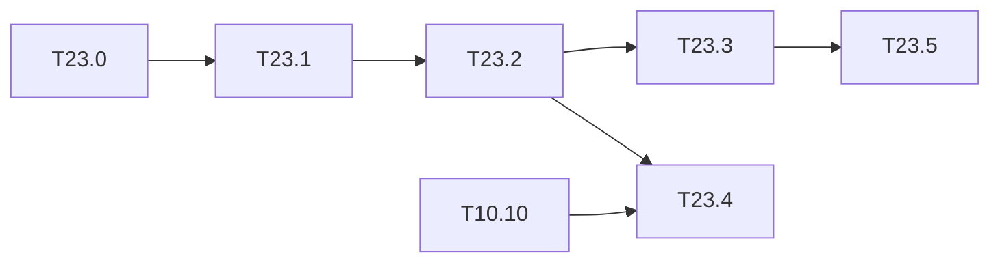

# M23 — Two MACs per DSP (optional)

Goal: raise the number of MACs per cycle of the single engine without more DSPs, by packing
two int8 products that share an operand into one DSP48E2 multiplier, as 2024-zhang does
[2024-zhang#011.0] (§10.2). The contract does not change: **C-sim == golden to the byte**.

Why it is the main lever left:

- the compute bound of the M10 kernel is **31.6 ms** for Tiny-YOLOv2
  ([roofline.md](../../results/roofline.md)); it only goes down if the MACs per cycle go up;
- [rapport.md §3](../../results/rapport.md) explains most of the 2.6× gap to 2024-zhang
  (37.2 ms) by the gap in multipliers (1.8×), and 2024-zhang reaches its multiplier count
  with *packing*;
- [quant_4bits.md](../../results/quant_4bits.md) and [T10.10](M10-ameliorations.md) list
  "2 MACs per DSP in the HLS" as remaining.

The PE of `hls/kernels/conv_pe.cpp` (`mac:` loop) multiplies `w_buf[too][tii]` by
`in_buf[tii]`: one activation is shared by the Tm output channels. The natural packing is
therefore **two weights (filters `too`, `too + 1`) × one shared activation**.

Winograd F(2,3) is the other way to cut multiplications. It conflicts with packing
(transformed weights wider than 8 bits), so it is only studied here (T23.5).

**State**: not started (2026-10-19). Everything up to T23.4 runs without the board or
Vitis; synthesis and board measurements wait for them, like M6.

### [ ] T23.0 — Packing arithmetic
- **Spec**: §9.3, §10.2 · **Depends on**: — · **Size**: M
- **Deliverables**: `python/yolo/quant/pack.py` (`pack2`, `unpack2`) + tests;
  `results/dsp_packing.md` (scheme, bit budget)
- **Acceptance**:
  - `(w_a·2^s + w_b)·x` on a 27 × 18-bit signed multiplier (DSP48E2 A:B port widths)
    gives back `w_a·x` and `w_b·x` exactly, after the sign-borrow correction of the low
    lane (low product negative → +1 on the high lane);
  - exhaustive test over all int8 × int8 × int8 triples;
  - the shift `s` and the **accumulation depth** N (products summed before the low lane
    overflows into the high one) are derived and written down, with the guard bits needed
    for the Tn = 24 addition tree.
- **Notes**: the reference is the integer contract of
  [conventions.md](../conventions.md#integer-arithmetic-python--c--hls-contract): only the
  multiplication changes, the accumulator, requantization and saturation stay. Xilinx
  white paper WP486 ("Deep Learning with INT8 Optimization on Xilinx Devices") describes
  the same scheme (outside the base).

### [ ] T23.1 — Packed MAC in the golden model
- **Spec**: §10.2 · **Depends on**: T23.0 · **Size**: S
- **Deliverables**: `golden::mac2` in `cpp/golden/include/golden/conv.hpp` (C++17, no
  dynamic allocation, shared with HLS); Catch2 test in `cpp/golden/tests/test_conv.cpp`
- **Acceptance**: `mac2` == two separate `int8 × int8` products on all input triples, and
  a packed partial sum of depth N == the two unpacked sums
- **Notes**: same pattern as `golden::mul_split4` (T9.3.4), tested on all pairs.

### [ ] T23.2 — Packed PE in the HLS kernel
- **Spec**: §10.2 · **Depends on**: T23.1 · **Size**: L
- **Deliverables**: `mac:` loop of `hls/kernels/conv_pe.cpp` with an `ACC_PACK` macro (1
  or 2, default 1 until the board is measured); `BIND_OP ... impl=dsp` on the packed
  product; unpacking and sign correction before `out_buf`
- **Acceptance**:
  - `tb_net` == golden to the byte on the 3 dumps, Tiny-YOLOv2 VOC **and** Tiny-YOLOv3
    COCO, and on the synthetic CI export (`make ci`);
  - the C-sim cycles are unchanged at equal Tm × Tn (packing changes the DSP count, not
    the schedule), checked by `make perf-model`;
  - Tm odd or a trimmed lane (`n < Tn`, T10.3) handled.
- **Notes**: the gain is taken in two ways, to compare in T23.3: same tiles on half the
  DSPs, or Tm doubled (64) at a constant DSP count. The second also needs `out_buf` and
  `w_buf` twice as wide (BRAM).

### [ ] T23.3 — Projected gain
- **Spec**: §10.2, §10.4 · **Depends on**: T23.2 · **Size**: S
- **Deliverables**: packed PE in `tools/perf_model.py` and `tools/roofline.py`
  (MACs per DSP = 2); updated `results/roofline.md`; new projection rows in
  `results/benchmarks.csv` and in [rapport.md](../../results/rapport.md)
- **Acceptance**: new compute bound and ms/image for Tiny-YOLOv2 and Tiny-YOLOv3 on the
  KV260, for both options of T23.2, marked "projection"; the gap to 2024-zhang is
  recomputed and explained again
- **Notes**: with Tm doubled, the loads (input, weights) must also follow, or the layer
  becomes memory-bound: check each layer against the roofline, not only the total.

### [ ] T23.4 — Four 4-bit products per DSP
- **Spec**: §9.2, §9.3 · **Depends on**: T23.2, T10.10 · **Size**: M
- **Deliverables**: packing of 4-bit weights (`wbits = 4` of the manifest, T10.10) with
  2 or more products per DSP; golden + C-sim
- **Acceptance**: golden == C-sim to the byte on the mixed-precision export of T10.10
  (`tb_net_mixed`); MACs per DSP and projected ms for the selected configuration
- **Notes**: closes "2 4-bit MACs per DSP in the kernel" in T10.10 and M9.3. The packed
  4-bit weights in memory already exist (`export.pack4`).

### [ ] T23.5 — Winograd F(2,3) study
- **Spec**: §4.1, §10.2 · **Depends on**: T23.3 · **Size**: S
- **Deliverables**: `results/winograd.md`
- **Acceptance**:
  - integer-exact variant: G multiplied by 2 so that the transformed weights stay
    integers, with the exact output scale; width of the transformed weights and of the
    transformed inputs;
  - MACs (2.25× fewer on the 3×3 convs), DSPs, BRAM and bandwidth against T23.3;
  - decision: implement only if it beats packing; packing and Winograd cannot be combined
    with 8-bit DSP inputs.
- **Notes**: 2023-zhai uses Winograd on FPGA [2023-zhai#004.0]. The 1×1 convs and L00
  (folded, T10.4) do not benefit.

## Remaining (waiting for Vitis and the board)

- Synthesis of the packed PE: DSP, LUT and timing at 200 MHz.
- Measurement on the KV260 with the protocol of [protocole.md](../../results/protocole.md).

## Dependencies

