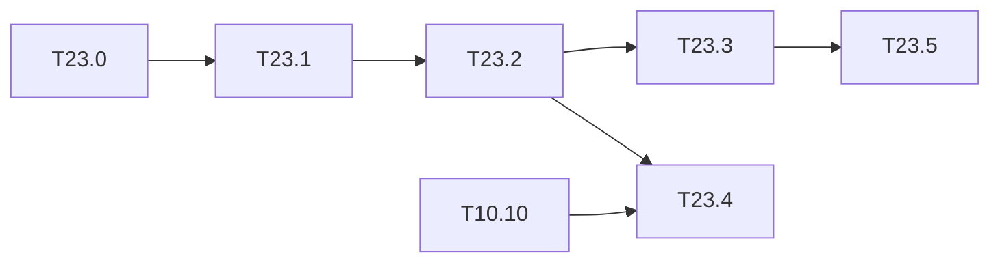

# M23 — Two MACs per DSP (optional)

Goal: raise the number of MACs per cycle of the single engine without more DSPs, by packing
two int8 products that share an operand into one DSP48E2 multiplier, as 2024-zhang does
[2024-zhang#011.0] (§10.2). The contract does not change: **C-sim == golden to the byte**.

Why it is the main lever left:

- the compute bound of the M10 kernel is **31.6 ms** for Tiny-YOLOv2
  ([roofline.md](../../results/roofline.md)); it only goes down if the MACs per cycle go up;
- [rapport.md §3](../../results/rapport.md) explains most of the 2.6× gap to 2024-zhang
  (37.2 ms) by the gap in multipliers (1.8×), and 2024-zhang reaches its multiplier count
  with *packing*;
- [quant_4bits.md](../../results/quant_4bits.md) and [T10.10](M10-ameliorations.md) list
  "2 MACs per DSP in the HLS" as remaining.

The PE of `hls/kernels/conv_pe.cpp` (`mac:` loop) multiplies `w_buf[too][tii]` by
`in_buf[tii]`: one activation is shared by the Tm output channels. The natural packing is
therefore **two weights (filters `too`, `too + 1`) × one shared activation**.

Winograd F(2,3) is the other way to cut multiplications. It conflicts with packing
(transformed weights wider than 8 bits), so it is only studied here (T23.5).

**State**: done in C-sim (2026-10-19), all six tasks; synthesis and board measurements wait
for Vitis and the board, like M6. Results: [dsp_packing.md](../../results/dsp_packing.md),
[winograd.md](../../results/winograd.md).

**Figures** (M13, section H): `dsp_packing` (bit layout and accumulation depth, T13.54),
`pack_options` (time per image of each option, per network, T13.55), `winograd` (T13.56); the
packed PE also shows in `etat_art`, `ressources` and `roofline_couches`
([results/figures.md](../../results/figures.md)).

### [x] T23.0 — Packing arithmetic
- **Spec**: §9.3, §10.2 · **Depends on**: — · **Size**: M
- **Deliverables**: `python/yolo/quant/pack.py` (`pack2`, `unpack2`) + tests;
  `results/dsp_packing.md` (scheme, bit budget)
- **Acceptance**:
  - `(w_a·2^s + w_b)·x` on a 27 × 18-bit signed multiplier (DSP48E2 A:B port widths)
    gives back `w_a·x` and `w_b·x` exactly, after the sign-borrow correction of the low
    lane (low product negative → +1 on the high lane);
  - exhaustive test over all int8 × int8 × int8 triples;
  - the shift `s` and the **accumulation depth** N (products summed before the low lane
    overflows into the high one) are derived and written down, with the guard bits needed
    for the Tn = 24 addition tree.
- **Notes**: the reference is the integer contract of
  [conventions.md](../conventions.md#integer-arithmetic-python--c--hls-contract): only the
  multiplication changes, the accumulator, requantization and saturation stay. Xilinx
  white paper WP486 ("Deep Learning with INT8 Optimization on Xilinx Devices") describes
  the same scheme (outside the base).
- **Done**:
  - `pack.py`: `pack2`, `unpack2` (sign borrow), `depth`, `max_shift`, `lanes` (k products
    per DSP, generic), `groups`; `python -m yolo.quant.pack` prints the budget table.
  - s = 18 (largest shift for all int8 pairs in A); N = 7 for any int8, **N = 8** under the
    contract (±127), so the Tn = 24 tree is cut into 3 groups of 8, each unpacked before
    the int32 sum. s = 19 / N = 16 and DSP48E1 (s = 17, N = 4) are documented.
  - `test_pack.py`: exhaustive over the 2^24 triples, tight depth (N + 1 overflows),
    random partial sums.

### [x] T23.1 — Packed MAC in the golden model
- **Spec**: §10.2 · **Depends on**: T23.0 · **Size**: S
- **Deliverables**: `golden::mac2` in `cpp/golden/include/golden/conv.hpp` (C++17, no
  dynamic allocation, shared with HLS); Catch2 test in `cpp/golden/tests/test_conv.cpp`
- **Acceptance**: `mac2` == two separate `int8 × int8` products on all input triples, and
  a packed partial sum of depth N == the two unpacked sums
- **Notes**: same pattern as `golden::mul_split4` (T9.3.4), tested on all pairs.
- **Done**: `PACK_S`, `PACK_N`, `pack2`, `mac2`, `unpack2` next to `mul_split4`; two Catch2
  cases (all 2^24 triples; depth-N sums on 100,000 random vectors and the ±127 extremes).

### [x] T23.2 — Packed PE in the HLS kernel
- **Spec**: §10.2 · **Depends on**: T23.1 · **Size**: L
- **Deliverables**: `mac:` loop of `hls/kernels/conv_pe.cpp` with an `ACC_PACK` macro (1
  or 2, default 1 until the board is measured); `BIND_OP ... impl=dsp` on the packed
  product; unpacking and sign correction before `out_buf`
- **Acceptance**:
  - `tb_net` == golden to the byte on the 3 dumps, Tiny-YOLOv2 VOC **and** Tiny-YOLOv3
    COCO, and on the synthetic CI export (`make ci`);
  - the C-sim cycles are unchanged at equal Tm × Tn (packing changes the DSP count, not
    the schedule), checked by `make perf-model`;
  - Tm odd or a trimmed lane (`n < Tn`, T10.3) handled.
- **Notes**: the gain is taken in two ways, to compare in T23.3: same tiles on half the
  DSPs, or Tm doubled (64) at a constant DSP count. The second also needs `out_buf` and
  `w_buf` twice as wide (BRAM).
- **Done**:
  - `ACC_PACK` in `accel_config.hpp` (excludes `ACC_WMODE_POW2`); `accel::mac2` (ap_int
    27 × 18 → 48 bits); `mac:` loop over filter pairs, unpacking every PACK_N lanes (every
    Tn lanes for a 4-bit layer); unpaired last filter if Tm is odd (Tm is even today,
    `TM % (2·WORD) == 0`; the odd valid count of the heads, 125 and 255, is exercised).
  - Targets `accel_pack`, `tb_net_pack`, `tb_conv_pack`, `tb_pack` (ap_int product ==
    golden on 2^24 triples), `tb_net_mixed_pack`; `make hls-synth-pack`
    (`synth_pack.tcl`).
  - Golden == C-sim to the byte: Tiny-YOLOv2 VOC and Tiny-YOLOv3 COCO, 3 dumps (ap_int and
    native integers), synthetic CI export, Tm 64, Tn 32, mixed export.
  - Cycles: `tb_conv_pack` == `perf_model --check` (0 differences), also at Tm 64 and
    Tn 32.
  - `tb_net_pack` uses native integers (`ACC_NO_APINT`): the packed ap_int PE is about 7×
    slower in C-sim (523 s against 26 s).

### [x] T23.3 — Projected gain
- **Spec**: §10.2, §10.4 · **Depends on**: T23.2 · **Size**: S
- **Deliverables**: packed PE in `tools/perf_model.py` and `tools/roofline.py`
  (MACs per DSP = 2); updated `results/roofline.md`; new projection rows in
  `results/benchmarks.csv` and in [rapport.md](../../results/rapport.md)
- **Acceptance**: new compute bound and ms/image for Tiny-YOLOv2 and Tiny-YOLOv3 on the
  KV260, for both options of T23.2, marked "projection"; the gap to 2024-zhang is
  recomputed and explained again
- **Notes**: with Tm doubled, the loads (input, weights) must also follow, or the layer
  becomes memory-bound: check each layer against the roofline, not only the total.
- **Done**:
  - `perf_model`: `pe_dsp`, `kernel_dsp`, `layer_bound` (compute, load, store, DDR per
    layer), `PACK_OPTIONS`, table "Two MACs per DSP".
  - `roofline`: `packed_macs_per_dsp` and `ff` per board; `w_buf` flip-flops as a new
    constraint; section "Two MACs per DSP" with the memory-bound convs.
  - `bench_report`: rows "projection C-sim, 2 MAC/DSP" for Tm 64 and Tn 32 (the same-tiles
    option keeps the times of the M10 row, in `mesures.md`); `rapport.md` §2 and §3.
  - **Results** (Tiny-YOLOv2 / v3, KV260):
    - same tiles: 37.2 / 36.1 ms on 384 PE DSPs;
    - Tm 64: **24.7 / 23.8 ms** on 768. L10, L12, L13 and L14 become limited by the weight
      port; `w_buf` needs 221 k FF (94 % of the board);
    - Tn 32 (feasible roofline point, 147 k FF): 30.0 / 30.2 ms.
  - Gap to 2024-zhang: 2.6× → **1.7×** (Tm 64). The multiplier gap is closed (1,536
    against about 1,374); what remains is the time outside the MAC loop.

### [x] T23.4 — Four 4-bit products per DSP
- **Spec**: §9.2, §9.3 · **Depends on**: T23.2, T10.10 · **Size**: M
- **Deliverables**: packing of 4-bit weights (`wbits = 4` of the manifest, T10.10) with
  2 or more products per DSP; golden + C-sim
- **Acceptance**: golden == C-sim to the byte on the mixed-precision export of T10.10
  (`tb_net_mixed`); MACs per DSP and projected ms for the selected configuration
- **Notes**: closes "2 4-bit MACs per DSP in the kernel" in T10.10 and M9.3. The packed
  4-bit weights in memory already exist (`export.pack4`).
- **Done**:
  - `pack.lanes`: with 4-bit weights and int8 activations, 2 per DSP at s = 18 give N =
    129 ≥ Tn, so the whole tree is one packed sum (1 unpack instead of 3). 3 per DSP give
    N = 1 (one unpack per product). 4 per DSP are impossible with 8-bit activations
    (s = 7). **Selected: 2 per DSP**, ungrouped on the `wbits = 4` layers.
  - `tb_net_mixed_pack`: golden == C-sim to the byte on the T10.10 export.
  - Projection on the mixed manifest: 37.2 ms at the same tiles; **23.2 ms at Tm 64**
    (4-bit weights relieve the weight port of L10, L12 and L13).
- **Remaining**: four products per DSP need 4-bit activations as well (W4A4) and a PE
  sized for them; not reachable on the shared int8 PE.

### [x] T23.5 — Winograd F(2,3) study
- **Spec**: §4.1, §10.2 · **Depends on**: T23.3 · **Size**: S
- **Deliverables**: `results/winograd.md`
- **Acceptance**:
  - integer-exact variant: G multiplied by 2 so that the transformed weights stay
    integers, with the exact output scale; width of the transformed weights and of the
    transformed inputs;
  - MACs (2.25× fewer on the 3×3 convs), DSPs, BRAM and bandwidth against T23.3;
  - decision: implement only if it beats packing; packing and Winograd cannot be combined
    with 8-bit DSP inputs.
- **Notes**: 2023-zhai uses Winograd on FPGA [2023-zhai#004.0]. The 1×1 convs and L00
  (folded, T10.4) do not benefit.
- **Done**: `tools/winograd.py` (`make winograd`) → `results/winograd.md`, test
  `test_winograd.py`.
  - G′ = 2G, the output divided by 4 exactly. Transformed weights on 12 bits (exports:
    max 1018 / 1033), transformed inputs on 10 bits, products on 21 bits: one DSP per
    product, no packing.
  - Compute bound at 768 DSPs: 17.1 against 18.1 ms for packing (Tiny-YOLOv2). With the
    loads (same first-order estimator): 42.8 ms with weights transformed offline (×2.67
    bytes), 22.8 ms transformed on the fly, against 19.8 ms for packing.
  - **Decision: not implemented.**

## Remaining (waiting for Vitis and the board)

Synthesis of the packed PE, choice between Tm 64 and Tn 32 (`ACC_PACK` stays at 1 until
then) and measurement on the KV260: [deferred/M23](deferred/M23-dsp-packing.md).

## Dependencies

