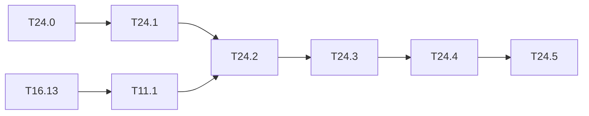

# M24 — YOLOv4-tiny (optional)

Goal: a third network on the whole chain float → integer → golden → C-sim, with official
Darknet weights. YOLOv4-tiny keeps the leaky activation and the conv / maxpool / route /
upsample building blocks of the engine, and reaches ≈ 40 AP50 on COCO against ≈ 33 for
Tiny-YOLOv3 (values published by Darknet, outside the base, to measure in T24.2).

What it adds to the code:

- `[route]` with `groups` / `group_id` (CSP blocks): the route keeps one half of the
  channels of its source. `python/yolo/models/cfg.py` and `graph.py` do not handle it.
- `[yolo]` with `scale_x_y = 1.05`: decoding `σ(t)·α − (α − 1)/2`.
- A maxpool after a concat route, never after a conv: it cannot be fused as it is (fused
  pools are carried by a conv, `LayerDesc.pool_k`).

The engine only computes convs. A grouped route is a channel offset in a CHW buffer, so it
fits the input segments of `LayerDesc` (`seg*_off`, `seg*_c`) without a kernel change.

Related backlog: the COCO evaluation is [T11.1](M11-jeux-de-donnees.md) and needs the COCO
data on the PC ([T16.13](M16-presentation-jeux.md)).

**State**: not started (2026-10-19).

### [ ] T24.0 — Weights, cfg and layer table
- **Spec**: §3 · **Depends on**: — · **Size**: S
- **Deliverables**: `yolov4-tiny.cfg` in `python/yolo/models/cfg/`; `yolov4-tiny.weights`
  in `make get-weights`; `tiny-yolov4-coco` in `CFG_FILES` and `PRETRAINED`
  (`python/yolo/models/tiny_yolo.py`) and in `specs.NETWORKS`
- **Acceptance**: layer table (shapes, MACs) in `specs` checked against the Darknet output
  for this cfg; weight file read to the last byte (`test_darknet_weights.py`)

### [ ] T24.1 — Grouped route in the float model
- **Spec**: §4.5 · **Depends on**: T24.0 · **Size**: M
- **Deliverables**: `groups` / `group_id` in `cfg.parse_cfg` (route section) and in
  `graph.Network` (forward: channel slice; backward: scatter into the source gradient);
  tests in `test_tiny_yolo.py`
- **Acceptance**: gradcheck of a grouped route; the full network built from the cfg has the
  shapes of T24.0
- **Notes**: a grouped route has a single source. A route with several sources and groups
  does not occur in yolov4-tiny.cfg: reject it with a clear error.

### [ ] T24.2 — Decoding and float mAP
- **Spec**: §8.1, §8.3 · **Depends on**: T24.1, T11.1 · **Size**: M
- **Deliverables**: `scale_x_y` in `python/yolo/infer/decode.py` (and in the loss, for a
  later fine-tuning); float mAP in `results/map_coco.md` (T11.1 format)
- **Acceptance**: AP50 and AP@[.5:.95] on COCO val2017 close to the published values (gap
  explained as in [map_float.md](../../results/map_float.md)); the same evaluation for
  `tiny-yolov3-coco` in the same table
- **Notes**: letterbox or stretch: use the preprocessing of the Darknet version that
  trained these weights (AlexeyAB, letterbox off by default for `yolov4-tiny`), to check.

### [ ] T24.3 — Integer model and export
- **Spec**: §9.1-§9.3 · **Depends on**: T24.2 · **Size**: M
- **Deliverables**: calibration (`yolo.quant.calibrate`), `IntNetwork` with grouped routes,
  manifest with the new routes; `results/calibration_tiny-yolov4-coco.md`;
  `manifest.schema.json` updated if a field is needed
- **Acceptance**:
  - the sources of each concat share one scale (as for Tiny-YOLOv3);
  - a grouped route is exported as a segment `{offset + group_id·(C/groups)·H·W,
    c = C/groups}`, without a copy;
  - the maxpool after a concat is fused into **each** source conv (max over a 2×2 window
    commutes with a channel concat), and the concat is written already pooled;
  - the allocation test of `yolo.io.export.layout` passes (no write overlaps a tensor still
    to be read).
- **Notes**: the concat sources must be end to end in one buffer (`layout: "contiguous"`).
  The CSP block reads its source map twice (full and half): keep it alive in the
  allocation.

### [ ] T24.4 — Golden model and C-sim
- **Spec**: §10.2, §10.3 · **Depends on**: T24.3 · **Size**: M
- **Deliverables**: grouped segments in the C++ golden model (`golden::InView`) and in the
  driver (`sw/driver/program.hpp`); export of `model/tiny-yolov4-coco/`
- **Acceptance**: `make golden-check` and `tb_net --model model/tiny-yolov4-coco` == Python
  dumps to the byte on 3 images; C-sim cycles == `perf_model`
- **Notes**: `MAX_SEGMENTS = 2` (`hls/kernels/layer_desc.hpp`) is enough: yolov4-tiny has at
  most two sources per concat.

### [ ] T24.5 — Three-stage mAP and integration
- **Spec**: §10.4 · **Depends on**: T24.4 · **Size**: M
- **Deliverables**: float / integer / C-sim mAP (T8.2 method,
  [map_stades.md](../../results/map_stades.md)); `perf_model` projection; a column in
  [rapport.md](../../results/rapport.md) and rows in `results/benchmarks.csv`;
  `tiny-yolov4-coco` and `int:tiny-yolov4-coco` in `tools/webcam.py`, `yolo:tiny-yolov4-coco`
  in `tools/autolabel_models.py`
- **Acceptance**: integer vs float gap ≤ 1 point (otherwise QAT); integer == C-sim image by
  image; projection marked as such
- **Notes**: the C-sim pass over the 5,000 COCO images costs time (≈ 40 min for 4,952 VOC
  images with v2); a subset is acceptable if stated.

## Dependencies

