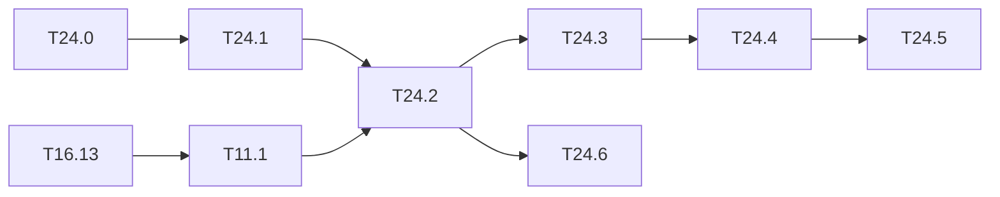

# M24 — YOLOv4-tiny (optional)

Goal: a third network on the whole chain float → integer → golden → C-sim, with official
Darknet weights. YOLOv4-tiny keeps the leaky activation and the conv / maxpool / route /
upsample building blocks of the engine, and reaches ≈ 40 AP50 on COCO against ≈ 33 for
Tiny-YOLOv3 (values published by Darknet, outside the base, to measure in T24.2).

What it adds to the code:

- `[route]` with `groups` / `group_id` (CSP blocks): the route keeps one half of the
  channels of its source. `python/yolo/models/cfg.py` and `graph.py` do not handle it.
- `[yolo]` with `scale_x_y = 1.05`: decoding `σ(t)·α − (α − 1)/2`.
- A maxpool after a concat route, never after a conv: it cannot be fused as it is (fused
  pools are carried by a conv, `LayerDesc.pool_k`).

The engine only computes convs. A grouped route is a channel offset in a CHW buffer, so it
fits the input segments of `LayerDesc` (`seg*_off`, `seg*_c`) without a kernel change.

Related backlog: the COCO evaluation is [T11.1](M11-jeux-de-donnees.md) and needs the COCO
data on the PC ([T16.13](M16-presentation-jeux.md)).

- Two 3×3 **stride-2** convs (layers 0 and 1), which the engine did not compute (stride 1
  only). Found when the task started; lowered to a stride-1 conv followed by a decimation in
  the output stage (fused "maxpool" k = 1, s = 2), no kernel change (T24.3).

**State**: 5 tasks done out of 7 (2026-10-19). Open: the full C-sim pass of T24.5 and the
fine-tuning of T24.6, both to run from their notebooks; the integer model loses 1.3 AP50
(QAT to do); `scale_x_y` is not in the hardware post-processing (`yolo_post`), out of scope.

**Summary**: float AP50 41.4 on val2017 (40.2 published on test-dev), integer 40.1; golden
and C-sim equal to the Python dumps to the byte, C-sim detections == integer on a 10-image
smoke run; projection 51.8 ms, 19.3 img/s, 133.3 GOPS at 200 MHz
([map_coco.md](../../results/map_coco.md), [rapport.md](../../results/rapport.md)).

**Figures** (M13, section H): YOLOv4-tiny is the third network of every per-network figure
(profile, graph, memory, YOLO output, calibration, layer error, datasheet, receptive field,
tensor flow); `map_coco` (T13.57) plots the COCO AP and the three stages; `boites_decodage`
plots `scale_x_y` ([results/figures.md](../../results/figures.md)).

**Notebooks**: [coco/tiny-yolov4-coco_infer](../../notebooks/coco/tiny-yolov4-coco_infer.ipynb)
(float; `INT8 = True`: calibration and integer AP; `HW = True`: export, golden, C-sim and
three-stage AP on `SUBSET` images), the same network out of domain on the other datasets,
and [voc/tiny-yolov4-voc_train](../../notebooks/voc/tiny-yolov4-voc_train.ipynb) /
[voc/tiny-yolov4-voc_infer](../../notebooks/voc/tiny-yolov4-voc_infer.ipynb) (T24.6).

### [x] T24.0 — Weights, cfg and layer table
- **Spec**: §3 · **Depends on**: — · **Size**: S
- **Deliverables**: `yolov4-tiny.cfg` in `python/yolo/models/cfg/`; `yolov4-tiny.weights`
  in `make get-weights`; `tiny-yolov4-coco` in `CFG_FILES` and `PRETRAINED`
  (`python/yolo/models/tiny_yolo.py`) and in `specs.NETWORKS`
- **Acceptance**: layer table (shapes, MACs) in `specs` checked against the Darknet output
  for this cfg; weight file read to the last byte (`test_darknet_weights.py`)
- **Done**: 38 layers, 3.454 GMAC (6.908 GFLOPs of convs, Darknet prints 6.910 with the three
  maxpools); per-layer BFLOPs of Darknet in `test_v4_layer_table`. Weights from the
  `darknet_yolo_v4_pre` release of AlexeyAB/darknet (24.25 MB).

### [x] T24.1 — Grouped route in the float model
- **Spec**: §4.5 · **Depends on**: T24.0 · **Size**: M
- **Deliverables**: `groups` / `group_id` in `cfg.parse_cfg` (route section) and in
  `graph.Network` (forward: channel slice; backward: scatter into the source gradient);
  tests in `test_tiny_yolo.py`
- **Acceptance**: gradcheck of a grouped route; the full network built from the cfg has the
  shapes of T24.0
- **Notes**: a grouped route has a single source. A route with several sources and groups
  does not occur in yolov4-tiny.cfg: reject it with a clear error.
- **Done**: `route_forward(xs, groups, group_id)`; gradchecks of the layer and of a reduced
  CSP block in the graph (`test_tiny_yolo.py`).

### [x] T24.2 — Decoding and float mAP
- **Spec**: §8.1, §8.3 · **Depends on**: T24.1, T11.1 · **Size**: M
- **Deliverables**: `scale_x_y` in `python/yolo/infer/decode.py` (and in the loss, for a
  later fine-tuning); float mAP in `results/map_coco.md` (T11.1 format)
- **Acceptance**: AP50 and AP@[.5:.95] on COCO val2017 close to the published values (gap
  explained as in [map_float.md](../../results/map_float.md)); the same evaluation for
  `tiny-yolov3-coco` in the same table
- **Notes**: letterbox or stretch: use the preprocessing of the Darknet version that
  trained these weights (AlexeyAB, letterbox off by default for `yolov4-tiny`), to check.
- **Done**: `yolov4-tiny.cfg` has no `letter_box=1`, so `stretch` is the reference. Float
  AP 21.7, AP50 41.4 (letterbox 39.9); Tiny-YOLOv3 AP50 37.2 against 33.1 published, probably
  optimistic (2014 training split overlapping val2017). Loss: gradient ×α (gradcheck case
  in `test_loss.py`). `hw_postproc` and `make_hw_head` reject `scale_x_y` ≠ 1.

### [x] T24.3 — Integer model and export
- **Spec**: §9.1-§9.3 · **Depends on**: T24.2 · **Size**: M
- **Deliverables**: calibration (`yolo.quant.calibrate`), `IntNetwork` with grouped routes,
  manifest with the new routes; `results/calibration_tiny-yolov4-coco.md`;
  `manifest.schema.json` updated if a field is needed
- **Acceptance**:
  - the sources of each concat share one scale (as for Tiny-YOLOv3);
  - a grouped route is exported as a segment `{offset + group_id·(C/groups)·H·W,
    c = C/groups}`, without a copy;
  - the maxpool after a concat is fused into **each** source conv (max over a 2×2 window
    commutes with a channel concat), and the concat is written already pooled;
  - the allocation test of `yolo.io.export.layout` passes (no write overlaps a tensor still
    to be read).
- **Notes**: the concat sources must be end to end in one buffer (`layout: "contiguous"`).
  The CSP block reads its source map twice (full and half): keep it alive in the
  allocation.
- **Done**: the conv read by a grouped route writes its unpooled map (`prepool_out`, buffer
  `S`); conv 23 writes pooled into route 24 and unpooled into route 34. The manifest keeps
  `s: 2` (schema: conv `s` ∈ {1, 2}, route `layout: grouped`, yolo `scale_x_y`); a stride-2
  conv cannot carry a fused maxpool. New allocation test `check_allocation`
  (`test_export.py`), on v2, v3 and v4, with a negative case; v2/v3 manifests unchanged.
  Calibration on 500 COCO train2017 images; seven concat groups share their scale.

### [x] T24.4 — Golden model and C-sim
- **Spec**: §10.2, §10.3 · **Depends on**: T24.3 · **Size**: M
- **Deliverables**: grouped segments in the C++ golden model (`golden::InView`) and in the
  driver (`sw/driver/program.hpp`); export of `model/tiny-yolov4-coco/`
- **Acceptance**: `make golden-check` and `tb_net --model model/tiny-yolov4-coco` == Python
  dumps to the byte on 3 images; C-sim cycles == `perf_model`
- **Notes**: `MAX_SEGMENTS = 2` (`hls/kernels/layer_desc.hpp`) is enough: yolov4-tiny has at
  most two sources per concat.
- **Done**: no kernel change: a stride-2 conv is passed to the kernel as `pool_k = 1,
  pool_s = 2`, which the output stage already handles. `golden-check`, `tb_net` (33 layer
  outputs per image) and `tb_conv` (21 convs) equal to the dumps; 10.36 Mcycles in C-sim ==
  `perf_model`. The stride-2 lowering computes 4.164 GMAC instead of 3.454 (+20.6 %, all of
  it on L00-L01).

### [ ] T24.5 — Three-stage mAP and integration
- **Spec**: §10.4 · **Depends on**: T24.4 · **Size**: M
- **Deliverables**: float / integer / C-sim mAP (T8.2 method,
  [map_stades.md](../../results/map_stades.md)); `perf_model` projection; a column in
  [rapport.md](../../results/rapport.md) and rows in `results/benchmarks.csv`;
  `tiny-yolov4-coco` and `int:tiny-yolov4-coco` in `tools/webcam.py`, `yolo:tiny-yolov4-coco`
  in `tools/autolabel_models.py`
- **Acceptance**: integer vs float gap ≤ 1 point (otherwise QAT); integer == C-sim image by
  image; projection marked as such
- **Notes**: the C-sim pass over the 5,000 COCO images costs time (≈ 40 min for 4,952 VOC
  images with v2); a subset is acceptable if stated.
- **Done**: float and integer on all 5,000 images: float AP50 41.4, integer 40.1.
  **Integer vs float −1.3 AP50: over the 1-point target, QAT left to do** (the heads are not
  the cause: fake-quant of L29 or L36 alone costs nothing). The `HW` stage of the inference
  notebooks (export, golden, C-sim, `map_stades.py --subset`) found that `yolo_bench`
  decoded the heads without `scale_x_y` (`sw/postproc/heads.cpp`, fixed): C-sim == integer
  on 10 / 10 images after the fix.
- **Remaining**: the C-sim pass on the 5,000 images from
  `notebooks/coco/tiny-yolov4-coco_infer.ipynb` (`SUBSET = 0`, `INT8 = True`, `HW = True`;
  ≈ 1.5 h on 18 cores), then the C-sim row of `map_coco.md` and `rapport.md`.
  Projection 51.8 ms, 19.3 img/s, 133.3 GOPS on network MACs, 52.3 % MAC efficiency. GOPS
  are counted on the network MACs (`perf_model.useful_macs`), the efficiency on the
  computed MACs.

### [ ] T24.6 — Fine-tuning on VOC (notebook)
- **Depends on**: T24.1, T24.2 · **Size**: M
- **Deliverables**: `notebooks/voc/tiny-yolov4-voc_train.ipynb` (k-means anchors of VOC,
  cfg from `yolov4-tiny.cfg` by `tools/make_cfg.py`, fine-tuning from the COCO weights,
  heads re-initialised) and `notebooks/voc/tiny-yolov4-voc_infer.ipynb` (float, `INT8`,
  `HW`); registry `tools/notebooks/matrice.py` (`Notebook.arch`)
- **Acceptance**: VOC2007 test mAP of the fine-tuned network against Tiny-YOLOv3 VOC
  ([map_float.md](../../results/map_float.md)), integer and C-sim stages from the inference
  notebook
- **Notes**: the second head keeps `mask = 1,2,3` of `yolov4-tiny.cfg`, so anchor 0 is unused
  in training as in Darknet. A 2-iteration run of the chain (anchors, cfg, `train.py`) passes.

## Dependencies

