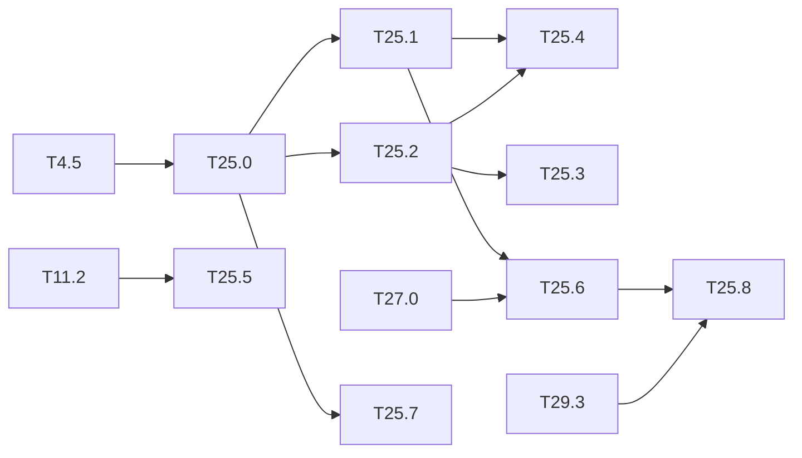

# M25 — Dependability (optional)

Goal: measure and improve how the embedded detector behaves when the hardware or the input
is not what it was designed for. Nothing in the repo covers it yet. Three directions:

- **Fault injection**: bit flips in the weights, the activation buffers and the int32
  accumulators of the integer model, and their effect on the mAP, layer by layer.
- **ABFT** (algorithm-based fault tolerance): each conv is checked by a checksum. The sum of
  the output channels equals the conv of the input by the summed filters. Before
  requantization everything is int32, so the equality is **exact**: no tolerance, no false
  alarm.
- **Out-of-distribution monitor**: flag inputs far from the training domain (night, thermal)
  from the backbone features.

The bit-exact integer model (`IntNetwork`, M4) is the fault-free reference: any difference is
caused by the injected fault. This is outside the base of the spec: the method is
engineering, to be cited from the dependability literature when written up.

**State** (2026-10-20):

- **Done**:
  - T25.0 injector, T25.2 ABFT in Python and the golden, T25.5 OOD monitor (commit ceefca3).
  - T25.3 ABFT lane in the HLS kernel and T25.7 faults in the HLS buffers, in C-sim
    ([results/faults.md](../../results/faults.md)).
- **Tooling ready, campaign to run**: T25.1 (`tools/m25.sh`).
- **Remaining**: T25.4, T25.6 and T25.8; the synthesis costs are deferred.

### [x] T25.0 — Fault model and injector
- **Spec**: §9.3 · **Depends on**: T4.5 · **Runs on**: PC · **Size**: M
- **Deliverables**: `python/yolo/quant/faults.py` (NumPy only) + `python/tests/test_faults.py`
- **Acceptance**:
  - fault sites: int8 weights, int32 biases, int8 activations of a layer output, int32
    accumulator before requantization;
  - fault types: single bit flip at a given bit, random flips at a rate (BER), stuck-at;
  - seeded, reproducible; with no fault, the output equals `IntNetwork` exactly;
  - a hook in `IntNetwork` that does not slow the fault-free path.

### [ ] T25.1 — Sensitivity campaign
- **Spec**: §8.3 · **Depends on**: T25.0 · **Runs on**: PC · **Size**: M
- **Deliverables**: `tools/fault_campaign.py`; `results/faults.md`; a figure in
  `tools/figures/resultats.py` (M13 style)
- **Acceptance**: mAP (500 VOC2007 test images, tier M) against the BER, per site and per
  layer; effect of the bit position (sign and high bits against low bits); ranking of the
  layers by sensitivity; several seeds, spread given
- **Notes**: 1,000s of evaluations: use the PC profiles of [M12](M12-profils-pc.md) to size
  the campaign before running it.

### [x] T25.2 — ABFT checksum in the reference models
- **Spec**: §4.1, §9.3 · **Depends on**: T25.0 · **Runs on**: PC (golden C++) · **Size**: M
- **Deliverables**: checksum filter `Σ_f w_f` and bias `Σ_f b_f` per conv (computed at
  export, int32); check in `IntNetwork` and in the C++ golden model; manifest field (schema
  updated)
- **Acceptance**:
  - fault-free: the check passes on every conv of the 3 dumps (Tiny-YOLOv2, Tiny-YOLOv3);
  - every accumulator fault of T25.0 is detected (100 %); weight and activation faults:
    detection rate measured;
  - the summed weights do not fit int8: their width and the cost of the extra MAC lane
    are given.
- **Notes**: the check is done on the int32 accumulator, before requantization, leaky and
  saturation (which are not linear). A fused maxpool is after the check.
- **Done** (ceefca3): `python/yolo/quant/abft.py`, golden `conv_layer`, `checksum.bin`
  and the manifest fields `cs_offset` / `cs_b`.

### [x] T25.3 — ABFT in the HLS kernel
- **Spec**: §10.2 · **Depends on**: T25.2 · **Size**: L
  · **Runs on**: PC (C-sim gcc); PC + Vitis for the DSP and cycles after synthesis
- **Deliverables**: one extra output lane per tile (filter Tm + 1 = checksum), comparison
  with the sum of the Tm lanes, error flag and counter in a status register
  (`sw/driver/regmap.hpp`, `LayerDesc` unchanged if possible); `perf_model` cost
- **Acceptance**: C-sim == golden to the byte (outputs unchanged); a fault forced in the
  testbench raises the flag; extra DSPs and cycles reported
- **Notes**: conflicts with T23 packing only on the lane count (Tm + 1 is odd): check the
  combination.
- **Done (C-sim)**:
  - **Lane and check**: the checksum lane is computed in `compute` (same II = 1 loop) and
    compared in the requantization pass of `store_tile`, modulo 2³².
  - **Parameters**: `prm[m0_off − 2..1]` = Σ_f b_f and the index of Σ_f w_f, written by
    `driver::build`; `LayerDesc` is unchanged.
  - **Status**: output register `abft_err` (`regmap::ABFT_ERR`, to confirm with
    `check-regmap`), read by `Accelerator::abft_errors()` and emulated by the `sim` backend.
  - **Equality**: C-sim == golden to the byte on every test, with 0 errors without fault.
  - **Detection**: `tb_fault` checks that an accumulator flip is detected and that a lane
    flip is flagged with the outputs unchanged.
  - **Cost**: `perf_model --abft` gives +24 DSP (+3 %) and 0 cycles.
  - **Packing**: the lane is outside the Tm filters, so the Tm count stays even.
- **Deferred** (Vitis): [deferred/M25](deferred/M25-dependability.md) — T25.3, DSP and cycles after synthesis.

### [ ] T25.4 — Selective protection
- **Spec**: §10.4 · **Depends on**: T25.1, T25.2 · **Size**: S
  · **Runs on**: PC (perf_model estimates); PC + Vitis for the exact BRAM and DSP
- **Deliverables**: section in `results/faults.md`
- **Acceptance**: for the most sensitive layers of T25.1, mAP under faults and cost (DSP,
  BRAM, cycles) of: ABFT, ECC on the weights in BRAM, duplication of the sensitive layers;
  recommendation
- **Deferred** (Vitis): [deferred/M25](deferred/M25-dependability.md) — T25.4, exact BRAM and DSP.

### [x] T25.5 — Out-of-distribution monitor
- **Spec**: §4, §7 · **Depends on**: T11.2 · **Runs on**: PC · **Size**: M
- **Deliverables**: small autoencoder (NumPy, layers of `python/yolo/layers`) on the
  backbone features of Tiny-YOLOv2 (output of L12 or L13), trained on VOC; score =
  reconstruction error; `results/ood_monitor.md`
- **Acceptance**: AUROC of VOC test against ExDark and FLIR (domain shifts of
  [T11.2](M11-jeux-de-donnees.md), M18 for the thermal drone sets); correlation between
  the score and the mAP drop per image group; cost of the monitor in MACs against the
  detector
- **Notes**: a simpler baseline first (mean and covariance of pooled features, Mahalanobis
  distance) to know what the autoencoder adds.

The three tasks below come from the thesis state of the art (ARCYS, 2026-10): fault studies
use the error criterion of a classifier (a changed class), always on classifiers, never on a
YOLO, and the BRAM are excluded (Libano 2019). Rech 2024 defines a critical detection error
by an IoU threshold on the boxes and reports that temporal coherence between frames detects
≈ 70 % of the critical errors.

### [ ] T25.6 — Critical error for a person detector
- **Spec**: §8.3 · **Depends on**: T25.1, T27.0 · **Runs on**: PC · **Size**: S
- **Deliverables**: `tools/fault_campaign.py --criterion person`; section in
  `results/faults.md`
- **Acceptance**: a fault is **critical** when it makes a person present in the fault-free
  output disappear (no box at IoU ≥ 0.5) and **tolerable** otherwise (extra or moved box
  counted apart); the T25.1 ranking of layers and bits redone with this criterion on
  CrowdHuman (tier M), and compared with the mAP ranking
- **Notes**: the person-level criterion is the input of the budget of
  [T31.3](M31-assurance-case.md).

### [x] T25.7 — Faults in the HLS buffers
- **Spec**: §10.2 · **Depends on**: T25.0, T6.3 · **Runs on**: PC (C-sim gcc) · **Size**: M
- **Deliverables**: fault hook in the C-sim testbench (`hls/tb/`) on the weight, input and
  output tiles of the on-chip buffers (BRAM) and the line buffer of the fused maxpool;
  section in `results/faults.md`
- **Acceptance**: a flip in an HLS buffer gives the same output as the corresponding Python
  site of T25.0 (the mapping of buffer addresses to tensor indices is tested); the share of
  faults masked by tiling reuse (a tile reloaded from DDR) is given
- **Notes**: configuration-memory upsets are out of reach in C-sim.
- **Done**:
  - **Hook and testbench**: `hls/kernels/fault_hook.hpp` (in, w, out, q, cs buffers) and
    `hls/tb/tb_fault`.
  - **Mapping**: `faults.hls_buffer_reference` == C-sim on 195 flips
    (`test_hls_buffer_faults_match_python_reference`).
  - **Campaign**: 2,200 flips on v2 and v3, reported by `tools/hls_faults.py`.
    - Accumulator and weight flips that change the output are always detected.
    - Requantized-tile flips are never detected (after the check).
    - Input-tile flips are missed only on the single-`to` layers L0 and L2.
  - **Masking**: tile reloading masks 99 % (weights) and 93 % (inputs) of the damage of
    the same fault persistent in DDR.
  - **Line buffer**: the kernel has none; the fused pool reads the `q` tile, which is
    covered.
- **Deferred** (Vivado, board): [deferred/M25](deferred/M25-dependability.md) — T25.7, configuration-memory upsets (SEM IP).

### [ ] T25.8 — Fault detection by temporal coherence
- **Spec**: §8 · **Depends on**: T25.6, T29.3 · **Runs on**: PC · **Size**: S
- **Deliverables**: section in `results/faults.md`
- **Acceptance**: on a video, the critical faults of T25.6 injected in one frame: share
  detected by the temporal vote of [T29.3](M29-runtime-monitors.md), by the ABFT of T25.2,
  and by both; false alarms of the temporal check without faults

## Dependencies

