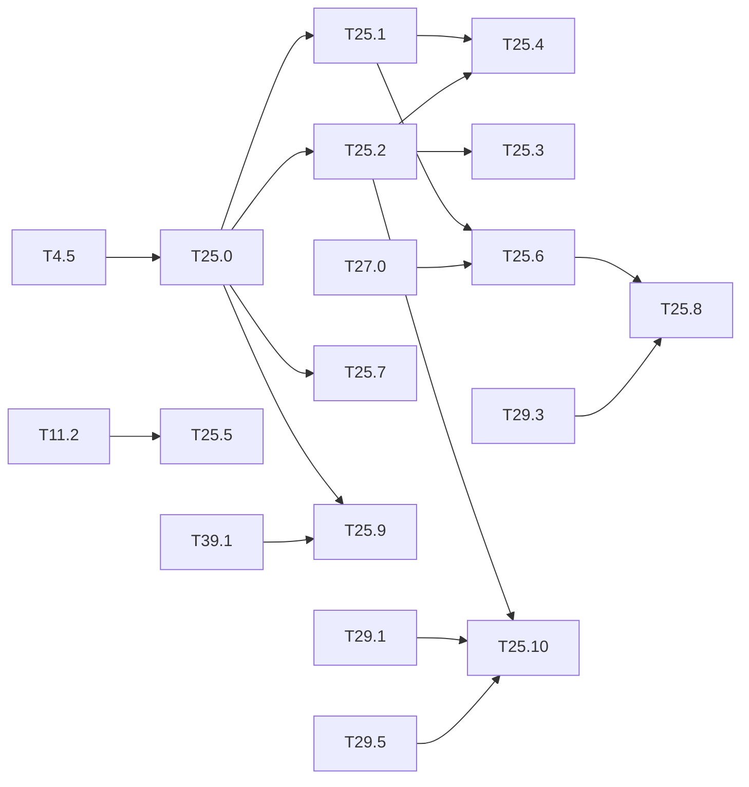

# M25 — Dependability (optional)

Goal: measure and improve how the embedded detector behaves when the hardware or the input
is not what it was designed for. Nothing in the repo covers it yet. Three directions:

- **Fault injection**: bit flips in the weights, the activation buffers and the int32
  accumulators of the integer model, and their effect on the mAP, layer by layer.
- **ABFT** (algorithm-based fault tolerance): each conv is checked by a checksum. The sum of
  the output channels equals the conv of the input by the summed filters. Before
  requantization everything is int32, so the equality is **exact**: no tolerance, no false
  alarm.
- **Out-of-distribution monitor**: flag inputs far from the training domain (night, thermal)
  from the backbone features.

The bit-exact integer model (`IntNetwork`, M4) is the fault-free reference: any difference is
caused by the injected fault. This is outside the base of the spec: the method is
engineering, to be cited from the dependability literature when written up.

**State** (2026-10-27):

- **Done**:
  - T25.0 injector, T25.2 ABFT in Python and the golden, T25.5 OOD monitor (commit ceefca3).
  - T25.1 sensitivity campaign (2026-10-27, [results/faults.md](../../results/faults.md)).
  - T25.3 ABFT lane in the HLS kernel and T25.7 faults in the HLS buffers, in C-sim
    ([results/faults.md](../../results/faults.md)).
- **Remaining**: T25.6 (run on VOC; CrowdHuman left), T25.8 and T25.10; the
  synthesis costs are deferred. T25.9
  done: one output-bias flip silences the failure monitor, ABFT sees it, hidden activations stay blind.

### [x] T25.0 — Fault model and injector
- **Spec**: §9.3 · **Depends on**: T4.5 · **Runs on**: PC · **Size**: M
- **Deliverables**: `python/yolo/quant/faults.py` (NumPy only) + `python/tests/test_faults.py`
- **Acceptance**:
  - fault sites: int8 weights, int32 biases, int8 activations of a layer output, int32
    accumulator before requantization;
  - fault types: single bit flip at a given bit, random flips at a rate (BER), stuck-at;
  - seeded, reproducible; with no fault, the output equals `IntNetwork` exactly;
  - a hook in `IntNetwork` that does not slow the fault-free path.

### [x] T25.1 — Sensitivity campaign
- **Spec**: §8.3 · **Depends on**: T25.0 · **Runs on**: PC · **Size**: M
- **Deliverables**: `tools/fault_campaign.py`; `results/faults.md`; a figure in
  `tools/figures/resultats.py` (M13 style)
- **Acceptance**: mAP (500 VOC2007 test images, tier M) against the BER, per site and per
  layer; effect of the bit position (sign and high bits against low bits); ranking of the
  layers by sensitivity; several seeds, spread given
- **Notes**: 1,000s of evaluations: use the PC profiles of [M12](M12-profils-pc.md) to size
  the campaign before running it.
- **Done** (2026-10-27, [results/faults.md](../../results/faults.md), figure `faults`
  T13.58): Tiny-YOLOv2 VOC integer, 500 images, 3 seeds, 393 runs, fault-free mAP 57.73.
  - **BER**: no loss beyond the seed spread up to 1e-6; at 1e-4, accumulators 21.3,
    activations 51.0, biases 50.8 ± 6.5, weights 57.6 (int8 weight flips are harmless).
  - **Bits**: one flip at bit ≥ 16 of an int32 bias kills the model (−55 to −58 points);
    an accumulator flip costs ≤ 1.4 points per image, the int8 activation sign 1.3.
  - **Layers**: L00 > L02 > L04 ≈ L06, then below the seed spread from L08 on.
  - **ABFT**: weight, bias and accumulator faults that change a result are all flagged;
    activation faults never are (71 % of the images changed silently), so the activation
    buffers need their own protection (T25.7). Input for T25.4 (biases and the first
    layers first).

### [x] T25.2 — ABFT checksum in the reference models
- **Spec**: §4.1, §9.3 · **Depends on**: T25.0 · **Runs on**: PC (golden C++) · **Size**: M
- **Deliverables**: checksum filter `Σ_f w_f` and bias `Σ_f b_f` per conv (computed at
  export, int32); check in `IntNetwork` and in the C++ golden model; manifest field (schema
  updated)
- **Acceptance**:
  - fault-free: the check passes on every conv of the 3 dumps (Tiny-YOLOv2, Tiny-YOLOv3);
  - every accumulator fault of T25.0 is detected (100 %); weight and activation faults:
    detection rate measured;
  - the summed weights do not fit int8: their width and the cost of the extra MAC lane
    are given.
- **Notes**: the check is done on the int32 accumulator, before requantization, leaky and
  saturation (which are not linear). A fused maxpool is after the check.
- **Done** (ceefca3): `python/yolo/quant/abft.py`, golden `conv_layer`, `checksum.bin`
  and the manifest fields `cs_offset` / `cs_b`.

### [x] T25.3 — ABFT in the HLS kernel
- **Spec**: §10.2 · **Depends on**: T25.2 · **Size**: L
  · **Runs on**: PC (C-sim gcc); PC + Vitis for the DSP and cycles after synthesis
- **Deliverables**: one extra output lane per tile (filter Tm + 1 = checksum), comparison
  with the sum of the Tm lanes, error flag and counter in a status register
  (`sw/driver/regmap.hpp`, `LayerDesc` unchanged if possible); `perf_model` cost
- **Acceptance**: C-sim == golden to the byte (outputs unchanged); a fault forced in the
  testbench raises the flag; extra DSPs and cycles reported
- **Notes**: conflicts with T23 packing only on the lane count (Tm + 1 is odd): check the
  combination.
- **Done (C-sim)**:
  - **Lane and check**: the checksum lane is computed in `compute` (same II = 1 loop) and
    compared in the requantization pass of `store_tile`, modulo 2³².
  - **Parameters**: `prm[m0_off − 2..1]` = Σ_f b_f and the index of Σ_f w_f, written by
    `driver::build`; `LayerDesc` is unchanged.
  - **Status**: output register `abft_err` (`regmap::ABFT_ERR`, to confirm with
    `check-regmap`), read by `Accelerator::abft_errors()` and emulated by the `sim` backend.
  - **Equality**: C-sim == golden to the byte on every test, with 0 errors without fault.
  - **Detection**: `tb_fault` checks that an accumulator flip is detected and that a lane
    flip is flagged with the outputs unchanged.
  - **Cost**: `perf_model --abft` gives +24 DSP (+3 %) and 0 cycles.
  - **Packing**: the lane is outside the Tm filters, so the Tm count stays even.
- **Deferred** (Vitis): [deferred/M25](deferred/M25-dependability.md) — T25.3, DSP and cycles after synthesis.

### [x] T25.4 — Selective protection
- **Spec**: §10.4 · **Depends on**: T25.1, T25.2 · **Size**: S
  · **Runs on**: PC (perf_model estimates); PC + Vitis for the exact BRAM and DSP
- **Deliverables**: section in `results/faults.md`
- **Acceptance**: for the most sensitive layers of T25.1, mAP under faults and cost (DSP,
  BRAM, cycles) of: ABFT, ECC on the weights in BRAM, duplication of the sensitive layers;
  recommendation
- **Done** (PC part, 2026-10-28, `tools/m25.sh protect`). Results are in
  [results/faults.md](../../results/faults.md).
  - **Run**: every site faulty at once at BER 1e-5 and 1e-4, 3 seeds, Tiny-YOLOv2 VOC on
    500 images.
  - **mAP under faults** (fault-free 57.73):

    | Scheme | BER 1e-5 | BER 1e-4 |
    |---|---|---|
    | none | 49.1 | 14.2 |
    | ECC on weights and biases | 50.2 | 17.5 |
    | ABFT on every conv | 57.0 | 51.0 |
    | ABFT on the first 3 convs only | unstable (± 8.5) | |
    | duplication of L00-L04 | 55.4 | 41.3 |
    | ABFT + duplication | **57.5** | **54.5** |

  - **Costs** (`perf_model`): ABFT +24 DSP (+3 %), 0 exposed cycles; duplication +28.1 %
    cycles. The weights are not in BRAM: they sit in 768 register banks, where SECDED
    costs +62.5 % bits, against +12.5 % for (72,64) on DDR.
  - **Recommendation**: ABFT on every conv plus the duplication of L00-L04, or ABFT alone
    if the 28 % do not fit T30.
- **Deferred** (Vitis): [deferred/M25](deferred/M25-dependability.md) — T25.4, exact BRAM and DSP.

### [x] T25.5 — Out-of-distribution monitor
- **Spec**: §4, §7 · **Depends on**: T11.2 · **Runs on**: PC · **Size**: M
- **Deliverables**: small autoencoder (NumPy, layers of `python/yolo/layers`) on the
  backbone features of Tiny-YOLOv2 (output of L12 or L13), trained on VOC; score =
  reconstruction error; `results/ood_monitor.md`
- **Acceptance**: AUROC of VOC test against ExDark and FLIR (domain shifts of
  [T11.2](M11-jeux-de-donnees.md), M18 for the thermal drone sets); correlation between
  the score and the mAP drop per image group; cost of the monitor in MACs against the
  detector
- **Notes**: a simpler baseline first (mean and covariance of pooled features, Mahalanobis
  distance) to know what the autoencoder adds.

The three tasks below come from the thesis state of the art (ARCYS, 2026-10): fault studies
use the error criterion of a classifier (a changed class), always on classifiers, never on a
YOLO, and the BRAM are excluded (Libano 2019). Rech 2024 defines a critical detection error
by an IoU threshold on the boxes and reports that temporal coherence between frames detects
≈ 70 % of the critical errors.

### [x] T25.6 — Critical error for a person detector
- **Done** (2026-10-29, [results/faults.md](../../results/faults.md#on-crowdhuman-val-2026-10-29)):
  the T25.1 grids with the person criterion on CrowdHuman val (500 images, 477 with a
  person), Tiny-YOLOv2 VOC integer (no CrowdHuman weights on the PC yet, T15.14).
  - Critical rates are **about twice those of VOC**: L00 11.0 % of the images, `acc` 1e-5
    on L00 54.6 %, high accumulator bits 30-32 %, `act` bit 7 27.4 %.
  - Meanwhile the person mAP moves by at most 0.16 point per conv.
  - By critical images the ranking is L00 > L02 > L04 > L06 > L12, against L00 > L02 > L12
    > L13 by mAP loss, so the mAP ranking is not the one to protect by.
  - ABFT unchanged: no silent weight, bias or accumulator fault, every activation fault
    silent.
  - 248 runs, ≈ 9 h on 10 processes. The first start crashed on a class bug, see T25.8.
- **Spec**: §8.3 · **Depends on**: T25.1, T27.0 · **Runs on**: PC · **Size**: S
- **Deliverables**: `tools/fault_campaign.py --criterion person`; section in
  `results/faults.md`
- **Acceptance**: a fault is **critical** when it makes a person present in the fault-free
  output disappear (no box at IoU ≥ 0.5) and **tolerable** otherwise (extra or moved box
  counted apart); the T25.1 ranking of layers and bits redone with this criterion on
  CrowdHuman (tier M), and compared with the mAP ranking
- **Notes**: the person-level criterion is the input of the budget of
  [T31.3](M31-assurance-case.md).
- **Progress** (2026-10-28):
  - **Code**: `--criterion person` (`person_match`, critical / lost / moved / extra
    per run, person tables in the report), with tests in `test_fault_campaign.py`.
    Profile: `tools/m25.sh person`.
  - **Run** on the VOC person class (Tiny-YOLOv2 VOC, 500 images of the T25.1 subset,
    198 of them with a person; T25.1 grids, about 6 h). Results are in
    [results/faults.md](../../results/faults.md). The mAP hides the critical faults:
    - a high accumulator bit costs < 0.6 mAP points but loses a person on 10-12 % of
      the images;
    - `act` on L00 at BER 1e-5 raises the mAP and still gives 7.3 % critical images.

    The layer ranking is the mAP one (L00 > L02 > L04 > L06), except L14, the output
    conv, which never loses a person. The bias gives 3-6 % critical at bits ≤ 8, 30 % at
    bit 12, and 100 % at bits ≥ 16.
  - **Left for the acceptance**: the same run on CrowdHuman (images not on the PC).
    T25.8 can already start from the VOC critical faults.

### [x] T25.7 — Faults in the HLS buffers
- **Spec**: §10.2 · **Depends on**: T25.0, T6.3 · **Runs on**: PC (C-sim gcc) · **Size**: M
- **Deliverables**: fault hook in the C-sim testbench (`hls/tb/`) on the weight, input and
  output tiles of the on-chip buffers (BRAM) and the line buffer of the fused maxpool;
  section in `results/faults.md`
- **Acceptance**: a flip in an HLS buffer gives the same output as the corresponding Python
  site of T25.0 (the mapping of buffer addresses to tensor indices is tested); the share of
  faults masked by tiling reuse (a tile reloaded from DDR) is given
- **Notes**: configuration-memory upsets are out of reach in C-sim.
- **Done**:
  - **Hook and testbench**: `hls/kernels/fault_hook.hpp` (in, w, out, q, cs buffers) and
    `hls/tb/tb_fault`.
  - **Mapping**: `faults.hls_buffer_reference` == C-sim on 195 flips
    (`test_hls_buffer_faults_match_python_reference`).
  - **Campaign**: 2,200 flips on v2 and v3, reported by `tools/hls_faults.py`.
    - Accumulator and weight flips that change the output are always detected.
    - Requantized-tile flips are never detected (after the check).
    - Input-tile flips are missed only on the single-`to` layers L0 and L2.
  - **Masking**: tile reloading masks 99 % (weights) and 93 % (inputs) of the damage of
    the same fault persistent in DDR.
  - **Line buffer**: the kernel has none; the fused pool reads the `q` tile, which is
    covered.
- **Deferred** (Vivado, board): [deferred/M25](deferred/M25-dependability.md) — T25.7, configuration-memory upsets (SEM IP).

### [x] T25.8 — Fault detection by temporal coherence
- **Done** (2026-10-29, [results/faults.md](../../results/faults.md#t258-fault-detection-by-temporal-coherence)),
  YOLOv4-tiny COCO integer, 300 injection frames × 6 critical faults × 2 seeds per set:

  | Set | Critical runs | Temporal (m = 2) | ABFT | Either | False alarms (no fault) |
  |---|---|---|---|---|---|
  | PREWID `lab` | 62 / 3,600 | 55 % | 73 % | 85 % | 1.0 % of the frames |
  | MOT17 train | 680 / 3,600 | 52 % | 71 % | 86 % | 24 % of the frames |

  The ABFT sees every accumulator fault and no activation fault; the temporal check is the
  only one to see the activation faults (about half). In crowds its false alarms make it
  unusable alone. 45 min (PREWID) and 51 min (MOT17) on 4 jobs.
- **PREWID `lab`** (2026-10-29, YOLOv4-tiny COCO integer, [results/faults.md](../../results/faults.md#t258-fault-detection-by-temporal-coherence)): 62 critical runs out of 3,600. The temporal check (m = 2) detects 34 (55 %), the ABFT 45 (73 %), either 53 (85 %); 1.0 % false alarms per fault-free frame. The ABFT sees every accumulator fault and no activation fault; the temporal check is the only one to see the activation faults (8 of 17).
- A first run with Tiny-YOLOv2 VOC was stopped after 2,400 runs with 0 critical: `_person_index` returned the person index of the dataset view (0) where the detections carry the model's classes (VOC person = 14), so it tracked `aeroplane`. Fixed (model class, and `score` maps the labels through `eval_view().det_lut`; `test_person_index_is_model_class`). The VOC results of T25.6 are not affected: there the view is the model.
- **Spec**: §8 · **Depends on**: T25.6, T29.3 · **Runs on**: PC · **Size**: S
- **Deliverables**: section in `results/faults.md`
- **Acceptance**: on a video, the critical faults of T25.6 injected in one frame: share
  detected by the temporal vote of [T29.3](M29-runtime-monitors.md), by the ABFT of T25.2,
  and by both; false alarms of the temporal check without faults
- **Progress** (2026-10-28):
  - **Code**: `tools/fault_campaign.py temporal`, with `stable_tracks`, `temporal_alarm`
    and `temporal_points`, and tests in `test_fault_campaign.py`.
    - Injection frames are drawn among the frames that hold a ground-truth person and have
      3 contiguous previous frames.
    - The previous frames are fault-free, and the faulty frame gets one of 6 transient
      critical faults of T25.6 (act / acc at BER 1e-5 on L00 / L02, 100 flips of act bit 7
      and of acc bits 24 and 31).
    - The coherence check raises an alarm when a person track linked over the m previous
      frames (m = 1, 2, 3, IoU ≥ 0.3) has no box in the current frame. The ABFT is the
      `AbftMonitor` of T25.2.
    - The false alarms are the same check on the fault-free frame.
  - Runs: PREWID `lab` and MOT17 train, 300 frames each, seeds 0 and 1 (YOLOv4-tiny COCO
    integer, the network of T29.3).

The two tasks below come from the thesis draft (ARCYS, 2026-10): a learned monitor
([M39](M39-failure-prediction.md)) shares the chip with the detector, and the draft separates
three families of dreaded events (perception error, execution anomaly, missed deadline).

### [x] T25.9 — Faults in the failure monitor
- **Spec**: §9.3 · **Depends on**: T25.0, T39.1 · **Runs on**: PC · **Size**: S
- **Deliverables**: fault sites on the failure head of [T39.1](M39-failure-prediction.md)
  (weights, activations, accumulators) in `faults.py`; section in `results/faults.md`
- **Acceptance**: per site and bit, the share of faults that **silence** the monitor (an
  image flagged without fault is no longer flagged) and the share that raise a false alarm;
  share of the silencing faults caught by the ABFT of T25.2 when the head is a conv
- **Notes**: CoDANN II gives the monitor the same assurance level as the function it
  watches; a monitor that fails silent is the case to measure.
- **Done** (2026-10-28, [results/faults.md](../../results/faults.md#t259-faults-in-the-failure-monitor)):
  `faults.head_forward` (weight, bias, act, acc on both layers of the `IntFailureHead`, ABFT
  of both layers), `fault_campaign.py monitor`, `tools/m25.sh monitor`. Measured on PREWID
  `test`, `lab` and COCO with YOLOv4-tiny:
  - one high-bit flip (16-28) of the output bias moves the score past its whole range.
    The monitor then silences every alarm on PREWID, where the bias is negative, or raises
    100 % alarms on COCO, where it is positive.
  - ABFT sees 99-100 % of the silencing weight, bias and accumulator faults, and none of
    the hidden-activation faults. A sign-bit flip there silences up to 49 % of the alarms,
    so a range check on the ReLU output is needed.
  - At BER ≤ 1e-5, every site stays under 0.8 % silenced.

### [ ] T25.10 — Three families of dreaded events
- **Spec**: §8.3 · **Depends on**: T25.2, T29.1, T29.5 · **Runs on**: PC · **Size**: M
- **Deliverables**: section in `results/faults.md`, reused by [T31.1](M31-assurance-case.md)
- **Acceptance**: one table, rows = mechanisms (max-score and learned monitors, ABFT,
  temporal vote, watchdog), columns = event families (perception error without fault,
  execution anomaly from the injections of T25.1 / T25.6, missed deadline from a delayed
  frame in `sw-sim`); each cell = share of the events of the family detected, with counts
- **Notes**: shows, with numbers, that an uncertainty monitor does not see a corrupted
  computation and that the ABFT does not see a missed person.

## Dependencies

