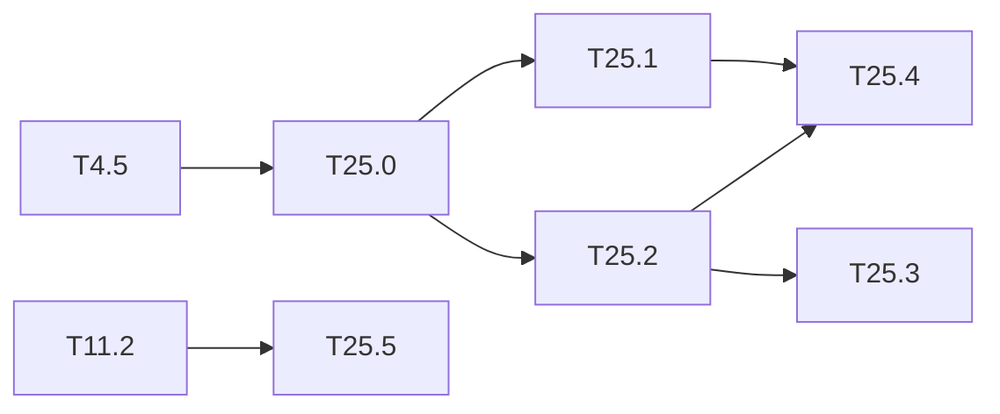

# M25 — Dependability (optional)

Goal: measure and improve how the embedded detector behaves when the hardware or the input
is not what it was designed for. Nothing in the repo covers it yet. Three directions:

- **Fault injection**: bit flips in the weights, the activation buffers and the int32
  accumulators of the integer model, and their effect on the mAP, layer by layer.
- **ABFT** (algorithm-based fault tolerance): each conv is checked by a checksum. The sum of
  the output channels equals the conv of the input by the summed filters. Before
  requantization everything is int32, so the equality is **exact**: no tolerance, no false
  alarm.
- **Out-of-distribution monitor**: flag inputs far from the training domain (night, thermal)
  from the backbone features.

The bit-exact integer model (`IntNetwork`, M4) is the fault-free reference: any difference is
caused by the injected fault. This is outside the base of the spec: the method is
engineering, to be cited from the dependability literature when written up.

**State**: not started (2026-10-19). T25.0 to T25.2 and T25.5 need neither the board nor
Vitis.

### [ ] T25.0 — Fault model and injector
- **Spec**: §9.3 · **Depends on**: T4.5 · **Size**: M
- **Deliverables**: `python/yolo/quant/faults.py` (NumPy only) + `python/tests/test_faults.py`
- **Acceptance**:
  - fault sites: int8 weights, int32 biases, int8 activations of a layer output, int32
    accumulator before requantization;
  - fault types: single bit flip at a given bit, random flips at a rate (BER), stuck-at;
  - seeded, reproducible; with no fault, the output equals `IntNetwork` exactly;
  - a hook in `IntNetwork` that does not slow the fault-free path.

### [ ] T25.1 — Sensitivity campaign
- **Spec**: §8.3 · **Depends on**: T25.0 · **Size**: M
- **Deliverables**: `tools/fault_campaign.py`; `results/faults.md`; a figure in
  `tools/figures/resultats.py` (M13 style)
- **Acceptance**: mAP (500 VOC2007 test images, tier M) against the BER, per site and per
  layer; effect of the bit position (sign and high bits against low bits); ranking of the
  layers by sensitivity; several seeds, spread given
- **Notes**: 1,000s of evaluations: use the PC profiles of [M12](M12-profils-pc.md) to size
  the campaign before running it.

### [ ] T25.2 — ABFT checksum in the reference models
- **Spec**: §4.1, §9.3 · **Depends on**: T25.0 · **Size**: M
- **Deliverables**: checksum filter `Σ_f w_f` and bias `Σ_f b_f` per conv (computed at
  export, int32); check in `IntNetwork` and in the C++ golden model; manifest field (schema
  updated)
- **Acceptance**:
  - fault-free: the check passes on every conv of the 3 dumps (Tiny-YOLOv2, Tiny-YOLOv3);
  - every accumulator fault of T25.0 is detected (100 %); weight and activation faults:
    detection rate measured;
  - the summed weights do not fit int8: their width and the cost of the extra MAC lane
    are given.
- **Notes**: the check is done on the int32 accumulator, before requantization, leaky and
  saturation (which are not linear). A fused maxpool is after the check.

### [ ] T25.3 — ABFT in the HLS kernel
- **Spec**: §10.2 · **Depends on**: T25.2 · **Size**: L
- **Deliverables**: one extra output lane per tile (filter Tm + 1 = checksum), comparison
  with the sum of the Tm lanes, error flag and counter in a status register
  (`sw/driver/regmap.hpp`, `LayerDesc` unchanged if possible); `perf_model` cost
- **Acceptance**: C-sim == golden to the byte (outputs unchanged); a fault forced in the
  testbench raises the flag; extra DSPs and cycles reported
- **Notes**: conflicts with T23 packing only on the lane count (Tm + 1 is odd): check the
  combination.

### [ ] T25.4 — Selective protection
- **Spec**: §10.4 · **Depends on**: T25.1, T25.2 · **Size**: S
- **Deliverables**: section in `results/faults.md`
- **Acceptance**: for the most sensitive layers of T25.1, mAP under faults and cost (DSP,
  BRAM, cycles) of: ABFT, ECC on the weights in BRAM, duplication of the sensitive layers;
  recommendation

### [ ] T25.5 — Out-of-distribution monitor
- **Spec**: §4, §7 · **Depends on**: T11.2 · **Size**: M
- **Deliverables**: small autoencoder (NumPy, layers of `python/yolo/layers`) on the
  backbone features of Tiny-YOLOv2 (output of L12 or L13), trained on VOC; score =
  reconstruction error; `results/ood_monitor.md`
- **Acceptance**: AUROC of VOC test against ExDark and FLIR (domain shifts of
  [T11.2](M11-jeux-de-donnees.md), M18 for the thermal drone sets); correlation between
  the score and the mAP drop per image group; cost of the monitor in MACs against the
  detector
- **Notes**: a simpler baseline first (mean and covariance of pooled features, Mahalanobis
  distance) to know what the autoencoder adds.

## Dependencies

