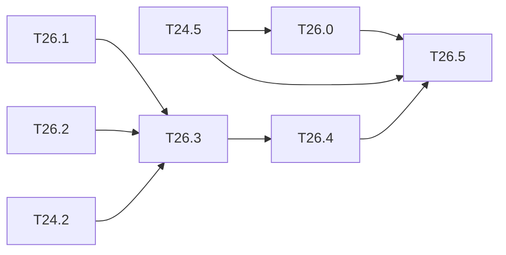

# M26 — Recent models (optional)

Goal: put more recent detectors on the same chain, to place the Tiny-YOLO results against
the current state of the art at a known cost. Three networks, in order of effort:

| Network | Interest | What is missing |
|---|---|---|
| YOLOv7-tiny (leaky, Darknet cfg) | much more accurate than v4-tiny, still leaky and Darknet weights | concats of 4 sources (`MAX_SEGMENTS = 2`), SPP with stride-1 maxpools 5 / 9 / 13 |
| YOLOv5n | current reference for small models | SiLU, weights from PyTorch, C3 / SPPF blocks, 3 heads |
| YOLOv8n | current reference, anchor-free | as v5n, plus anchor-free heads and DFL decoding |

Constraints kept: `python/yolo/` stays NumPy only ([ADR 0001](../adr/0001-numpy-pur.md)).
PyTorch weights are converted **once, offline**, by a tool. Only inference with converted
weights is in scope; training these networks is not.

Related backlog: [M24](M24-yolov4-tiny.md) brings grouped routes, `scale_x_y` and the COCO
evaluation of T11.1, which this milestone reuses.

**State**: not started (2026-10-19).

### [ ] T26.0 — YOLOv7-tiny
- **Spec**: §3, §4.4, §10.3 · **Depends on**: T24.5 · **Size**: L
- **Deliverables**: cfg and weights (`tiny-yolov7-coco`), float model, integer model,
  export, golden, C-sim; mAP at the three stages
- **Acceptance**: as T24.5; the study below is written before the kernel change
- **Notes**:
  - concats of more than 2 sources: either the sources are written end to end in one
    buffer (`layout: "contiguous"`, no copy, no segment needed), or `MAX_SEGMENTS` is
    raised (`hls/kernels/layer_desc.hpp`, 31-word `LayerDesc` and regmap change);
  - SPP: stride-1 maxpools 5, 9 and 13 with padding. The engine has 2×2 / 1 by
    replication (T6.3). A 5×5 / 1 pool equals two chained 3×3 / 1 pools and 9×9 two 5×5
    (SPPF identity): a 3×3 / 1 pool on the ARM or in the post-processing may be enough;
    to measure in cycles.
  - Figures (T13.59): `tiny-yolov7-coco` is the fourth network of the per-network figures
    (graph, tensor flow, datasheet, memory, output, calibration, per-layer error). The
    network is 2.89 GMAC (`make count-macs`); the export counts 2.916 GMAC, as it copies the
    SPP input by two identity 1×1 convs and chains the 5×5 pools.

### [ ] T26.1 — Offline PyTorch weight converter
- **Spec**: §9.1 · **Depends on**: — · **Size**: M
- **Deliverables**: `tools/convert_ultralytics.py` (torch imported only there, optional
  extra in `python/pyproject.toml`); `.npz` + generated cfg-like description per network
- **Acceptance**: forward of the converted NumPy model == PyTorch forward to within 1e-4
  on 3 images (test skipped without torch); BN folded or kept as in the NumPy layers
- **Notes**: check the licence of the weights (Ultralytics models are AGPL-3.0) before
  storing them on Drive or in the article.

### [ ] T26.2 — SiLU
- **Spec**: §4.3, §9.4 · **Depends on**: — · **Size**: M
- **Deliverables**: float SiLU (forward, backward) in `python/yolo/layers/activations.py`;
  integer SiLU as a 256-entry table indexed by the int8 input (Python, golden, HLS);
  integer contract section of [conventions.md](../conventions.md) completed
- **Acceptance**: gradcheck; the table is exact by construction (int8 input), and Python ==
  golden == HLS on all 256 inputs for any (in_scale, out_scale)
- **Notes**: the SiLU is applied before the requantization to the output scale, unlike the
  leaky: define where the table sits (after requant to an intermediate scale, then table to
  the output scale), and its cost in the PE.

### [ ] T26.3 — YOLOv5n
- **Spec**: §3, §8 · **Depends on**: T26.1, T26.2, T24.2 · **Size**: L
- **Deliverables**: C3, SPPF, stride-2 convs and 3 heads in the graph; float COCO mAP; then
  integer model, export, golden and C-sim
- **Acceptance**: float mAP close to the published one (letterbox 640, then 416); integer
  gap documented; golden == C-sim
- **Notes**: stride-2 convs replace the maxpools: check that the engine supports stride 2
  (`LayerDesc` only has stride 1 today) or decompose.

### [ ] T26.4 — YOLOv8n
- **Spec**: §8.1 · **Depends on**: T26.3 · **Size**: L
- **Deliverables**: anchor-free decoded heads with DFL (softmax over 16 bins per side,
  expectation) in Python and on the ARM post-processing (`sw/postproc`); float and integer
  COCO mAP
- **Acceptance**: float mAP close to the published one; integer gap documented; the DFL
  softmax in integer reuses the LUT approach of the v2 softmax (`luts.bin`)

### [ ] T26.5 — Comparison
- **Spec**: §10.4 · **Depends on**: T24.5, T26.0, T26.3, T26.4 · **Size**: S
- **Deliverables**: `results/models_comparison.md`; figure
- **Acceptance**: Tiny-YOLOv2, v3, v4, v7-tiny, v5n, v8n: COCO mAP (float and integer),
  MACs, weight bytes, `perf_model` ms on the KV260 (projection), DSP; what the engine would
  need for each one

## Dependencies

