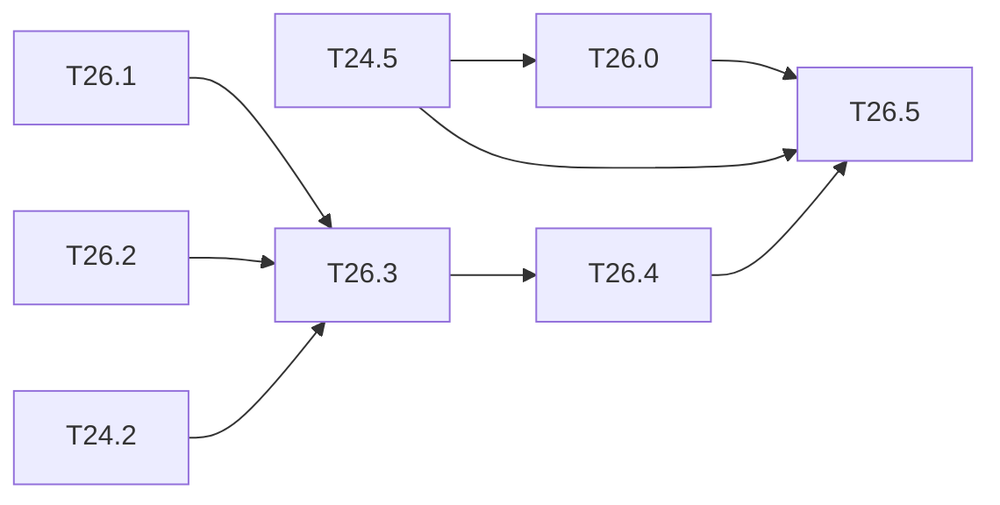

# M26 — Recent models (optional)

Goal: put more recent detectors on the same chain, to place the Tiny-YOLO results against
the current state of the art at a known cost. Three networks, in order of effort:

| Network | Interest | What is missing |
|---|---|---|
| YOLOv7-tiny (leaky, Darknet cfg) | much more accurate than v4-tiny, still leaky and Darknet weights | concats of 4 sources (`MAX_SEGMENTS = 2`), SPP with stride-1 maxpools 5 / 9 / 13 |
| YOLOv5n | current reference for small models | SiLU, weights from PyTorch, C3 / SPPF blocks, 3 heads |
| YOLOv8n | current reference, anchor-free | as v5n, plus anchor-free heads and DFL decoding |

Constraints kept: `python/yolo/` stays NumPy only ([ADR 0001](../adr/0001-numpy-pur.md)).
PyTorch weights are converted **once, offline**, by a tool. Only inference with converted
weights is in scope; training these networks is not.

Related backlog: [M24](M24-yolov4-tiny.md) brings grouped routes, `scale_x_y` and the COCO
evaluation of T11.1, which this milestone reuses.
The from-scratch, torch-free versions (weight reading, backward passes, loss, training) are
[M33](M33-yolov5n.md) (YOLOv5n), [M34](M34-yolov7-tiny.md) (YOLOv7-tiny) and
[M35](M35-yolov8n.md) (YOLOv8n); T26.0, T26.3 and T26.4 stay the inference and hardware view.

**State** (2026-10-23):
- **Done**: T26.1 (converter, torch-free since T33.0) and T26.2 (SiLU).
- **T26.0** in progress: cfg, weights, float COCO mAP (T34.2) and the INT8 calibration
  ([calibration_tiny-yolov7-coco.md](../../results/calibration_tiny-yolov7-coco.md)) are
  done. The integer mAP, export, golden and C-sim are open.
- **T26.3 / T26.4**: the float COCO mAP is measured by M33 (YOLOv5n, T33.4) and M35
  (YOLOv8n, T35.3), see [map_coco.md](../../results/map_coco.md). The integer models,
  export, golden, C-sim, the stride-2 convs and the DFL post-processing on the ARM are open.
  The export, driver and engine wiring of SiLU layers comes with T26.3.
- **T26.5** waits for T26.0, T26.3 and T26.4.

### [ ] T26.0 — YOLOv7-tiny
- **Running** (2026-10-28, times CET): unit `t26-0`, queued behind `t35-3`: v7-tiny float + int COCO val2017 and C-sim of the 5,000 images (`build/longruns/t26-0.sh`, 6 cores, 18 s per image per core); start ≈ 23:15, ETA ≈ 04:00. Log `build/longruns/T26.0.log`.
- **Spec**: §3, §4.4, §10.3 · **Depends on**: T24.5 · **Size**: L
- **Deliverables**: cfg and weights (`tiny-yolov7-coco`), float model, integer model,
  export, golden, C-sim; mAP at the three stages
- **Acceptance**: as T24.5; the study below is written before the kernel change
- **Notes**:
  - concats of more than 2 sources: either the sources are written end to end in one
    buffer (`layout: "contiguous"`, no copy, no segment needed), or `MAX_SEGMENTS` is
    raised (`hls/kernels/layer_desc.hpp`, 31-word `LayerDesc` and regmap change);
  - SPP: stride-1 maxpools 5, 9 and 13 with padding. The engine has 2×2 / 1 by
    replication (T6.3). A 5×5 / 1 pool equals two chained 3×3 / 1 pools and 9×9 two 5×5
    (SPPF identity): a 3×3 / 1 pool on the ARM or in the post-processing may be enough;
    to measure in cycles.
  - Figures (T13.59): `tiny-yolov7-coco` is the fourth network of the per-network figures
    (graph, tensor flow, datasheet, memory, output, calibration, per-layer error). The
    network is 2.89 GMAC (`make count-macs`); the export counts 2.916 GMAC, as it copies the
    SPP input by two identity 1×1 convs and chains the 5×5 pools.
- **Study** (2026-10-28, written before any kernel change; result: none is needed):
  - **Concats of 4 sources**: the export already uses `layout: "contiguous"`. Each of the
    9 four-source routes (L07, L15, L23, L31, L41, L55, L67, L76, L85) has its own buffer
    (`R`, `R1` … `R13`), and every source conv writes its channels end to end at its offset
    in it. The route is a no-op for the engine and the driver: no segment, so
    `MAX_SEGMENTS = 2` and the 31-word `LayerDesc` stay as they are.
  - **SPP**: the stride-1 5 × 5 pool is in the output stage (`PK_MAX = 5`,
    `LayerDesc::pool_lo`, commit 7db966a). The 9 × 9 and 13 × 13 pools are chained 5 × 5
    pools (SPPF identity), so no pool runs on the ARM.
  - **Cycles** (`tools/perf_model.py --manifest`, KV260 kernel, 416 × 416):

    | Network | MACs | Cycles | ms | fps | MAC efficiency |
    |---|---|---|---|---|---|
    | tiny-yolov4-coco | 4.16 G | 10.36 M | 51.8 | 19.3 | 52 % |
    | tiny-yolov7-coco | 3.93 G | 16.60 M | 83.0 | 12.0 | 31 % |

    v7-tiny has fewer MACs than v4-tiny but takes 60 % more cycles. Its ELAN blocks are
    mostly 1 × 1 convs with 32 to 64 channels, which fill the Tm × Tn = 32 × 24 array badly.
    A gain would come from the tiling (a smaller Tn for the 1 × 1 layers), not from the
    concat or the SPP.
  - **Equality**: on 3 COCO images (`build/m26/v7-smoke`), the integer Python model
    (`eval_quant.py --calib build/quant/tiny-yolov7-coco/calib-coco.json`, the calibration
    of the export) and the C-sim (`yolo_bench`, sim backend, `ACC_NO_APINT`) give the same
    boxes and scores to the last bit (131, 2 and 188 detections). C-sim: 18 s per image on
    one core.

### [x] T26.1 — Offline PyTorch weight converter
- **Spec**: §9.1 · **Depends on**: — · **Size**: M
- **Deliverables**: `tools/convert_ultralytics.py` (torch imported only there, optional
  extra in `python/pyproject.toml`); `.npz` + generated cfg-like description per network
- **Acceptance**: forward of the converted NumPy model == PyTorch forward to within 1e-4
  on 3 images (test skipped without torch); BN folded or kept as in the NumPy layers
- **Notes**: check the licence of the weights (Ultralytics models are AGPL-3.0) before
  storing them on Drive or in the article.
- **Done**:
  - **Converter**: `tools/convert_ultralytics.py` rebuilds YOLOv5n (C3, SPPF, anchor
    `Detect`) and YOLOv8n (C2f, SPPF, DFL `Detect`) in torch with the reference parameter
    names (`strict=True` loading of a state dict or of an official checkpoint, the latter
    with `ultralytics` / the yolov5 repo to unpickle).
  - **Output**: BN folded, `.npz` + `.json` flat layer list, run in NumPy by
    `python/yolo/models/ul_graph.py`.
  - **Check**: NumPy == torch to within 2·10⁻⁷ (random weights, non-trivial BN, 3 images).
    The parameter counts are those published for the two "n" models (1.87 M, 3.15 M).
  - **Test**: `test_convert_ultralytics.py`, skipped without torch.
  - **Official weights** (2026-10-22, M33): run on `yolov5n.pt` / `yolov8n.pt` (local only,
    AGPL). It showed that the v5 anchors written to the json were the stride units of
    the checkpoint, not pixels.
  - **Since T33.0**: the converter is torch-free (`yolo.io.torch_pickle` + `ul_yaml`), its
    output is identical to this one except the anchors, now in pixels; the torch modules and
    the `convert` extra are gone.

### [x] T26.2 — SiLU
- **Spec**: §4.3, §9.4 · **Depends on**: — · **Size**: M
- **Deliverables**: float SiLU (forward, backward) in `python/yolo/layers/activations.py`;
  integer SiLU as a 256-entry table indexed by the int8 input (Python, golden, HLS);
  integer contract section of [conventions.md](../conventions.md) completed
- **Acceptance**: gradcheck; the table is exact by construction (int8 input), and Python ==
  golden == HLS on all 256 inputs for any (in_scale, out_scale)
- **Notes**: the SiLU is applied before the requantization to the output scale, unlike the
  leaky: define where the table sits (after requant to an intermediate scale, then table to
  the output scale), and its cost in the PE.
- **Done**:
  - **Float**: `silu_forward` / `silu_backward` (gradcheck), `activation=silu|swish` in the
    cfg and the graph.
  - **Integer**: `lut.silu_lut(s_mid, s_out, qmax)`, `int_layers.silu_int`,
    `conv_out(act="silu")`, `golden::silu_lookup`, `ConvParams::act_lut`.
  - **HLS**: `store_tile` with `LayerDesc::leaky = 2`; the table is 64 words of `prm` after
    the M0s.
  - **Equality**: Python == golden == HLS on every accumulator around the 256 table inputs,
    5 random scale sets (`test_silu_python_golden_hls`).
  - **Contract**: in [conventions.md](../conventions.md).
  - **Remaining for T26.3**: the manifest field (table scale, table blob), the driver and
    the calibration of s_mid.

### [ ] T26.3 — YOLOv5n
- **Spec**: §3, §8 · **Depends on**: T26.1, T26.2, T24.2 · **Size**: L
- **Deliverables**: C3, SPPF, stride-2 convs and 3 heads in the graph; float COCO mAP; then
  integer model, export, golden and C-sim
- **Acceptance**: float mAP close to the published one (letterbox 640, then 416); integer
  gap documented; golden == C-sim
- **Notes**: stride-2 convs replace the maxpools: check that the engine supports stride 2
  (`LayerDesc` only has stride 1 today) or decompose.

### [ ] T26.4 — YOLOv8n
- **Spec**: §8.1 · **Depends on**: T26.3 · **Size**: L
- **Deliverables**: anchor-free decoded heads with DFL (softmax over 16 bins per side,
  expectation) in Python and on the ARM post-processing (`sw/postproc`); float and integer
  COCO mAP
- **Acceptance**: float mAP close to the published one; integer gap documented; the DFL
  softmax in integer reuses the LUT approach of the v2 softmax (`luts.bin`)

### [ ] T26.5 — Comparison
- **Spec**: §10.4 · **Depends on**: T24.5, T26.0, T26.3, T26.4 · **Size**: S
- **Deliverables**: `results/models_comparison.md`; figure
- **Acceptance**: Tiny-YOLOv2, v3, v4, v7-tiny, v5n, v8n: COCO mAP (float and integer),
  MACs, weight bytes, `perf_model` ms on the KV260 (projection), DSP; what the engine would
  need for each one

## Dependencies

