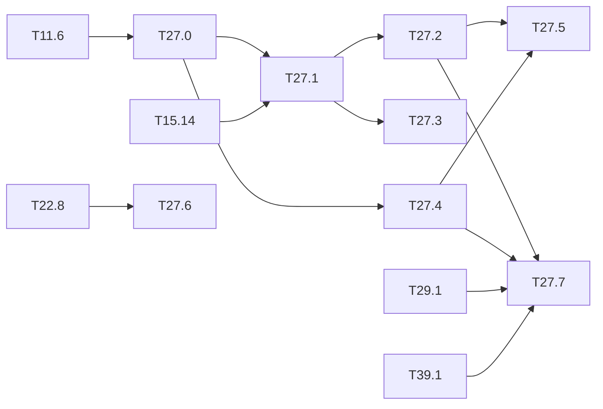

# M27 — Safety metrics for person detection (optional)

Goal: measure the detector the way a safety function is judged, not the way a benchmark
ranks it. The use case is a camera watching a dangerous industrial zone where no person may
be present: a **missed person** (false negative) is the dreaded event, a false alarm is an
unwanted stop. The mAP averages both and hides the first one.

What the literature lacks (thesis state of the art, ARCYS, 2026-10):

- published person-detection metrics are mAP or averaged error rates; no recall at a fixed
  false-alarm rate, per distance or per occlusion (CrowdHuman, Shao 2018, is the closest);
- the only FPGA person detector (Karki 2026, preprint) measures the mAP on the board but no
  miss rate; the closest certified case (Belcaid 2024) publishes no metric at all;
- the asymmetric loss (missed pedestrian catastrophic, false detection "major") and the
  conversion of a per-image error rate into a per-hour rate are posed by DEEL (Delseny 2021,
  §4.2.4.2 and §4.2.4.4), without a detection metric to plug in;
- no industrial person dataset (PPE, machines, dust, degraded lighting). PREWID (Mendeley
  Data, 2026: workers in a legacy plant, person only, no PPE) appeared since and is in the
  chain through [M38](M38-prewid.md).

The chain of the repo gives the three stages (float, integer, C-sim) on CrowdHuman already
([T11.6](M11-jeux-de-donnees.md), [T15.14](M15-campagne-entrainement.md)): this milestone
adds the metrics and the test conditions. Outside the base of the spec: the method comes
from the pedestrian-detection literature (miss rate against FPPI) and from DEEL.

**State** (2026-10-27): code and tests of every task done; runs done on PREWID (`test`,
592 frames of which 289 empty, and the 3,000-frame `lab` sequence). Done: T27.0 (metrics,
checked by hand and against a brute-force reference). Code done, PREWID measured, CrowdHuman
/ MOT17 / ExDark runs pending (data not in `data/`, no `tiny-yolov3-crowdhuman` checkpoint,
T15.14): T27.1-T27.5. T27.6 slot and procedure done, waiting for the ARCYS images. T27.7
done on PREWID `lab` with the monitor rows of T29.1 / T39.1 (M40 to add).
Results: [results/person_safety.md](../../results/person_safety.md); figure
`miss_fppi` (T13.61).

Headline (YOLOv4-tiny COCO, no fine-tuning, PREWID `test`): recall 90.7 % float / 90.1 %
integer at 0.1 FPPI, LAMR 9.6 / 10.5 %; workers under 30 px never found (0/3), 30-80 px
82 %; the 0.95 recall target chosen on one half holds at 89-91 % on the other; misses come
in bursts (runs of 5 missed frames several hundred times more frequent than independent
misses predict), which puts the DEEL estimate 6 to 8 orders of magnitude above SIL 1-3.

Commands (all from the repo root; `build/m27/` holds the runs):

```bash
P="python tools/person_safety.py"
for n in tiny-yolov3-coco tiny-yolov4-coco; do $P infer --net $n --dataset prewid --split test; done
$P infer --net tiny-yolov4-coco --dataset prewid --split lab
$P infer --net tiny-yolov4-coco --dataset prewid --split test --degrade all
python tools/make_inputs.py --net tiny-yolov4-coco --dataset prewid --split test:CAM1 \
    --subset 100 --out build/m27/csim/tiny-yolov4-coco
BENCH=build/sw-fast/yolo_bench EXTRA="--conf 0.001" CHUNK=5 \
    tools/bench_sim.sh build/m27/csim/tiny-yolov4-coco model/tiny-yolov4-coco 10
$P csim --net tiny-yolov4-coco --dataset prewid --split test --dir build/m27/csim/tiny-yolov4-coco
$P report --dataset prewid --split test --nets tiny-yolov3-coco,tiny-yolov4-coco --per-camera --write
$P oppoint --dataset prewid --split test --net tiny-yolov4-coco --write
$P degrade-report --dataset prewid --split test --net tiny-yolov4-coco --write
python tools/dreaded_event.py --dataset prewid --split lab --net tiny-yolov4-coco --fps 10 --write
$P deel --events build/m27/prewid-lab/tiny-yolov4-coco/events_int.json --write
$P unflagged --dataset prewid --split lab --net tiny-yolov4-coco \
    --events build/m27/prewid-lab/tiny-yolov4-coco/events_int.json --event-n 5 --write
```

### [x] T27.0 — Person metrics
- **Spec**: §8.3 · **Depends on**: T11.6 · **Runs on**: PC · **Size**: M
- **Deliverables**: in `python/yolo/infer/metrics.py`: recall and miss rate at a fixed FPPI
  (false positives per image), log-average miss rate over FPPI ∈ [10⁻², 10⁰], recall per
  box-height bin and per occlusion level (CrowdHuman visible box against full box);
  `python/tests/test_metrics.py` extended
- **Acceptance**:
  - a toy case computed by hand (3 images, known matches) gives the exact values;
  - the log-average miss rate of a published detector on Caltech-like settings is
    reproduced on a small fixture, or the formula is checked against a reference
    implementation;
  - ignore regions (`iscrowd`, CrowdHuman `mask`) handled as in the mAP of T11.0.
- **Notes**: the FPPI axis needs the detections down to a low threshold (0.001), as for the
  mAP; the operating point is a threshold, not a curve.
- **Done** (2026-10-26): `match_class` (the greedy VOC matching of `eval_class`, now kept
  per detection and per ground truth; mAP unchanged, devkit tests pass), `mr_fppi`,
  `recall_at_fppi` (lowest threshold with FPPI ≤ target), `log_average_miss_rate` (Caltech
  `dbEval`: 9 points 10^(-2:0.25:0), geometric mean, 10⁻¹⁰ floor), `recall_by_bin` (height:
  Caltech < 30 / 30-80 / ≥ 80 px; occlusion 1 − visible: 0-10 / 10-35 / 35-80 / 80-100 %),
  `person_metrics` (one call; `empty_only` counts FPPI on the empty frames). CrowdHuman
  samples carry `visible` (|vbox ∩ fbox| / |fbox|). Tests: a 3-image toy case computed by
  hand (curve, R@FPPI, LAMR, bins, empty-only FPPI, ignore regions), and the LAMR checked to
  10⁻¹² against `python/tests/mr_ref.py`, a brute-force reference that re-matches the
  detections at every threshold, on 5 random scenes with ties, duplicates and `difficult`
  boxes. Ignore regions and `difficult` (`iscrowd`, CrowdHuman `mask`) go through the same
  code as the mAP.

### [ ] T27.1 — Metrics at the three stages
- **Spec**: §8.3, §10.4 · **Depends on**: T27.0, T15.14 · **Size**: M
  · **Runs on**: PC (float, integer, C-sim gcc)
- **Deliverables**: `tools/person_safety.py`; `results/person_safety.md`
- **Acceptance**: for `tiny-yolov3-crowdhuman` and the person class of `tiny-yolov3-coco`
  (and `tiny-yolov4-coco` when available): recall at 0.1 and 0.01 FPPI, log-average miss
  rate, recall per height bin and occlusion, in float, integer and C-sim (CrowdHuman val);
  the loss per stage is attributed (quantization, engine)
- **Notes**: C-sim on the full val split is long: size it with the profiles of
  [M12](M12-profils-pc.md); C-sim == integer is already known bit-exact, so the C-sim column
  may be a subset that confirms it.
- **Progress** (2026-10-26): `tools/person_safety.py` (`infer` float / integer down to
  0.001, ~0.1 s per image with 20 processes; `csim` from `bench_sim.sh`; `report`). PREWID
  `test`: YOLOv4-tiny R@0.1 90.7 / 90.1 % (float / integer), LAMR 9.6 / 10.5 %; Tiny-YOLOv3
  59.8 / 56.6 %, LAMR 41.8 / 45.1 %. Quantization costs 0.6 points of R@0.1 on v4, 3.2 on
  v3; C-sim == integer on 100 CAM1 frames at threshold 0.001, so the engine costs 0. Per
  height (v4 float): < 30 px 0/3, 30-80 px 82.4 %, ≥ 80 px 97.1 %. Per camera in the
  results file (CAM0 and CAM2 worst for v4).
- **Pending**: CrowdHuman val (data not local; `tools/get_datasets.sh crowdhuman`, then the
  same commands with `--dataset crowdhuman --split val`; the occlusion table appears by
  itself), `tiny-yolov3-crowdhuman` (T15.14 checkpoint, `--net <cfg> --weights <ckpt>`).

### [x] T27.2 — Asymmetric operating point
- **Spec**: §8.1 · **Depends on**: T27.1 · **Runs on**: PC · **Size**: S
- **Deliverables**: section in `results/person_safety.md`; figure (miss rate against FPPI,
  float / integer) in `tools/figures/resultats.py` (M13 style)
- **Acceptance**: threshold chosen for a target recall (0.95, 0.99) on a calibration half,
  checked on the other half; FPPI paid for it; the default threshold of the repo (0.005 for
  the mAP, 0.5 for the demo) placed on the curve
- **Done** (2026-10-26, PREWID): `person_safety.py oppoint`, halves made of alternating
  blocks of consecutive frames (no neighbour leak); figure `miss_fppi` (T13.61). YOLOv4-tiny
  `test`: recall 0.95 is reached on the calibration half at 0.25 FPPI (float) / 0.55
  (integer) but the check half gets 89.1 / 90.8 %: the target does **not** transfer between
  halves; 0.99 is never reached even at 0.001 (max ≈ 97 %). Threshold 0.005 (mAP): 95.9 %
  recall for 3.7 FPPI; 0.5 (demo): 64.7 % for 0 FPPI. Same on `lab`. CrowdHuman: pending
  with T27.1.

### [ ] T27.3 — Degraded conditions (ODD stress)
- **Spec**: §8.3 · **Depends on**: T27.1 · **Runs on**: PC · **Size**: M
- **Deliverables**: `tools/degrade.py` (NumPy, seeded): low light (gamma + noise), fog / dust
  (contrast loss + veil), motion blur, sensor noise, JPEG, partial occlusion patches, each at
  3 severities; `results/person_safety.md` section
- **Acceptance**:
  - recall at 0.1 FPPI per degradation and severity, float and integer, on CrowdHuman val;
  - ExDark persons (real low light, [T11.2](M11-jeux-de-donnees.md)) compared with the
    synthetic low light;
  - the degradations are the ones of the ODD of [T31.0](M31-assurance-case.md).
- **Notes**: does the integer model lose more than the float one under degradation? That is
  the question no FPGA paper answers.
- **Progress** (2026-10-26): `tools/degrade.py` (six kinds × 3 severities, seeded per image
  id, `--show` contact sheet), `person_safety.py infer --degrade all` and `degrade-report`
  (R@0.1 with the threshold re-chosen, and recall / FPPI at the clean threshold). PREWID
  `test`, YOLOv4-tiny, R@0.1 float → integer: clean 90.7 → 90.1; low light 66.2 / 48.1 /
  10.8 → 61.5 / 42.0 / 7.9; fog 87.8 / 80.5 / 60.6; motion blur 83.7 / 43.7 / 4.4; noise
  84.8 / 67.1 / 36.2; JPEG 80.5 / 53.1 / 6.7; occlusion 68.8 / 19.8 / 3.8. **Answer on
  PREWID**: the integer model loses more only in low light (−4.7 and −6.1 points at
  severities 1-2, against −0.6 clean); for the other degradations the gap stays within
  ±4 points, either way. Low light is where the INT8 input and activation scales,
  calibrated on daylight, lose most. The list is written as the ODD input of T31.0 (pointer
  in M31).
- **Pending**: CrowdHuman val (with T27.1) and ExDark persons against synthetic low light
  (`infer --dataset exdark --split test --net tiny-yolov4-coco`, then `report`; the
  `People` class maps to `person`).

### [x] T27.4 — Dreaded event on video
- **Spec**: §8.3 · **Depends on**: T27.0 · **Runs on**: PC · **Size**: M
- **Deliverables**: `tools/dreaded_event.py`; a video set with persons (MOT17 or MOT20 train
  sequences, loader in `python/yolo/data/datasets.py`); `results/person_safety.md` section
- **Acceptance**: rate of "person present, not reported during N consecutive frames"
  (N = 1…10, persons above a minimum height) per hour of video, float and integer; the
  per-frame FN rate and the per-event rate are both given, to show how much the temporal
  correlation of misses matters
- **Notes**: UAVDT ([M18](M18-jeux-drone.md)) has vehicles only; AU-AIR has persons but
  seen from above. A ground-level person video set is needed.
- **Progress** (2026-10-26): `tools/dreaded_event.py` (track mode with identities, frame
  mode without; a gap in the frame numbers ends a run; independent-miss prediction
  p^N·(1 + (T − N)(1 − p)) per episode, checked by enumeration), MOT17 loader `mot17`
  (FRCNN copy, classes 2/7/8/12 and `consider` 0 as `difficult`, `track`, `visible`, fps of
  `seqinfo.ini`) in the `EVAL_ONLY` registry, `tools/get_datasets.sh mot17`. PREWID `lab`
  (one 3,000-frame run, 10 frames/s **assumed**, PREWID publishes no rate): per-frame miss
  9.1 % (integer); runs of ≥ 5 missed frames 132 per hour of video, 1,240 times the
  independent prediction; `test` gives the same pattern on its short runs.
- **Done** (2026-10-27, MOT17 train): `tools/get_datasets.sh mot17` (5.5 GB, 3 min),
  `person_safety.py infer --dataset mot17 --split train --jobs 12` (5,316 frames, ≈ 12
  min), `dreaded_event.py --dataset mot17 --write` (59 s); section `events-mot17-train` of
  [results/person_safety.md](../../results/person_safety.md). The seven sequences run at
  14, 25 or 30 frames/s: `dreaded_event.py` now sums each frame's own duration (it wanted a
  single rate). YOLOv4-tiny at 0.1 FPPI misses 78.7 % (float) / 80.5 % (integer) of the
  person-frames of these crowded street scenes (track mode, persons ≥ 30 px, 3.6 min of
  video). With misses that frequent, the measured runs of ≥ N missed frames are 0.13-0.41
  times the independent prediction (N = 1…10, rising with N): the misses merge into fewer,
  longer runs. PREWID showed the other side (rare misses, 1,240 times more ≥ 5-frame runs
  than predicted); both say the per-frame rate alone does not give the event rate.

### [x] T27.5 — From per-image errors to failures per hour
- **Spec**: — · **Depends on**: T27.2, T27.4 · **Runs on**: PC · **Size**: S
- **Deliverables**: section in `results/person_safety.md`
- **Acceptance**: DEEL computation (§4.2.4.4) redone with the measured rates: frame rate,
  rate of presence in the zone, per-image FN at the operating point, independence or
  measured correlation (T27.4) → dangerous failures per hour; gap to SIL 1 / 2 / 3 (10⁻⁵,
  10⁻⁶, 10⁻⁷ /h, values to check in IEC 61508) in orders of magnitude; every assumption
  written
- **Notes**: input of the budget of [T31.3](M31-assurance-case.md).
- **Done** (2026-10-26): `person_safety.py deel`, assumptions table written with the
  section. SIL bounds checked: IEC 61508-1 table 3 (high demand / continuous) gives PFH
  ranges [10⁻⁶, 10⁻⁵) for SIL 1, [10⁻⁷, 10⁻⁶) SIL 2, [10⁻⁸, 10⁻⁷) SIL 3, so 10⁻⁵ / 10⁻⁶ / 10⁻⁷
  are the upper bounds. With YOLOv4-tiny integer on the `lab` sequence, 10 frames/s, 10 %
  presence, N = 5 frames (0.5 s): 0.02 failures/h if misses were independent (3.3 orders
  above SIL 1), 25 /h with the measured bursts (6.4 above SIL 1, 8.4 above SIL 3). The
  independence assumption flatters the detector by three orders of magnitude.

### [ ] T27.6 — Industrial-site images
- **Spec**: §8.3 · **Depends on**: T22.8 · **Size**: S
  · **Runs on**: PC (needs the ARCYS images, not hardware)
- **Deliverables**: loader slot `industrial` (folder of images + YOLO txt) and a procedure
  (autolabel of [M22](M22-autolabel.md), then manual correction) in this file
- **Acceptance**: an empty folder gives a clear message; a folder of 10 labelled images runs
  T27.1 and T27.3 end to end
- **Notes**: waiting for site images from ARCYS; until then, PPE images from a public set
  (e.g. a hard-hat dataset) can stand in.
- **Progress** (2026-10-26): slot `industrial` (`EVAL_ONLY` registry, `load_industrial`):
  `data/industrial/<split>/images/*.jpg|png` and `labels/<stem>.txt` (YOLO, class 0 =
  person, empty txt = empty frame). An empty or missing folder, or an image without its
  txt, raises a `FileNotFoundError` naming the layout and this procedure.
  `test_industrial_end_to_end` runs `infer` (float, integer, `fog:2`), `report` and
  `degrade-report` on 10 synthetic labelled images. Waiting for the ARCYS images.
- **Procedure** for site images:
  1. copy the frames to `data/industrial/raw/` (keep the camera and frame number in the
     name, `<camera>_<frame>.jpg`, so sequences can be cut later);
  2. pre-label with the autolabeller of [M22](M22-autolabel.md) (`make autolabel`, Folder
     tab or headless batch, class `person`, YOLO txt output);
  3. correct every frame by hand (missed workers first, then false boxes; a frame without
     worker keeps an empty txt);
  4. split by time blocks per camera (as PREWID, T38.1) into `data/industrial/{calib,test}/
     {images,labels}/`;
  5. run the commands of the State section with `--dataset industrial`.
  [M38](M38-prewid.md) brings PREWID (public, workers in legacy plants, person only) as
  that stand-in; T38.8-T38.10 run T27.1, T27.3 and T27.4 on it. Ready since 2026-10-26
  (T38.0-T38.6): `data/prewid/`, splits `train` / `val` / `test` / `lab`, best
  out-of-domain person AP50 89.9 on `test` (YOLOv4-tiny COCO, T38.6). The `industrial`
  slot can reuse the PREWID loader (one JSON per split, empty frames kept).

### [x] T27.7 — Unflagged dangerous false negatives
- **Spec**: §8.3 · **Depends on**: T27.2, T27.4, T29.1, T39.1 · **Runs on**: PC · **Size**: S
- **Deliverables**: in `python/yolo/infer/metrics.py`: the unflagged-miss rate;
  `results/person_safety.md` section
- **Acceptance**:
  - per person and per event (T27.4): number of persons missed by the detector **and** not
    flagged by a monitor before the deadline, over the number of dangerous events;
  - 95 % confidence interval (Clopper-Pearson) and the counts next to every rate;
  - given for the detector alone, with each monitor of T29.1 and [T39.1](M39-failure-prediction.md),
    and with the early alerts of [M40](M40-early-alerts.md) when available, at the same
    alarm rate.
- **Notes**: central metric of the thesis draft; the monitor coverage on the detector errors
  and the false alarms per image are reported apart, never folded into it.
- **Progress** (2026-10-26): `clopper_pearson`, `unflagged_miss_rate` in `metrics.py`;
  `person_safety.py unflagged --flags <monitor JSONL> --events <dreaded_event JSON>`: per
  person, and per presence episode of ≥ N frames (failed when it holds N consecutive missed
  frames, flagged when every such run has an alarm within `--deadline` frames); alarm rate
  in its own column. Detector alone, YOLOv4-tiny integer on `lab` at 0.1 FPPI: 148 / 1,574
  persons missed (9.40 %, CI [8.01, 10.95]); per episode (N = 5 frames), 3 of the 4 long
  presence episodes hold a 5-frame miss (75 %, CI [19, 99]): four episodes is too few for
  a useful interval, the counts are written next to the rate.
- **Done** (2026-10-27, monitor rows): the seven monitors of T29.1 and T39.1 are fitted
  on PREWID `test` (out of sample for `lab`). Their per-image alarms on the 3,000 `lab`
  frames are written by `tools/ood_monitor.py compare --labels <test> --apply <lab> --flags
  build/m39/flags --rate-on apply`, at the same alarm rate for all, 1 % and 5 % (threshold
  set on the `lab` scores, no label). At 5 % alarms the best rows, the learned miss head and
  the max score, leave 141 / 1,574 persons unflagged (8.96 %, CI [7.59, 10.48]) against
  148 for the detector alone. The episodes do not move (3 / 4). M40 stays to add.
- **Reading**: the learned head flags 53 % of the misses inside one camera (T39.1, `lab` test
  split) but 5 % from the cameras of `test` to `lab`. With thresholds taken from `test`
  instead (`--rate-on val`), every monitor goes to 0 % or 100 % alarms on `lab`: neither the
  monitors nor their thresholds transfer across cameras.

## Dependencies


