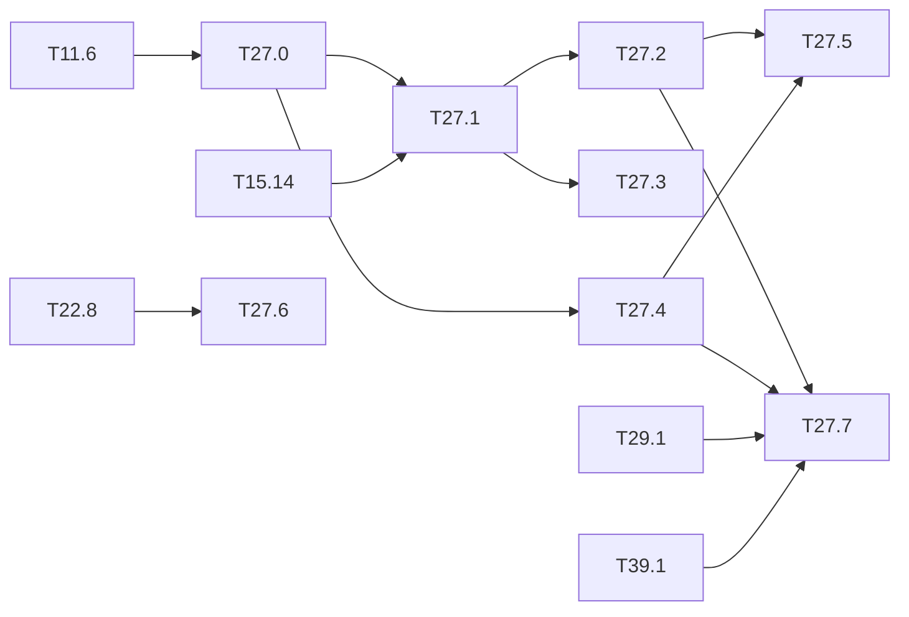

# M27 — Safety metrics for person detection (optional)

Goal: measure the detector the way a safety function is judged, not the way a benchmark
ranks it. The use case is a camera watching a dangerous industrial zone where no person may
be present: a **missed person** (false negative) is the dreaded event, a false alarm is an
unwanted stop. The mAP averages both and hides the first one.

What the literature lacks (thesis state of the art, ARCYS, 2026-10):

- published person-detection metrics are mAP or averaged error rates; no recall at a fixed
  false-alarm rate, per distance or per occlusion (CrowdHuman, Shao 2018, is the closest);
- the only FPGA person detector (Karki 2026, preprint) measures the mAP on the board but no
  miss rate; the closest certified case (Belcaid 2024) publishes no metric at all;
- the asymmetric loss (missed pedestrian catastrophic, false detection "major") and the
  conversion of a per-image error rate into a per-hour rate are posed by DEEL (Delseny 2021,
  §4.2.4.2 and §4.2.4.4), without a detection metric to plug in;
- no industrial person dataset (PPE, machines, dust, degraded lighting).

The chain of the repo gives the three stages (float, integer, C-sim) on CrowdHuman already
([T11.6](M11-jeux-de-donnees.md), [T15.14](M15-campagne-entrainement.md)): this milestone
adds the metrics and the test conditions. Outside the base of the spec: the method comes
from the pedestrian-detection literature (miss rate against FPPI) and from DEEL.

**State**: not started (2026-10-20). Everything but T27.6 runs on the PC.

### [ ] T27.0 — Person metrics
- **Spec**: §8.3 · **Depends on**: T11.6 · **Runs on**: PC · **Size**: M
- **Deliverables**: in `python/yolo/infer/metrics.py`: recall and miss rate at a fixed FPPI
  (false positives per image), log-average miss rate over FPPI ∈ [10⁻², 10⁰], recall per
  box-height bin and per occlusion level (CrowdHuman visible box against full box);
  `python/tests/test_metrics.py` extended
- **Acceptance**:
  - a toy case computed by hand (3 images, known matches) gives the exact values;
  - the log-average miss rate of a published detector on Caltech-like settings is
    reproduced on a small fixture, or the formula is checked against a reference
    implementation;
  - ignore regions (`iscrowd`, CrowdHuman `mask`) handled as in the mAP of T11.0.
- **Notes**: the FPPI axis needs the detections down to a low threshold (0.001), as for the
  mAP; the operating point is a threshold, not a curve.

### [ ] T27.1 — Metrics at the three stages
- **Spec**: §8.3, §10.4 · **Depends on**: T27.0, T15.14 · **Size**: M
  · **Runs on**: PC (float, integer, C-sim gcc)
- **Deliverables**: `tools/person_safety.py`; `results/person_safety.md`
- **Acceptance**: for `tiny-yolov3-crowdhuman` and the person class of `tiny-yolov3-coco`
  (and `tiny-yolov4-coco` when available): recall at 0.1 and 0.01 FPPI, log-average miss
  rate, recall per height bin and occlusion, in float, integer and C-sim (CrowdHuman val);
  the loss per stage is attributed (quantization, engine)
- **Notes**: C-sim on the full val split is long: size it with the profiles of
  [M12](M12-profils-pc.md); C-sim == integer is already known bit-exact, so the C-sim column
  may be a subset that confirms it.

### [ ] T27.2 — Asymmetric operating point
- **Spec**: §8.1 · **Depends on**: T27.1 · **Runs on**: PC · **Size**: S
- **Deliverables**: section in `results/person_safety.md`; figure (miss rate against FPPI,
  float / integer) in `tools/figures/resultats.py` (M13 style)
- **Acceptance**: threshold chosen for a target recall (0.95, 0.99) on a calibration half,
  checked on the other half; FPPI paid for it; the default threshold of the repo (0.005 for
  the mAP, 0.5 for the demo) placed on the curve

### [ ] T27.3 — Degraded conditions (ODD stress)
- **Spec**: §8.3 · **Depends on**: T27.1 · **Runs on**: PC · **Size**: M
- **Deliverables**: `tools/degrade.py` (NumPy, seeded): low light (gamma + noise), fog / dust
  (contrast loss + veil), motion blur, sensor noise, JPEG, partial occlusion patches, each at
  3 severities; `results/person_safety.md` section
- **Acceptance**:
  - recall at 0.1 FPPI per degradation and severity, float and integer, on CrowdHuman val;
  - ExDark persons (real low light, [T11.2](M11-jeux-de-donnees.md)) compared with the
    synthetic low light;
  - the degradations are the ones of the ODD of [T31.0](M31-assurance-case.md).
- **Notes**: does the integer model lose more than the float one under degradation? That is
  the question no FPGA paper answers.

### [ ] T27.4 — Dreaded event on video
- **Spec**: §8.3 · **Depends on**: T27.0 · **Runs on**: PC · **Size**: M
- **Deliverables**: `tools/dreaded_event.py`; a video set with persons (MOT17 or MOT20 train
  sequences, loader in `python/yolo/data/datasets.py`); `results/person_safety.md` section
- **Acceptance**: rate of "person present, not reported during N consecutive frames"
  (N = 1…10, persons above a minimum height) per hour of video, float and integer; the
  per-frame FN rate and the per-event rate are both given, to show how much the temporal
  correlation of misses matters
- **Notes**: UAVDT ([M18](M18-jeux-drone.md)) has vehicles only; AU-AIR has persons but
  seen from above. A ground-level person video set is needed.

### [ ] T27.5 — From per-image errors to failures per hour
- **Spec**: — · **Depends on**: T27.2, T27.4 · **Runs on**: PC · **Size**: S
- **Deliverables**: section in `results/person_safety.md`
- **Acceptance**: DEEL computation (§4.2.4.4) redone with the measured rates: frame rate,
  rate of presence in the zone, per-image FN at the operating point, independence or
  measured correlation (T27.4) → dangerous failures per hour; gap to SIL 1 / 2 / 3 (10⁻⁵,
  10⁻⁶, 10⁻⁷ /h, values to check in IEC 61508) in orders of magnitude; every assumption
  written
- **Notes**: input of the budget of [T31.3](M31-assurance-case.md).

### [ ] T27.6 — Industrial-site images
- **Spec**: §8.3 · **Depends on**: T22.8 · **Size**: S
  · **Runs on**: PC (needs the ARCYS images, not hardware)
- **Deliverables**: loader slot `industrial` (folder of images + YOLO txt) and a procedure
  (autolabel of [M22](M22-autolabel.md), then manual correction) in this file
- **Acceptance**: an empty folder gives a clear message; a folder of 10 labelled images runs
  T27.1 and T27.3 end to end
- **Notes**: waiting for site images from ARCYS; until then, PPE images from a public set
  (e.g. a hard-hat dataset) can stand in.
  [M38](M38-prewid.md) brings PREWID (public, workers in legacy plants, person only) as
  that stand-in; T38.8-T38.10 run T27.1, T27.3 and T27.4 on it.

### [ ] T27.7 — Unflagged dangerous false negatives
- **Spec**: §8.3 · **Depends on**: T27.2, T27.4, T29.1, T39.1 · **Runs on**: PC · **Size**: S
- **Deliverables**: in `python/yolo/infer/metrics.py`: the unflagged-miss rate;
  `results/person_safety.md` section
- **Acceptance**:
  - per person and per event (T27.4): number of persons missed by the detector **and** not
    flagged by a monitor before the deadline, over the number of dangerous events;
  - 95 % confidence interval (Clopper-Pearson) and the counts next to every rate;
  - given for the detector alone, with each monitor of T29.1 and [T39.1](M39-failure-prediction.md),
    and with the early alerts of [M40](M40-early-alerts.md) when available, at the same
    alarm rate.
- **Notes**: central metric of the thesis draft; the monitor coverage on the detector errors
  and the false alarms per image are reported apart, never folded into it.

## Dependencies

