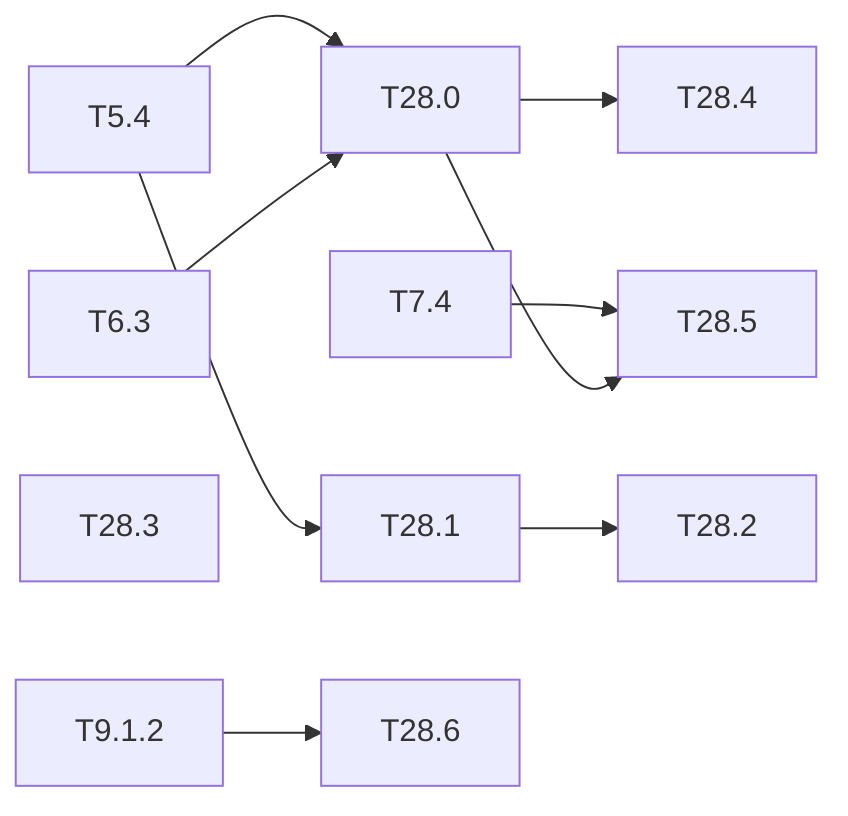

# M28 — Model ↔ circuit equivalence evidence (optional)

Goal: show, with evidence that a reviewer can check, that the circuit computes what the
validated model computes. This is the first gap of the thesis state of the art (ARCYS,
2026-10):

- on FPGA the accuracy after quantization is rarely measured on the target, and the losses
  are large and unpredictable (Karki 2026, preprint; Schlosser 2023: −2.2 points at
  quantization, more at compilation);
- the EASA Concept Paper asks that properties be preserved after conversion (IMP-06) and
  only admits implementation optimizations without effect on the behaviour (MOC IMP-04-2);
  formal methods are "expected to be necessary", with no means of compliance;
- CoDANN II (§3.6.1) defines three levels of equivalence: **pointwise** (same output),
  **bounded proximity** (bounded gap) and **statistical** (same performance). A fixed-point
  dataflow chain can aim at the pointwise level, a GPU only at proximity;
- ACETONE (de Albuquerque Silva 2022) generates traceable C in FP32 with a 10⁻⁶ gap, tested
  and not proved; no work covers a quantized model down to HLS.

The repo already has bit-exact stages (integer `IntNetwork` == C++ golden == HLS C-sim, M5,
M6, M24). This milestone turns those checks into an equivalence argument: what level is
reached between which stages, on which inputs, and why the remaining stages are covered.
Formal verification is aimed at **components** (scalar kernels, accumulators, NMS), where
it scales, not at the whole network (52,650 parameters is the largest bit-exact QNN verified,
Henzinger 2021).

**State** (2026-10-20): T28.1, T28.2 and T28.3 done
([results/equivalence.md](../../results/equivalence.md), [docs/traceability.md](../traceability.md)).
Python == golden == HLS on 105.6 M swept accumulators of the four exports. 95 SMT
obligations are proved for every shift. T28.1 found an int32 overflow in the golden leaky (unreachable
on the exports, fixed). T28.0, T28.4 and T28.6 remain on the PC; T28.5 needs the board.

### [ ] T28.0 — Equivalence matrix
- **Spec**: §9, §10.2 · **Depends on**: T5.4, T6.3 · **Size**: M
  · **Runs on**: PC (C-sim rows); PC + Vitis for co-sim; board for the board row
- **Deliverables**: `tools/equivalence.py`; `results/equivalence.md`
- **Acceptance**: for each network (Tiny-YOLOv2, v3, v4) and each layer, the level reached
  between consecutive stages — float → fake-quant: statistical (mAP gap) and proximity
  (max abs error per layer); fake-quant → integer, integer → golden, golden → C-sim:
  pointwise (byte-identical) on N images — with N, the image set and the date; generated
  from the existing dumps, `--check` mode
- **Notes**: the C-sim → co-sim and co-sim → board rows stay "pending" until Vitis and the
  board (M6, M7).
- **Deferred** (Vitis, board): [deferred/M28](deferred/M28-equivalence.md) — T28.0, co-sim and board rows.

### [x] T28.1 — Exhaustive operator tests
- **Spec**: §9.3, §9.4 · **Depends on**: T5.4 · **Size**: M
  · **Runs on**: PC (Python, golden, C-sim gcc)
- **Deliverables**: `python/tests/test_exhaustive_ops.py`, C++ counterpart in the golden
  tests, HLS testbench mode
- **Acceptance**:
  - requantization + leaky + saturation: every int32 accumulator value in the range reachable
    by each layer (bounded by the worst case of [T4.3](M4-quantification.md)), or a dense
    sweep plus all boundaries when the range is too large; Python == golden == HLS;
  - every LUT (sigmoid, exp, SiLU when M26 lands) over its 256 inputs;
  - the run time and the number of values tested are given.
- **Done**:
  - **Sweep**: `python/yolo/quant/bounds.py` (exact reachable range per channel, sweep of
    every step of the output).
  - **Implementations compared**: `golden_ops requant` (cpp/golden/tools) and `tb_ops --ops`
    (`store_tile`) == Python on 16.0 / 17.4 / 16.9 / 55.3 M values (v2 / v3 / v4 / v7), in
    33 s.
  - **C++ boundary test**: `test_ops_exhaustive.cpp` checks the golden against a 128-bit
    specification on every rounding boundary of every n (31 M assertions).
  - **Tables**: σ, e^t and softmax-exp tables == Python on 256 inputs per head; SiLU table
    (T26.2) on 256 inputs × 5 random scales.
  - **Finding**: 13·y in int32 in `golden::leaky_int` (overflow below −165 M). Now on
    64 bits.
### [x] T28.2 — Formal proof of the scalar kernels
- **Spec**: §9.3 · **Depends on**: T28.1 · **Runs on**: PC · **Size**: M
- **Deliverables**: `tools/prove_kernels.py` (z3 as an optional dependency, test skipped
  without it); section in `results/equivalence.md`
- **Acceptance**:
  - for all 32-bit inputs, the requantization (multiply, shift, rounding, saturation) of
    the C++ golden equals the Python specification, proved by SMT, not sampled;
  - for each layer, no int32 overflow of the accumulator, proved from the int8 weights of the
    export;
  - a deliberately wrong rounding is caught (counter-example printed).
- **Notes**: the C++ is re-expressed in z3 by hand; the gap between that model and the
  source is the residual risk, covered by T28.1.
- **Done**:
  - **Proof**: `tools/prove_kernels.py` (extra `formal`, `make prove-kernels`) proves 95
    obligations for all int32 accumulators, all 0 < M0 < 2ⁿ and every n ∈ [1, 31], in 135 s:
    no int64 overflow, a lossless int32 cast, floor-rounding, leaky, clip.
  - **Precondition**: M0 < 2ⁿ is now checked by `Model::load`.
  - **Mutants**: no rounding, and leaky on 32 bits; both give a counter-example.
  - **Overflow**: no int32 overflow on the 103 exported layers. The widest accumulator is
    27 bits (v2 L13), and partial sums are included.
  - **Test**: `test_prove_kernels.py`.

### [x] T28.3 — Per-layer traceability
- **Spec**: §3, §10.3 · **Depends on**: — · **Runs on**: PC · **Size**: M
- **Deliverables**: `tools/traceability.py`; `docs/traceability.md` (generated)
- **Acceptance**: each cfg operation (conv, leaky, maxpool, route, upsample, yolo head) maps
  to its Python function, golden function, HLS function and `LayerDesc` fields, with file and
  line; `--check` in `make ci` fails when a symbol moves or disappears
- **Done**:
  - **Table**: 14 operations (SiLU and the HLS ABFT lane included) → Python, golden, HLS,
    `LayerDesc` fields.
  - **Check**: `--check` is in `make ci`, and `make traceability` regenerates the document.
  - **Test**: `test_traceability.py` (a missing symbol is reported, the committed document
    is up to date).

### [ ] T28.4 — Tool-chain risks
- **Spec**: §10.2 · **Depends on**: T28.0 · **Runs on**: PC · **Size**: S
- **Deliverables**: section in `results/equivalence.md`
- **Acceptance**: list of the transformations of Vitis HLS and Vivado that could break
  equivalence (pragmas, `ap_int` / `ap_fixed` rounding and overflow modes, DSP inference,
  retiming, BRAM initialization), and for each one the check that covers it (C-sim, co-sim,
  board hash of T28.5); a short note on tool qualification (DO-178C §12.2, TQL) and why
  testing the output replaces qualifying the tool here

### [ ] T28.5 — Equivalence on the board
- **Spec**: §10.4 · **Depends on**: T7.4, T28.0 · **Runs on**: board (KV260) · **Size**: M
- **Deferred** (board): [deferred/M28](deferred/M28-equivalence.md) — T28.5, deliverables and acceptance.

### [ ] T28.6 — Post-processing equivalence and properties
- **Spec**: §8.1 · **Depends on**: T9.1.2 · **Runs on**: PC (C-sim gcc) · **Size**: S
- **Deliverables**: tests in `python/tests/` and the HLS post-processing testbench
- **Acceptance**: hardware decode + NMS == integer golden on the full test sets already used;
  checked properties: no candidate dropped while below the slot capacity, result independent
  of the order of the cells, overflow flagged (never silent)

## Dependencies

