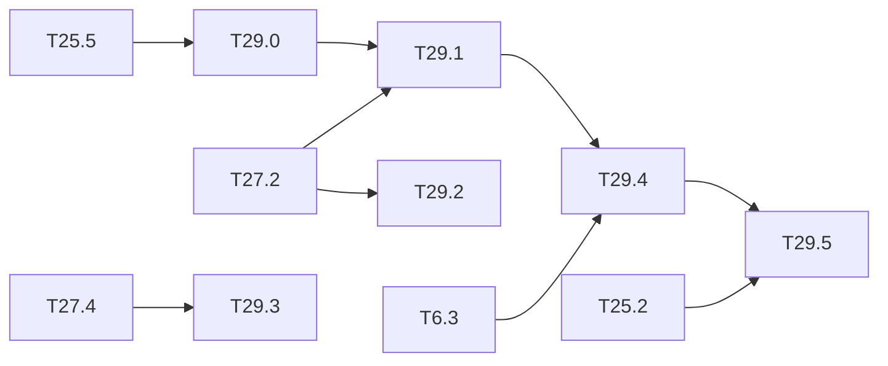

# M29 — Runtime monitors (optional)

Goal: a detector that **signals** the situations where it may miss a person, on the same
chip, at a measured cost. Third gap of the thesis state of the art (ARCYS, 2026-10):

- the EASA Concept Paper asks to monitor the ODD, the input distribution and the confidence,
  with a fallback to a conventional system (EXP-04 to 07, SRM-02); CoDANN (§6.6) separates
  the function (doer) from its monitor (checker), and CoDANN II (§5.2.2) gives the monitor
  the same assurance level as the function;
- the monitors in the literature were tested on classifiers, on CPU or GPU: maximum softmax
  score (Hendrycks 2017), activation patterns (Cheng 2018), abstraction boxes (Henzinger
  2020), SafeML (Aslansefat 2020); on detectors, Gaussian YOLOv3 (Choi 2019) and conformal
  prediction (Andéol 2023), which **does not cover false negatives**;
- none was implemented on an FPGA; several reduce to compares and adds, so their logic cost
  should be small (to be measured).

[T25.5](M25-dependability.md) gives the first monitor (Mahalanobis and autoencoder on the L13
features, OOD sets ExDark and FLIR, `results/ood_monitor.md`). This milestone compares
monitors on the question that matters for safety — "is a person being missed?" — and puts
the best one in the integer chain and the HLS kernel.

**State**: not started (2026-10-20). T29.0 to T29.3 and T29.5 run on the PC.

### [ ] T29.0 — Monitor comparison
- **Spec**: §4, §8 · **Depends on**: T25.5 · **Size**: M
- **Deliverables**: in `python/yolo/infer/ood.py`: maximum objectness (the detector's MSP
  analogue), abstraction boxes per cluster on L13 (Henzinger 2020), binary activation
  patterns on a reduced layer (Cheng 2018), next to the existing Mahalanobis and
  autoencoder; `tools/ood_monitor.py` options; `results/ood_monitor.md` section
- **Acceptance**: same protocol as T25.5 (fit, reference, VOC test, ExDark, FLIR): AUROC,
  false-alarm rate at 95 % detection, memory and MACs per monitor, computed on the integer
  features

### [ ] T29.1 — Monitors against missed persons
- **Spec**: §8.3 · **Depends on**: T29.0, T27.2 · **Size**: M
- **Deliverables**: `results/ood_monitor.md` section
- **Acceptance**: on CrowdHuman val, the degraded sets of [T27.3](M27-safety-metrics.md) and
  ExDark: AUROC of each monitor for the event "this image has at least one missed person at
  the operating point"; share of the missed persons flagged at a fixed alarm rate (1 %,
  5 %); recall of the system "detector or monitor alarm" against the detector alone
- **Notes**: an OOD score can be good at OOD and blind to in-domain misses: report both.

### [ ] T29.2 — Conformal threshold for persons
- **Spec**: §8.1 · **Depends on**: T27.2 · **Size**: M
- **Deliverables**: `python/yolo/infer/conformal.py`; `results/person_safety.md` section
- **Acceptance**: split-conformal calibration of the person score threshold (and of a box
  margin) for a target miss rate; empirical coverage on the test half within the
  finite-sample bound, over 20 random splits; the FPPI it costs; what happens under the
  degradations of T27.3 (coverage lost when the data is not exchangeable)
- **Notes**: Andéol 2023 covers the boxes, not the misses; here the risk controlled is the
  false negative.

### [ ] T29.3 — Temporal vote
- **Spec**: §8 · **Depends on**: T27.4 · **Size**: M
- **Deliverables**: `python/yolo/infer/temporal.py` (k-of-n persistence per zone, simple
  IoU association, no Re-ID); `results/person_safety.md` section
- **Acceptance**: the dreaded-event rate of T27.4 with and without the vote, for several
  (k, n), against the added latency in frames; detection of the faults of
  [T25.8](M25-dependability.md) by temporal incoherence
- **Notes**: Rech 2024 reports ≈ 70 % of critical errors detected by temporal coherence
  (other work, not comparable).

### [ ] T29.4 — Monitor in the integer chain and the HLS kernel
- **Spec**: §10.2 · **Depends on**: T29.1, T6.3 · **Size**: L
- **Deliverables**: the chosen monitor in integer (int8 features, int32 sums, compares) in
  `IntNetwork`, the C++ golden and the HLS kernel or a small side kernel reading the L13
  buffer; score and flag in a status register (`sw/driver/regmap.hpp`); `perf_model` cost
- **Acceptance**: Python == golden == C-sim on the monitor score, byte for byte; detector
  outputs unchanged; LUT, DSP, BRAM and cycles added, and latency added to the frame
- **Notes**: abstraction boxes are 2 compares per neuron and cluster; Mahalanobis needs a
  matrix product (1024² MACs on pooled features), likely on the ARM instead.

### [ ] T29.5 — Fallback logic
- **Spec**: §10.4 · **Depends on**: T29.4, T25.2 · **Size**: S
- **Deliverables**: state machine in `sw/` (detector result, monitor flag, ABFT flag, frame
  watchdog → `CLEAR` / `PERSON` / `UNSAFE`), unit tests; `sw-sim` backend
- **Acceptance**: every combination of inputs tested; a missing frame or a late frame
  (watchdog from [T30.0](M30-latency-bound.md)) gives `UNSAFE`; the output is `UNSAFE` by
  default at start-up

## Dependencies

