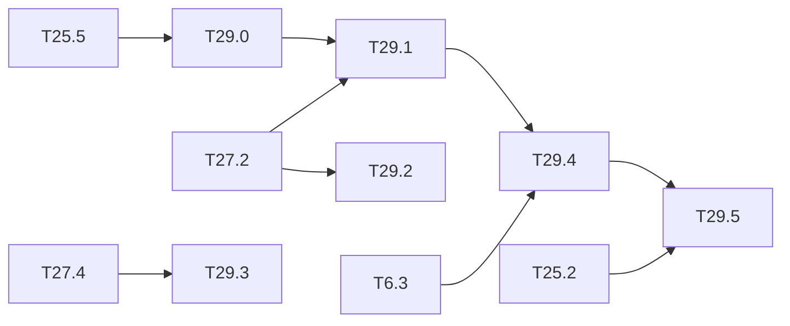

# M29 — Runtime monitors (optional)

Goal: a detector that **signals** the situations where it may miss a person, on the same
chip, at a measured cost. Third gap of the thesis state of the art (ARCYS, 2026-10):

- the EASA Concept Paper asks to monitor the ODD, the input distribution and the confidence,
  with a fallback to a conventional system (EXP-04 to 07, SRM-02); CoDANN (§6.6) separates
  the function (doer) from its monitor (checker), and CoDANN II (§5.2.2) gives the monitor
  the same assurance level as the function;
- the monitors in the literature were tested on classifiers, on CPU or GPU: maximum softmax
  score (Hendrycks 2017), activation patterns (Cheng 2018), abstraction boxes (Henzinger
  2020), SafeML (Aslansefat 2020); on detectors, Gaussian YOLOv3 (Choi 2019) and conformal
  prediction (Andéol 2023), which **does not cover false negatives**;
- none was implemented on an FPGA; several reduce to compares and adds, so their logic cost
  should be small (to be measured).

[T25.5](M25-dependability.md) gives the first monitor (Mahalanobis and autoencoder on the L13
features, OOD sets ExDark and FLIR, `results/ood_monitor.md`). This milestone compares
monitors on the question that matters for safety — "is a person being missed?" — and puts
the best one in the integer chain and the HLS kernel.

**State** (2026-10-27): T29.0 done ([results/ood_monitor.md](../../results/ood_monitor.md)).
No monitor wins on both shifts: the detector's max score is the best on ExDark (AUROC 0.81),
the activation patterns on FLIR (AUROC 0.93). T29.2 done on PREWID: the conformal threshold
does not hold its bound across CCTV blocks, and loses it under every degradation. T29.3 measured on
PREWID `lab` and MOT17: the hold 1/3 helps on short gaps only; its T25.8 part waits.
T29.1 measured at the T27.2 point on PREWID and COCO: the OOD scores are blind to the
missed persons (AUROC ≤ 0.62), the learned head of T39.1 is not (0.84-0.97); ExDark measured;
CrowdHuman and the degraded sets pending.

### [x] T29.0 — Monitor comparison
- **Spec**: §4, §8 · **Depends on**: T25.5 · **Runs on**: PC · **Size**: M
- **Deliverables**: in `python/yolo/infer/ood.py`: maximum objectness (the detector's MSP
  analogue), abstraction boxes per cluster on L13 (Henzinger 2020), binary activation
  patterns on a reduced layer (Cheng 2018), next to the existing Mahalanobis and
  autoencoder; `tools/ood_monitor.py` options; `results/ood_monitor.md` section
- **Acceptance**: same protocol as T25.5 (fit, reference, VOC test, ExDark, FLIR): AUROC,
  false-alarm rate at 95 % detection, memory and MACs per monitor, computed on the integer
  features
- **Done**:
  - **Monitors**: `ood.MaxScore`, `AbstractionBoxes` (4 k-means clusters, compare-only),
    `ActivationPatterns` (64 bits, Hamming distance); `pool_int` (integer pooled features),
    `fpr_at_tpr`.
  - **Command**: `tools/ood_monitor.py compare` runs the six monitors against VOC test,
    ExDark and FLIR, raw and typicality, and writes `build/m25/ood/compare.json`.
  - **Results**:
    - max_score: AUROC 0.81 / 0.80, one compare.
    - patterns: AUROC 0.78 / 0.93, FPR@95 29 % on FLIR, 12.5 KB.
    - Mahalanobis and the autoencoder are dominated at 10³ to 10⁴ times the cost.

### [ ] T29.1 — Monitors against missed persons
- **Spec**: §8.3 · **Depends on**: T29.0, T27.2 · **Runs on**: PC · **Size**: M
- **Deliverables**: `results/ood_monitor.md` section
- **Acceptance**: on CrowdHuman val, the degraded sets of [T27.3](M27-safety-metrics.md) and
  ExDark: AUROC of each monitor for the event "this image has at least one missed person at
  the operating point"; share of the missed persons flagged at a fixed alarm rate (1 %,
  5 %); recall of the system "detector or monitor alarm" against the detector alone
- **Notes**: an OOD score can be good at OOD and blind to in-domain misses: report both.
  The learned monitor of [T39.1](M39-failure-prediction.md) uses the same protocol, to be
  compared row by row.
- **Progress** (code done in M39, 2026-10-26; full run waiting for T27.2 and T27.3):
  - **Code**: `tools/ood_monitor.py compare --labels <labels of tools/failure_labels.py>`
    fits norm, Mahalanobis, max score, abstraction boxes and activation patterns on the fit
    split of a labels file and reports, on its test split: AUROC (all images, and images
    with persons), missed persons flagged at 1 % and 5 %, system recall. Raw score or
    typicality, chosen on val. The autoencoder is left out (full maps needed, dominated in
    T29.0). `--failure` adds the T39.1 heads as rows.
  - **Reduced run** (Tiny-YOLOv3 COCO, threshold 0.25 provisional, in
    [results/failure_prediction.md](../../results/failure_prediction.md)): on COCO persons
    every OOD score stays at AUROC 0.38-0.54 while the max score reaches 0.66-0.77, so they
    are blind to in-domain misses, as the note expected.
  - **At the T27.2 point** (2026-10-27, YOLOv4-tiny integer, test splits of PREWID `test`,
    `lab` and the COCO persons, [results/failure_prediction.md](../../results/failure_prediction.md)):
    - Best AUROC of the OOD scores for "this image has a missed person": 0.60 / 0.62 / 0.58
      (activation patterns, Mahalanobis); max score 0.57 / 0.60 / 0.61; learned head of
      T39.1 0.94 / 0.97 / 0.84.
    - Missed persons flagged at 5 % alarms on `lab`: 0 % (norm, Mahalanobis, boxes), 6 %
      (patterns), 3 % (max score), 53 % (head).
    - The OOD scores stay blind to in-domain misses, as the note expected. Mahalanobis costs
      9.4 MB and 2.4 M ops for nothing.
    - ExDark (real low light): the norm reaches 0.60 and the max score 0.71 (typicality),
      the head 0.84. 14 % of the missed persons flagged at 5 % by the norm, 19 % by the head.
  - **Alarms for T27.7**: `compare --apply <labels> --flags <dir> [--rate-on val|apply]`
    writes the per-image alarms of every monitor at 1 % and 5 % on another set. The
    thresholds of `test` do not transfer to `lab` (0 or 100 % alarms), so the rows of T27.7
    set the alarm rate on the `lab` scores.
  - **Not run**: CrowdHuman val, the T27.3 degraded sets (`failure_labels.py` has no
    `--degrade` yet).

### [x] T29.2 — Conformal threshold for persons
- **Spec**: §8.1 · **Depends on**: T27.2 · **Runs on**: PC · **Size**: M
- **Deliverables**: `python/yolo/infer/conformal.py`; `results/person_safety.md` section
- **Acceptance**: split-conformal calibration of the person score threshold (and of a box
  margin) for a target miss rate; empirical coverage on the test half within the
  finite-sample bound, over 20 random splits; the FPPI it costs; what happens under the
  degradations of T27.3 (coverage lost when the data is not exchangeable)
- **Notes**: Andéol 2023 covers the boxes, not the misses; here the risk controlled is the
  false negative.
- **Done** (2026-10-27, PREWID; CrowdHuman val to add when its data is on the PC):
  - **Code**: `python/yolo/infer/conformal.py` (per-person split conformal with its
    Beta(k, n + 1 − k) spread, per-image conformal risk control after Angelopoulos 2022,
    box margin quantile); `person_safety.py conformal` (20 random splits of blocks of
    consecutive frames, the T27.3 degradations at the clean threshold); tests in
    `python/tests/test_conformal.py` and `test_person_safety.py`.
  - **Results** (YOLOv4-tiny integer, [results/person_safety.md](../../results/person_safety.md)):
    on PREWID `test` the per-person threshold for α = 5 % misses 8.1 % of the test persons
    on average (bound 4.6 %, Beta 5-95 % range 2.3-7.5 %); only 1 of the 11 splits with a
    threshold stays under α. Exchangeability does not hold between blocks of 4 CCTV
    cameras. The per-image risk control is closer (6.3 % for 5 %, 12.5 % for 10 %) but
    spreads from 1 to 15 %. On `lab` (one 3,000-frame sequence) the spread is wider still
    (2-40 % at α = 10 %).
  - **FPPI paid**: 1.8 FPPI on average for α = 5 % per person, 0.18 for α = 10 %.
  - **Box margin**: 0.14 to 0.25 of the box size for a 90-96 % box coverage.
  - **Under degradation** (clean calibration, α = 10 %, integer): the miss rate climbs to
    15-97 %, above α under every degradation. Even severity 1 doubles it (fog 15 %, low light
    29 %): the guarantee is lost as soon as the data shifts, as the task expected.

### [x] T29.3 — Temporal vote
- **Done** (2026-10-29): the T25.8 part is in
  ([results/faults.md](../../results/faults.md#t258-fault-detection-by-temporal-coherence)).
  Temporal incoherence (a track linked over the 2 previous frames and gone) detects 55 % of
  the critical one-frame faults on PREWID `lab` and 52 % on MOT17, at 1 % and 24 % of false
  alarms per fault-free frame; with the ABFT, 85-86 %.
- **Spec**: §8 · **Depends on**: T27.4 · **Runs on**: PC · **Size**: M
- **Deliverables**: `python/yolo/infer/temporal.py` (k-of-n persistence per zone, simple
  IoU association, no Re-ID); `results/person_safety.md` section
- **Acceptance**: the dreaded-event rate of T27.4 with and without the vote, for several
  (k, n), against the added latency in frames; detection of the faults of
  [T25.8](M25-dependability.md) by temporal incoherence
- **Notes**: Rech 2024 reports ≈ 70 % of critical errors detected by temporal coherence
  (other work, not comparable).
- **Progress** (2026-10-27):
  - **Code**: `python/yolo/infer/temporal.py` (k-of-n per IoU-associated track, the last box
    held); `tools/dreaded_event.py --votes k/n,…` (each vote at the T27.4 threshold and at a
    threshold re-tuned to 0.1 FPPI after the vote, events counted as T27.4, added latency
    per episode); tests in `python/tests/test_temporal.py` and `test_person_safety.py`. 1/1
    reproduces T27.4 exactly on both sets.
  - **PREWID `lab`** (YOLOv4-tiny integer, 10 frames/s assumed): at equal FPPI the hold
    1/3 lowers the per-frame miss from 9.11 to 7.20 % and the 10-frame events from 3 to 1,
    for +0.25 frame of latency on average. Confirmations (2/2, 3/3) add misses and 1 to
    4 frames of latency (up to 14).
  - **MOT17 train**: the detector misses 80 % of the person-frames at 0.1 FPPI (crowds,
    small persons), and no vote changes that. At equal FPPI the 10-frame events go from
    869 to 823 at best (1/3), at +9.5 frames of latency on average.
  - **Reading**: a hold helps when the misses are short gaps (PREWID), not when the
    detector is blind to a person (MOT17). The vote cannot replace a better detector.

### [ ] T29.4 — Monitor in the integer chain and the HLS kernel
- **Spec**: §10.2 · **Depends on**: T29.1, T6.3 · **Size**: L
  · **Runs on**: PC (C-sim gcc) + perf_model; PC + Vitis for the LUT, DSP and BRAM cost
- **Deliverables**: the chosen monitor in integer (int8 features, int32 sums, compares) in
  `IntNetwork`, the C++ golden and the HLS kernel or a small side kernel reading the L13
  buffer; score and flag in a status register (`sw/driver/regmap.hpp`); `perf_model` cost
- **Acceptance**: Python == golden == C-sim on the monitor score, byte for byte; detector
  outputs unchanged; LUT, DSP, BRAM and cycles added, and latency added to the frame
- **Notes**: abstraction boxes are 2 compares per neuron and cluster; Mahalanobis needs a
  matrix product (1024² MACs on pooled features), likely on the ARM instead.
- **Deferred** (Vitis): [deferred/M29](deferred/M29-runtime-monitors.md) — T29.4, LUT, DSP and BRAM cost.

### [ ] T29.5 — Fallback logic
- **Spec**: §10.4 · **Depends on**: T29.4, T25.2 · **Size**: S
  · **Runs on**: PC (`sw-sim` backend); board for the final check
- **Deliverables**: state machine in `sw/` (detector result, monitor flag, ABFT flag, frame
  watchdog → `CLEAR` / `PERSON` / `UNSAFE`), unit tests; `sw-sim` backend
- **Acceptance**: every combination of inputs tested; a missing frame or a late frame
  (watchdog from [T30.0](M30-latency-bound.md)) gives `UNSAFE`; the output is `UNSAFE` by
  default at start-up
- **Deferred** (board): [deferred/M29](deferred/M29-runtime-monitors.md) — T29.5, final check.

## Dependencies

