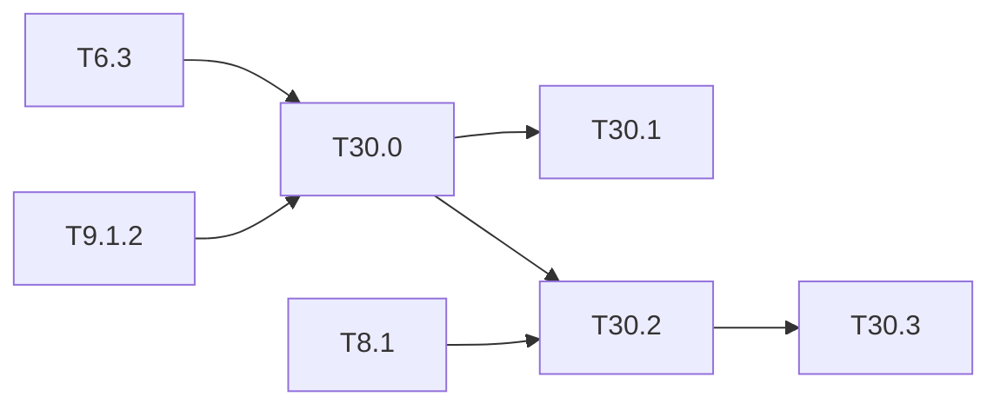

# M30 — Latency bound and determinism (optional)

Goal: a latency bound that can be **demonstrated**, not only a mean. Sixth gap of the thesis
state of the art (ARCYS, 2026-10):

- FPGA papers give mean latencies; the latency can vary with the video (Fata 2026, Fig. 14)
  and the post-processing on the ARM is often the limit; no worst case, p99 or end-to-end
  jitter is published;
- CoDANN II argues that an FPGA is more predictable than a GPU (no hidden microcode, no
  DVFS, no shared scheduler), without a measurement;
- on GPU, traceability stops at the NVIDIA drivers (Belcaid 2024).

The engine of the repo is a fixed schedule of `LayerDesc` descriptors: its cycle count should
not depend on the image, except for the decode and the NMS, whose worst case is already
bounded ([T9.1](M9.1-postproc-materiel.md), [T12.7](M12-profils-pc.md)). This milestone
proves the bound for the accelerator, then measures the whole frame on the board.

**State** (2026-10-20): T30.0 done and the C-sim part of T30.1 done
([results/latency_bound.md](../../results/latency_bound.md)). Bound per frame at 200 MHz:
Tiny-YOLOv2 92 ms (watchdog 116 ms); for v3 and v4 the uncapped NMS of the sigmoid heads
dominates (0.52 s). T30.1 co-sim, T30.2 and T30.3 need Vitis or the board.

### [x] T30.0 — Static bound of the accelerator
- **Spec**: §10.3 · **Depends on**: T6.3, T9.1.2 · **Runs on**: PC · **Size**: M
- **Deliverables**: `tools/perf_model.py --wcet`; `results/latency_bound.md`
- **Acceptance**: per network, cycles per layer from the `LayerDesc` only (no image input),
  with the argument that no loop bound depends on data; NMS and decode bound for the worst
  case (all cells pass, slot capacity full); total in ms at the clock of the board, and the
  watchdog value used by [T29.5](M29-runtime-monitors.md)
- **Notes**: DDR transfers are the data-independent part that is not cycle-exact in C-sim:
  bound them by the transfer size and the measured bandwidth (T30.2).
- **Done**:
  - **Tool**: `perf_model.py --wcet`; `wcet_layer` is the sequential schedule + DDR bytes at
    13.44 GB/s + 64 cycles per m_axi phase (an assumption until T30.2), and `postproc_wcet`
    covers every cell, every passing class, 256 full NMS slots.
  - **Argument**: written in `results/latency_bound.md`.
  - **Accelerator bound**: 16.7 / 15.4 / 21.4 Mcycles (v2 / v3 / v4), 2.2× the overlapped
    model.
  - **Finding**: with sigmoid heads, the worst case is 202,800 candidates × 2 × 256 NMS
    compares. A demonstrable bound needs a candidate cap (top-1 class per cell, or a stream
    limit), an input for M29 and M31.
  - **Tests**: `test_perf_model.py`.

### [ ] T30.1 — Cycle distribution in simulation (C-sim part done)
- **Spec**: §10.3 · **Depends on**: T30.0 · **Size**: M
  · **Runs on**: PC (C-sim gcc); PC + Vitis for the co-sim cycles
- **Deliverables**: cycle counters of the C-sim (and of the co-sim when Vitis is available)
  over ≥ 10,000 images; adversarial inputs (uniform, noise, an image that makes every cell
  pass); `results/latency_bound.md` section
- **Acceptance**: the accelerator cycle count is identical for every image (or its spread is
  explained); the post-processing maximum is ≤ the static bound of T30.0 and reached by the
  adversarial input
- **Done (C-sim)**:
  - **Accelerator**: its cycle count is a function of the descriptor only (argument of T30.0;
    the C-sim counters are those of `perf_model --check`).
  - **Post-processing**: `tb_post --csv build/hls/cycles_post.csv` (in `make hls-cycles`)
    adds the adversarial input "every cell and every class passes". Its cycles are ≤ the
    static bound, and the tables, scan and decode terms and the v3 candidate count are
    reached exactly (`test_postproc_bound_vs_adversarial_csim`).
  - **Remaining**: the run over ≥ 10,000 real images.
- **Deferred** (Vitis): [deferred/M30](deferred/M30-latency-bound.md) — T30.1, co-sim cycles.

### [ ] T30.2 — End-to-end latency on the board
- **Spec**: §10.4 · **Depends on**: T8.1, T30.0 · **Runs on**: board (KV260) · **Size**: M
- **Deferred** (board): [deferred/M30](deferred/M30-latency-bound.md) — T30.2, deliverables and acceptance.

### [ ] T30.3 — Sources of non-determinism on the PS
- **Spec**: §10.4 · **Depends on**: T30.2 · **Runs on**: board (KV260) · **Size**: M
- **Deferred** (board): [deferred/M30](deferred/M30-latency-bound.md) — T30.3, deliverables and acceptance.

## Dependencies

