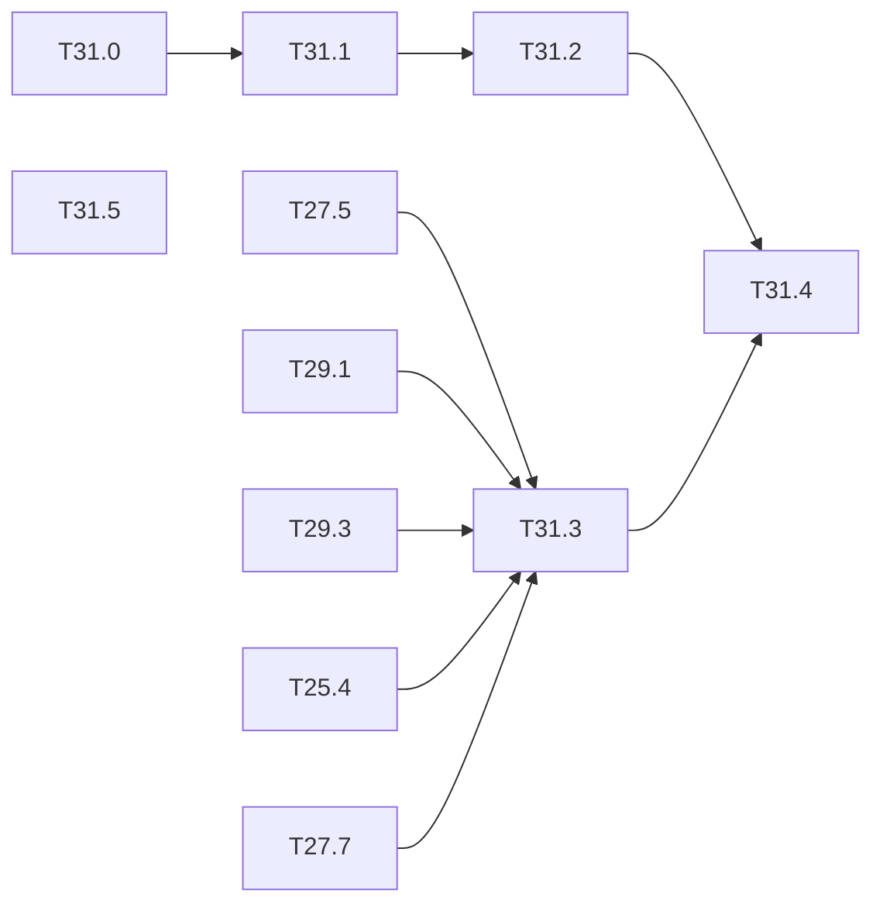

# M31 — Assurance case (optional)

Goal: tie the measurements of M25 and M27 to M30 into one argument for the example use case
(person in a dangerous industrial zone), and place it against the ML guidance and the
machine-safety standards. Gaps of the thesis state of the art (ARCYS, 2026-10):

- the ML certification frameworks (EASA CoDANN I and II, EASA Concept Paper Issue 02, AMLAS,
  DEEL) say what to prove, not how on an FPGA, and come from aviation and automotive; none
  is mapped to IEC 61508, IEC 62061, ISO 13849, IEC 61496 or ISO/IEC TR 5469;
- the closest applied case (Belcaid 2024, ED-324 / ARP 6983) does the ODD and the data on a
  Jetson, without verification or monitor;
- a detector alone is 4 to 5 orders of magnitude away from a SIL 2 (DEEL §4.2.4.4): the gap
  must come from the architecture (monitor, temporal vote, fallback), and each element's
  gain must be measured.

This milestone is mostly writing; its value is that every claim points to a generated
result of the repo. The standards themselves have not been read yet: their columns are
marked "to read" until they are.

**State** (2026-10-27): all six tasks done, on the results present today
([docs/safety/](../safety/), [results/failure_budget.md](../../results/failure_budget.md)).
The budget and the argument are **provisional**: most of their inputs (T25.4, T29.1 full
runs, T29.3, T29.5, T27.7 monitor rows) are open, so they say where the proof stands, not
that the function is safe. Regenerate with `make failure-budget` when an input lands;
`make ci` runs `tools/safety_case.py --check`.

### [x] T31.0 — Operational design domain
- **Spec**: — · **Depends on**: — · **Runs on**: PC · **Size**: S
- **Deliverables**: `docs/safety/odd.md`
- **Acceptance**: the example use case described by measurable parameters — zone size and
  camera height, person distance and minimum height in pixels, lighting range, dust and
  fog, occlusion, posture, PPE, frame rate — each linked to a dataset or a degradation of
  [T27.3](M27-safety-metrics.md), or marked "not covered"
- **Notes**: the target standard (IEC 61496 or another) is an expected input from ARCYS; it
  is written at the top of the file, or "to be given by ARCYS".
- **Input from M27** (2026-10-26): the six degradations of `tools/degrade.py` (T27.3) are
  the proposed ODD axes, each at 3 severities: low light, fog / dust, motion blur, sensor
  noise, JPEG, partial occlusion; their recall cost on PREWID is in
  [results/person_safety.md](../../results/person_safety.md).
- **Done** (2026-10-27): [odd.md](../safety/odd.md), 14 parameters. Target standard "to be
  given by ARCYS".
  - Covered: height ≥ 30 px, fog, blur, noise and JPEG at severity 1, empty frames, network.
  - Partial: zone geometry, low light and occlusion (> 20 points lost at severity 1).
  - Not covered: distance, posture, PPE.

### [x] T31.1 — Hazard and safety requirements
- **Spec**: — · **Depends on**: T31.0 · **Runs on**: PC · **Size**: S
- **Deliverables**: `docs/safety/requirements.md`
- **Acceptance**: dreaded event ("person in the zone, not reported during N frames, at
  distance ≤ d"); requirements with numbers and a verification method each: recall at
  FPPI, reaction time bound, monitor coverage, fault detection, behaviour at start-up and on
  a missing frame; each requirement tied to one of the three event families of
  [T25.10](M25-dependability.md) (perception error, execution anomaly, missed deadline)
- **Done** (2026-10-27): [requirements.md](../safety/requirements.md).
  - E1: N = 5 frames, ≥ 30 px. SR-01 to SR-13, each with a number, a method, a family
    (P / X / D) and a status.
  - Not met: recall 90 % against the 95 % target, monitor 9-12 % against 90 %, `q` buffer
    silent, order-dependent NMS (the M28 finding).
  - Open: vote, fallback, start-up, missing frame, reaction time.

### [x] T31.2 — Map of the objectives to the evidence
- **Spec**: — · **Depends on**: T31.1 · **Runs on**: PC · **Size**: M
- **Deliverables**: `docs/safety/objectives.md`
- **Acceptance**: one row per objective — EASA Concept Paper (LM-02, LM-06, IMP-04-2, IMP-05,
  IMP-06, EXP-04 to 07, SRM-02), CoDANN II equivalence levels, AMLAS stages 1 to 6 — with the
  evidence in the repo (task, result file, test) or "missing"; columns IEC 61508, ISO 13849,
  IEC 61496 / TS 61496-4-3 and ISO/IEC TR 5469 marked "to read" until the texts are read
- **Done** (2026-10-27): [objectives.md](../safety/objectives.md).
  - Rows: 10 EASA, 4 CoDANN II, 6 AMLAS, each with its evidence and gap.
  - Standards columns "to read".
  - The subject of LM-06, IMP-05 and EXP-07 is "to check": the repo does not cite their text.
  - Slot `m36:explainability` for T36.11.

### [x] T31.3 — Dangerous failure rate budget
- **Spec**: — · **Depends on**: T27.5, T27.7, T29.1, T29.3, T25.4 · **Runs on**: PC · **Size**: M
- **Deliverables**: `tools/failure_budget.py`; `results/failure_budget.md`
- **Acceptance**: per hour, the contributions of model misses (T27.5), hardware faults
  (fault rate assumption × undetected share from M25), monitor coverage (T29.1) and temporal
  vote (T29.3), unflagged misses (T27.7), combined with the independence assumptions written; result in orders of
  magnitude against SIL 1 to 3 / PL c to e; sensitivity to each assumption
- **Done** (2026-10-27): `make failure-budget`; tests in `python/tests/test_failure_budget.py`.
  - The model rate is read from the T27.5 section, so the budget follows a new run.
  - Total 22.6 /h: +7.4 orders above SIL 2 / PL d, +8.4 above SIL 3 / PL e.
  - The perception term is the whole budget. The hardware (10⁴ FIT assumed × 24 % silent)
    and deadline terms are 10⁻⁶ /h.
  - Levers: monitor coverage at 0.9 gives −1 order; a vote at 0.01 gives −2.
  - Provisional inputs: coverage, vote, silent share, hw_miss, watchdog.

### [x] T31.4 — Assurance argument
- **Spec**: — · **Depends on**: T31.2, T31.3 · **Runs on**: PC · **Size**: M
- **Deliverables**: `docs/safety/argument.md` (GSN-style goal / strategy / evidence tree in
  mermaid); a check in `make ci` that every evidence leaf points to an existing file
- **Acceptance**: the top goal ("the zone monitor reports a person within the bound with the
  target rate, inside the ODD") decomposed down to results of the repo; the undeveloped
  goals listed as open work
- **Done** (2026-10-27): [argument.md](../safety/argument.md).
  - G0 → three families + budget, 12 evidence leaves, each saying whether the goal is met.
  - Five undeveloped goals (◇) and an open-work table.
  - `tools/safety_case.py --check` in `make ci`: leaf ↔ row, paths, and every link of
    `docs/safety/`. Tests in `python/tests/test_safety_case.py`.

### [x] T31.5 — Perspectives
- **Spec**: — · **Depends on**: — · **Runs on**: PC · **Size**: S
- **Deliverables**: section in `docs/safety/argument.md`
- **Acceptance**: short notes, each with what would be needed in the repo: continual
  learning under certification (frozen backbone, small adapted head, embedded non-regression
  test and rollback; EASA MOC LM-02 forbids online learning today), adversarial patches
  against person detection (Thys 2019) and the effect of quantization on them, tracking and
  re-identification on the SoC
- **Done** (2026-10-27): section "Perspectives" of [argument.md](../safety/argument.md).

## Dependencies

