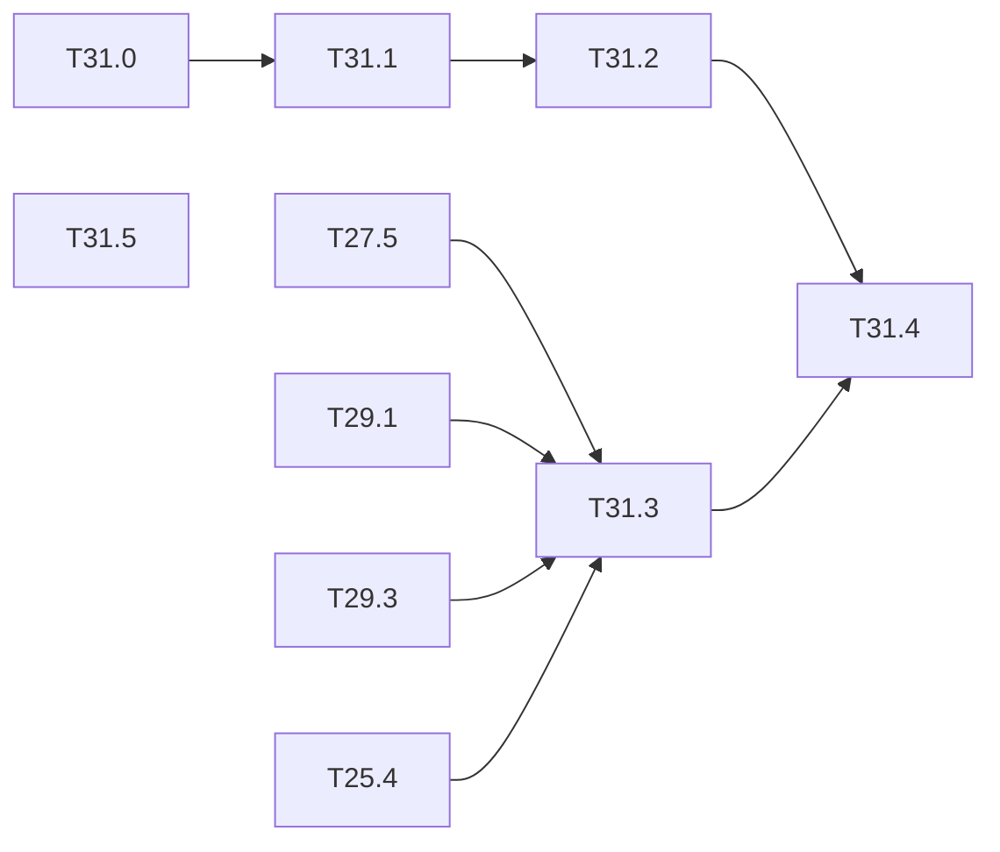

# M31 — Assurance case (optional)

Goal: tie the measurements of M25 and M27 to M30 into one argument for the example use case
(person in a dangerous industrial zone), and place it against the ML guidance and the
machine-safety standards. Gaps of the thesis state of the art (ARCYS, 2026-10):

- the ML certification frameworks (EASA CoDANN I and II, EASA Concept Paper Issue 02, AMLAS,
  DEEL) say what to prove, not how on an FPGA, and come from aviation and automotive; none
  is mapped to IEC 61508, IEC 62061, ISO 13849, IEC 61496 or ISO/IEC TR 5469;
- the closest applied case (Belcaid 2024, ED-324 / ARP 6983) does the ODD and the data on a
  Jetson, without verification or monitor;
- a detector alone is 4 to 5 orders of magnitude away from a SIL 2 (DEEL §4.2.4.4): the gap
  must come from the architecture (monitor, temporal vote, fallback), and each element's
  gain must be measured.

This milestone is mostly writing; its value is that every claim points to a generated
result of the repo. The standards themselves have not been read yet: their columns are
marked "to read" until they are.

**State**: not started (2026-10-20). Documents only; T31.3 and T31.4 need the results of
M25 and M27 to M30.

### [ ] T31.0 — Operational design domain
- **Spec**: — · **Depends on**: — · **Size**: S
- **Deliverables**: `docs/safety/odd.md`
- **Acceptance**: the example use case described by measurable parameters — zone size and
  camera height, person distance and minimum height in pixels, lighting range, dust and
  fog, occlusion, posture, PPE, frame rate — each linked to a dataset or a degradation of
  [T27.3](M27-safety-metrics.md), or marked "not covered"

### [ ] T31.1 — Hazard and safety requirements
- **Spec**: — · **Depends on**: T31.0 · **Size**: S
- **Deliverables**: `docs/safety/requirements.md`
- **Acceptance**: dreaded event ("person in the zone, not reported during N frames, at
  distance ≤ d"); requirements with numbers and a verification method each: recall at
  FPPI, reaction time bound, monitor coverage, fault detection, behaviour at start-up and on
  a missing frame

### [ ] T31.2 — Map of the objectives to the evidence
- **Spec**: — · **Depends on**: T31.1 · **Size**: M
- **Deliverables**: `docs/safety/objectives.md`
- **Acceptance**: one row per objective — EASA Concept Paper (LM-02, LM-06, IMP-04-2, IMP-05,
  IMP-06, EXP-04 to 07, SRM-02), CoDANN II equivalence levels, AMLAS stages 1 to 6 — with the
  evidence in the repo (task, result file, test) or "missing"; columns IEC 61508, ISO 13849,
  IEC 61496 / TS 61496-4-3 and ISO/IEC TR 5469 marked "to read" until the texts are read

### [ ] T31.3 — Dangerous failure rate budget
- **Spec**: — · **Depends on**: T27.5, T29.1, T29.3, T25.4 · **Size**: M
- **Deliverables**: `tools/failure_budget.py`; `results/failure_budget.md`
- **Acceptance**: per hour, the contributions of model misses (T27.5), hardware faults
  (fault rate assumption × undetected share from M25), monitor coverage (T29.1) and temporal
  vote (T29.3), combined with the independence assumptions written; result in orders of
  magnitude against SIL 1 to 3 / PL c to e; sensitivity to each assumption

### [ ] T31.4 — Assurance argument
- **Spec**: — · **Depends on**: T31.2, T31.3 · **Size**: M
- **Deliverables**: `docs/safety/argument.md` (GSN-style goal / strategy / evidence tree in
  mermaid); a check in `make ci` that every evidence leaf points to an existing file
- **Acceptance**: the top goal ("the zone monitor reports a person within the bound with the
  target rate, inside the ODD") decomposed down to results of the repo; the undeveloped
  goals listed as open work

### [ ] T31.5 — Perspectives
- **Spec**: — · **Depends on**: — · **Size**: S
- **Deliverables**: section in `docs/safety/argument.md`
- **Acceptance**: short notes, each with what would be needed in the repo: continual
  learning under certification (frozen backbone, small adapted head, embedded non-regression
  test and rollback; EASA MOC LM-02 forbids online learning today), adversarial patches
  against person detection (Thys 2019) and the effect of quantization on them, tracking and
  re-identification on the SoC

## Dependencies

