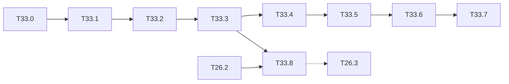

# M33 — YOLOv5n from scratch, without PyTorch (optional)

Goal: the full YOLOv5n (Ultralytics v6.0+ architecture) in NumPy, from the checkpoint file
to a trained and quantized network: torch-free weight reading, blocks in forward **and**
backward passes, decoding, targets, loss, training, then the integer chain. M26 covers the
inference and hardware view and converts the weights with torch (T26.1); this milestone
removes torch from every step, including the conversion, and adds training.

The torch-free pieces written here (`.pt` reader, CIoU, SiLU blocks, training recipe) are
shared with [M34](M34-yolov7-tiny.md) and [M35](M35-yolov8n.md).

Constraints kept:

- `python/yolo/` and `tools/` stay NumPy only ([ADR 0001](../adr/0001-numpy-pur.md)):
  no `torch`, no `ultralytics`, no `torchvision`, not even as an optional extra. The torch
  reference outputs used in the tests are stored once as `.npz` fixtures (from the T26.1
  run) and read back without torch.
- Same layer interface as M1: `forward(x) -> (y, cache)`, `backward(dy, cache) -> (dx, grads)`,
  gradcheck with `python/yolo/testing/gradcheck.py` (float64, ≤ 1e-7).
- The weights are AGPL-3.0 (Ultralytics): check the licence before storing them on Drive or
  quoting numbers in the article (note of T26.1).

Related backlog: [M1](M1-briques-numpy.md) (layers, gradcheck), [M2](M2-cibles-perte-entrainement.md)
(targets, loss, training loop), [M3](M3-inference-evaluation.md) (NMS, mAP), [M4](M4-quantification.md)
(integer model), [T26.1](M26-recent-models.md) (converted description, `ul_graph.py`),
[T26.2](M26-recent-models.md) (float and integer SiLU), [T26.3](M26-recent-models.md)
(YOLOv5n on the hardware chain).

**State** (2026-10-22): T33.0-T33.3 done: the official `yolov5n.pt` is read without torch,
described from its YAML and run as a trainable NumPy network equal to torch to 4·10⁻¹⁴.
T33.4-T33.8 open. The official checkpoints (`weights/ultralytics/`) and the torch reference
fixtures (`weights/m33/`) are local only (gitignored, AGPL, not on Drive); they were made
once by a throwaway torch script that is not in the repo, and the tests that need them are
skipped without them.

## Architecture reference

YOLOv5n = YOLOv5 v6.0 YAML with `depth_multiple = 0.33`, `width_multiple = 0.25`.
Repeats $n' = \max(\mathrm{round}(n·0.33), 1)$, channels $c' = \lceil c·0.25 / 8 \rceil·8$.
`Conv` = conv (no bias) + BN ($\varepsilon = 10^{-3}$, momentum 0.03) + SiLU, padding $k/2$.

| # | Block | Args after scaling | Output (640 input) |
|---|---|---|---|
| 0 | Conv 6×6 / 2, p = 2 | 3 → 16 | 16 × 320 × 320 |
| 1 | Conv 3×3 / 2 | 16 → 32 | 32 × 160 × 160 |
| 2 | C3, n = 1 | 32 → 32 | |
| 3 | Conv 3×3 / 2 | 32 → 64 | 64 × 80 × 80 |
| 4 | C3, n = 2 | 64 → 64 | **P3 route** |
| 5 | Conv 3×3 / 2 | 64 → 128 | 128 × 40 × 40 |
| 6 | C3, n = 3 | 128 → 128 | **P4 route** |
| 7 | Conv 3×3 / 2 | 128 → 256 | 256 × 20 × 20 |
| 8 | C3, n = 1 | 256 → 256 | |
| 9 | SPPF k = 5 | 256 → 256 | |
| 10 | Conv 1×1 | 256 → 128 | **route to 21** |
| 11-13 | Upsample ×2, Concat [−1, 6], C3 n = 1 no shortcut | 256 → 128 | 128 × 40 × 40 |
| 14 | Conv 1×1 | 128 → 64 | **route to 18** |
| 15-17 | Upsample ×2, Concat [−1, 4], C3 n = 1 no shortcut | 128 → 64 | **P3 out**, stride 8 |
| 18-20 | Conv 3×3 / 2, Concat [−1, 14], C3 n = 1 no shortcut | 128 → 128 | **P4 out**, stride 16 |
| 21-23 | Conv 3×3 / 2, Concat [−1, 10], C3 n = 1 no shortcut | 256 → 256 | **P5 out**, stride 32 |
| 24 | Detect: three 1×1 convs with bias | 64 / 128 / 256 → 3·(5 + C) | |

- **Bottleneck**$(c, \text{shortcut})$: $y = x + \mathrm{Conv}_{3×3}(\mathrm{Conv}_{1×1}(x))$ with
  hidden width $c$ (`e = 1.0` inside C3); no add when `shortcut = False`.
- **C3**$(c_1 → c_2, n)$: $c_h = c_2/2$; $a = m(\mathrm{cv1}(x))$ with $m$ = n bottlenecks,
  $b = \mathrm{cv2}(x)$, $y = \mathrm{cv3}([a, b])$ (cv1, cv2: 1×1 $c_1 → c_h$; cv3: 1×1 $2c_h → c_2$).
- **SPPF**$(c_1 → c_2, k=5)$: $x_0 = \mathrm{cv1}(x)$ ($c_1/2$), $x_1 = P(x_0)$, $x_2 = P(x_1)$,
  $x_3 = P(x_2)$ with $P$ = maxpool 5×5 / 1, padding 2; $y = \mathrm{cv2}([x_0, x_1, x_2, x_3])$.
- **Anchors** (pixels): P3 (10, 13) (16, 30) (33, 23); P4 (30, 61) (62, 45) (59, 119);
  P5 (116, 90) (156, 198) (373, 326).
- **Published**: 1.9 M parameters, 4.5 GFLOPs at 640, COCO val2017 mAP50-95 28.0, mAP50 45.7.

### [x] T33.0 — Torch-free `.pt` reader
- **Spec**: §9.1 · **Depends on**: — · **Size**: M
- **Deliverables**: `python/yolo/io/torch_pickle.py` (`load_pt(path) -> dict[str, np.ndarray]`,
  names as in a torch `state_dict`); `tools/convert_ultralytics.py` rewritten on top of it
  (no `import torch`); `python/tests/test_torch_pickle.py`
- **Acceptance**: on the official `yolov5n.pt` and `yolov8n.pt`, every array equal to the bit
  to the T26.1 `.npz` fixtures (same names, shapes and dtypes before BN folding); the
  converted `.npz` / `.json` identical to the T26.1 output; the test runs without torch
  installed; a crafted pickle that calls a non-whitelisted global is refused
  (`UnpicklingError`), never executed
- **Notes**:
  - Format: a `.pt` file (torch ≥ 1.6) is a zip: `<root>/data.pkl` (the pickled object),
    `<root>/data/<key>` (raw little-endian storages), `<root>/version`, sometimes
    `<root>/byteorder`. Read it with `zipfile`; the root folder name varies.
  - `pickle.Unpickler` subclass:
    - `persistent_load(pid)`: `pid = ("storage", storage_type, key, location, numel)` →
      `np.frombuffer(zip.read(f"{root}/data/{key}"), dtype)` with dtype from the storage
      type (`FloatStorage` float32, `HalfStorage` float16, `LongStorage` int64,
      `IntStorage` int32, `BoolStorage` bool; torch ≥ 2.0 sends `torch.UntypedStorage` with
      the dtype carried by `_rebuild_tensor_v2` through `TypedStorage`; handle both);
    - `find_class(module, name)`: a whitelist. `torch._utils._rebuild_tensor_v2(storage,
      offset, size, stride, requires_grad, hooks[, metadata])` →
      `np.lib.stride_tricks.as_strided(storage[offset:], size, stride·itemsize).copy()`;
      `torch._utils._rebuild_parameter(data, requires_grad, hooks)` → `data`;
      `collections.OrderedDict`, `builtins.set`, `torch.Size` → tuple,
      `torch.device`, `torch.float16`-style dtype objects → a string. Classes of
      `torch.nn.modules.*`, `models.common.*`, `models.yolo.*`, `ultralytics.nn.*` →
      one generic `_Module` stub (stores `__setstate__` / `__dict__`, never imports the
      real module). Anything else raises `UnpicklingError`.
  - Checkpoint layout: `{"model": Module, "ema": Module | None, "epoch", "optimizer", ...}`.
    Use `ema` when present, else `model`. Walk the `_Module` tree (`_modules`, an
    OrderedDict) and collect `_parameters` and `_buffers` (`running_mean`, `running_var`,
    `num_batches_tracked`) with dotted names (`model.2.cv1.conv.weight`, ...): this is the
    state dict. Also read `model.yaml` (dict in the module state) and `stride`,
    `names`, and, for v5, `model.24.anchors` (in stride units).
  - Checkpoints are saved in float16: cast to float32 after reading, keep a test that
    the float16 → float32 cast is the only rounding.
  - Security: a `.pt` from the web is untrusted data (pickle). The whitelist is the
    protection; open it with `python -I`, in its own download folder (environment note of
    the repo).
- **Done**:
  - **Reader**: `yolo.io.torch_pickle`: `unpickle`, `load_checkpoint(path) -> (state dict,
    meta)`, `load_pt`. The two official files use only these globals: `_rebuild_tensor_v2`,
    `_rebuild_parameter`, `OrderedDict`, `set`, `torch.Size`, Float / Half / Double / Long
    storages, and module classes. Modules are rebuilt by NEWOBJ + BUILD, so no
    `copyreg` entry is needed.
  - **Equality**: on `yolov5n.pt` (v7.0, 349 tensors) and `yolov8n.pt` (v8.2.0, 355
    tensors), every array is bit-equal to the state dict read by torch, with the same names,
    shapes and dtypes. Neither file has `ema` (None), so `model` is used. The float16 →
    float32 cast is exact.
  - **Converter**: `tools/convert_ultralytics.py` = `load_checkpoint` + `ul_yaml` +
    `ul_net.fold`, with no torch. Its npz is bit-identical to the T26.1 torch converter
    and its json identical except the anchors. T26.1 wrote the stride units stored in the
    checkpoint, so its "pixel" anchors were wrong (1.25, 1.625, ...); they are now pixels.
    The `convert` extra is removed from `pyproject.toml`.
  - **Tests**: `test_torch_pickle.py` builds pickles opcode by opcode (no torch needed).
    It covers strides, offsets, dtypes, the module tree and non-persistent buffers. A
    crafted `os.system` pickle is refused and the marker file is never created. The reader
    is also run in a subprocess with `torch` blocked. `test_convert_ultralytics.py` no longer
    needs torch.

### [x] T33.1 — Network description from the YAML
- **Spec**: §3 · **Depends on**: T33.0 · **Size**: S
- **Deliverables**: `python/yolo/models/ul_yaml.py`: model YAML (the dict read in T33.0, or
  `yolov5n.yaml` stored in `python/yolo/models/cfg/`) → the flat layer list of
  `ul_graph.py` (same JSON schema, without the BN fold: `conv` layers gain a `bn` field);
  `yolov5n-coco` in `specs.NETWORKS`; MAC table
- **Acceptance**: the parameter count of T26.1 with C = 80 (published 1.87 M);
  the list equal to the one of T26.1 once BN is folded; `make count-macs` gives 4.5 GFLOPs at
  640 (2.25 GMAC, ±1 %) and the 416 value
- **Notes**: the YAML parser implements `make_divisible`, `round(n·gd)`, the `from` indices
  (−1, lists) and the modules `Conv`, `C3`, `SPPF`, `nn.Upsample`, `Concat`, `Detect`; the
  same parser serves YOLOv8 (T35.0) with `C2f` and the v8 `Detect`.
- **Done**:
  - **Parser**: `yolo.models.ul_yaml.parse(cfg)` handles YOLOv5 and YOLOv8 (C2f, DFL
    `Detect`, `slice` layers). Each conv gets `bn` and `name` (state-dict prefix).
  - **YAMLs**: `YOLOV5N` / `YOLOV8N` are Python dicts rather than `cfg/*.yaml`, as pyyaml
    is not a dependency of `yolo/`. They equal the `model.yaml` of the official
    checkpoints (test).
  - **Layer list**: equal to the T26.1 one for both nets (85 and 106 layers) once `bn` /
    `name` are dropped.
  - **Graph support**: `specs.NETWORKS["yolov5n-coco"]`; `specs.layer_sources` accepts
    `from` on any layer; `infer_shapes` handles `concat`, `add`, `slice` and the conv `p`.
  - **Counts**: 1,867,405 parameters with BN folded (published 1.87 M); 1,872,157 unfolded
    (+ one β per BN channel). 2.234 GMAC at 640 (4.47 GFLOPs, published 4.5) and 0.944
    GMAC at 416 (`make count-macs`, new `--size` option).

### [x] T33.2 — Blocks in forward and backward passes
- **Spec**: §4 · **Depends on**: T33.1 · **Size**: M
- **Deliverables**: `python/yolo/layers/blocks.py`: `conv_bn_act` (conv + BN + SiLU or
  leaky, train / eval mode), `bottleneck`, `c3`, `sppf`, `concat`, `add`; each with
  `forward` / `backward`; `python/tests/test_blocks.py`
- **Acceptance**: gradcheck ≤ 1e-7 on every block and every parameter (W, γ, β), float64,
  small sizes (C = 4-8, 8×8 maps), with and without shortcut; the gradient of a shortcut
  add is the sum of the two branch gradients (test); the stride-2, 6×6, padding 2 first conv
  checked against the naive conv (1e-12)
- **Notes**:
  - Backward of a concat: split `dy` along C by the source widths. A tensor read by
    several layers (route, the C3 input read by cv1 and cv2, the SPPF chain where $x_1$
    feeds both $x_2$ and the concat) **accumulates** its gradients: the graph runner sums
    `dx` into a per-tensor buffer and runs the layers in reverse topological order.
  - SPPF backward: the max-pool backward of `pool.py` (argmax routing); ties go to the
    first maximum, as in the forward (test with equal values, gradient mass conserved).
  - BN in training mode uses the batch statistics and updates the running averages with
    momentum 0.03 (PyTorch convention: $\hat\mu ← (1-m)\hat\mu + m\mu_B$); $\varepsilon = 10^{-3}$.
- **Done**:
  - **Blocks**: `yolo.layers.blocks` has `conv_bn_act` (SiLU or leaky, train / eval),
    `bottleneck`, `c3`, `sppf`, `concat` and `add`. Parameters are flat dicts named like
    the torch state dict (`m.0.cv2.W`); BN uses ε 10⁻³, keep factor 0.97, and the running
    variance from the unbiased batch variance (PyTorch). The variance flag is
    `bn_forward(unbiased=)`; Darknet networks are unchanged.
  - **Gradchecks**: ≤ 1e-7 on x, W, γ, β of every block, with and without shortcut, C3
    with n = 1 and 2, in train and eval modes.
  - **Other checks**:
    - the shortcut dx equals the residual-branch dx + dy;
    - three chained 5×5 pools equal the 5 / 9 / 13 windows;
    - the 6×6 / 2 p = 2 conv equals the naive conv (1e-12);
    - on equal values, each window routes its gradient to its first maximum, as a
      brute-force reference does, and the gradient mass is conserved.

### [x] T33.3 — Float network, forward and backward
- **Spec**: §4.5 · **Depends on**: T33.2 · **Size**: M
- **Deliverables**: `python/yolo/models/ul_net.py`: trainable network built from the T33.1
  description (parameters, gradients, `train()` / `eval()`, `fold_bn()` → the `ul_graph`
  description); `yolov5n-coco` loadable by name like the Darknet networks
- **Acceptance**: eval forward == stored torch outputs of the 3 heads to within 1e-4 on the 3
  T26.1 images (fixtures, no torch); after `fold_bn()`, `ul_graph.forward` == unfolded forward
  to within 1e-5; gradcheck of the whole network on a 2-image 64×64 batch, sampled indices
- **Notes**: the network keeps its weights unfused for training; inference, quantization and
  export work on the folded description (`quant/fuse_bn.py` formula, T4.1).
- **Done**:
  - **Network**: `yolo.models.ul_net` runs the `ul_yaml` description in the generic
    `graph.Network`, which now reads `from` on any layer and handles `concat` / `add` /
    `slice`, the conv `p`, `net["outputs"]` and `bn_unbiased`.
  - **API**: `build(name_or_desc, state_dict, pretrained)`, `state_dict`, `load_state_dict`,
    `fold` / `fold_bn` (`ul_graph` schema, float32) and `random_state_dict`.
    `ul_net.build("yolov5n-coco", pretrained=True)` reads `weights/ultralytics/yolov5n.pt`.
  - **Against torch**: eval forward vs the torch heads (float64) on 3 COCO val2017 images
    letterboxed to 640 (139, 285, 632): max error 3.6·10⁻¹⁴.
  - **Folding**: `fold_bn` is bit-identical to the T26.1 weights; `ul_graph.forward` of
    the folded net is within 5.6·10⁻⁶ of the unfolded forward (float32 weights).
  - **Gradchecks**: whole YOLOv5n, 2 images 64×64, training mode: sampled entries of x and
    of 8 parameters (stem, C3 bottleneck, SPPF, P5 C3, heads) ≤ 1e-7. A small Conv + C3 (n = 2)
    + SPPF + head network is checked on every parameter, and the graph's flat list equals
    `blocks.c3` / `blocks.sppf` to 1e-12.

### [ ] T33.4 — Decoding, letterbox and COCO mAP
- **Spec**: §8 · **Depends on**: T33.3 · **Size**: M
- **Deliverables**: `mode="v5"` in `python/yolo/infer/decode.py`; letterbox 640 (gray 114,
  `auto=False`, stride 32) in `data/letterbox.py`; v5 NMS settings in `infer/nms.py`;
  `notebooks/coco/yolov5n-coco_infer.ipynb` from the M14 generator; row in
  `results/map_coco.md`
- **Acceptance**: COCO val2017 mAP50-95 within 0.5 point of the published 28.0 at 640 (conf
  0.001, IoU 0.65, max 300 detections, as the published value); 416 value recorded
- **Notes**:
  - Head output per anchor $a$ and cell $(c_x, c_y)$, all through a sigmoid:
    $b_{xy} = (2σ(t_{xy}) - 0.5 + c_{xy})·s$, $b_{wh} = (2σ(t_{wh}))^2·A_a$,
    score $= σ(t_o)·σ(t_c)$; same formulas as the `new_coords` heads already decoded for
    YOLOv7-tiny (`wh_new_coords`).
  - Multi-label NMS: a box keeps every class with score > conf; class-aware NMS by offsetting
    the boxes by `class · 4096`.

### [ ] T33.5 — Targets
- **Spec**: §5 · **Depends on**: T33.4 · **Size**: M
- **Deliverables**: `build_targets_v5` in `python/yolo/data/targets.py`; test
- **Acceptance**: on hand-built cases, the selected (image, anchor, cell, class) tuples and
  the offsets match the rule below; a box is never assigned outside the grid
- **Notes**:
  - For each level $l$ (stride $s_l$, anchors $A_l$ in grid units) and each ground-truth box
    $(x, y, w, h)$ in grid units: keep anchor $a$ when
    $\max(r, 1/r) < 4$ for both $r = w/A_w$ and $r = h/A_h$ (`anchor_t = 4`). A box can match
    several anchors and several levels.
  - Neighbour cells: besides the cell $(\lfloor x \rfloor, \lfloor y \rfloor)$, take the left
    (or right) neighbour when the fractional part of $x$ is < 0.5 (or > 0.5), same for $y$:
    3 cells per match. The regression targets are the offsets relative to each chosen cell
    (they lie in [−0.5, 1.5], the range of $2σ - 0.5$).

### [ ] T33.6 — Loss and its gradients
- **Spec**: §6 · **Depends on**: T33.5 · **Size**: L
- **Deliverables**: `python/yolo/train/loss_v5.py`: `ciou` (forward and analytic backward)
  in `infer/boxes.py` or `train/iou.py`, `yolo_v5_loss(outputs, targets) -> LossResult`;
  tests
- **Acceptance**: gradcheck of CIoU on random box pairs (including nested and disjoint ones),
  of the full loss on a small batch; loss value == stored torch value on a fixture batch to
  within 1e-5
- **Notes**:
  - CIoU: $L = 1 - \mathrm{IoU} + ρ^2/c^2 + αv$, $v = \frac{4}{π^2}(\arctan\frac{w_g}{h_g} -
    \arctan\frac{w_p}{h_p})^2$, $α = v / (1 - \mathrm{IoU} + v + \varepsilon)$, α treated as a
    constant in the backward (no gradient through α, as the reference).
  - Box term: mean over positives of $1 - \mathrm{CIoU}$, predicted box built as in T33.4.
  - Objectness: BCE with logits on every cell and anchor; target = IoU of the matched
    prediction, detached and clamped at 0 (`gr = 1`); levels weighted by `balance = [4.0, 1.0, 0.4]`.
  - Classes: BCE with logits on positives, one-hot (label smoothing 0).
  - Gains (`hyp.scratch-low`): box 0.05·3/nl, cls 0.5·(C/80)·3/nl, obj 1.0·(img/640)²·3/nl;
    total multiplied by the batch size.
  - Reuse `bce_logits` and `softplus` of `train/loss.py`.

### [ ] T33.7 — Training recipe
- **Spec**: §7 · **Depends on**: T33.6 · **Size**: L
- **Deliverables**: in `python/yolo/train/`: SGD with Nesterov momentum and the three
  parameter groups in `optim.py`, warmup + linear (or cosine) schedule in `schedule.py`,
  weight EMA (`ema.py`); mosaic, random affine, HSV and flip in `data/augment.py`; head bias
  initialisation; `yolov5n-voc_train` notebook (M14)
- **Acceptance**: one image overfitted (box loss → 0, the boxes back at mAP 1.0, as T2.8);
  VOC fine-tuning from the COCO weights for N epochs improves the VOC mAP over the
  out-of-domain value; the training curves in the notebook
- **Notes**:
  - SGD: lr0 0.01, momentum 0.937 (Nesterov), weight decay 5e-4 on conv weights only (no
    decay on BN γ / β and biases); final lr 0.01·lr0 (linear `lrf`).
  - Warmup `max(3 epochs, 100 iterations)`: lr ramps from 0 (weights) and from 0.1 (biases)
    to the scheduled value, momentum from 0.8 to 0.937.
  - Gradient accumulation to a nominal batch of 64.
  - EMA: decay $d(t) = 0.9999·(1 - e^{-t/2000})$, on parameters and BN buffers; evaluate and
    save the EMA weights.
  - Bias init of the head convs: objectness $\log(8 / (640/s)^2)$, classes
    $\log(0.6 / (C - 0.99))$.
  - Augmentation (NumPy, `data/augment.py`): mosaic of 4 images (probability 1), random
    perspective (scale ±0.5, translate 0.1), HSV (h 0.015, s 0.7, v 0.4), horizontal
    flip 0.5; boxes clipped, those under 2 px or with an aspect ratio > 100 dropped.
  - Time: the conv cost is the bottleneck; record the time of an epoch on the PC in
    [long-runs.md](long-runs.md).

### [ ] T33.8 — Integer model and hardware chain
- **Spec**: §9, §10 · **Depends on**: T33.3, T26.2 · **Size**: L
- **Deliverables**: integer `add` (two inputs requantized to a common scale, saturating) in
  `quant/int_layers.py`; SiLU layers wired in calibration, export and driver (the manifest
  field and s_mid calibration left open by T26.2); integer COCO mAP; then T26.3 (stride-2
  convs lowered as in T24.3, golden, C-sim)
- **Acceptance**: integer mAP gap documented (and QAT opened if > 1.5 AP50); integer `add`
  equal in Python and golden on every int8 pair for random scales
- **Notes**: the residual add is the one new integer operator; the 6×6 / 2 first conv lowers
  as the 3×3 / 2 ones (stride-1 conv then decimation).

## Dependencies

