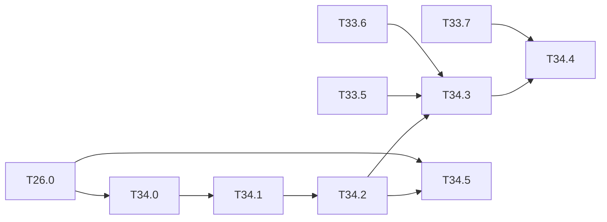

# M34 — YOLOv7-tiny from scratch, without PyTorch (optional)

Goal: YOLOv7-tiny (leaky variant, Darknet cfg) trained and run in NumPy end to end: Darknet
weights, ELAN and SPP-CSP blocks in forward and backward passes, `new_coords` decoding, the
YOLOv5-style targets and loss (with the OTA assignment of the reference training as an
option), training, then the integer chain. [T26.0](M26-recent-models.md) puts the network
on the inference and hardware chain; this milestone adds the backward passes, the loss and
the training, with no torch at any step.

YOLOv7-tiny is the closest of the three recent networks to the existing code: leaky
activation, Darknet `.cfg` / `.weights` (read by `python/yolo/io/darknet_weights.py`, no
pickle), and only conv / maxpool / route / upsample layers. What it adds: routes of 4
sources, stride-1 maxpools 5 / 9 / 13, logistic heads with `scale_x_y = 2` and
`new_coords = 1`, and a training loss that is not the Darknet v3 loss of M2.

Constraints kept: NumPy only ([ADR 0001](../adr/0001-numpy-pur.md)); M1 layer interface and
gradcheck; the shared pieces of [M33](M33-yolov5n.md) (CIoU, targets, loss, training recipe)
are reused, not copied.

Related backlog: [T26.0](M26-recent-models.md) (cfg, weights, float and integer inference,
export, C-sim), [M24](M24-yolov4-tiny.md) (stride-2 lowering, `scale_x_y`, COCO
evaluation), [M1](M1-briques-numpy.md) (route, maxpool, leaky), [M2](M2-cibles-perte-entrainement.md)
(trainer).

**State** (2026-10-22): not started. Available: `python/yolo/models/cfg/yolov7-tiny.cfg`
(100 sections), `new_coords` and `scale_x_y` decoding (`infer/decode.py`), stride-1
maxpools with padding (`layers/pool.py`), route forward / backward (`layers/route.py`);
T26.0 in progress (SPP 5×5 stride-1 pool, `new_coords` heads, calibration).

## Architecture reference

From `yolov7-tiny.cfg` (input 416 in the project, 640 in the reference): every conv is
conv + BN + leaky 0.1, except the three head convs (1×1, bias, `activation=logistic`).

- **Stem**: conv 3×3 / 2 (32), conv 3×3 / 2 (64).
- **ELAN-tiny block** (×4 in the backbone, ×4 in the neck), input $x$, width $c$:
  $a = \mathrm{conv}_{1×1}(x)$, $b = \mathrm{conv}_{1×1}(x)$ (route `-2`),
  $d_1 = \mathrm{conv}_{3×3}(b)$, $d_2 = \mathrm{conv}_{3×3}(d_1)$,
  $y = \mathrm{conv}_{1×1}([d_2, d_1, b, a])$ (route `-5,-3,-2,-1`, then a 1×1 conv).
- **Downsampling**: maxpool 2×2 / 2 between backbone ELAN blocks (strides 8, 16, 32), 3×3 / 2
  convs in the PAN path.
- **SPP-CSP** at stride 32: $u = \mathrm{conv}_{1×1}(x)$, $v = \mathrm{conv}_{1×1}(x)$;
  $[\mathrm{mp}_5(v), \mathrm{mp}_9(v), \mathrm{mp}_{13}(v), v]$ (stride 1, same size) →
  1×1 conv → concat with $u$ (route `-10,-1`) → 1×1 conv.
- **Neck**: FPN (1×1 conv, upsample ×2, route to the backbone, ELAN) then PAN (3×3 / 2 conv,
  route, ELAN); three heads at strides 8, 16, 32 with the YOLOv5 anchors
  (10, 13) … (373, 326), 3 per level.
- **Size**: 2.89 GMAC at 416 (`make count-macs`), 6.2 M parameters.

### [ ] T34.0 — Layer table and parameter check
- **Spec**: §3 · **Depends on**: T26.0 (cfg, weights) · **Size**: S
- **Deliverables**: `tiny-yolov7-coco` in `specs.NETWORKS` with per-layer shapes and MACs;
  test that the weight file is read to the last byte (as `test_darknet_weights.py` for v4)
- **Acceptance**: per-layer BFLOPs equal to the Darknet output for this cfg; parameter count
  equal to the published 6.2 M (with C = 80)
- **Notes**: published COCO numbers of the leaky model (YOLOv7 README) recorded with their
  input size, to compare with T34.2.

### [ ] T34.1 — Backward of the multi-source route and of the stride-1 pools
- **Spec**: §4 · **Depends on**: T34.0 · **Size**: M
- **Deliverables**: `route_backward` for N sources (split of `dy` by the source widths) in
  `layers/route.py`; maxpool backward for k = 5, 9, 13, s = 1, padding $k/2$ in
  `layers/pool.py`; gradient accumulation in `models/graph.py` for a layer read by several
  later layers (the ELAN input read by the two 1×1 convs and by the route; $v$ read by three
  pools and the route); tests
- **Acceptance**: gradcheck ≤ 1e-7 of one ELAN block and of the SPP-CSP block (small widths,
  8×8 maps); the gradient of a tensor read 4 times equals the sum of the 4 contributions;
  the padded border of a pool never receives a gradient
- **Notes**:
  - Padding of the stride-1 pools is $-\infty$ (Darknet and PyTorch): the border cells take
    the max of the valid window only. Check the forward against a naive window max first.
  - Ties: route the gradient to the first maximum in raster order, consistent with the
    forward argmax (gradient mass conserved, test with constant inputs).
  - The SPPF identity of T26.0 ($\mathrm{mp}_9 = \mathrm{mp}_5 ∘ \mathrm{mp}_5$,
    $\mathrm{mp}_{13} = \mathrm{mp}_5^{∘3}$) holds in the forward; in the backward the two
    forms give the same gradient only without ties: keep the direct form for training, the
    chained one for the hardware.

### [ ] T34.2 — Float network and COCO mAP
- **Spec**: §8 · **Depends on**: T34.1 · **Size**: M
- **Deliverables**: forward and backward of the whole graph in train mode (batch BN) and
  eval mode; COCO val2017 mAP at 416 and 640 (letterbox of T33.4); row in
  `results/map_coco.md`; `tiny-yolov7-coco_infer` notebook (M14)
- **Acceptance**: mAP at 640 within 0.5 point of the published value; gradcheck of the full
  network on a 2-image 64×64 batch (sampled indices)
- **Notes**:
  - Decoding (logistic already applied by the head conv, `scale_x_y = 2`, `new_coords = 1`):
    $b_{xy} = (2p_{xy} - 0.5 + c_{xy})·s$, $b_{wh} = (2p_{wh})^2·A$, score $= p_o·p_c$: the
    YOLOv5 formulas of T33.4, already in `decode_head` (`wh_new_coords`, `scale_xy`).
  - Since the head applies the logistic, the loss of T34.3 takes the post-sigmoid values:
    write the BCE on probabilities with the logit recovered as $\log(p/(1-p))$ only for the
    backward through the logistic layer, or (simpler) mark the head conv `linear` during
    training and apply the logistic in the loss, as in T33.6.

### [ ] T34.3 — Targets and loss
- **Spec**: §5, §6 · **Depends on**: T34.2, T33.5, T33.6 · **Size**: M
- **Deliverables**: the v5 targets and loss of M33 run on the Darknet graph outputs
  (`yolo_v5_loss` with the v7-tiny hyperparameters); optional OTA assignment
  `build_targets_ota` in `data/targets.py`; tests
- **Acceptance**: loss and gradient on a fixture batch equal to a stored reference to within
  1e-5; gradcheck through the heads; OTA: on hand-built cases, the dynamic-k selection and
  the conflict resolution match the rule below
- **Notes**:
  - Baseline: candidates exactly as T33.5 (`anchor_t = 4`, 3 cells per match), CIoU box
    loss, IoU-target objectness, BCE classes (T33.6).
  - Reference training (`yolov7` repo, `ComputeLossOTA`): the T33.5 candidates are refined
    per image by a SimOTA-style assignment. Cost $C_{ij} = L^{cls}_{ij} + 3·(-\log
    \mathrm{IoU}_{ij})$ between ground truth $i$ and candidate $j$; dynamic $k_i =
    \max(1, \lfloor \sum \mathrm{top}_{10}(\mathrm{IoU}_{i·}) \rfloor)$; each ground truth
    keeps its $k_i$ cheapest candidates; a candidate claimed by several ground truths goes to
    the cheapest one. Check which loss the published tiny weights were trained with
    (`loss_ota` in the hyp file) before choosing the default.
  - Hyperparameters (`hyp.scratch.tiny.yaml`): box 0.05, cls 0.5, obj 1.0, `anchor_t = 4`,
    balance [4.0, 1.0, 0.4]; read them from the file and record them in the notebook.

### [ ] T34.4 — Training
- **Spec**: §7 · **Depends on**: T34.3, T33.7 · **Size**: M
- **Deliverables**: the M33 recipe (SGD Nesterov, warmup, three parameter groups, EMA,
  mosaic / affine / HSV / flip) on the Darknet graph; `tiny-yolov7-voc_train` notebook (M14);
  run in [long-runs.md](long-runs.md)
- **Acceptance**: one image overfitted (T2.8 criterion); VOC fine-tuning from the COCO
  weights improves on the out-of-domain mAP; float VOC mAP recorded for M15
- **Notes**: the Darknet trainer of M2 (burn-in, steps) stays for the v2 / v3 / v4 networks;
  the v7-tiny path uses the M33 schedule because its weights come from the PyTorch recipe.

### [ ] T34.5 — Integer model and hardware chain
- **Spec**: §9, §10 · **Depends on**: T34.2, T26.0 · **Size**: M
- **Deliverables**: integer COCO and VOC mAP of the trained networks; the T26.0 export,
  golden and C-sim passes rerun on the VOC fine-tuned weights
- **Acceptance**: integer gap documented; golden == C-sim on the fine-tuned network
- **Notes**: the 4-source routes are the T26.0 study (`layout: "contiguous"` or
  `MAX_SEGMENTS` raised in `hls/kernels/layer_desc.hpp`); the logistic heads stay on the
  integer sigmoid LUT of T4.4.

## Dependencies

