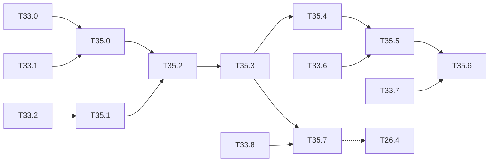

# M35 — YOLOv8n from scratch, without PyTorch (optional)

Goal: YOLOv8n in NumPy end to end: checkpoint read without torch, C2f blocks and the
decoupled anchor-free head in forward and backward passes, DFL decoding, task-aligned
assignment, the BCE + CIoU + DFL loss, training, then the integer chain.
[T26.4](M26-recent-models.md) covers the inference and hardware view; this milestone adds
the backward passes, the assigner, the loss and the training, with no torch at any step.

Constraints kept: NumPy only ([ADR 0001](../adr/0001-numpy-pur.md)); M1 layer interface and
gradcheck; the torch-free `.pt` reader, YAML parser, blocks, CIoU and training recipe of
[M33](M33-yolov5n.md) are reused. Weights under AGPL-3.0 (licence check of T26.1).

Related backlog: [M33](M33-yolov5n.md) (shared pieces), [T26.1](M26-recent-models.md)
(converted description, DFL in `ul_graph.py`), [T26.4](M26-recent-models.md) (integer DFL,
ARM post-processing), [M3](M3-inference-evaluation.md) (NMS, mAP),
[M37](M37-notebooks-recent-models.md) (COCO and VOC notebooks).

**State** (2026-10-23):
- **Done**:
  - T35.0-T35.2: `yolov8n.pt` is read without torch and described from its YAML. C2f
    and the decoupled DFL head are checked in forward and backward passes, and the
    decoded boxes equal the torch boxes to 2·10⁻¹³ px.
  - T35.4: the task-aligned assigner equals the Ultralytics one on real predictions.
  - T35.5: the BCE + CIoU + DFL loss equals `v8DetectionLoss` to 5·10⁻⁷, with gradchecks.
- **Code done, check open**:
  - T35.3: the network equals torch to 1.7·10⁻¹³, but the COCO val2017 mAP (≈ 45 min per
    size on the CPU) is not run yet.
  - T35.6: the v8 recipe (loss, `optimizer=auto`, `close_mosaic`, bias prior) and its
    tests are written; the VOC fine-tuning is in [long-runs.md](long-runs.md).
- **Open**: T35.7, which waits for the integer model of T33.8.

The notebooks are in [M37](M37-notebooks-recent-models.md). The torch references
(`weights/m33/yolov8n_heads.npz`, `yolov8n_loss.npz`, local only, AGPL) were made once by a
throwaway script in a scratchpad venv with ultralytics 8.4.184. That script is not in the
repo, and the tests that need the references are skipped without them.

## Architecture reference

YOLOv8n = `yolov8.yaml` scale `n`: depth 0.33, width 0.25, max channels 1024. `Conv` as in
M33 (BN $\varepsilon = 10^{-3}$, SiLU). All downsampling by 3×3 / 2 convs.

| # | Block | Args after scaling | Output (640 input) |
|---|---|---|---|
| 0 | Conv 3×3 / 2 | 3 → 16 | 16 × 320 × 320 |
| 1 | Conv 3×3 / 2 | 16 → 32 | 32 × 160 × 160 |
| 2 | C2f n = 1, shortcut | 32 → 32 | |
| 3 | Conv 3×3 / 2 | 32 → 64 | 64 × 80 × 80 |
| 4 | C2f n = 2, shortcut | 64 → 64 | **P3 route** |
| 5 | Conv 3×3 / 2 | 64 → 128 | 128 × 40 × 40 |
| 6 | C2f n = 2, shortcut | 128 → 128 | **P4 route** |
| 7 | Conv 3×3 / 2 | 128 → 256 | 256 × 20 × 20 |
| 8 | C2f n = 1, shortcut | 256 → 256 | |
| 9 | SPPF k = 5 | 256 → 256 | **route to 21** |
| 10-12 | Upsample ×2, Concat [−1, 6], C2f n = 1 | 384 → 128 | **route to 18** |
| 13-15 | Upsample ×2, Concat [−1, 4], C2f n = 1 | 192 → 64 | **P3 out**, stride 8 |
| 16-18 | Conv 3×3 / 2, Concat [−1, 12], C2f n = 1 | 192 → 128 | **P4 out**, stride 16 |
| 19-21 | Conv 3×3 / 2, Concat [−1, 9], C2f n = 1 | 384 → 256 | **P5 out**, stride 32 |
| 22 | Detect (decoupled, `reg_max = 16`) | 64 / 128 / 256 | 64 + C per cell |

- **C2f**$(c_1 → c_2, n, \text{shortcut})$: $c = c_2/2$; $[y_0, y_1] = \mathrm{split}(\mathrm{cv1}(x))$
  (1×1, $c_1 → 2c$); $y_{k+1} = \mathrm{Bottleneck}_k(y_k)$ for $k = 1…n$ (two 3×3 convs,
  `e = 1.0`); $y = \mathrm{cv2}([y_0, y_1, …, y_{n+1}])$ (1×1, $(2+n)c → c_2$). The neck C2f
  have no shortcut.
- **Detect**, per level with input width $c_l$: box branch $c_b = \max(16, c_{P3}/4, 4·16) = 64$:
  Conv 3×3, Conv 3×3, conv 1×1 with bias → $4·16$; class branch $c_c = \max(c_{P3}, \min(C, 100)) = 80$:
  Conv 3×3, Conv 3×3, conv 1×1 with bias → $C$. No objectness, no anchors.
- **Published**: 3.2 M parameters (3.15 M), 8.7 GFLOPs at 640, COCO val2017 mAP50-95 37.3.

### [x] T35.0 — Weights and description
- **Spec**: §3, §9.1 · **Depends on**: T33.0, T33.1 · **Size**: S
- **Deliverables**: `yolov8n.pt` read by `io/torch_pickle.py` (T33.0); `C2f` and the v8
  `Detect` in `models/ul_yaml.py`; `yolov8n-coco` in `specs.NETWORKS` with the MAC table
- **Acceptance**: parameter count equal to the T26.1 one (3.15 M published); description
  equal to the T26.1 one after BN folding; 8.7 GFLOPs at 640 (±1 %)
- **Notes**: the checkpoint layout is the one of T33.0 (`ema` / `model`); the class names
  and `stride` (8, 16, 32) come from the checkpoint; the DFL conv (`model.22.dfl.conv`, fixed
  weights $0…15$) is not trained and is rebuilt, not read.
- **Done**:
  - **Description**: `specs.NETWORKS["yolov8n-coco"]` = `ul_yaml.parse(YOLOV8N)` (the C2f
    and v8 `Detect` of the T33.1 parser). It has 106 layers, equal to the T26.1 list once
    `bn` / `name` are dropped. `ul_net.PRETRAINED` reads `weights/ultralytics/yolov8n.pt`.
  - **Counts**: 3,151,888 parameters with BN folded (published 3.15 M). 4.371 GMAC at 640,
    i.e. 8.74 GFLOPs against the published 8.7 (+0.5 %); 1.847 GMAC at 416.
  - **Checkpoint**: `stride` (8, 16, 32) and the 80 names come from the checkpoint meta.
    `model.22.dfl.conv.weight` is in the file but never read: `load_state_dict` reads only
    the conv layers of the description.
  - **Tests**: `test_ul_yaml.py`: architecture (6 shortcut adds, 16 slices, 144-channel
    heads, branch widths 64 / 80), MACs, checkpoint meta.

### [x] T35.1 — C2f in forward and backward passes
- **Spec**: §4 · **Depends on**: T33.2 · **Size**: S
- **Deliverables**: `c2f` in `layers/blocks.py`; tests
- **Acceptance**: gradcheck ≤ 1e-7 with n = 1, 2 and with / without shortcut (small widths)
- **Notes**: the split is a channel slice (`slice` layer of `ul_graph`); its backward writes
  the two halves of `dx` of cv1; $y_1$ is read by the concat and by the first bottleneck, so
  its gradient is the sum of both (accumulation of T33.2).
- **Done**:
  - **Block**: `c2f_forward` / `c2f_backward` in `layers/blocks.py`. cv1 is split by
    slicing; the backward walks the bottleneck chain backwards, adding the concat gradient
    of each $y_k$ to the bottleneck one, and feeds the two halves back into cv1.
  - **Tests** (`test_blocks.py`): gradcheck ≤ 1e-7 on x and every W, γ, β with n = 1, 2,
    with and without shortcut, in train and eval modes. `test_v8.py`: in a mini v8 network,
    the graph's flat list equals `blocks.c2f` to 1e-12.

### [x] T35.2 — Decoupled head and DFL decoding
- **Spec**: §8.1 · **Depends on**: T35.1 · **Size**: M
- **Deliverables**: `detect_v8` forward / backward in `layers/blocks.py`; `mode="v8"` in
  `infer/decode.py` (`dfl_expect`, `dist2bbox`, anchor points); tests
- **Acceptance**: gradcheck of the head and of the DFL expectation; decoded boxes equal to
  the stored torch boxes on the T26.1 images to within 1e-4
- **Notes**:
  - Anchor points: cell centres $(c_x + 0.5, c_y + 0.5)$ in grid units, one per cell and
    level (8 400 points at 640, 3 549 at 416).
  - DFL: for each side $k ∈ \{l, t, r, b\}$, 16 logits $z_{k,0…15}$,
    $p = \mathrm{softmax}(z)$, distance $d_k = \sum_{i} i·p_i$ (grid units).
    Backward: $\partial d / \partial z_i = p_i (i - d)$.
  - Box: $x_1 = a_x - d_l$, $y_1 = a_y - d_t$, $x_2 = a_x + d_r$, $y_2 = a_y + d_b$, times
    the stride.
  - Scores: $σ(z_c)$ per class, no objectness.
- **Done**:
  - **Head**: `detect_v8_forward` / `detect_v8_backward` in `blocks.py`: per level, the box
    and class branches (two conv_bn_act, then a 1×1 conv with bias), concatenated.
  - **Decoding**: `infer/decode.py` has `anchor_points`, `dfl_expect` /
    `dfl_expect_backward`, `dist2bbox`, `split_v8` and `decode_v8`. `decode` picks the v8
    path for `head: "dfl"` (`targets.is_v8`, `v8_levels`). `obj` is the best class
    score, so `postprocess` and the NMS are unchanged.
  - **Tests** (`test_blocks.py`, `test_v8.py`): head gradcheck on two levels; DFL
    expectation gradcheck; 8,400 / 3,549 points. Against the Ultralytics `Detect` output on
    the 3 images: boxes within 2.3·10⁻¹³ px and scores within 2·10⁻¹⁶, at 640 and at 416.

### [ ] T35.3 — Float network and COCO mAP
- **Running** (2026-10-28, times CET): unit `t35-3` since 22:09: COCO val2017 at 640 (4 jobs, ≈ 0.45 s/image, 3,800 / 5,000 at 22:37), then 416; ETA ≈ 23:15. Log `build/longruns/T35.3-{640,416}.log`.
- **Spec**: §8 · **Depends on**: T35.2 · **Size**: M
- **Deliverables**: trainable network from the description (`models/ul_net.py` of T33.3);
  COCO val2017 mAP at 640 and 416; row in `results/map_coco.md`; `yolov8n-coco_infer`
  notebook (M14, [M37](M37-notebooks-recent-models.md))
- **Acceptance**: mAP50-95 within 0.5 point of the published 37.3 at 640 (conf 0.001, IoU 0.7,
  max 300 detections); eval forward == stored torch outputs to within 1e-4; gradcheck of the
  full network on a 2-image 64×64 batch
- **Notes**: NMS of T33.4 (multi-label, class offset), IoU 0.7 as the reference.
- **Done so far**:
  - **Network**: `ul_net.build("yolov8n-coco", pretrained=True)` runs in `graph.Network`
    unchanged. The eval forward equals the torch head maps (float64, 3 COCO images at 640)
    to 1.7·10⁻¹³.
  - **Folding**: the folded network (float32 weights) is within 1.6·10⁻⁵ of the unfolded
    one on logits up to ≈ 20, and within 1e-5 with random weights.
  - **Gradchecks**:
    - the whole YOLOv8n, 2 images 64×64, training mode, on sampled entries of x and of 10
      parameters (stem, C2f bottleneck, SPPF, neck C2f, box and class head convs and their
      biases), 5 s;
    - a mini v8 network on every tensor of its C2f and of one level of each head branch.
  - **Evaluation**: `tools/eval_voc.py --preset v8` (letterbox v5, conf 0.001, NMS 0.7,
    max 300). The smoke run on the first 50 COCO images gives 43.4 AP (YOLOv5n: 32.7) in
    27 s at 640.
  - **Notebooks**: in [M37](M37-notebooks-recent-models.md).
- **Remaining**: the full COCO val2017 mAP at 640 and 416 ([long-runs.md](long-runs.md),
  ≈ 45 min each) and its row in `results/map_coco.md`.

### [x] T35.4 — Task-aligned assigner
- **Spec**: §5 · **Depends on**: T35.3 · **Size**: M
- **Deliverables**: `python/yolo/data/tal.py`: `assign_tal(pred_scores, pred_boxes,
  anchor_points, gt_labels, gt_boxes) -> (target_boxes, target_scores, fg_mask)`; tests
- **Acceptance**: on hand-built cases (one box, two overlapping boxes, a small box covering
  no anchor centre), the selected anchors and the normalised scores match the rule below;
  no gradient flows through the assigner (it works on detached predictions)
- **Notes**:
  - Candidates: anchor points whose centre lies inside the ground-truth box (margin
    $10^{-9}$).
  - Alignment $t_{ij} = s_{ij}^{α}·u_{ij}^{β}$, $α = 0.5$, $β = 6$, with $s$ the predicted
    score of the ground-truth class and $u$ the CIoU of the predicted box with the ground
    truth (clamped at 0).
  - For each ground truth, keep the top-10 candidates by $t$; an anchor claimed by several
    ground truths goes to the one of highest IoU.
  - Soft targets: for ground truth $i$, $\hat t_{ij} = t_{ij}·\max_j u_{ij} / \max_j t_{ij}$;
    the class target of anchor $j$ is $\hat t_{ij}$ on the class of $i$, 0 elsewhere.
- **Done**:
  - **Code**: `python/yolo/data/tal.py`, `assign_tal(...) -> (target_boxes, target_scores,
    fg_mask, gt_index)`, one image, in pixels, on plain arrays: no gradient path.
  - **Choices**:
    - the top-k is taken over the whole row $t_{i·}$, then masked by the candidates, and
      a conflict takes $\arg\max_i u_{ij}$, as the reference;
    - the rule is the one of the v8 releases (8.0-8.2). Ultralytics 8.3+ also enlarges
      ground-truth sides under 16 px before the candidate test (`stride_val`); that is left
      out, and the torch reference was made with `stride_val = 0`.
  - **Tests** (`test_tal.py`):
    - an element-by-element reference of the rule on one box, two overlapping boxes (9
      shared centres, each to the box of highest CIoU) and a box covering no centre (no
      positive);
    - the normalisation (best soft target = best CIoU);
    - inputs unchanged.
  - **Against Ultralytics**: `TaskAlignedAssigner` on the YOLOv8n predictions of 2 COCO
    images at 320 (21 boxes, 113 positives): the same positives, ground truths and target
    boxes, soft scores within 1.1·10⁻⁸. The reference adds ε to the box heights of its
    xyxy CIoU, which, raised to the power β = 6, accounts for that gap.

### [x] T35.5 — Loss and its gradients
- **Spec**: §6 · **Depends on**: T35.4, T33.6 · **Size**: L
- **Deliverables**: `python/yolo/train/loss_v8.py` (`yolo_v8_loss`); tests
- **Acceptance**: loss value == stored torch value on a fixture batch to within 1e-5;
  gradcheck of the three terms (assignment fixed)
- **Notes**:
  - $S = \max(\sum_j \hat t_j, 1)$ (sum of the soft targets over the batch).
  - Classes: BCE with logits on every anchor and class, against the soft targets, summed / $S$.
  - Box: $\sum_{j ∈ fg} w_j (1 - \mathrm{CIoU}_j) / S$, weight $w_j = \sum_c \hat t_{jc}$;
    CIoU of M33, on boxes decoded from the DFL expectation (gradient through T35.2).
  - DFL: target distances $g_k$ (grid units, clamped to $[0, 15 - 0.01]$), $g_l = \lfloor g \rfloor$,
    $g_r = g_l + 1$: $L = (g_r - g)·\mathrm{CE}(z, g_l) + (g - g_l)·\mathrm{CE}(z, g_r)$,
    mean over the 4 sides, weighted by $w_j$, / $S$.
  - Gains: box 7.5, cls 0.5, dfl 1.5; total multiplied by the batch size.
- **Done**:
  - **Code**: `python/yolo/train/loss_v8.py`, `yolo_v8_loss(outputs, gt_boxes, gt_labels,
    levels, C, hyp, targets_from) -> LossResult` (parts box / cls / dfl).
  - **Gradients**:
    - the box term: CIoU of `boxes.ciou` on grid-unit boxes, xyxy ↔ cxcywh chain rule,
      then `dist2bbox` and the DFL expectation;
    - the DFL term: soft cross-entropy $p - q$ on the same logits;
    - `targets_from` holds the assignment and the CIoU α fixed.
  - **Tests** (`test_loss_v8.py`):
    - gradcheck ≤ 1e-7 of each term on two levels with real positives;
    - a batch without boxes, which leaves only the class term;
    - the gains.
  - **Against Ultralytics**: `v8DetectionLoss` (`stride_val = 0`) on the YOLOv8n outputs
    of 2 COCO images at 320: box 3.080792, cls 2.383426, dfl 2.217916. Each term is within
    5·10⁻⁷ of the reference, and the cls and dfl terms within 10⁻⁹.
  - **Torch-free**: decoding, assigner and loss import and run with `torch` blocked
    (`test_v8.py`).

### [ ] T35.6 — Training
- **Spec**: §7 · **Depends on**: T35.5, T33.7 · **Size**: M
- **Deliverables**: the M33 recipe with the v8 settings; `yolov8n-voc_train` notebook (M14, [M37](M37-notebooks-recent-models.md));
  run in [long-runs.md](long-runs.md)
- **Acceptance**: one image overfitted (T2.8 criterion); VOC fine-tuning from the COCO weights
  improves on the out-of-domain mAP
- **Notes**:
  - SGD lr0 0.01, momentum 0.937, weight decay 5e-4 (no decay on BN and biases), warmup 3
    epochs (bias lr from 0.1, momentum from 0.8), linear decay to 0.01·lr0. The reference
    `optimizer=auto` switches to AdamW (lr $0.002·5/(4 + C)$, momentum 0.9) for short runs:
    reuse the AdamW of `train/optim.py` and record which one was used.
  - Mosaic off for the last 10 epochs (`close_mosaic`).
  - Head bias init: box branch bias 1.0; class branch $\log(5 / C / (640/s)^2)$.
  - EMA as in T33.7.
- **Done so far** (code and tests; the VOC run is open, [long-runs.md](long-runs.md)):
  - **Out-of-domain baseline**: the VOC2007 test mAP of the COCO weights through `MAPPINGS`, `voc/yolov8n-coco_infer` (T37.2, 2026-10-27): **79.64**, the value the VOC fine-tuning must beat (Tiny-YOLOv3 68.45, Tiny-YOLOv4 74.54 in the same notebooks).
  - **Loop**: `TrainerV5` takes the v8 loss and levels from `head: "dfl"`
    (`HYP_V8` by default) and logs box / cls / dfl.
  - **Bias prior**: `init_head_biases` has the v8 path: box convs 1.0, class convs
    $\log(5 / C / (640/s)^2)$; with `--init coco`, only the reinitialized class convs.
  - **Optimizer**: `AdamWGroups` in `optim.py` (the `torch.optim.AdamW` formula, decay on the
    weights group only, β1 fixed) and `auto_optimizer`, the rule of v8.0-8.2:
    $\lceil n / \max(N, 64) \rceil·$epochs > 10,000 optimizer steps gives SGD 0.01,
    otherwise AdamW at $0.002·5/(4 + C)$; no bias warmup. Ultralytics 8.4 picks MuSGD here
    and sets the box bias to 2.0; these changes are not followed.
  - **CLI**: `tools/train_v5.py --net yolov8n-voc` defaults to `--optimizer auto` and
    writes the choice to `<out>/optimizer.txt`. VOC07+12 for 30 epochs is 7,770 steps, so
    AdamW at lr0 0.000417. `--close-mosaic 10` (the default for v8) switches to a loader
    without mosaic for the last 10 epochs, and an exact resume is kept.
  - **Tests** (`test_recipe_v5.py`): the bias prior, the auto rule, AdamW against the
    torch formula, one v8 training step with its log, an exact resume with AdamW (written
    with M37), and the one-image overfit (slow, 330 s, passes: box loss under 1 % of its
    start, the decoded box at IoU > 0.95, the T2.8 criterion).
  - **Notebook** `voc/yolov8n-voc_train`: in [M37](M37-notebooks-recent-models.md).
- **Remaining**: the VOC fine-tuning from the COCO weights and its mAP against the
  out-of-domain value ([long-runs.md](long-runs.md)).

### [ ] T35.7 — Integer model and post-processing
- **Spec**: §9, §8.1 · **Depends on**: T35.3, T33.8 · **Size**: L
- **Deliverables**: T26.4: integer DFL (softmax over 16 bins through the exp LUT of the v2
  softmax, `luts.bin`, then the integer expectation) in Python and in `sw/postproc`; integer
  COCO mAP; export, golden and C-sim of the backbone, neck and head convs
- **Acceptance**: integer gap documented; ARM DFL == Python integer DFL on every head output of
  10 images; golden == C-sim
- **Notes**: the class branch is 80 channels of sigmoid only (LUT of T4.4); the box branch
  outputs stay int8 into the ARM post-processing; the integer `add` of T33.8 serves the
  backbone C2f shortcuts.
- **Waits for**: T33.8 (integer Ultralytics model, integer `add`, SiLU calibration). What
  is already there: `decode.dfl_expect` is the float reference of the integer DFL.
- **Deferred** (Vitis, Board): [deferred/M35](deferred/M35-yolov8n.md) — T35.7 synthesis
  and board run.

## Dependencies

