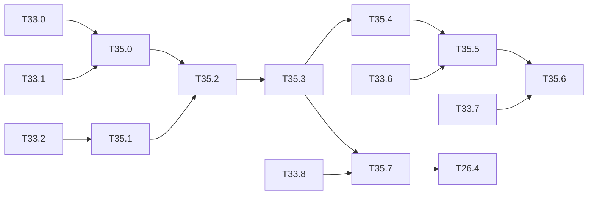

# M35 — YOLOv8n from scratch, without PyTorch (optional)

Goal: YOLOv8n in NumPy end to end: checkpoint read without torch, C2f blocks and the
decoupled anchor-free head in forward and backward passes, DFL decoding, task-aligned
assignment, the BCE + CIoU + DFL loss, training, then the integer chain.
[T26.4](M26-recent-models.md) covers the inference and hardware view; this milestone adds
the backward passes, the assigner, the loss and the training, with no torch at any step.

Constraints kept: NumPy only ([ADR 0001](../adr/0001-numpy-pur.md)); M1 layer interface and
gradcheck; the torch-free `.pt` reader, YAML parser, blocks, CIoU and training recipe of
[M33](M33-yolov5n.md) are reused. Weights under AGPL-3.0 (licence check of T26.1).

Related backlog: [M33](M33-yolov5n.md) (shared pieces), [T26.1](M26-recent-models.md)
(converted description, DFL in `ul_graph.py`), [T26.4](M26-recent-models.md) (integer DFL,
ARM post-processing), [M3](M3-inference-evaluation.md) (NMS, mAP).

**State** (2026-10-22): not started. Available: the YOLOv8n float forward of
`python/yolo/models/ul_graph.py` (BN folded, from the T26.1 torch conversion), SiLU (T26.2).

## Architecture reference

YOLOv8n = `yolov8.yaml` scale `n`: depth 0.33, width 0.25, max channels 1024. `Conv` as in
M33 (BN $\varepsilon = 10^{-3}$, SiLU). All downsampling by 3×3 / 2 convs.

| # | Block | Args after scaling | Output (640 input) |
|---|---|---|---|
| 0 | Conv 3×3 / 2 | 3 → 16 | 16 × 320 × 320 |
| 1 | Conv 3×3 / 2 | 16 → 32 | 32 × 160 × 160 |
| 2 | C2f n = 1, shortcut | 32 → 32 | |
| 3 | Conv 3×3 / 2 | 32 → 64 | 64 × 80 × 80 |
| 4 | C2f n = 2, shortcut | 64 → 64 | **P3 route** |
| 5 | Conv 3×3 / 2 | 64 → 128 | 128 × 40 × 40 |
| 6 | C2f n = 2, shortcut | 128 → 128 | **P4 route** |
| 7 | Conv 3×3 / 2 | 128 → 256 | 256 × 20 × 20 |
| 8 | C2f n = 1, shortcut | 256 → 256 | |
| 9 | SPPF k = 5 | 256 → 256 | **route to 21** |
| 10-12 | Upsample ×2, Concat [−1, 6], C2f n = 1 | 384 → 128 | **route to 18** |
| 13-15 | Upsample ×2, Concat [−1, 4], C2f n = 1 | 192 → 64 | **P3 out**, stride 8 |
| 16-18 | Conv 3×3 / 2, Concat [−1, 12], C2f n = 1 | 192 → 128 | **P4 out**, stride 16 |
| 19-21 | Conv 3×3 / 2, Concat [−1, 9], C2f n = 1 | 384 → 256 | **P5 out**, stride 32 |
| 22 | Detect (decoupled, `reg_max = 16`) | 64 / 128 / 256 | 64 + C per cell |

- **C2f**$(c_1 → c_2, n, \text{shortcut})$: $c = c_2/2$; $[y_0, y_1] = \mathrm{split}(\mathrm{cv1}(x))$
  (1×1, $c_1 → 2c$); $y_{k+1} = \mathrm{Bottleneck}_k(y_k)$ for $k = 1…n$ (two 3×3 convs,
  `e = 1.0`); $y = \mathrm{cv2}([y_0, y_1, …, y_{n+1}])$ (1×1, $(2+n)c → c_2$). The neck C2f
  have no shortcut.
- **Detect**, per level with input width $c_l$: box branch $c_b = \max(16, c_{P3}/4, 4·16) = 64$:
  Conv 3×3, Conv 3×3, conv 1×1 with bias → $4·16$; class branch $c_c = \max(c_{P3}, \min(C, 100)) = 80$:
  Conv 3×3, Conv 3×3, conv 1×1 with bias → $C$. No objectness, no anchors.
- **Published**: 3.2 M parameters (3.15 M), 8.7 GFLOPs at 640, COCO val2017 mAP50-95 37.3.

### [ ] T35.0 — Weights and description
- **Spec**: §3, §9.1 · **Depends on**: T33.0, T33.1 · **Size**: S
- **Deliverables**: `yolov8n.pt` read by `io/torch_pickle.py` (T33.0); `C2f` and the v8
  `Detect` in `models/ul_yaml.py`; `yolov8n-coco` in `specs.NETWORKS` with the MAC table
- **Acceptance**: parameter count equal to the T26.1 one (3.15 M published); description
  equal to the T26.1 one after BN folding; 8.7 GFLOPs at 640 (±1 %)
- **Notes**: the checkpoint layout is the one of T33.0 (`ema` / `model`); the class names
  and `stride` (8, 16, 32) come from the checkpoint; the DFL conv (`model.22.dfl.conv`, fixed
  weights $0…15$) is not trained and is rebuilt, not read.

### [ ] T35.1 — C2f in forward and backward passes
- **Spec**: §4 · **Depends on**: T33.2 · **Size**: S
- **Deliverables**: `c2f` in `layers/blocks.py`; tests
- **Acceptance**: gradcheck ≤ 1e-7 with n = 1, 2 and with / without shortcut (small widths)
- **Notes**: the split is a channel slice (`slice` layer of `ul_graph`); its backward writes
  the two halves of `dx` of cv1; $y_1$ is read by the concat and by the first bottleneck, so
  its gradient is the sum of both (accumulation of T33.2).

### [ ] T35.2 — Decoupled head and DFL decoding
- **Spec**: §8.1 · **Depends on**: T35.1 · **Size**: M
- **Deliverables**: `detect_v8` forward / backward in `layers/blocks.py`; `mode="v8"` in
  `infer/decode.py` (`dfl_expect`, `dist2bbox`, anchor points); tests
- **Acceptance**: gradcheck of the head and of the DFL expectation; decoded boxes equal to
  the stored torch boxes on the T26.1 images to within 1e-4
- **Notes**:
  - Anchor points: cell centres $(c_x + 0.5, c_y + 0.5)$ in grid units, one per cell and
    level (8 400 points at 640, 3 549 at 416).
  - DFL: for each side $k ∈ \{l, t, r, b\}$, 16 logits $z_{k,0…15}$,
    $p = \mathrm{softmax}(z)$, distance $d_k = \sum_{i} i·p_i$ (grid units).
    Backward: $\partial d / \partial z_i = p_i (i - d)$.
  - Box: $x_1 = a_x - d_l$, $y_1 = a_y - d_t$, $x_2 = a_x + d_r$, $y_2 = a_y + d_b$, times
    the stride.
  - Scores: $σ(z_c)$ per class, no objectness.

### [ ] T35.3 — Float network and COCO mAP
- **Spec**: §8 · **Depends on**: T35.2 · **Size**: M
- **Deliverables**: trainable network from the description (`models/ul_net.py` of T33.3);
  COCO val2017 mAP at 640 and 416; row in `results/map_coco.md`; `yolov8n-coco_infer`
  notebook (M14)
- **Acceptance**: mAP50-95 within 0.5 point of the published 37.3 at 640 (conf 0.001, IoU 0.7,
  max 300 detections); eval forward == stored torch outputs to within 1e-4; gradcheck of the
  full network on a 2-image 64×64 batch
- **Notes**: NMS of T33.4 (multi-label, class offset), IoU 0.7 as the reference.

### [ ] T35.4 — Task-aligned assigner
- **Spec**: §5 · **Depends on**: T35.3 · **Size**: M
- **Deliverables**: `python/yolo/data/tal.py`: `assign_tal(pred_scores, pred_boxes,
  anchor_points, gt_labels, gt_boxes) -> (target_boxes, target_scores, fg_mask)`; tests
- **Acceptance**: on hand-built cases (one box, two overlapping boxes, a small box covering
  no anchor centre), the selected anchors and the normalised scores match the rule below;
  no gradient flows through the assigner (it works on detached predictions)
- **Notes**:
  - Candidates: anchor points whose centre lies inside the ground-truth box (margin
    $10^{-9}$).
  - Alignment $t_{ij} = s_{ij}^{α}·u_{ij}^{β}$, $α = 0.5$, $β = 6$, with $s$ the predicted
    score of the ground-truth class and $u$ the CIoU of the predicted box with the ground
    truth (clamped at 0).
  - For each ground truth, keep the top-10 candidates by $t$; an anchor claimed by several
    ground truths goes to the one of highest IoU.
  - Soft targets: for ground truth $i$, $\hat t_{ij} = t_{ij}·\max_j u_{ij} / \max_j t_{ij}$;
    the class target of anchor $j$ is $\hat t_{ij}$ on the class of $i$, 0 elsewhere.

### [ ] T35.5 — Loss and its gradients
- **Spec**: §6 · **Depends on**: T35.4, T33.6 · **Size**: L
- **Deliverables**: `python/yolo/train/loss_v8.py` (`yolo_v8_loss`); tests
- **Acceptance**: loss value == stored torch value on a fixture batch to within 1e-5;
  gradcheck of the three terms (assignment fixed)
- **Notes**:
  - $S = \max(\sum_j \hat t_j, 1)$ (sum of the soft targets over the batch).
  - Classes: BCE with logits on every anchor and class, against the soft targets, summed / $S$.
  - Box: $\sum_{j ∈ fg} w_j (1 - \mathrm{CIoU}_j) / S$, weight $w_j = \sum_c \hat t_{jc}$;
    CIoU of M33, on boxes decoded from the DFL expectation (gradient through T35.2).
  - DFL: target distances $g_k$ (grid units, clamped to $[0, 15 - 0.01]$), $g_l = \lfloor g \rfloor$,
    $g_r = g_l + 1$: $L = (g_r - g)·\mathrm{CE}(z, g_l) + (g - g_l)·\mathrm{CE}(z, g_r)$,
    mean over the 4 sides, weighted by $w_j$, / $S$.
  - Gains: box 7.5, cls 0.5, dfl 1.5; total multiplied by the batch size.

### [ ] T35.6 — Training
- **Spec**: §7 · **Depends on**: T35.5, T33.7 · **Size**: M
- **Deliverables**: the M33 recipe with the v8 settings; `yolov8n-voc_train` notebook (M14);
  run in [long-runs.md](long-runs.md)
- **Acceptance**: one image overfitted (T2.8 criterion); VOC fine-tuning from the COCO weights
  improves on the out-of-domain mAP
- **Notes**:
  - SGD lr0 0.01, momentum 0.937, weight decay 5e-4 (no decay on BN and biases), warmup 3
    epochs (bias lr from 0.1, momentum from 0.8), linear decay to 0.01·lr0. The reference
    `optimizer=auto` switches to AdamW (lr $0.002·5/(4 + C)$, momentum 0.9) for short runs:
    reuse the AdamW of `train/optim.py` and record which one was used.
  - Mosaic off for the last 10 epochs (`close_mosaic`).
  - Head bias init: box branch bias 1.0; class branch $\log(5 / C / (640/s)^2)$.
  - EMA as in T33.7.

### [ ] T35.7 — Integer model and post-processing
- **Spec**: §9, §8.1 · **Depends on**: T35.3, T33.8 · **Size**: L
- **Deliverables**: T26.4: integer DFL (softmax over 16 bins through the exp LUT of the v2
  softmax, `luts.bin`, then the integer expectation) in Python and in `sw/postproc`; integer
  COCO mAP; export, golden and C-sim of the backbone, neck and head convs
- **Acceptance**: integer gap documented; ARM DFL == Python integer DFL on every head output of
  10 images; golden == C-sim
- **Notes**: the class branch is 80 channels of sigmoid only (LUT of T4.4); the box branch
  outputs stay int8 into the ARM post-processing; the integer `add` of T33.8 serves the
  backbone C2f shortcuts.

## Dependencies

