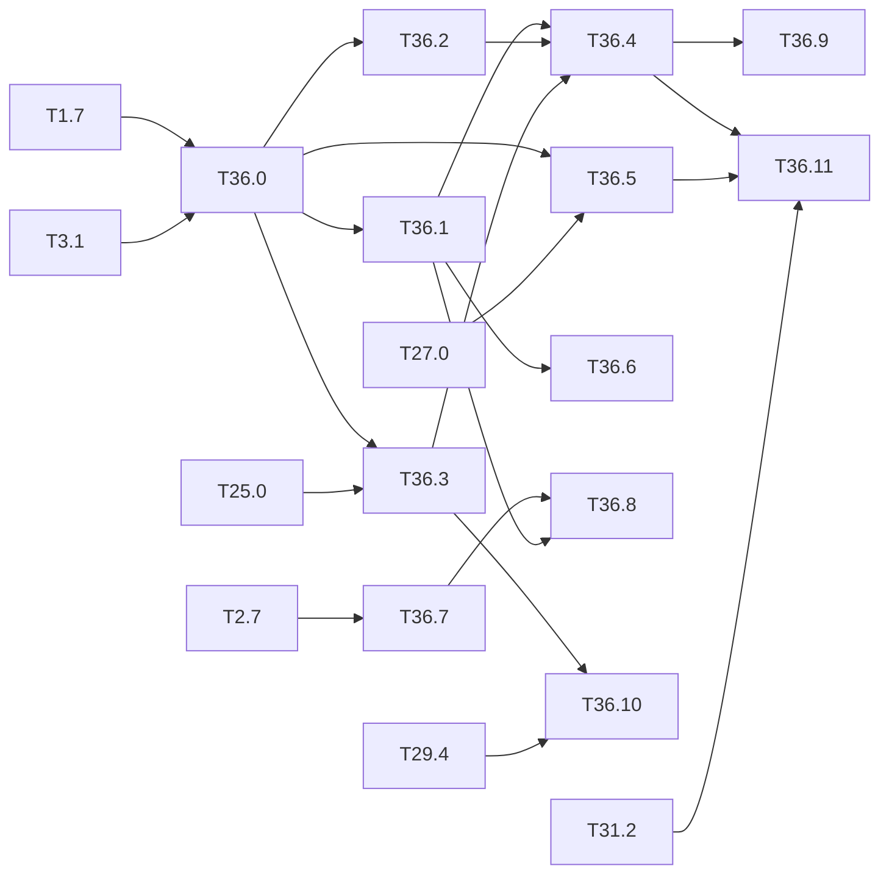

# M36 — Decision explanation (optional)

Goal: say **why** the detector output a box, and above all why it **missed** a person, at
the three stages of the chain (float, integer, C-sim). Watch how these choices form during
training. The use case is the one of [M27](M27-safety-metrics.md): a camera over a
dangerous zone, where a missed person is the dreaded event. Measuring the misses (M27) and
signalling them (M29) is not enough for an assurance case. The miss must also be explained:
its cause, the part of the image it depends on, the layer where it is lost.

What the literature lacks:

- most attribution methods were designed and evaluated on classifiers: saliency, Integrated
  Gradients (Sundararajan 2017), Grad-CAM (Selvaraju 2017), LRP (Bach 2015). The
  detector-specific ones (D-RISE, Petsiuk 2021) explain a detected box, not a **missing**
  one;
- explanations are computed on the float model in PyTorch. The deployed model is an integer
  model on an FPGA, and nobody checks that its explanation is the same. In integer, the
  linear part of a conv is an exact sum of int8 products: an attribution there can be exact
  instead of approximated;
- many maps fail the sanity checks (Adebayo 2018: unchanged when the weights are
  randomized), so a map is evidence only with a faithfulness measure (deletion and
  insertion, Petsiuk 2018; pointing game, Zhang 2016);
- the EASA Concept Paper asks for explainability (EXP objectives, already used in
  [M29](M29-runtime-monitors.md) and [M31](M31-assurance-case.md)), but gives no method for
  a detector or for an embedded target.

The repo has what this needs without PyTorch ([ADR 0001](../adr/0001-numpy-pur.md)):

- `Network.backward` ([graph.py](../../python/yolo/models/graph.py)) already returns δx.
  The δ of the intermediate layers is computed in `dout` and dropped, so a `keep=` option is
  enough for Grad-CAM;
- the `IntNetwork` hooks `on_acc(i, acc, x)` ([int_model.py](../../python/yolo/quant/int_model.py),
  T25.0) see the int32 accumulator and its int8 input. Since integer == golden == C-sim
  ([M28](M28-equivalence.md)), an explanation of the integer model is the explanation of
  the circuit;
- `Trainer.fit(callback=)` and `grad_hook` ([trainer.py](../../python/yolo/train/trainer.py))
  give the losses and the gradients at every iteration, with no change to the trainer.

Outside the base of the spec: the methods come from the XAI literature cited per task. Code
goes in a new package `python/yolo/explain/` (NumPy only, never matplotlib or cv2: drawing
stays in `tools/`, as in M13 and M20), the CLI is `tools/explain.py`, and the results go to
`results/explain.md`.

**State** (2026-10-22): not started. Available: the backward pass of the three Darknet
networks (gradcheck green, M1), the `IntNetwork` hooks (T25.0), BN folding
(`quant/fuse_bn.py`), the integer L13 features and the monitors of T29.0, the webcam app
(M20). T36.5 waits for the person metrics of M27 (T27.0); T36.10 needs Vitis for its cost.

## A. Inference: why this box

### [ ] T36.0 — Explanation target
- **Spec**: §8.1, §4.5 · **Depends on**: T1.7, T3.1 · **Runs on**: PC · **Size**: S
- **Deliverables**: `python/yolo/explain/targets.py`: the scalar to explain and its δ on
  the head outputs, for a **detection** (σ(t_o) · p_c of its cell and anchor, before NMS)
  and for a **miss** (the cell and anchor that best match a ground-truth box, by the
  assignment rule of the targets, §5); `keep=` option on `Network.backward` returning the δ
  of chosen layers; tests
- **Acceptance**: gradcheck in float64 of the target with respect to the input and to an
  intermediate layer (relative error ≤ 10⁻⁶, `yolo.testing.gradcheck`); `backward` without
  `keep` unchanged (existing tests green)
- **Notes**: in eval mode, BN uses the running statistics, which `bn_backward` does not
  model (it differentiates the batch statistics). Fold BN first (`fuse_bn`), then
  differentiate the folded network. With `softmax` heads (v2), p_c depends on all the
  classes: the δ goes through the softmax.

### [ ] T36.1 — Gradient attributions
- **Spec**: — · **Depends on**: T36.0 · **Runs on**: PC (GPU via `yolo.backend` if
  available) · **Size**: M
- **Deliverables**: `python/yolo/explain/gradient.py`: saliency (|δx|, max over the
  channels), SmoothGrad (Smilkov 2017), Integrated Gradients (black and blurred baselines),
  Grad-CAM on any conv layer (L13 by default, the layers before each head for v3/v4);
  tests on a tiny network
- **Acceptance**: IG completeness: Σ attributions = f(x) − f(baseline) within 1 % with
  64 steps; Adebayo sanity checks: with the weights randomized from the top layer down,
  Spearman rank correlation with the original map < 0.3 for Grad-CAM and IG (report the
  methods that fail); cost in forward + backward passes per map
- **Notes**: saliency is known to fail the sanity checks; report it anyway, as a baseline.

### [ ] T36.2 — Perturbation attributions (black box)
- **Spec**: §9, §10.2 · **Depends on**: T36.0 · **Runs on**: PC (C-sim gcc for the third
  stage) · **Size**: M
- **Deliverables**: `python/yolo/explain/perturb.py`: occlusion (sliding grey patch) and
  D-RISE (random masks, similarity of the detections to the explained box: IoU · class ·
  objectness, Petsiuk 2021), on a `detect` function at any stage: float `Network`,
  `IntNetwork`, C-sim through the golden or the HLS testbench
- **Acceptance**: same map at the three stages for 20 VOC images × 3 networks: Spearman of
  the float map against the integer one, and integer == C-sim (the outputs are equal, so the
  maps must be equal bit for bit); deletion and insertion AUC per method
- **Notes**: needs no gradient, so it applies to the circuit as is. It costs 10² to 10³
  inferences per map, which is fine on the PC and too much for the board.

### [ ] T36.3 — Exact integer attribution
- **Spec**: §9.3 · **Depends on**: T36.0, T25.0 · **Runs on**: PC · **Size**: M
- **Deliverables**: `python/yolo/explain/int_attr.py`: an `IntNetwork` hook that keeps the
  int8 inputs; the int32 accumulator of the explained neuron split into per-channel and
  per-pixel contributions qW · qx; propagation down to the input with an LRP rule (ε and
  z⁺) over the integer weights, through requantization (scale M0 / 2ⁿ), leaky, maxpool
  (winner takes all), route and upsample; tests
- **Acceptance**: in every conv, Σ contributions == acc − qb **exactly** (int64
  arithmetic); relevance conserved over the network within the ε rule's leak (reported per
  layer); Spearman of the integer map against float Grad-CAM and LRP on 20 VOC images
- **Notes**: the exact part is the linear one. Requantization and leaky are approximated
  by the LRP rule, so the deviation is measured layer by layer. The split per channel is
  also what a side kernel can compute on the L13 buffer (T36.10).

### [ ] T36.4 — Evaluation of the explanations
- **Spec**: §8.3 · **Depends on**: T36.1, T36.2, T36.3 · **Runs on**: PC · **Size**: M
- **Deliverables**: `python/yolo/explain/evaluate.py` (pointing game, energy inside the
  box, deletion and insertion AUC); `tools/explain.py evaluate`; `results/explain.md`
  table per method × stage × network
- **Acceptance**: on VOC test (500 images, the detections at the operating point): pointing
  game rate and deletion / insertion AUC of each method, against a random map and a centre
  map; cost in passes and seconds per map; ranking of the methods stated in the results
- **Notes**: a map that beats the centre baseline only on large objects tells little:
  report the rates per box-size bin (same bins as T27.0).

## B. Safety link

### [ ] T36.5 — Miss causes
- **Spec**: §8 · **Depends on**: T36.0, T27.0 · **Runs on**: PC · **Size**: M
- **Deliverables**: `python/yolo/explain/misses.py`: for each missed person, its cause,
  computed from the head outputs and the post-processing: **no anchor** (no anchor shape
  close enough), **low objectness**, **class confusion** (object found, wrong class),
  **below the threshold** (right class, score under the operating point), **suppressed by
  NMS** (a box existed before NMS), **lost by quantization** (detected in float, not in
  integer); `results/person_safety.md` section
- **Acceptance**: the causes form a partition (each miss has one cause, by a fixed order of
  tests); share of each cause on CrowdHuman val, on the degraded sets of
  [T27.3](M27-safety-metrics.md) and on ExDark, at the three stages; one Grad-CAM or D-RISE
  map per cause on 5 examples
- **Notes**: the cause says what to fix: anchors (k-means again), a threshold (T29.2), NMS
  (crowd), training data or quantization (QAT). It also feeds the hazard analysis of
  T31.1.

### [ ] T36.6 — Concepts and channels
- **Spec**: §4 · **Depends on**: T36.1 · **Runs on**: PC · **Size**: M
- **Deliverables**: `python/yolo/explain/concepts.py`: Network Dissection-lite (Bau 2017)
  on L13 and the layers before the heads (IoU of each thresholded channel map with the boxes
  of each class); TCAV (Kim 2018) for the concepts "dark", "small", "occluded", "fog",
  built from the degradations of T27.3 and the CrowdHuman visibility, with a two-sided
  test against 20 random concepts; `results/explain.md` section
- **Acceptance**: top channels per VOC class, with their IoU; TCAV score of each concept for
  the class "person" and its p-value; the share of L13 channels that matches no class
- **Notes**: a concept that is significant for "person" and degrades the recall (T27.3) is
  a candidate for the ODD limits of T31.0.

## C. Training: how the choices form

### [ ] T36.7 — Training recorder
- **Spec**: §7 · **Depends on**: T2.7 · **Runs on**: PC, Colab · **Size**: M
- **Deliverables**: `python/yolo/explain/recorder.py`, a `Trainer.fit` callback writing
  every N iterations, per layer: weight norm, gradient norm, update / weight ratio, share of
  dead leaky units, BN γ, activation percentiles on a fixed probe batch; and **every image's
  loss** each epoch (forgetting events, Toneva 2019; data cartography, Swayamdipta 2020);
  `tools/train.py --record` option; `build/explain/<run>/record.npz`
- **Acceptance**: a short VOC run (M14 sweep size): overhead ≤ 10 % of the iteration time;
  the per-image loss lists the never-learned and the forgotten images; on VOC with 5 % of
  the labels corrupted on purpose, AUROC of "never learned" for the corrupted images
- **Notes**: the corrupted labels show what the data map finds. On the M22 auto-labelled
  sets, the same list points to the labels to check by hand.

### [ ] T36.8 — Representation dynamics
- **Spec**: §7, §9 · **Depends on**: T36.1, T36.7 · **Runs on**: PC · **Size**: M
- **Deliverables**: `python/yolo/explain/cka.py` (linear CKA, Kornblith 2019, on pooled
  maps); figures in `tools/figures/` (M13 registry): CKA layer × checkpoint, float against
  integer layer by layer, and a strip of the Grad-CAM maps of the probe images across the
  checkpoints
- **Acceptance**: CKA(layer, last checkpoint) per checkpoint for one fine-tuning (which
  layers settle first); CKA float / integer ≥ 0.99 on every layer, or the layer named where
  it drops (cross-check with the per-layer LSB of [T28.0](M28-equivalence.md)); figures
  regenerated by `make figures`

## D. Software and integration

### [ ] T36.9 — Explanation viewer
- **Spec**: — · **Depends on**: T36.1, T36.2, T36.3, T36.4 · **Runs on**: PC · **Size**: M
- **Deliverables**: `tools/explain.py` (subcommands `map`, `evaluate`, `misses`, `report`:
  one image or a folder, a Markdown + PNG report); `make explain`: an app that picks an
  image, a detection or a ground-truth box (miss), a method and a stage, then shows the map
  over the image, the miss cause and the top channels; an optional Grad-CAM overlay in
  `make webcam` (M20); an M14 notebook template
- **Acceptance**: a report for 10 VOC images and 10 CrowdHuman misses produced in one
  command; the app opens on the PC (checked by hand, screenshot in `docs/explain.md`);
  webcam overlay cost in ms per frame for each of the 4 models of M20
- **Notes**: same UI stack as `make autolabel` (M22) to avoid a new dependency.

### [ ] T36.10 — On-chip explanation
- **Spec**: §10.2 · **Depends on**: T36.3, T29.4 · **Size**: L
  · **Runs on**: PC (C-sim gcc) + perf_model; PC + Vitis for the LUT, DSP and BRAM cost
- **Deliverables**: the CAM of the 1×1 linear head (v2, v3) in integer: for the explained
  cell and anchor, Σ_c qW[c] · L13[c, :, :], a weighted sum of the channels already read
  by the T29.4 monitor; in `IntNetwork`, the C++ golden and the HLS kernel or a side kernel;
  13 × 13 int32 map in the output buffer; `perf_model` cost
- **Acceptance**: Python == golden == C-sim on the map, byte for byte; detector outputs
  unchanged; cycles added and latency added to the frame
- **Notes**: it is the only map cheap enough for every frame (one MAC per channel and
  pixel). It explains the last layer only. T36.3 says how far it is from the full map.
- **Deferred** (Vitis): [deferred/M36](deferred/M36-explanation.md) — T36.10, LUT, DSP and
  BRAM cost, and the map read on the board.

### [ ] T36.11 — Explainability in the assurance case
- **Spec**: — · **Depends on**: T36.4, T36.5, T31.2 · **Runs on**: PC · **Size**: S
- **Deliverables**: section of `docs/safety/` (the objective → evidence map of
  [T31.2](M31-assurance-case.md))
- **Acceptance**: each explainability objective (EASA EXP, AMLAS stage 4 and 5) points to a
  generated result of T36.4 to T36.6, or is marked "not covered"; the standards columns
  stay "to read" until they are read, as in M31

## Dependencies

