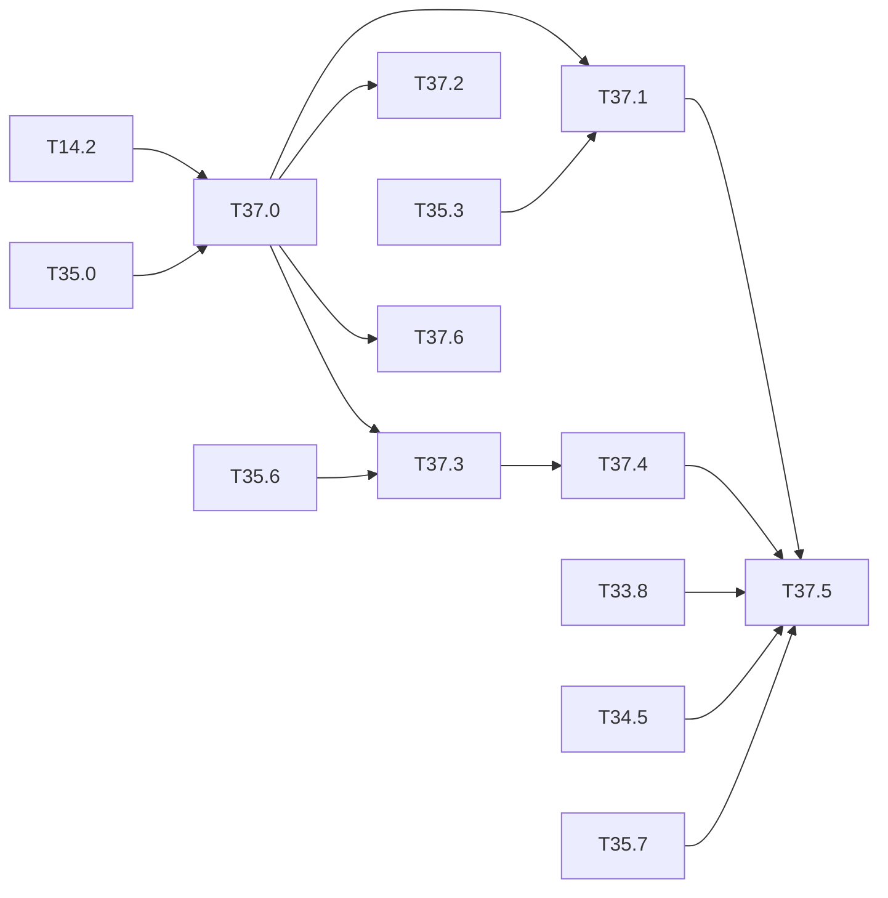

# M37 — Notebooks of the recent models (optional)

Goal: one inference and one training notebook for each of the three recent networks,
YOLOv5n ([M33](M33-yolov5n.md)), YOLOv7-tiny ([M34](M34-yolov7-tiny.md)) and YOLOv8n
([M35](M35-yolov8n.md)), on **COCO and VOC**. Each notebook comes from the
[M14](M14-notebooks.md) generator and drives the existing tools: `tools/eval_voc.py`
(`--preset v5` / `v8`) and `tools/train_v5.py`.

Scope: COCO (inference of the published weights) and VOC (out-of-domain inference,
fine-tuning, inference of the fine-tuned weights). The other datasets of `TRAINABLE`, the
`_sweep` notebooks of the YOLOv5 recipe and the hardware parts are out of scope.

Constraints kept:
- the [M14 rules](M14-notebooks.md#rules): every notebook is written by
  `python -m tools.notebooks`, never by hand. A versioned notebook is either empty or
  executed in full without error (`--check`). A notebook never writes to `results/`;
- NumPy only ([ADR 0001](../adr/0001-numpy-pur.md)): the Ultralytics checkpoints are read by
  `yolo.io.torch_pickle` (T33.0), without torch;
- the Ultralytics weights (`weights/ultralytics/yolov5n.pt`, `yolov8n.pt`) are AGPL-3.0. They
  stay local and are neither archived on the Drive nor fetched by a Colab cell (T26.1 note).
  The Colab path of these notebooks therefore expects the user to upload them.

Related backlog: [M14](M14-notebooks.md) (generator, registry, rules, T14.9 smoke run,
T14.11 run choice), [T33.4](M33-yolov5n.md) / [T34.2](M34-yolov7-tiny.md) /
[T35.3](M35-yolov8n.md) (COCO evaluation), [T33.7](M33-yolov5n.md) /
[T34.4](M34-yolov7-tiny.md) / [T35.6](M35-yolov8n.md) (training recipe),
[T11.2](M11-jeux-de-donnees.md) and [T14.5](M14-notebooks.md) (out-of-domain inference),
[long-runs.md](long-runs.md) (the full trainings).

**State** (2026-10-23):
- **Done**: T37.0 (registry and generator: the 12 notebooks of the matrix generated,
  versioned empty, `--check` clean for them; `PRESET = 'v8'` for YOLOv8n; fine-tuned runs
  found by `final.npz` too; YOLOv7-tiny fine-tuned read with the `net.cfg` of its run;
  loss curves per term and `optimizer.txt` in the `_train` notebooks).
- **Measured** (CLI, full split, `tools/eval_voc.py --resize v5 --preset v5|v8 --jobs 8`):
  COCO val2017 at 640, YOLOv8n **37.3 AP** / 52.5 AP50 (published 37.3, 1,153 s) and
  YOLOv5n **28.1 AP** (= T33.4, 1,019 s).
- **Checked**: smoke run (T14.9) of the 12 notebooks, the three fine-tuned `_infer` ones
  on throwaway 2-iteration runs (deleted); exact resume of `TrainerV5` with the v8 loss and
  AdamW (`test_recipe_v5.py::test_trainer_resume_is_exact`).
- **Open**: T37.1 notebooks to execute (T37.2 done 2026-10-27), YOLOv7-tiny COCO; T37.3 full
  runs and YOLOv8n training speed; T37.4 after them; T37.5 blocked by T33.8, T34.5, T35.7.
- **Known**: `--check` fails for reasons outside M37 (stale notebooks of other datasets,
  `tiny-yolov7-coco_infer` of the non-VOC datasets never generated); generating any target
  also rewrites `figures_live` and `analyse_*`, which loses their outputs.

## Notebook matrix

The 12 notebooks are in the registry and versioned (T37.0).

| Dataset | YOLOv5n | YOLOv7-tiny | YOLOv8n |
|---|---|---|---|
| coco | `yolov5n-coco_infer` | `tiny-yolov7-coco_infer` | `yolov8n-coco_infer` |
| voc, out-of-domain | `yolov5n-coco_infer` | `tiny-yolov7-coco_infer` | `yolov8n-coco_infer` |
| voc, training | `yolov5n-voc_train` | `tiny-yolov7-voc_train` | `yolov8n-voc_train` |
| voc, fine-tuned | `yolov5n-voc_infer` | `tiny-yolov7-voc_infer` | `yolov8n-voc_infer` |

12 notebooks. Paths: `notebooks/<dataset>/<model>_<role>.ipynb`; run
outputs in `build/notebooks/<dataset>/<model>/` (M14 layout).

Weights per notebook:

| Notebook | `WEIGHTS` | Evaluation preset |
|---|---|---|
| `yolov5n-coco_infer` | `weights/ultralytics/yolov5n.pt` | `v5` (conf 0.001, IoU 0.65, max 300, letterbox) |
| `tiny-yolov7-coco_infer` | `weights/yolov7-tiny.weights` | `v5` |
| `yolov8n-coco_infer` | `weights/ultralytics/yolov8n.pt` | `v8` (IoU 0.7) |
| `yolov5n-voc_infer`, `yolov8n-voc_infer` | `build/notebooks/voc/<model>/final.npz` (EMA, torch-named state dict) | `v5` / `v8` |
| `tiny-yolov7-voc_infer` | `build/notebooks/voc/tiny-yolov7-voc/final.weights` + `net.cfg` of the run | `v5` |

## Tasks

### [x] T37.0 — Registry and generator
- **Spec**: — · **Depends on**: T14.2, T35.0 · **Size**: M
- **Deliverables**:
  - `tools/notebooks/matrice.py`:
    - `V5_NOTEBOOKS` gets the `yolov8n-coco` / `yolov8n-voc` rows;
    - the out-of-domain VOC rows of `yolov5n-coco` and `yolov8n-coco` (family `coco`,
      `MAPPINGS[("voc", "coco")]`);
    - the three fine-tuned `voc/<model>_infer` rows, weights from `_final`.
  - `tools/notebooks/gabarits.py`:
    - `_v5` also true for a `head == "dfl"` network;
    - `--preset v8` in the printed command and in the evaluation cell of YOLOv8n;
    - training curves read the loss parts of `loss.csv` (`box obj cls` for v5 / v7,
      `box cls dfl` for v8);
    - the `_train` summary shows `optimizer.txt` (T35.6).
  - `notebooks/README.md` and `python/tests/test_notebooks.py` updated.
- **Acceptance**: `python -m tools.notebooks --list` shows the 12 notebooks of the matrix;
  `python -m tools.notebooks --check` passes; the test checks the arch, `WEIGHTS` and the
  preset of each row.
- **Notes**:
  - Generate by target (`python -m tools.notebooks voc/yolov8n-voc_train …`), never `all`:
    it would rewrite the executed notebooks whose template changed
    ([M32 warning](M32-trashnet-pets.md)).
  - Before a template change that touches the existing v5 notebooks, freeze their complete
    executions with `--archive` (M14 rules).
  - The out-of-domain rows of the Ultralytics networks cannot come from `PRETRAINED` (Darknet
    weights only): add them as `V5_NOTEBOOKS` rows with the `coco` family, as
    `yolov5n-coco_infer`.

### [ ] T37.1 — COCO inference notebooks
- **Spec**: §8 · **Depends on**: T37.0, T35.3 · **Size**: S
- **Deliverables**: `notebooks/coco/yolov8n-coco_infer.ipynb` executed in full;
  `yolov5n-coco_infer` and `tiny-yolov7-coco_infer` regenerated and executed again if
  T37.0 changed their template
- **Acceptance**:
  - the full-split mAP of each notebook equals the CLI value of its task, same parameters:
    YOLOv5n 28.1 AP at 640 (T33.4), YOLOv7-tiny 34.3 AP at 416 (T34.2), YOLOv8n 37.3 AP at
    640 (T35.3);
  - the notebook prints the equivalent `tools/eval_voc.py` command.
- **Notes**:
  - Float only: the integer sections wait for T37.5.
  - Cost: COCO val2017 at 640 with `--preset v5` and 5 jobs is ≈ 5 min (v5n) to ≈ 16 min
    (v7-tiny) ([long-runs.md](long-runs.md#reference-speeds)); YOLOv8n ≈ 35 min at 640 with 4
    jobs (T35.3).
    Ship with a tier R `SUBSET` and run the full split once for the acceptance.
- **Progress** (2026-10-29):
  - `yolov8n-coco_infer` run on the full split (a copy with `SUBSET = 0`, output
    `build/m37/yolov8n-coco_infer-full.ipynb`, 28 min on 4 cores, no error):
    **37.3 AP / 52.5 AP50 at 640**, the CLI value of T35.3, with the same parameters
    (conf 0.001, NMS 0.7, max 300).
  - The executed copy is not committed: its `SUBSET` differs from the generated notebook,
    so `--check` would reject it (same choice as the full `tiny-yolov4-coco_infer` run).
  - **Left**: the full-split runs of `yolov5n-coco_infer` (28.1 AP at 640) and
    `tiny-yolov7-coco_infer` (34.3 AP at 416).

### [x] T37.2 — VOC out-of-domain inference
- **Spec**: §8 · **Depends on**: T37.0 · **Size**: S
- **Deliverables**: `notebooks/voc/yolov5n-coco_infer.ipynb`,
  `notebooks/voc/tiny-yolov7-coco_infer.ipynb` and `notebooks/voc/yolov8n-coco_infer.ipynb`,
  executed in full
- **Acceptance**:
  - VOC2007 test mAP of the 80-class COCO networks through `MAPPINGS` (T11.2), same
    parameters as `tools/m11.sh hors-domaine` (T14.5);
  - each value is written in the "Done" of T33.7, T34.4 and T35.6: it is the baseline the
    VOC fine-tuning must beat.
- **Notes**: the Tiny-YOLOv3 / v4 rows of the same notebooks (`voc/tiny-yolov3-coco_infer`,
  `voc/tiny-yolov4-coco_infer`) give the comparison.
- **Done** (2026-10-27, executed on the PC, VOC2007 test 4952 images): YOLOv5n **69.48**,
  YOLOv7-tiny **79.74**, YOLOv8n **79.64** mAP (Tiny-YOLOv3 68.45, Tiny-YOLOv4 74.54).
  Written in the Done of [T33.7](M33-yolov5n.md), [T34.4](M34-yolov7-tiny.md) and
  [T35.6](M35-yolov8n.md). About 1 h 10 per notebook on 3 cores; a notebook holds about
  4 GB per evaluation job, so it runs in a memory-capped unit
  ([long-runs.md](long-runs.md)).
- **Progress** (2026-10-27): the three notebooks set to the full split by default
  (`FULL_RUN` of `gabarits.py`, `SUBSET = 0`) and regenerated, versioned empty. Their
  execution (`jupyter nbconvert --execute --inplace`, ≈ 30-45 min for the three) was
  stopped twice by the end of the session: to run again.

### [ ] T37.3 — VOC training notebooks
- **Spec**: §7 · **Depends on**: T37.0, T35.6 · **Size**: M
- **Deliverables**:
  - `notebooks/voc/yolov8n-voc_train.ipynb`, with the T35.6 settings: `optimizer=auto`,
    mosaic off for the last 10 epochs, v8 loss;
  - `yolov5n-voc_train` and `tiny-yolov7-voc_train` regenerated if their template changed;
  - the three full runs in [long-runs.md](long-runs.md).
- **Acceptance**:
  - smoke run of the three notebooks (`ITERS = 2`, `SUBSET = 4`, `BATCH = 2`) executed
    without error;
  - resume after an interruption gives the same `loss.csv` as an uninterrupted run (exact
    resume of T33.7);
  - YOLOv8n training speed measured (`tools/train_v5.py --iters 6`, 640, batch 16) and
    written to the reference speeds of [long-runs.md](long-runs.md).
- **Notes**:
  - The full runs are tier N: ≈ 6 days on CPU for YOLOv5n and ≈ 10 days for YOLOv7-tiny
    ([long-runs.md](long-runs.md)). The versioned notebook is the empty one, or a complete
    execution of the full run, never the smoke one.
  - The `_train` notebooks write the EMA weights to `build/notebooks/voc/<model>/`, which
    T37.4 reads.

### [ ] T37.4 — VOC fine-tuned inference
- **Spec**: §8 · **Depends on**: T37.3 · **Size**: S
- **Deliverables**: `notebooks/voc/yolov5n-voc_infer.ipynb`,
  `notebooks/voc/tiny-yolov7-voc_infer.ipynb` and `notebooks/voc/yolov8n-voc_infer.ipynb`,
  executed in full once the T37.3 weights exist
- **Acceptance**:
  - run choice as in T14.11 (`RUN`, banner when no `final.npz` / `final.weights` exists);
  - VOC2007 test mAP equal to `tools/eval_voc.py --net <model> --weights … --preset v5|v8`;
  - a table compares it with the out-of-domain value of T37.2.
- **Notes**:
  - YOLOv7-tiny reads the `net.cfg` written by `tools/train_v5.py` next to its weights (20
    classes, `tools/make_cfg.py`); YOLOv5n and YOLOv8n are rebuilt by name
    (`tools.eval_voc.load_net`).
  - Float only, as T37.1.

### [ ] T37.5 — Integer sections
- **Spec**: §9 · **Depends on**: T37.1, T37.4, T33.8, T34.5, T35.7 · **Size**: M
- **Deliverables**: calibration and INT8 mAP sections (T14.4 template) in the COCO and VOC
  `_infer` notebooks of the three networks
- **Acceptance**: INT8 mAP of each notebook equal to the CLI value of T33.8, T34.5 and T35.7;
  float / integer gap shown
- **Notes**:
  - Integer SiLU (T26.2) for YOLOv5n and YOLOv8n; integer DFL on the ARM path (T35.7) for
    YOLOv8n.
  - The C-sim and board sections are hardware work and go to
    [deferred/](deferred/README.md).

### [ ] T37.6 — Index, cross-links and smoke run
- **Spec**: — · **Depends on**: T37.0 · **Size**: S
- **Deliverables**:
  - [M14](M14-notebooks.md#notebook-matrix): matrix table updated with the three networks;
  - the notebook names in T33.4, T33.7, T34.2, T34.4, T35.3 and T35.6 linked to M37;
  - `make notebooks-smoke` (T14.9) covers the 12 notebooks when their data and weights are
    present.
- **Acceptance**:
  - `make notebooks-smoke` passes, skipping a notebook whose Ultralytics weights are
    missing (AGPL, not on the Drive);
  - `make ci` (`--check`) passes.
- **Done so far** (2026-10-27): M14 matrix rows and the M37 links in T33.4 … T35.6 in
  place. `make notebooks-smoke` passes (106 passed, 54 skipped for missing data or
  weights, 2 h 29 on 8 cores). In `make ci`, lint and every `--check` pass (notebooks,
  article, traceability, equivalence, safety case, golden). `test-py` has 1 failure left,
  outside M37: `test_data_stats.py::test_split_images_releves` wants a TrashNet test count
  in `tools/notebooks/matrice.py::SPLIT_IMAGES`, and the TrashNet split is not prepared on
  the PC (M32, `tools/prep_datasets.py trashnet`).
- **Remaining**: the TrashNet count once its split exists, then `make ci` again.

## Dependencies

