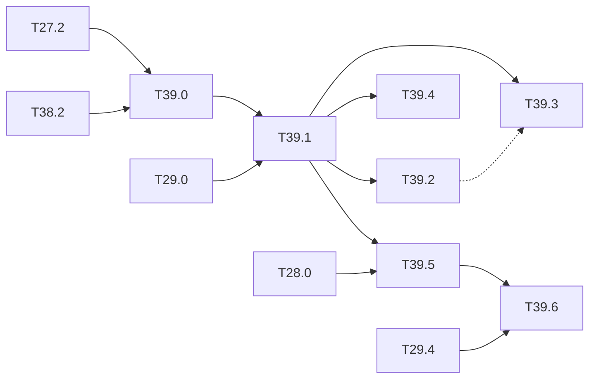

# M39 — Learned failure prediction (optional)

Goal: a monitor **trained to predict the missed person**, first grafted on the frozen
detector, then trained with it. Core of axis 1 of the thesis draft (ARCYS, 2026-10): the
monitors of [M29](M29-runtime-monitors.md) are post-hoc scores (max score, activation
patterns, abstraction boxes, OOD distances); none of them is trained on the failures it must
signal.

What the literature gives and lacks:

- ConfidNet (Corbière 2019) learns the true-class probability (TCP) as a confidence target,
  on classification and segmentation; SelectiveNet (Geifman 2019) trains the abstention with
  the model under a coverage constraint; neither is applied to the false negatives of a
  detector;
- KGFP (Zimmermann 2026) flags the images where a detector misses a critical object by
  comparing its features with those of an auxiliary vision model (DINO, ≈ 86 M parameters):
  the idea of flagging missed objects exists, but with a large external model, post-hoc,
  and on GPU;
- Zhu 2024 shows that some calibration and OOD methods make the separation of correct and
  wrong predictions worse, on classifiers;
- no learned failure predictor has been quantized or put on an FPGA.

The claim of the draft is not the idea of failure prediction but its **joint training** with
the detector, its integer form and its cost on the chip. Outside the base of the spec: the
method comes from the failure-prediction literature above.

**State**: not started (2026-10-26). T39.0 waits for the operating point of
[T27.2](M27-safety-metrics.md); everything but the exact cost of T39.6 runs on the PC or
Colab.

### [ ] T39.0 — Failure labels
- **Spec**: §8.3 · **Depends on**: T27.2, T38.2 · **Runs on**: PC · **Size**: M
- **Deliverables**: `tools/failure_labels.py`; `build/m39/labels/<model>_<set>.npz`;
  `results/failure_prediction.md` section
- **Acceptance**:
  - per image: "at least one missed person at the T27.2 operating point" (the KGFP
    criterion); per person: missed or not, with the miss cause of
    [T36.5](M36-explanation.md);
  - on CrowdHuman val, PREWID ([M38](M38-prewid.md)) and the COCO persons, float and
    integer;
  - share of missed persons and of images with a miss, per split and per set: the class
    imbalance the training of T39.1 must handle is written down.
- **Notes**: reuse `matched` and `classify_miss` of `python/yolo/explain/misses.py`, so a
  miss means the same thing in M36 and here. The labels depend on the operating point: a
  new threshold means new labels.

### [ ] T39.1 — Post-hoc learned monitor
- **Spec**: §8.3 · **Depends on**: T39.0, T29.0 · **Runs on**: PC · **Size**: M
- **Deliverables**: `python/yolo/infer/failure.py` (small MLP head, NumPy, on the frozen
  multi-scale features); `tools/ood_monitor.py` option to add it to `compare`;
  `python/tests/test_failure.py`; `results/failure_prediction.md` section
- **Acceptance**:
  - two targets: the TCP of the person class (ConfidNet) and the binary "person missed";
  - same protocol as [T29.1](M29-runtime-monitors.md) (same sets, same operating point):
    AUROC for "this image has a missed person", share of missed persons flagged at 1 % and
    5 % alarm rate, recall of "detector or monitor alarm" against the detector alone;
  - side by side with the six monitors of T29.0, with memory and MACs.
- **Notes**: the head stays integer-friendly (ReLU, no softmax over many classes) so T39.5
  and T39.6 need no redesign. Class imbalance: weighted loss or balanced batches, chosen on
  the validation split only.

### [ ] T39.2 — Joint training of the detector and the failure head
- **Spec**: §6, §7 · **Depends on**: T39.1 · **Runs on**: PC / Colab · **Size**: L
- **Deliverables**: failure head and loss term in `python/yolo/train/` (the trainer of
  `trainer.py`); run commands in [long-runs.md](long-runs.md);
  `results/failure_prediction.md` section
- **Acceptance**:
  - detector and failure head trained together from `tiny-yolov3-crowdhuman`, with an
    asymmetric loss weighting the missed persons and a coverage constraint in the
    SelectiveNet style;
  - two numbers against T39.1: the gain in flagged missed persons at a fixed alarm rate,
    and the cost in person AP and in recall at the T27.2 operating point;
  - gradient check of the new loss term (as for the losses of M2).
- **Notes**: the failure labels move while the detector trains: recompute them per epoch,
  or freeze the detector for the last epochs; state which.

### [ ] T39.3 — KGFP baseline
- **Spec**: — · **Depends on**: T39.1 · **Runs on**: PC (GPU) / Colab · **Size**: M
- **Deliverables**: `tools/kgfp_baseline.py` (wrapper around the published code, outside
  `python/yolo/`); `results/failure_prediction.md` section
- **Acceptance**:
  - KGFP run on the same COCO person images, with its metric (recall among the accepted
    images at 5 % false alarms);
  - the same metric for T39.1 and T39.2;
  - parameters and MACs of KGFP (DINO) against the failure head.
- **Notes**: if the code, weights or protocol are not available, the limit of the comparison
  is written instead (rule of the draft).

### [ ] T39.4 — Calibration against failure prediction
- **Spec**: §8 · **Depends on**: T39.1 · **Runs on**: PC · **Size**: S
- **Deliverables**: `results/failure_prediction.md` section
- **Acceptance**: temperature scaling and label smoothing applied to the detector; ECE of
  the person score, and AUROC / AURC of the failure prediction (max score and T39.1), before
  and after
- **Notes**: Zhu 2024 shows the degradation on classifiers; the question is whether it holds
  on a detector.

### [ ] T39.5 — Failure monitor at the three stages
- **Spec**: §9, §10.2 · **Depends on**: T39.1, T28.0 · **Runs on**: PC (float, integer,
  C-sim gcc) · **Size**: M
- **Deliverables**: integer head in `IntNetwork`; `results/failure_prediction.md` section
- **Acceptance**: AUROC and flagged-miss share at float, integer and C-sim; the images whose
  flag changes between stages, listed with their miss cause; integer == C-sim on the head
  score
- **Notes**: links to [M28](M28-equivalence.md): the equivalence matrix gets a row for the
  head.

### [ ] T39.6 — Failure head in the HLS kernel
- **Spec**: §10.2 · **Depends on**: T39.5, T29.4 · **Size**: M
  · **Runs on**: PC (C-sim gcc) + perf_model; PC + Vitis for the LUT, DSP and BRAM cost
- **Deliverables**: the head in the kernel or in the side kernel of T29.4, reading the
  feature buffer; score and flag in the status register (`sw/driver/regmap.hpp`);
  `perf_model` cost
- **Acceptance**: Python == golden == C-sim on the head score, byte for byte; detector
  outputs unchanged; LUT, DSP, BRAM and cycles estimated by `perf_model`
- **Deferred** (Vitis): [deferred/M39](deferred/M39-failure-prediction.md) — T39.6, exact LUT, DSP, BRAM and cycles.

## Dependencies

