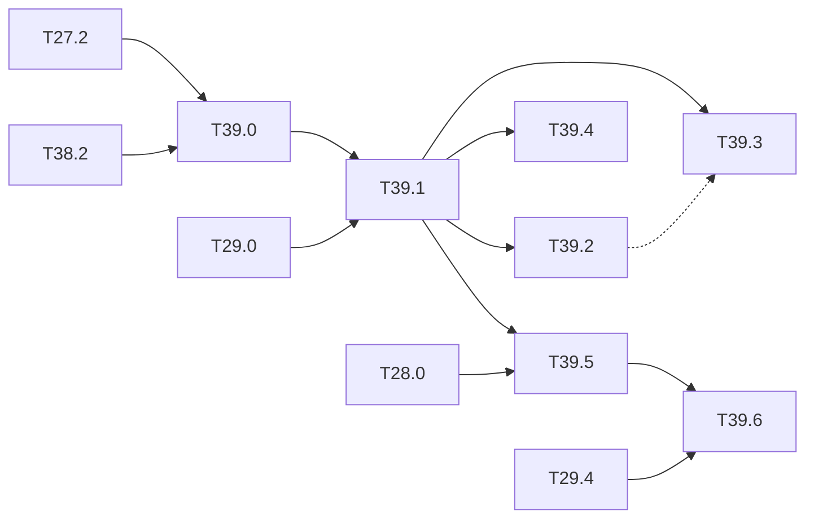

# M39 — Learned failure prediction (optional)

Goal: a monitor **trained to predict the missed person**, first grafted on the frozen
detector, then trained with it. Core of axis 1 of the thesis draft (ARCYS, 2026-10): the
monitors of [M29](M29-runtime-monitors.md) are post-hoc scores (max score, activation
patterns, abstraction boxes, OOD distances); none of them is trained on the failures it must
signal.

What the literature gives and lacks:

- ConfidNet (Corbière 2019) learns the true-class probability (TCP) as a confidence target,
  on classification and segmentation; SelectiveNet (Geifman 2019) trains the abstention with
  the model under a coverage constraint; neither is applied to the false negatives of a
  detector;
- KGFP (Zimmermann 2026) flags the images where a detector misses a critical object by
  comparing its features with those of an auxiliary vision model (DINO, ≈ 86 M parameters):
  the idea of flagging missed objects exists, but with a large external model, post-hoc,
  and on GPU;
- Zhu 2024 shows that some calibration and OOD methods make the separation of correct and
  wrong predictions worse, on classifiers;
- no learned failure predictor has been quantized or put on an FPGA.

The claim of the draft is not the idea of failure prediction but its **joint training** with
the detector, its integer form and its cost on the chip. Outside the base of the spec: the
method comes from the failure-prediction literature above.

**State** (2026-10-27): T39.0 and T39.1 run at the T27.2 point on PREWID and COCO (YOLOv4-tiny), CrowdHuman pending. The code of T39.0 to T39.5 is written and tested
(`python/tests/test_failure.py`); reduced runs with `tiny-yolov3-coco` on COCO persons and
PREWID test are in [results/failure_prediction.md](../../results/failure_prediction.md), at a
**provisional** threshold of 0.25. Every task stays open until T27.2 gives the operating
point and CrowdHuman (data and `tiny-yolov3-crowdhuman`) is on the PC; the full runs are in
[long-runs.md](long-runs.md). T39.6 waits for T29.4. First findings: the learned head beats
every T29.0 monitor on COCO (AUROC 0.82 against 0.77 for the max score), but on PREWID frames
with persons the max score is better (0.94 against 0.87); integer == C-sim on the head.

### [ ] T39.0 — Failure labels
- **Spec**: §8.3 · **Depends on**: T27.2, T38.2 · **Runs on**: PC · **Size**: M
- **Deliverables**: `tools/failure_labels.py`; `build/m39/labels/<model>_<set>.npz`;
  `results/failure_prediction.md` section
- **Acceptance**:
  - per image: "at least one missed person at the T27.2 operating point" (the KGFP
    criterion); per person: missed or not, with the miss cause of
    [T36.5](M36-explanation.md);
  - on CrowdHuman val, PREWID ([M38](M38-prewid.md)) and the COCO persons, float and
    integer;
  - share of missed persons and of images with a miss, per split and per set: the class
    imbalance the training of T39.1 must handle is written down.
- **Notes**: reuse `matched` and `classify_miss` of `python/yolo/explain/misses.py`, so a
  miss means the same thing in M36 and here. The labels depend on the operating point: a
  new threshold means new labels.
- **Progress** (code done, full run waiting for T27.2):
  - **Code**: `tools/failure_labels.py label` (per person: missed, cause, TCP; per image:
    failure, top score, pooled features float and integer, split 60 / 20 / 20; person
    detections down to 0.005 for T39.4) and `report`; `failure.person_tcp`,
    `image_targets`, `split_of`, `feature_layers` (inputs of the last conv of each head).
  - **Fix found on the way**: in Tiny-YOLOv3, anchor 0 belongs to no head, and
    `misses.responsible_index` crashed on a box whose best anchor is anchor 0. Such a box now
    counts as `no_anchor`; it is 34 % of the COCO misses at 0.25.
  - **Reduced run**: 500 COCO persons (55 s) and 592 PREWID test frames (70 s), threshold
    0.25. 61 % of the COCO persons missed (70 % of the images), 56 % of the PREWID persons
    (30 % of the frames). Imbalance: 0.4 and 2.3 failure-free images per failing one.
  - **Not run**: CrowdHuman val (data and weights not on the PC), the T27.2 threshold.
  - **At the T27.2 point** (2026-10-27, YOLOv4-tiny, threshold 0.0953 = 0.1 FPPI of the
    integer stage on PREWID `lab`, the T27.7 point), in
    [results/failure_prediction.md](../../results/failure_prediction.md):
    - **Labelled**: PREWID `test` (592), `lab` (3,000), COCO val2017 persons (2,693
      images), float and integer. The `lab` integer labels give the 148 / 1,574 misses of
      T27.7, the same miss.
    - **Imbalance**: 17.5 (`test`) and 19.3 (`lab`) failure-free frames per failing one,
      1.1 on COCO.
    - **Causes**: COCO misses are mostly `no_anchor` (52 %; as in Tiny-YOLOv3, anchor 0
      belongs to no head of YOLOv4-tiny); on `lab`, `nms_suppressed` (45 %, workers close
      together).
    - ExDark failed (`People` has no `person` class name), fixed in `person_index`
      (`eval_view`, commit 5c6b5c9), rerun under way.
    - The provisional Tiny-YOLOv3 files at 0.25 are moved to `build/m39/labels_provisional_v3/`.

### [ ] T39.1 — Post-hoc learned monitor
- **Spec**: §8.3 · **Depends on**: T39.0, T29.0 · **Runs on**: PC · **Size**: M
- **Deliverables**: `python/yolo/infer/failure.py` (small MLP head, NumPy, on the frozen
  multi-scale features); `tools/ood_monitor.py` option to add it to `compare`;
  `python/tests/test_failure.py`; `results/failure_prediction.md` section
- **Acceptance**:
  - two targets: the TCP of the person class (ConfidNet) and the binary "person missed";
  - same protocol as [T29.1](M29-runtime-monitors.md) (same sets, same operating point):
    AUROC for "this image has a missed person", share of missed persons flagged at 1 % and
    5 % alarm rate, recall of "detector or monitor alarm" against the detector alone;
  - side by side with the six monitors of T29.0, with memory and MACs.
- **Notes**: the head stays integer-friendly (ReLU, no softmax over many classes) so T39.5
  and T39.6 need no redesign. Class imbalance: weighted loss or balanced batches, chosen on
  the validation split only.
- **Progress** (code done, full run waiting for T39.0 at T27.2):
  - **Code**: `yolo.infer.failure.FailureHead` (d → 32 ReLU → 1, `miss` and `tcp` targets,
    positive weight or balanced batches), the metrics of the T29.1 protocol, the KGFP metric;
    `tools/failure_prediction.py fit` / `eval`; `tools/ood_monitor.py compare --labels …
    --failure …`, which also gives T29.1 its code.
  - **Tests**: gradcheck of both losses, a rare-failure toy learned (AUROC > 0.95), the
    metrics on hand-computed cases.
  - **Reduced run** (test split, 100 and 119 images): COCO head AUROC 0.82 / 0.81 (float /
    int) against 0.77 for the max score and ≤ 0.54 for the other T29.0 monitors. PREWID:
    head 0.94 overall but 0.87 on the frames with persons, where the max score gets 0.94.
    The head is 49 k parameters and 49 k MACs.
  - **At the T27.2 point** (2026-10-27, YOLOv4-tiny, integer, test split): AUROC of the
    `miss` head against the max score:
    - PREWID `lab`: 0.974 against 0.595; flags 53 % of the missed persons at 5 % alarms (max
      score 3 %).
    - PREWID `test`: 0.937 against 0.572, on only 3 failing test images, so noisy.
    - COCO persons: 0.840 against 0.597.
    - On the frames with persons alone the max score stays strong on PREWID (0.965 on `lab`,
      the head 0.955).
    - The `tcp` target is close (0.93 / 0.87 / 0.84).
    - Across cameras (fitted on `test`, applied to `lab`) the head flags 5 % of the misses
      at 5 % alarms: see T27.7.
    - Not run: CrowdHuman val.

### [ ] T39.2 — Joint training of the detector and the failure head
- **Spec**: §6, §7 · **Depends on**: T39.1 · **Runs on**: PC / Colab · **Size**: L
- **Deliverables**: failure head and loss term in `python/yolo/train/` (the trainer of
  `trainer.py`); run commands in [long-runs.md](long-runs.md);
  `results/failure_prediction.md` section
- **Acceptance**:
  - detector and failure head trained together from `tiny-yolov3-crowdhuman`, with an
    asymmetric loss weighting the missed persons and a coverage constraint in the
    SelectiveNet style;
  - two numbers against T39.1: the gain in flagged missed persons at a fixed alarm rate,
    and the cost in person AP and in recall at the T27.2 operating point;
  - gradient check of the new loss term (as for the losses of M2).
- **Notes**: the failure labels move while the detector trains: recompute them per epoch,
  or freeze the detector for the last epochs; state which.
- **Progress** (code done, run open on Colab):
  - **Code**: `yolo.train.failure.FailureTerm` (asymmetric BCE, SelectiveNet coverage
    penalty, gradient through the pooled features scaled by `weight`). The labels are
    **recomputed at every batch** from the current detector outputs;
    `--failure-freeze-after K` freezes the detector for the last iterations. Wired into
    `Trainer` (log columns `fail`, `coverage`, `positives`; head in the checkpoint) and
    `tools/train.py --failure …`.
  - **Evaluation**: `failure_labels.py label --checkpoint` relabels with the joint
    detector; `failure_prediction.py eval --joint` adds the jointly trained head.
  - **Tests**: gradcheck of the term (features and head, coverage on and off), exact resume
    from a checkpoint, detector frozen by `freeze_after`. CPU smoke run of `tools/train.py
    --failure` passes.
  - **Not run**: the training from `tiny-yolov3-crowdhuman` ([long-runs.md](long-runs.md)).

### [ ] T39.3 — KGFP baseline
- **Spec**: — · **Depends on**: T39.1 · **Runs on**: PC (GPU) / Colab · **Size**: M
- **Deliverables**: `tools/kgfp_baseline.py` (wrapper around the published code, outside
  `python/yolo/`); `results/failure_prediction.md` section
- **Acceptance**:
  - KGFP run on the same COCO person images, with its metric (recall among the accepted
    images at 5 % false alarms);
  - the same metric for T39.1 and T39.2;
  - parameters and MACs of KGFP (DINO) against the failure head.
- **Notes**: if the code, weights or protocol are not available, the limit of the comparison
  is written instead (rule of the draft).
- **Progress**:
  - **Availability**: code, models and features on the Fraunhofer GitLab
    (`iosb_public/KGFP`, arXiv 2603.25499). It needs a GPU and is built on YOLOv8 features.
  - **Wrapper**: `tools/kgfp_baseline.py` does not import it. `metric --scores` scores a CSV
    exported by the KGFP run on the same image ids; `cost` computes DINO ViT-B/16 from its
    architecture: 85.8 M parameters and 17.6 GMACs, 1,743× and 357,000× the head.
  - **Reduced run, COCO test**: person recall among the accepted images at 5 % false alarms
    is 54 % for the max score and 50 % for the heads, against 43 % for the detector alone.
    The paper's 84.5 % is for YOLOv8, a different detector; the limit is written in the
    results.
  - **Not run**: KGFP itself.

### [ ] T39.4 — Calibration against failure prediction
- **Spec**: §8 · **Depends on**: T39.1 · **Runs on**: PC · **Size**: S
- **Deliverables**: `results/failure_prediction.md` section
- **Acceptance**: temperature scaling and label smoothing applied to the detector; ECE of
  the person score, and AUROC / AURC of the failure prediction (max score and T39.1), before
  and after
- **Notes**: Zhu 2024 shows the degradation on classifiers; the question is whether it holds
  on a detector.
- **Progress**:
  - **Code**: `yolo.infer.confidence` (ECE, AURC, temperature by NLL);
    `yolo_loss(label_smoothing=ε)` (gradcheck in `test_loss.py`) and
    `tools/train.py --label-smoothing`; `tools/failure_prediction.py calib [--smoothed]`.
  - **Reduced run**: temperature 1.1-1.2 changes the ECE by less than 0.006. The failure AUROC
    and AURC cannot move, since temperature scaling is monotone.
  - **Not run**: the label-smoothing fine-tune, which is the actual test of Zhu 2024.

### [ ] T39.5 — Failure monitor at the three stages
- **Spec**: §9, §10.2 · **Depends on**: T39.1, T28.0 · **Runs on**: PC (float, integer,
  C-sim gcc) · **Size**: M
- **Deliverables**: integer head in `IntNetwork`; `results/failure_prediction.md` section
- **Acceptance**: AUROC and flagged-miss share at float, integer and C-sim; the images whose
  flag changes between stages, listed with their miss cause; integer == C-sim on the head
  score
- **Notes**: links to [M28](M28-equivalence.md): the equivalence matrix gets a row for the
  head.
- **Progress** (code done, full run waiting for T39.0 at T27.2):
  - **Code**: `yolo.quant.int_failure.IntFailureHead`: integer zero point and
    standardization folded into the first layer, int8 per-row weights, int32 accumulators,
    hidden layer requantized by M0/n as a conv. `IntNetwork.failure_score`.
    `hls/kernels/failure_head.hpp` and `hls/tb/tb_failure.cpp` (C-sim, g++).
    `tools/failure_prediction.py stages --check`. A "failure head" note under the
    equivalence matrix (a row would break the article's per-network table).
  - **Reduced run**: 51 KB against 197 KB in float32. AUROC float → integer 0.817 → 0.821
    (COCO) and 0.938 → 0.901 (PREWID); the flag changes on 1 and 3 test images.
    Integer == C-sim on all 1,092 images (also a test).

### [ ] T39.6 — Failure head in the HLS kernel
- **Spec**: §10.2 · **Depends on**: T39.5, T29.4 · **Size**: M
  · **Runs on**: PC (C-sim gcc) + perf_model; PC + Vitis for the LUT, DSP and BRAM cost
- **Deliverables**: the head in the kernel or in the side kernel of T29.4, reading the
  feature buffer; score and flag in the status register (`sw/driver/regmap.hpp`);
  `perf_model` cost
- **Acceptance**: Python == golden == C-sim on the head score, byte for byte; detector
  outputs unchanged; LUT, DSP, BRAM and cycles estimated by `perf_model`
- **Deferred** (Vitis): [deferred/M39](deferred/M39-failure-prediction.md) — T39.6, exact LUT, DSP, BRAM and cycles.

## Dependencies

