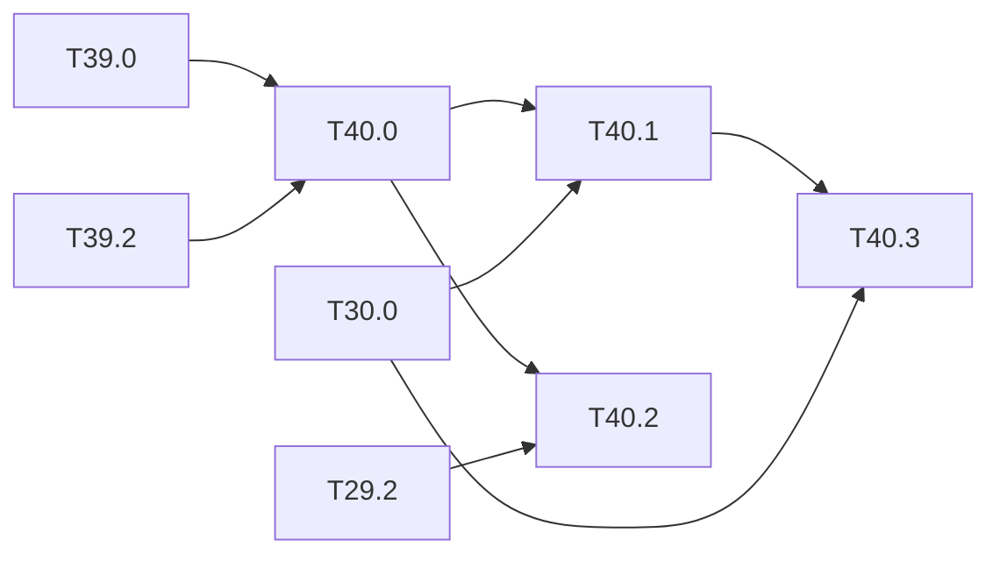

# M40 — Conservative early alerts (optional)

Goal: use early exits to **signal a presence early**, never to conclude that there is no
danger. Axis 1 of the thesis draft (ARCYS, 2026-10), first question: can a person be
suspected from the intermediate representations, before the end of the inference?

What the literature gives and lacks:

- BranchyNet (Teerapittayanon 2016) and MSDNet (Huang 2018) add intermediate classifiers to
  stop the inference early and lower the **mean** compute; the run time becomes variable,
  and a confident early exit is taken as the answer;
- for a safety function, an early positive can raise an alert, but an early negative must
  not let the zone be declared clear;
- no early-exit work bounds the time of the first suspicion, nor runs on an FPGA with a
  fixed schedule.

Decision rule of this milestone: an early head that fires raises the alert; an early head
that stays silent cancels nothing; the full inference always runs and stays the reference.
The nominal path keeps its bound ([T30.0](M30-latency-bound.md)); only the alert can come
earlier. Outside the base of the spec.

**State**: not started (2026-10-26). T40.0 uses the joint trainer of
[T39.2](M39-failure-prediction.md); T40.2 reuses the conformal calibration of
[T29.2](M29-runtime-monitors.md).

### [ ] T40.0 — Intermediate presence heads
- **Spec**: §6, §7 · **Depends on**: T39.0, T39.2 · **Runs on**: PC / Colab · **Size**: L
- **Deliverables**: "person likely" heads at 2 or 3 backbone levels (after the stride-8, 16
  and 32 blocks), trained with the detector; the decision rule in `python/yolo/infer/`;
  unit tests of the rule; `results/early_alerts.md`
- **Acceptance**:
  - per head: AUROC of "a person is present" and recall at a fixed alarm rate, on CrowdHuman
    val and PREWID;
  - the rule is tested on every combination (early positive, early negative, final
    positive, final negative): no early negative removes a final detection;
  - person AP of the detector with and without the heads (cost of the extra loss).
- **Notes**: the presence target can be per image or per zone of the grid; start per image.
  Per behaviour class, the auto-labelled factory clips of
  [M41](M41-safe-unsafe-behaviours.md) (T41.9) say which unsafe situations the heads flag
  early; they are not used for the alarm rate.

### [ ] T40.1 — Time to first suspicion
- **Spec**: §10.3 · **Depends on**: T40.0, T30.0 · **Runs on**: PC (perf_model) · **Size**: M
- **Deliverables**: `perf_model.py --wcet` per-head prefix bound; `results/early_alerts.md`
  section
- **Acceptance**: cycles from the frame start to each head, layer by layer; share of the
  persons (and of the missed-by-the-final-detector persons of T39.0) flagged before the end
  of the inference, and the lead time in ms at the board clock
- **Deferred** (board): [deferred/M40](deferred/M40-early-alerts.md) — T40.1, time to first suspicion measured on the KV260.

### [ ] T40.2 — Guaranteed thresholds of the early heads
- **Spec**: §8.1 · **Depends on**: T40.0, T29.2 · **Runs on**: PC · **Size**: M
- **Deliverables**: `results/early_alerts.md` section
- **Acceptance**: split-conformal threshold per early head (the `conformal.py` of T29.2) for
  a fixed alarm rate on empty frames; empirical alarm rate on the test half within the
  finite-sample bound over 20 random splits; recall paid for it
- **Notes**: PREWID empty frames ([M38](M38-prewid.md)) give the false-alarm side on
  industrial footage; the M41 clips are selected around behaviours and are not used here.

### [ ] T40.3 — Temporal bound with early heads
- **Spec**: §10.3 · **Depends on**: T40.1, T30.0 · **Runs on**: PC · **Size**: S
- **Deliverables**: argument in `results/latency_bound.md`; check in
  `python/tests/test_perf_model.py`
- **Acceptance**: the bound of the nominal path with the heads equals the T30.0 bound plus
  the head cycles (no data-dependent branch); the alert bound of a head equals the bound of
  the network prefix before it plus the head
- **Notes**: this is the point that separates the thesis from BranchyNet and MSDNet, where
  the run time depends on the input.

## Dependencies

