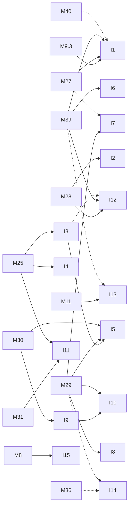

# M44 — Ideas from the literature (optional)

Goal: list the next pieces of work that the literature base supports and that no milestone
already plans. Each idea is tied to the current state of this repository, to a gap of the
base, to numbers read in the reading notes, and to a measurable acceptance criterion. This
file holds **ideas only, no tasks**. An accepted idea becomes a task in the milestone named
under **Proposal**, or a new milestone M45 and beyond. The ids written "proposed T25.11" are
the next free numbers at the time of writing and are not created here.

**State** (2026-11-03): 15 ideas, none started.

## Introduction

**Context.** The working title of the thesis is "certifiable safe embedded AI on FPGA". Its
application case is a YOLO detector on a CCTV stream that watches for people in a hazardous
industrial zone. The ARCYS subject draft (2026-10-25) adds six questions:

- failure prediction aimed at the critical false negative;
- early exits used as a conservative alert rather than a shortcut;
- the split between perception error, execution anomaly and timing failure;
- the effect of quantization on critical decisions;
- the end-to-end reaction delay;
- selective redundancy.

These questions are listed in `profile.md` of the base (section *Précisions*). Milestones
M25 and M27 to M43 already turn most of them into tasks. This file looks for what is left.

**Method.**

1. Read the profile, the gap map, the index and the 43 reading notes of the base that cover
   the relevant topics:
   - safety and certification;
   - SEU, TMR and fault injection;
   - runtime monitoring, OOD and conformal prediction;
   - failure prediction and calibration;
   - early exits;
   - person detection;
   - YOLO on FPGA, quantization and HLS toolflows.
2. Query `benchmarks.csv` with `bin/pdb bench`, filtered on detection, on the Zynq / Kria
   boards and on the YOLO models.
3. Inventory milestones M23 to M43, `docs/safety/` and `results/benchmarks.csv` of this
   repository.
4. Drop every idea that a milestone already covers (list below), then rank what is left by
   priority:
   - **P0**: answers a requirement of [docs/safety/requirements.md](../safety/requirements.md)
     marked "not met", with a PC-only first step;
   - **P1**: fills a gap of the base that the assurance case needs;
   - **P2**: useful for comparison or for the thesis, but with a larger cost or risk.

**Sources.**

- Literature base: [lrivals/PaperDatabase](https://github.com/lrivals/PaperDatabase),
  folder `bases/fpga/`, commit `0ff7ce7`, used read-only. It has 125 papers, all reading
  notes `done`, and `gaps.md` at its 10th pass (2026-11-03).
- The existing synthesis in `bases/fpga/docs/etat-de-l-art/` and the ARCYS slides in
  `bases/fpga/docs/presentation-arcys/`. Several ideas below were already stated there; the
  file and line are given when they were.
- This repository:
  - [README.md](../../README.md);
  - the [specification](../../yolo-embarque-de-zero.md), cited by section (§);
  - [architecture.md](../architecture.md);
  - this folder, milestones M23 to M43;
  - [docs/safety/](../safety/), [docs/adr/](../adr/);
  - [results/benchmarks.csv](../../results/benchmarks.csv).

**How numbers are cited.** Each number from the literature is written as: the value, then
the paper id, its section or table as given in the reading note (`fiche.md`), then the
passage id (chunk_id) in the base's short form, for example `2304.11580#014.0`.

- Most reading notes cite sections only. The chunk was then found with a search of
  `papers/<id>/sections.jsonl` and checked with `bin/pdb verify <chunk_id> "<quote>"`; every
  chunk below returned `OK`.
- A chunk printed in the reading note itself is marked *(fiche)*.
- `chunk n/r` means no passage holds the number.
- A value that is not reported is written `n/r`.

The paper ids map to the base as listed in the [paper list](#papers-cited).

**Flags.**

- `[preprint]`: not peer reviewed, per `bin/pdb paper`.
- `[in-domain only]`: the reading note says the test has no distribution shift.
- `[scope: board | chip | estimated | unspecified]`: the power scope, from `benchmarks.csv`
  or the reading note.
- `[inferred]`: a value or claim derived here, not read in a paper.
- `[table reconstructed]`: the table was rebuilt by PyMuPDF or Docling, so its digits are to
  be checked against the PDF (base `docs/EVAL.md` §6).

**Already covered, so not proposed.**

| Topic | Covered by |
|---|---|
| Three-stage mAP and person metrics | [M8](M8-mesures.md), [T27.1](M27-safety-metrics.md) |
| Early exits as a conservative alert, with their timing bound | [M40](M40-early-alerts.md) |
| Conformal thresholds | [T29.2](M29-runtime-monitors.md), [T40.2](M40-early-alerts.md) |
| Fallback state machine and frame watchdog in software | [T29.5](M29-runtime-monitors.md) |
| Reaction delay of the whole chain, shared resources included | [T30.4](M30-latency-bound.md) |
| Measurement of PS non-determinism | [T30.3](M30-latency-bound.md) |
| Power protocol (chip estimate, SOM measurement, idle then load) | [results/protocole.md](../../results/protocole.md) |
| Configuration-memory upsets through the SEM IP | deferred [T25.7](deferred/M25-dependability.md) |
| Leave-one-camera-out evaluation | [T38.7](M38-prewid.md) |
| KGFP baseline and its metric | [T39.1](M39-failure-prediction.md), [T39.3](M39-failure-prediction.md) |
| Calibration against failure prediction | [T39.4](M39-failure-prediction.md) |
| Tracking and re-identification | out of scope in [M38](M38-prewid.md) and [M41](M41-safe-unsafe-behaviours.md) |

## Summary

| Idea | Priority | Area | Proposal | Gap (`bases/fpga/gaps.md`) |
|---|---|---|---|---|
| [I1](#i1--quantization-and-critical-decisions-at-w4) | P0 | quantization | proposed T9.3.7 | l. 1478 |
| [I2](#i2--qonnx-export-and-a-finn-compatible-variant) | P2 | quantization | new M45 | l. 643 |
| [I3](#i3--activation-range-check-for-the-faults-abft-cannot-see) | P0 | dependability | proposed T25.11 | l. 919 |
| [I4](#i4--channel-replication-chosen-under-a-budget) | P1 | dependability | proposed T25.12 | l. 919 |
| [I5](#i5--re-execution-triggered-by-an-execution-alarm) | P1 | dependability | new M46 | l. 1507 |
| [I6](#i6--a-failure-head-that-says-where) | P0 | monitoring | proposed T39.7 | l. 1347, 1307 |
| [I7](#i7--window-level-shift-test-for-the-odd) | P1 | monitoring | proposed T29.6 | l. 1107 |
| [I8](#i8--box-uncertainty-head-as-a-miss-monitor) | P2 | monitoring | proposed T29.7 | l. 1107 |
| [I9](#i9--contention-aware-accelerator-bound) | P1 | latency | proposed T30.5 | l. 1546, 1583 |
| [I10](#i10--bus-stall-monitor-as-a-hardware-watchdog) | P1 | latency | proposed T30.6 | l. 1615 |
| [I11](#i11--hardware-term-of-the-failure-budget) | P1 | assurance | proposed T31.6 | l. 971 |
| [I12](#i12--bit-exact-verification-of-the-failure-head) | P2 | assurance | proposed T28.7 | l. 1080 |
| [I13](#i13--natural-shift-set-shared-with-kgfp) | P2 | datasets | proposed T27.8 | l. 1676 |
| [I14](#i14--printable-patch-float-against-integer) | P2 | datasets | new M47 | l. 1725 |
| [I15](#i15--comparable-rows-in-resultsbenchmarkscsv) | P1 | measurement | proposed T8.4 | l. 369, 561, 588 |

## Quantization and accelerator

### I1 — Quantization and critical decisions at W4

Priority **P0**.

- **State in this repo**:
  - [T9.3.5](M9.3-quant-4bits.md) measures VOC mAP only: PTQ 17.06, short QAT 36.38,
    against 55.66 for INT8 ([M9.3-quant-4bits.md:54](M9.3-quant-4bits.md)). M9.3 has no
    person metric, no monitor and no miss count.
  - The person metrics of M27 ([T27.1](M27-safety-metrics.md),
    `M27-safety-metrics.md:89`) and the failure head at three stages
    ([T39.5](M39-failure-prediction.md), `M39-failure-prediction.md:202`) are measured
    at INT8 only.
- **Literature**:
  - A binarized CNN turns 38 % of its data corruptions into misclassifications, against
    26 % for the baseline CNN. Source: 2020-libano, §IV-B, `2020-libano#009.1`. Only MNIST
    was tested.
  - With Vitis AI PTQ, mAP@0.5:0.95 falls from 0.60 (CPU) to 0.45 (FPGA) for YOLOv8n on
    VOC, and from 0.64 to 0.34 on KITTI. Source: 2607.13106, Table II,
    `2607.13106#026.0` `[preprint]`.
  - At 4 bits, QAT recovers to within about 0.006 mAP@0.5 of float, whereas PTQ loses about
    0.17. Source: 2609.24757, §IV, `2609.24757#008.0` `[preprint]`. That paper detects
    vehicles only.
  - A method that improves calibration can worsen failure prediction: AURC×10³ is 9.52 for
    the baseline and 16.27 with mixup. Source: 2403.02886, Table 1, `2403.02886#048.0`
    `[preprint]`. That paper studies classification only.
- **Gap**: *Effet de la quantification sur la prédiction d'échec et les décisions
  critiques* (gaps.md:1478). The gap says no failure-prediction or calibration work
  quantizes, and asks what INT8 and INT4 change to three things: the missed-person rate,
  the monitor separation, and the early-exit thresholds calibrated in float.
- **Proposal**: add a new task, proposed T9.3.7 "Safety metrics at 4 bits", in
  [M9.3](M9.3-quant-4bits.md).
  - Run the M27 tools at float, W8, W4 PTQ and W4 QAT on PREWID test: recall at 0.1 FPPI,
    LAMR and E1 runs per hour (T27.5 method).
  - Run the T39.1 head (`tools/failure_prediction.py eval`) at the same four precisions. Fit
    it twice: once on INT8 features and used unchanged, once refitted on W4 features.
  - Add the early-head thresholds once T40.2 exists.
  - Files: `docs/tasks/M9.3-quant-4bits.md`; a `results/quant_4bits.md` section. Runs on:
    PC.
- **Acceptance**:
  - A table of the four precisions × {R@0.1 FPPI, LAMR, E1 per hour, head AUROC, head AURC}
    on PREWID test, with the change in missed persons given with its 95 % Clopper-Pearson
    interval (the T27.7 tool).
  - A decision line: W4 is acceptable for the safety function only if R@0.1 FPPI drops by
    ≤ 1 point and the E1 rate is not higher at 95 % confidence. Otherwise the table states
    which term fails.
- **Risks**:
  - The short QAT (600 iterations) mixes under-training with quantization. The table is
    only conclusive after [T9.3.6](M9.3-quant-4bits.md), the long QAT.
  - PREWID is the only industrial set with boxes until M41 to M43 exist.
  - Refitting the head can hide a shift that the unchanged head would show. This is why
    both fits are reported.

### I2 — QONNX export and a FINN-compatible variant

Priority **P2**.

- **State in this repo**:
  - The accelerator is an HLS kernel of our own ([ADR 0002](../adr/0002-hls.md)), with a
    leaky ReLU of slope 13/128 fused into the output stage ([architecture.md:75-83](../architecture.md)).
  - No milestone mentions FINN, hls4ml or QONNX.
  - The model ↔ circuit equivalence of [M28](M28-equivalence.md) covers our own chain only.
- **Literature**:
  - FINN supports only the ReLU, hardtanh and identity activations, and raises an error
    otherwise. Source: 2206.07527, §VI-D, `2206.07527#012.0` `[preprint]`.
  - The only hls4ml against FINN case in the base is MLPerf Tiny image classification:
    hls4ml takes 27.3 ms and 44 330 µJ, FINN 1.5 ms and 2 535 µJ. Source: 2206.11791,
    Table of results, `2206.11791#034.0` `[preprint]`. It is not one network on two flows:
    each flow has its own architecture.
  - The synthesis of the base proposes "one ReLU YOLO exported to QONNX, three flows, one
    board" (`docs/etat-de-l-art/sec-gaps-fpga.tex:81-82`).
- **Gap**: *Pas de comparaison croisée hls4ml / FINN / Vitis AI sur un même CNN et une même
  carte* (gaps.md:643).
- **Proposal**: a new milestone, M45 "Toolflow cross-check":
  1. `tools/export_qonnx.py`: writes the integer Tiny-YOLOv2 as QONNX, with per-channel
     `Quant` nodes and the M0/shift requantization made explicit.
  2. Execution check: the QONNX graph run by the `qonnx` executor equals `IntNetwork`, byte
     for byte, on the 20 images of the [T28.0](M28-equivalence.md) matrix.
  3. A ReLU variant, fine-tuned from the Darknet weights with leaky replaced by ReLU, with
     its VOC mAP.
  4. Deferred: a FINN build for the KV260, and the same row in the T28.0 matrix.
- **Acceptance**:
  - The QONNX execution equals the integer model on 20 VOC images × 3 networks.
  - The ReLU variant's VOC mAP is within 2 points of 55.66, or the gap is reported.
  - FINN ingests the ReLU variant without error (deferred, Vitis).
- **Risks**:
  - The `onnx` and `qonnx` packages are new dependencies. They stay in `tools/` and
    outside the NumPy-only core ([ADR 0001](../adr/0001-numpy-pur.md)).
  - Tiny-YOLOv2 weights may not fit on chip in a FINN dataflow (gaps.md:666).
  - The cost is large for a comparison, which is why this is P2.

## Hardware dependability

### I3 — Activation range check for the faults ABFT cannot see

Priority **P0**.

- **State in this repo**:
  - [T25.1](M25-dependability.md) found that ABFT flags every weight, bias and accumulator
    fault and no activation fault (`M25-dependability.md:40`).
  - [T25.7](M25-dependability.md) leaves the requantized `q` tile 67-81 % silent and the
    input tile 13-18 % silent, so SR-07 is not met
    ([requirements.md:33](../safety/requirements.md)).
  - [T25.9](M25-dependability.md) concludes that "a range check on the ReLU output is
    needed" for the failure head (`M25-dependability.md:266`). No task does it.
- **Literature**:
  - Clipping activations keeps AlexNet at 69.36 % accuracy at a fault rate of 5×10⁻⁷,
    against 51.16 % unprotected. Source: 1912.00941 (FT-ClipAct), §V-B,
    `1912.00941#008.0` `[preprint]`. The faults are software flips on weights, in float.
  - A symptom-based error detector (SED, range checks on values) has 90.21 % precision and
    92.5 % recall, and cuts the FIT of an Eyeriss-like accelerator from 8.55 to 0.35 in
    FLOAT. Source: 2017-li, §6.2, `2017-li#022.3`. The accelerator is simulated, not an
    FPGA; SED is blind to in-range corruptions.
  - ABFT or "smart pooling" detects up to 85 % of the critical errors. Source: 2024-rech,
    §VI-A, `2024-rech#029.1`. The survey's results are mostly on GPU.
- **Gap**: *Fiabilité SEU à l'échelle d'un détecteur : criticité par couche, TMR sélectif,
  DPU contre dataflow* (gaps.md:919). It asks for selective hardening (TMR, clipping, SED)
  costed on a quantized detector. The failure-head part is gaps.md:1507.
- **Proposal**: add a new task, proposed T25.11 "Range check on activations", in
  [M25](M25-dependability.md).
  - Take the per-channel `[min, max]` of the int8 outputs, and of the int32 accumulators
    before requantization, from the calibration set, with a margin.
  - Use the bounds two ways: *flag*, which raises the same alarm as ABFT, and *clip*, which
    bounds the damage.
  - Implement it in `IntNetwork`, the golden model and the HLS kernel (compare-only, no
    DSP), and for the hidden layer of the failure head.
  - Re-run the T25.7 and T25.9 campaigns. Files: `results/faults.md`,
    `docs/tasks/M25-dependability.md`.
  - Runs on: PC (C-sim); the LUT cost waits for Vitis (deferred).
- **Acceptance**:
  - On the T25.7 campaign, the silent share of the `q` and `in` sites falls to ≤ 1 %
    (SR-07), or the residue is given per site.
  - On the T25.9 campaign, the silencing hidden-activation faults are flagged.
  - Fault-free runs:
    - 0 false alarms on VOC test and PREWID test;
    - mAP and R@0.1 FPPI unchanged within 0.1 point with clipping on;
    - integer == golden == C-sim with the check in place.
- **Risks**:
  - Bounds taken from calibration can be exceeded by rare in-distribution inputs, which
    gives false alarms. The margin must be chosen on a separate split.
  - A corruption that stays in range is not seen, the limit stated for SED (2017-li).
  - One comparator pair per lane costs LUTs, to be weighed against the +24 DSP of the ABFT
    lane of T25.3.

### I4 — Channel replication chosen under a budget

Priority **P1**.

- **State in this repo**:
  - [T25.4](M25-dependability.md) protects by layer: ABFT on every convolution plus
    duplication of L00-L04 keeps 57.5 / 54.5 mAP at a BER of 1e-5 / 1e-4, against
    49.1 / 14.2, for +24 DSP and +28 % cycles (`M25-dependability.md:101`).
  - [T25.6](M25-dependability.md) shows that the layer ranking by critical (person-losing)
    images differs from the ranking by mAP (`M25-dependability.md:148`).
- **Literature**:
  - Selective replication costs +49.87 % MACs for a ≤ 2 % accuracy drop, against +200 %
    for full TMR. Source: 1912.07394, Table III, `1912.07394#018.2`. The faults are
    channel stuck-at faults in a BNN on a ZCU104, and the 2 % threshold is not tied to a
    SIL.
  - Selective TMR reduces the error probability of a small ANN by 64.2 %, against about
    85 % for full TMR. Source: 2019-libano, §V-C, `2019-libano#011.1`, under a neutron
    beam.
  - On a CNN, selective TMR of one IP masks about 40 % of the faults for 8 % overhead.
    Source: 2019-libano, §V-C, `2019-libano#011.4`. The networks hold 19 and 1848 weights.
- **Gap**: gaps.md:919, the same gap as I3. It asks for per-layer criticality measured in
  missed persons, and selective hardening costed in LUT/BRAM.
- **Proposal**: add a new task, proposed T25.12 "Budgeted selection by output channel", in
  [M25](M25-dependability.md).
  1. Score each output channel (or each PE column, the unit the kernel can actually
     duplicate) by its share of person-losing images under the T25.6 criterion.
  2. Choose the set to duplicate with a knapsack under a cycle or DSP budget, costed by
     `perf_model`.
  3. Compare with the layer duplication of T25.4 at equal cost.

  Runs on: PC.
- **Acceptance**: at equal extra cycles (+28 %) or equal extra DSP (+24), the share of
  person-losing images at BER 1e-4 on PREWID and CrowdHuman is lower than with T25.4, and
  the 95 % intervals do not overlap. Otherwise the absence of a gain is reported.
- **Risks**:
  - Scoring every channel needs a large campaign; sample it by layer first.
  - The duplication unit in the kernel is the Tm × Tn tile, not a channel
    `[inferred from architecture.md:75-83]`, so the gain may shrink once mapped.

### I5 — Re-execution triggered by an execution alarm

Priority **P1**.

- **State in this repo**:
  - [T25.8](M25-dependability.md) detects 85 % / 86 % of the critical one-frame faults when
    either ABFT or the temporal check fires, on PREWID and MOT17
    (`M25-dependability.md:210`). Nothing is done with the alarm yet.
  - The fallback logic [T29.5](M29-runtime-monitors.md) is open.
  - The static bound is 92 ms per Tiny-YOLOv2 frame, with a 116 ms watchdog
    ([T30.0](M30-latency-bound.md)).
- **Literature**:
  - Reduced-precision duplication with comparison (RP-DWC) detects about 75 % of the
    errors for less than 20 % overhead. Source: 2024-rech, §VI-B, `2024-rech#030.0`.
  - Temporal coherence detects about 70 %, with false positives. Source: 2024-rech, §VI-A,
    `2024-rech#029.2`. The survey's results are mostly on GPU.
- **Gap**: *Fiabilité matérielle du moniteur et redondance sélective guidée par le
  moniteur* (gaps.md:1507). Its status in the base is a hypothesis.
- **Proposal**: a new milestone, M46 "Selective re-execution".
  - On an *execution* alarm (ABFT, or the I3 range check), re-run the frame, or only the
    flagged layers, once before going `UNSAFE`. A transient fault recovers the frame; a
    second alarm means `UNSAFE`.
  - A *perception* alarm (the T39.1 failure head) goes to `UNSAFE` directly. Re-running a
    deterministic network gives the same miss `[inferred]`. This keeps the ARCYS split
    between perception error and execution anomaly.
  - Evaluate in `sw-sim` with the T25.7 injector. Files: `tools/`, `results/faults.md`.
- **Acceptance**:
  - On the T25.7 / T25.8 injection runs: the share of hit frames recovered (output == the
    fault-free output after one re-run), the share sent to `UNSAFE`, and the `UNSAFE` time
    per hour caused by false execution alarms on clean PREWID.
  - The worst-case frame time with one re-run is ≤ the 116 ms watchdog for Tiny-YOLOv2.
- **Risks**:
  - A full re-run doubles the 92 ms bound, past the 116 ms watchdog `[inferred]`. Only a
    re-run of the flagged layers may fit, and the I9 bound then has to cover it.
  - The logic adds states to T29.5 that its tests must cover.

## Runtime monitoring and failure prediction

### I6 — A failure head that says where

Priority **P0**.

- **State in this repo**:
  - [T39.1](M39-failure-prediction.md) is an image-level head: `FailureHead` maps pooled
    multi-scale features through d → 32 ReLU → 1, with the target "this image has a missed
    person" (`M39-failure-prediction.md:80-100`).
  - It gives AUROC 0.84-0.97 on PREWID, COCO and ExDark (progress table of the
    [task index](README.md)).
  - SR-05 is not met: 9-12 % of the misses are flagged at 5 % alarms
    ([requirements.md:31](../safety/requirements.md)).
- **Literature**:
  - KGFP, also image-level ("all or nothing" per image), raises person recall among the
    accepted images from 64.3 % to 84.5 % at 5 % FPR on COCO. Source: 2603.25499,
    Abstract, `2603.25499#000.0` `[preprint]`.
  - KGFP's safety AUROC is 92.9 %. Source: 2603.25499, §5, `2603.25499#016.1`.
  - The KGFP head alone has 2.6 M parameters, next to a frozen float YOLOv8l and a DINO
    ViT-B. Source: 2603.25499, §5, `2603.25499#017.0`.
  - A false-negative monitor on early-layer activations labels an error as "an object with
    no box at IoU > 0.7". Source: 2404.07685, §3, `2404.07685#009.0`.
  - That monitor costs 4.94 ms on CPU and 1.95 ms on GPU, for 2.60 GFLOPs, alone. Source:
    2404.07685, Table 2, `2404.07685#022.0` *(fiche)*. It is a 3D LiDAR detector and the
    test is `[in-domain only]`.
- **Gap**:
  - *Prédiction d'échec ciblée sur le faux négatif : deux travaux, moniteurs externes sur
    détecteurs gelés* (gaps.md:1347). It asks for a monitor localized per region or
    detection scale.
  - *Aucun moniteur de faux négatifs de détecteur mesuré sur matériel* (gaps.md:1307).
- **Proposal**: add a new task, proposed T39.7 "Per-cell failure head", in
  [M39](M39-failure-prediction.md).
  - A 1×1-convolution head on each detection scale predicts, per grid cell, "a person
    centred here is missed".
  - The zone alarm is the maximum over the cells inside the zone mask (ODD item O1,
    [odd.md](../safety/odd.md)).
  - Labels are the T39.0 failures matched to their cell.
  - Files: `python/yolo/infer/failure.py`, `tools/failure_prediction.py`, a
    `results/failure_prediction.md` section. Runs on: PC.
  - The head stays a convolution of the kind the kernel already runs, so the
    [T39.6](M39-failure-prediction.md) HLS path still applies.
- **Acceptance**:
  - Use the T29.1 protocol: share of missed persons flagged at 1 % and 5 % alarm rates.
    A flag counts only if the flagged cell lies within the missed box or one cell from it.
  - Report it beside the image-level T39.1 head at the same alarm rate, on PREWID, COCO
    person and CrowdHuman, with memory and MACs.
  - SR-05 status updated.
- **Risks**:
  - Positives per cell are far rarer than per image (already 17-19:1 per image on PREWID,
    `M39-failure-prediction.md:36`).
  - A large share of misses has no matching anchor (`no_anchor` 26-30 % on CrowdHuman,
    [T36.5](M36-explanation.md)), where the cell features may carry little signal.
  - PREWID has no zone masks; the masks have to be drawn per camera.

### I7 — Window-level shift test for the ODD

Priority **P1**.

- **State in this repo**:
  - The monitors of [T25.5](M25-dependability.md) and [T29.0](M29-runtime-monitors.md)
    score one image at a time. The best AUROC is 0.81 on ExDark (max score) and 0.93 on FLIR
    (activation patterns) (`M29-runtime-monitors.md:31-50`).
  - SR-13 asks for a shift AUROC ≥ 0.99 on each ODD axis beyond its limit and is not met
    ([requirements.md:39](../safety/requirements.md)).
  - The vote of [T29.3](M29-runtime-monitors.md) runs over detections, not over feature
    distributions.
- **Literature**:
  - SafeML compares the empirical distribution functions of a sliding window (d = 1500)
    with the training data. Source: 2005.13166, §3, `2005.13166#011.1` `[preprint]`.
  - SafeML's distance-based estimates are optimistic: true minimum accuracy 0.508,
    estimated 0.772 (Kolmogorov-Smirnov) and 0.986 (Wasserstein). Source: 2005.13166,
    Table 1, `2005.13166#024.0`. The data is 2D tabular and the ECDFs univariate.
  - Under ImageNet-C shift, the median ECE is 0.102 for a vanilla model, 0.072 after
    temperature scaling and 0.032 for ensembles. Source: 1906.02530, Table G.2,
    `1906.02530#035.0` `[preprint]`. A per-image confidence degrades under shift.
- **Gap**: *Moniteurs d'exécution (OOD, incertitude, prédiction conforme) non portés sur
  FPGA* (gaps.md:1107). It asks for light monitors compared at equal resources.
- **Proposal**: add a new task, proposed T29.6 "Window shift test", in
  [M29](M29-runtime-monitors.md).
  - Run a two-sample test between a reference window from the ODD and the last W frames,
    on the integer pooled features of T29.0 (`pool_int`). Either a Kolmogorov-Smirnov test
    per feature with a Bonferroni correction, or an MMD.
  - Sweep W ∈ {25, 100, 500}. Axes: the six [T27.3](M27-safety-metrics.md) degradations
    at three severities, ExDark and FLIR.
  - Files: `python/yolo/infer/ood.py`, `tools/ood_monitor.py`, `results/ood_monitor.md`.
    Runs on: PC.
- **Acceptance**:
  - Per ODD axis beyond its limit, a window AUROC ≥ 0.99 (SR-13) at some W, with the
    detection delay in frames at that W.
  - False-alarm rate per hour on clean PREWID sequences.
  - Memory of the reference.
- **Risks**:
  - A window adds W / FPS of delay: about 3.7 s for W = 100 at 27 FPS `[inferred]`,
    against the 0.5 s of SR-09. The test is a slow ODD monitor beside the per-frame ones,
    not a replacement.
  - A PREWID camera change is itself a shift, so each camera needs its own reference.

### I8 — Box uncertainty head as a miss monitor

Priority **P2**.

- **State in this repo**: Gaussian YOLOv3 is cited
  ([M29-runtime-monitors.md:12](M29-runtime-monitors.md)) but not implemented; none of the
  six T29.0 monitors uses box uncertainty.
- **Literature**: all from 1904.04620 (Gaussian YOLOv3) `[preprint]`, on a GTX 1080 Ti,
  `[in-domain only]`.
  - Modelling each box coordinate as a Gaussian costs +0.04 % FLOPs (§3.1,
    `1904.04620#004.3`).
  - It raises KITTI mAP by 3.09 at 43.13 FPS (Table 2, `1904.04620#009.1`).
  - It cuts false positives by 41.40 % on KITTI and 40.62 % on BDD (§4,
    `1904.04620#010.1`).
- **Gap**: gaps.md:1107, as for I7.
- **Proposal**: add a new task, proposed T29.7 "Gaussian box head", in
  [M29](M29-runtime-monitors.md).
  - Add four variance channels per anchor to the Tiny-YOLOv3 head, with the negative
    log-likelihood loss in the §6.2 loss.
  - Use σ on the candidate boxes (conf ≥ 0.005) as a monitor score per box and per image.
  - Run the integer variance through the sigmoid table (§9.4).
  - Runs on: PC, with Colab for training.
- **Acceptance**:
  - The AUROC for "missed person" (T29.1 protocol) of the σ score is given beside the max
    score and the T39.1 head.
  - VOC mAP changes by ≥ −0.5 point.
  - integer == golden.
- **Risks**:
  - σ is aleatoric localization uncertainty. A missed person often has no candidate box at
    all, so the score may not see the misses `[inferred]`. This is why it is P2.
  - Retraining costs CPU or GPU days (compare T33.7).
  - The head gains channels, which changes the manifest and the HLS output layer.

## Early alerts and latency

Early alerts are covered by [M40](M40-early-alerts.md) (BranchyNet and MSDNet are already
cited there). The only addition here is that their thresholds enter the I1 table.

### I9 — Contention-aware accelerator bound

Priority **P1**.

- **State in this repo**:
  - [T30.0](M30-latency-bound.md) bounds each layer as a sequential schedule plus its DDR
    bytes at 13.44 GB/s plus 64 cycles per m_axi phase, "an assumption until T30.2"
    (`M30-latency-bound.md:23-43`). No other bus master is counted.
  - [T30.4](M30-latency-bound.md) will model the whole chain with its shared resources and
    names Zhang 2025 as the reference for the inference part (`M30-latency-bound.md:86-92`).
  - This idea gives T30.4 that inference term.
- **Literature**:
  - Zhang 2025 (multi-DPU, ZCU102):
    - Its analytical bound for one DPU is 128 % of the measured maximum
      (`2025-zhang#016.1`).
    - With three DPUs it is 164 %, 252 % and 317 % of the best, mean and worst measured
      cases (`2025-zhang#017.1`).
    - It measures an HP-port read at 35 cycles and an LPD read at 146 cycles
      (`2025-zhang#015.2`, `2025-zhang#015.3` *(fiche)*).
    - Its "WCET" reference is a measured maximum, not a proof.
  - Restuccia 2021 (RTSS, DPU on ZCU102):
    - Its profiled bus delays are 40 cycles for a DRAM read, 30 for a write and 40 for an
      OCM read (`2021-restuccia#028.1` *(fiche)*).
    - Bus traffic varies by less than 0.1 % between jobs (`2021-restuccia#007.3`).
    - YOLOv3 peaks at 8.02 ms over 1000 runs (Table II, `2021-restuccia#044.0`
      *(fiche)*).
    - The parameters were profiled with an unloaded PS.
- **Gap**:
  - *Interférences PS / PL et DDR non modélisées pour un accélérateur CNN* (gaps.md:1546).
  - *Bornes temporelles fondées sur la mesure, un modèle de performance ou une autre
    cible* (gaps.md:1583).
- **Proposal**: add a new task, proposed T30.5 "Interference term in the static bound", in
  [M30](M30-latency-bound.md).
  - `perf_model.py --wcet --interference k` adds, to each m_axi burst of
    `gmem_in/out/w/p`, a worst-case arbitration delay against k competing masters (other
    HP ports, PS traffic to DDR).
  - Until the KV260 values are measured (T30.2), use the per-transaction delays above,
    flagged as ZCU102 values.
  - Files: `tools/perf_model.py`, `results/latency_bound.md`. Runs on: PC.
- **Acceptance**:
  - Bound per network for k = 0..3.
  - k = 0 equals the T30.0 bound exactly (92 ms for Tiny-YOLOv2).
  - Deferred: on the board, the maximum measured under a PS memory-stress load is ≤ the
    bound for the same k, and the ratio bound / measured is reported (128 % in Zhang 2025 as
    a reference point).
- **Risks**:
  - The ZCU102 delays are not KV260 values. Both are Zynq UltraScale+ `[inferred]`, but the
    DDR configuration differs.
  - DDR refresh and controller QoS are not modelled.
  - The bound may pass the 116 ms watchdog, which would call for bandwidth regulation.

### I10 — Bus stall monitor as a hardware watchdog

Priority **P1**.

- **State in this repo**:
  - The watchdog of [T29.5](M29-runtime-monitors.md) is software and not written
    (`M29-runtime-monitors.md:160`).
  - SR-08 (frame watchdog) and SR-10 (missing frame) are open
    ([requirements.md:34-36](../safety/requirements.md)).
  - In the failure budget, the share of late or missing frames turned into `UNSAFE` is 0
    ([tools/failure_budget.py:87-92](../../tools/failure_budget.py)).
- **Literature**: all from 2020-restuccia-safely (FCCM) `[table reconstructed]` for the
  cost. It was tested on FFT, DMA and FIR, with no DNN and a single injected failure.
  - An AXI stall monitor costs 185 LUT and 203 FF on a Z-7020 and 183 LUT on a ZU9EG, with
    0 BRAM and 0 DSP (Table III, `2020-restuccia-safely-preventing-unbounded-delays-during#030.0`).
  - Its response-time bounds are 12.6 ms for the FFT, 1.3 ms for the DMA and 24.2 ms for
    the FIR (§VI,
    `2020-restuccia-safely-preventing-unbounded-delays-during#019.0`).
- **Gap**:
  - *Repli et état sûr après une défaillance temporelle de l'accélérateur de perception*
    (gaps.md:1615), a hypothesis in the base.
  - gaps.md:1107 notes that the only FPGA monitor measured in the base is this temporal
    one.
- **Proposal**: add a new task, proposed T30.6 "Transaction timeout in the PL", in
  [M30](M30-latency-bound.md).
  - Place a per-port timeout between the kernel's m_axi ports and the HP port. Take the
    budget per burst from `perf_model` (with the I9 term).
  - On timeout: decouple, raise an interrupt, and the T29.5 state machine goes `UNSAFE`.
  - PC part: the budget table and a `sw-sim` injection of a stalled transaction. The RTL
    and Vivado parts go to [deferred/M30](deferred/M30-latency-bound.md).
- **Acceptance**:
  - In `sw-sim`, an injected stall on each of `gmem_in/out/w/p` gives `UNSAFE` within one
    frame period (SR-10) and before the 116 ms watchdog (SR-08).
  - The budgets raise 0 false timeouts over the 10,544-image cycle run of
    [T30.1](M30-latency-bound.md).
  - Deferred: cost ≤ 1 % of the XCK26 LUTs.
- **Risks**:
  - It sees stalls, not wrong data. It complements ABFT and I3 and replaces neither.
  - Budgets that are too tight under contention give false timeouts, so this waits for I9.
  - It needs a decoupler in the M7 block design.

## Safety metrics and assurance case

### I11 — Hardware term of the failure budget

Priority **P1**.

- **State in this repo**:
  - The failure budget of [T31.3](M31-assurance-case.md) gives 22.6 dangerous failures per
    hour, with provisional inputs.
  - Its hardware rate `hw_rate` is an assumption: 1e-5 per hour, about 10⁴ FIT, "to
    replace by the device reliability data"
    ([tools/failure_budget.py:75-78](../../tools/failure_budget.py)).
  - `hw_miss` is "missing" ([tools/failure_budget.py:83-86](../../tools/failure_budget.py)).
- **Literature**:
  - Essential bits are the configuration bits the design uses. A FINN BNN on a ZU3EG has
    1,940,316 essential bits out of 10,249,344 configuration bits. Source: 2404.01757,
    Table I, `2404.01757#008.2` `[preprint]`.
  - Emulated upsets in those bits give 1.06 % crashes and 0.23 % critical errors. Source:
    2404.01757, Table II, `2404.01757#018.0`. The network is an MNIST BNN with single
    faults and no beam test.
  - A raw rate of 20.49 FIT/Mb is used for latches and buffers. Source: 2017-li, §4.7,
    `2017-li#013.0`. It is a rate for an ASIC projected to 16 nm, **not** for FPGA
    configuration memory, and is not to be reused as such.
  - ASIL D requires < 10 FIT. Source: 2024-rech, §III-C, `2024-rech#015.1`.
- **Gap**: *Critère de criticité d'erreur pour la détection de personnes et lien FIT /
  précision → SIL / PL* (gaps.md:971). It asks for a per-hour dangerous rate that combines
  model errors and hardware faults.
- **Proposal**: add a new task, proposed T31.6 "Derived hardware rate", in
  [M31](M31-assurance-case.md).
  - Compute `hw_rate` = essential bits of the KV260 design × device FIT per Mb × the share
    of critical upsets.
  - The device FIT comes from the vendor reliability report, which is not in the base and
    is to read.
  - The critical share comes from the deferred SEM IP campaign of T25.7.
  - `hw_miss` comes from the T25.6 critical rate.
  - PC part: the formula in `tools/failure_budget.py`, each factor with its source and
    status. Essential bits need Vivado (deferred).
  - Files: `tools/failure_budget.py`, `results/failure_budget.md`,
    [docs/safety/argument.md](../safety/argument.md).
- **Acceptance**:
  - The `hw_rate` row changes status from "assumption" to "derived", each factor pointing
    to a file or document.
  - `make failure-budget` gives the hardware share of the dangerous rate with low and high
    bounds.
  - `make safety-case` passes.
- **Risks**:
  - Essential bits overestimate the sensitive bits. The 0.23 % critical share of a BNN does
    not carry over to a YOLO `[inferred]`.
  - The perception term dominates the budget by orders of magnitude
    ([tools/failure_budget.py:199](../../tools/failure_budget.py)). The conclusion may not
    move, but the hardware term stops being an unsourced number.

### I12 — Bit-exact verification of the failure head

Priority **P2**.

- **State in this repo**:
  - [T28.2](M28-equivalence.md) proves 95 SMT obligations on the scalar kernels with z3
    (`M28-equivalence.md:85`).
  - [T25.9](M25-dependability.md) shows that a single output-bias flip silences the
    failure head (`M25-dependability.md:248`).
  - The T39.1 head has 49 k parameters (`M39-failure-prediction.md:104`); its integer
    version takes 51 KB (`M39-failure-prediction.md:218`).
  - Nothing proves a property of the head itself.
- **Literature**: all from 2012.08185 (bit-exact verification of quantized networks), on a
  CPU, with dense layers only.
  - The problem is PSPACE-hard (Abstract, `2012.08185#000.0`).
  - It handles a network of 52,650 parameters (`2012.08185#013.2`).
  - At ε = 4 it solves 54 MNIST instances, 55.7 % (`2012.08185#022.0`), the rest timing
    out.
- **Gap**: *Vérification formelle non scalable aux CNN de détection* (gaps.md:1080). It asks
  for bounded verification of detector components, such as the head, the NMS and the
  monitor.
- **Proposal**: add a new task, proposed T28.7 "Robustness of the alarm", in
  [M28](M28-equivalence.md).
  - Encode the integer head (int8 weights, int32 accumulators, requantization) in z3 bit
    vectors, with the T28.2 encoding.
  - Property: for a feature vector that raises the alarm, no vector within ε LSB in ∞-norm
    silences it.
  - Runs on: PC.
- **Acceptance**:
  - For 100 PREWID alarm cases and ε ∈ {1, 2, 4} LSB: the share proved, the share with a
    counterexample, and the share timed out at 600 s.
  - Each counterexample is replayed through `IntNetwork` with the same output.
- **Risks**:
  - 49 k parameters is at the edge of the published scale, so many timeouts are likely.
  - Local robustness is not correctness of the alarm.
  - An ε in feature space has no physical meaning unless it is tied to the I3 bounds or to
    a sensor noise model.

## Datasets and out-of-domain evaluation

### I13 — Natural-shift set shared with KGFP

Priority **P2**.

- **State in this repo**:
  - The degraded conditions of [T27.3](M27-safety-metrics.md) are synthetic: six kinds at
    three severities (`M27-safety-metrics.md:126`).
  - The natural shifts are ExDark and FLIR ([T29.0](M29-runtime-monitors.md)).
  - COCO-O is not in the dataset chain (no hit in `docs/`, `tools/` or `python/`).
  - [T39.1](M39-failure-prediction.md) already implements the KGFP metric, and
    [T39.3](M39-failure-prediction.md) the KGFP baseline. What is missing is the shared
    data.
- **Literature**: all from 2603.25499 (KGFP), §5, `2603.25499#016.0` `[preprint]`, with a
  frozen float YOLOv8l on GPU.
  - Average recall on COCO-O is 34.2 %.
  - Missed persons fall by 56.6 % on COCO val and by 15.6 % on the weather domain.
  - On the weather domain, recall goes from 66.1 % to 71.4 %.
- **Gap**: *Détecteurs de personnes quantifiés sur FPGA : un seul travail, sans métrique de
  non-détection* (gaps.md:1676). It asks for miss metrics on a quantized detector, float
  against INT8.
- **Proposal**: add a new task, proposed T27.8 "COCO-O person", in
  [M27](M27-safety-metrics.md).
  - Check the licence first.
  - Load the six COCO-O domains through the M11 adapter ([T11.0](M11-jeux-de-donnees.md)),
    keeping the person class.
  - Report the M27 metrics and the KGFP metric for YOLOv4-tiny at float, integer and C-sim.
  - Files: `tools/prep_datasets.py`, `results/person_safety.md`,
    `results/failure_prediction.md`. Runs on: PC.
- **Acceptance**:
  - Per domain: R@0.1 FPPI and the recall among accepted images at 5 % FPR, at the three
    stages.
  - The KGFP rows are placed beside them, flagged "different detector".
- **Risks**:
  - The licence and availability of COCO-O have not been checked; the dataset is not in
    the base.
  - YOLOv8l in float and YOLOv4-tiny in integer differ in capacity, so the rows sit side by
    side and are not a comparison.

### I14 — Printable patch, float against integer

Priority **P2**.

- **State in this repo**:
  - Adversarial patches are only a perspective, in [T31.5](M31-assurance-case.md)
    (`M31-assurance-case.md:108`) and [argument.md:135](../safety/argument.md).
  - The NumPy backward of the whole network exists ([M1](M1-briques-numpy.md), M33 to M35),
    so a patch can be optimised without PyTorch.
- **Literature**: all from 1904.08653, Table 1, `1904.08653#018.0` `[preprint]`. Float
  only, and the ground truth is the detector's own clean detections.
  - A printed patch drops YOLOv2 person recall from 100 % (clean) to 26.46 % with the
    objectness loss and to 39.31 % with objectness × class.
  - Recall is 77.58 % with the class loss and 87.14 % with noise.
- **Gap**: *Robustesse adverse des détecteurs de personnes quantifiés et embarqués*
  (gaps.md:1725), a hypothesis in the base. Whether INT8 or FPGA compilation changes the
  effect has not been studied.
- **Proposal**: a new milestone, M47 "Adversarial patch".
  - Optimise a patch on float Tiny-YOLOv2 and YOLOv4-tiny with the objectness loss.
  - Evaluate that patch on fake-quant, integer and C-sim, and on PREWID crops.
  - Measure whether the T29.0 and T39.1 monitors flag the patched images.
- **Acceptance**:
  - Recall of patched persons at float, integer and C-sim, with 95 % intervals, under both
    ground truths: the detector's clean detections (as in the paper) and the PREWID boxes.
  - Monitor detection rate on patched images at 5 % alarms.
- **Risks**:
  - Security is a secondary axis of the thesis (`profile.md`, *Précisions*).
  - A digital patch is not a printed one (printing, viewpoint, light).
  - Optimising a patch through the NumPy backward is slow.

## Measurement methodology

### I15 — Comparable rows in results/benchmarks.csv

Priority **P1**.

- **State in this repo**:
  - [results/benchmarks.csv](../../results/benchmarks.csv) has French headers and one
    `perimetre_puissance` column. Its own rows are C-sim projections with power "à mesurer"
    (`results/benchmarks.csv:10-18`).
  - The protocol of [results/protocole.md](../../results/protocole.md) already defines the
    chip-estimate and SOM-measurement scopes and the idle measurement (lines 57-75).
  - What is missing is a row format that states split, input size, batch, stage and
    protocol, and a check that refuses a comparison when they differ.
- **Literature** and base:
  - The FPGA rows of the base have 46 `board` power values, 1 `chip`, 52 `unspecified`,
    16 `estimated` and 101 `n/r` (gaps.md:561).
  - The closest protocol in the base runs the COCO validation set six times and averages
    (§4, `2304.11580#006.0`).
  - It reads board power from a multimeter in series with the platform (§4,
    `2304.11580#005.0`).
  - The comparison grid of the synthesis asks for:
    - the same precision and batch;
    - accuracy measured on the target;
    - end-to-end latency;
    - chip and board power with idle
    (`docs/etat-de-l-art/sec-comparaison.tex:174-181`).
- **Gap**:
  - *Pas de protocole de mesure commun pour YOLO sur FPGA* (gaps.md:369).
  - *Puissance : puce contre carte, estimée contre mesurée* (gaps.md:561).
  - *Métriques flatteuses et comparaisons biaisées* (gaps.md:588).
- **Proposal**: add a new task, proposed T8.4 "Comparable benchmark rows", in
  [M8](M8-mesures.md).
  - Add the base's columns `dataset_split`, `input_res`, `batch`, `measure_protocol`,
    `confidence` and `platform_class`, plus a `stage` column (projection / C-sim / board).
  - Translate the headers (M19).
  - Add a check in `tools/` that lists, for each row of this repo, the published rows with
    the same model family, input size, precision, batch and power scope. Run it in
    `make ci`.
  - Files: `results/benchmarks.csv`, `tools/`, `Makefile`, `docs/tasks/M8-mesures.md`.
- **Acceptance**:
  - Every row has a non-empty value in each new column, with `power_scope` ∈ {chip, board,
    estimated, unspecified, to measure}.
  - The check runs in `make ci` and prints, for each repo row, its comparable published
    rows. An empty list is the expected result until the M8 board runs.
- **Risks**:
  - The [M17](M17-article.md) article reads this file by its French column names
    (`tools/article.py:848-858`), so it must change in the same commit.
  - The schema can drift from the PaperDatabase one; reference the base's `DATA_MODEL.md`
    version.
  - A same-board CPU baseline (the golden C++ on the A53) would give a measured point in
    identical conditions. The ZCU104 against Jetson pair of 2304.11580 (54.42 against
    22.0 ms) is the only same-protocol pair in the base. That baseline is not proposed
    here, to keep the list at 15.

## This repo against published results

Every row of this repository is a **projection** (`tools/perf_model.py`, accelerator only,
200 MHz) or a **C-sim** accuracy. No row is measured on the board yet, and no power is
measured.

| Model | Board | Precision | mAP (metric, set) | Latency | Power (scope) | Source |
|---|---|---|---|---|---|---|
| Tiny-YOLOv2 416 | KV260 (XCK26) | INT8 W8A8, per channel | 55.66 (VOC2007 test, 11-point, integer == C-sim) | 37.2 ms, projection, accelerator only | to measure | `results/benchmarks.csv:10`, [M8](M8-mesures.md) |
| Tiny-YOLOv2 416, 2 MAC/DSP, Tm 64 | KV260 (XCK26) | INT8 W8A8 | same model | 24.7 ms, projection | to measure | `results/benchmarks.csv:13`, [T23.3](M23-dsp-packing.md) |
| Tiny-YOLOv3 416 | KV260 (XCK26) | INT8 W8A8 | 16.20 AP / 36.57 AP50 (COCO val2017, integer == C-sim) | 36.1 ms, projection | to measure | `results/benchmarks.csv:11`, [M11-jeux-de-donnees.md:75](M11-jeux-de-donnees.md) |
| YOLOv4-tiny 416 | KV260 (XCK26) | INT8 W8A8 | 40.1 AP50 (COCO val2017, C-sim) | 51.8 ms, projection | to measure | `results/benchmarks.csv:12`, [T24.5](M24-yolov4-tiny.md) |
| YOLOv3-Tiny pruned 70 %, 416 | KV260 (DPU) | INT8 QAT | n/r. "Accuracy" 93.8 % (VOC2012), not an mAP | 41.59 ms | 2.13 W `[scope: unspecified]` | 2026-fata, Tables 7-8, `2026-fata#000.0`, `2026-fata#050.0` `[table reconstructed]` |
| YOLOv2-Tiny 416, batch 1 | KC705 (XC7K325T) | INT8 | 53.5 (VOC) | 14.49 ms, end-to-end | 12.3 W `[scope: board]`, 7.8 W `[scope: estimated]` chip | 2024-zhang, §3 and Table 3, `2024-zhang#021.0`, `2024-zhang#039.0` |
| YOLOv3-Tiny 416, batch 1 | KC705 (XC7K325T) | INT8 | 58.1 (VOC) | 15.2 ms, end-to-end | 12.3 W `[scope: board]` | 2024-zhang, Tables 4-5, `2024-zhang#021.0`, `2024-zhang#040.0` |
| YOLOv4 512 | ZCU104 (DPU) | INT8 | 37.5 mAP@0.5:0.95 (COCO val) | 54.42 ms | 23 W `[scope: board]` | 2304.11580, Table 1, `2304.11580#014.0` |
| YOLOv4 512 | Jetson AGX Xavier | INT8 (TensorRT) | 38.6 mAP@0.5:0.95 (COCO val) | 22.0 ms | 16.5 W `[scope: board]` | 2304.11580, Table 1, `2304.11580#014.0` |
| YOLOv5n 320 | ZCU104 | W8A16 | 21.2 mAP50 (COCO) | 9.83 ms | 14.82 W `[scope: unspecified]` | 2023-montgomerie-corcoran, Table IV, `2023-montgomerie-corcoran#036.0` |
| YOLOv5s 512 | ZCU102 | W4A4 | 73.8 (VOC) | 12.633 ms | 12.3 W `[scope: unspecified]` | 2024-yan, Tables 2-3, `2024-yan#034.0`, `2024-yan#035.0` |
| YOLOv26n 416 (person) | ZCU104 (DPU B4096) | INT8 PTQ | 0.67 mAP@0.5:0.95 (in-house person set) | 29.37 ms, end-to-end, on PETS2009 | 8.760 W `[scope: estimated]` (Vivado) | 2607.13106, Table II and §III, `2607.13106#026.0`, `2607.13106#014.0`, `2607.13106#015.0` `[preprint]` |
| LP-YOLO Slim 256 | PYNQ-Z1 (XC7Z020) | W2A4 QAT | 0.594 mAP@0.5 (VOC vehicles) | 45.11 ms (PL), 49.77 ms (end-to-end) | 2.91 W `[scope: board]`, 12 V input | 2609.24757, §V-§VI, `2609.24757#017.0`, `2609.24757#021.0`, `2609.24757#013.0` `[preprint]` |
| CoDeNet, config a, 256 | Ultra96 (XCZU3EG) | W4A8 | 51.1 AP50 (VOC07) | 32.2 FPS, latency n/r | 5.6 W `[scope: board]`, 4.3 W idle | 2006.08357, Table 6 and §5, `2006.08357#027.0`, `2006.08357#014.0` |

**Not comparable**, row by row against the repository's Tiny-YOLOv2 / Tiny-YOLOv3 /
YOLOv4-tiny:

- **Measurement against projection.** Every published row is measured (or estimated by
  Vivado for power); every repo row is a projection or a C-sim. No pair compares like with
  like until M8 runs on the board.
- **Accelerator against end-to-end.** The repo latencies exclude preprocessing,
  post-processing and transfers. 2024-zhang, 2607.13106 and 2609.24757 (49.77 ms) give
  end-to-end figures.
- **Metric and dataset.**
  - The repo's VOC mAP is VOC2007 test with the 11-point rule. 2024-zhang and 2024-yan say
    "VOC" without the AP rule.
  - 2304.11580 and 2607.13106 use mAP@0.5:0.95, and 2607.13106 measures it on an
    unpublished set while its FPS comes from PETS2009.
  - 2026-fata gives a classification-style "accuracy", not an mAP.
  - 2609.24757 detects vehicles only.
- **Input size.**
  - 512 for 2304.11580 and 2024-yan; 320 for 2023-montgomerie-corcoran; 256 for
    2609.24757 and CoDeNet; 416 for the repo, 2026-fata, 2024-zhang and 2607.13106.
- **Batch.**
  - 2609.24757 measures at batch 100.
  - 2024-zhang states batch 1.
  - The other rows give no batch (`n/r` in `benchmarks.csv`).
  - The repo projections are batch 1.
- **Power scope.**
  - `board`: 2024-zhang (12.3 W), 2304.11580, 2609.24757, CoDeNet.
  - `estimated`: 2607.13106 (Vivado), 2024-zhang's 7.8 W chip figure.
  - `unspecified`: 2026-fata, 2023-montgomerie-corcoran, 2024-yan.
  - No two rows of different papers share a scope **and** a model **and** an input size.
    `bin/pdb bench --comparable` finds no group of two papers for YOLO accuracy.
- **Model.** Pruned (2026-fata), modified for the DPU (2607.13106) and different families
  (YOLOv4, v5, v26, LP-YOLO, CoDeNet) make the rows context, not baselines. The nearest
  pairs to the repo are 2024-zhang (same Tiny-YOLOv2/v3 at 416, INT8, VOC, but a Kintex-7
  without a processor) and 2026-fata (same board, but a pruned DPU model without mAP).
- **Preprints.** 2607.13106 and 2609.24757 are not peer reviewed.

## Papers cited

Short id as used above → id in `bases/fpga/papers/`. Type is from `bin/pdb paper`.

| Short id | Paper id | Type |
|---|---|---|
| 2017-li | 2017-li-understanding-error-propagation-deep-learning | conference |
| 2019-libano | 2019-libano-selective-hardening-neural-networks-fpgas | journal |
| 2020-libano | 2020-libano-understanding-impact-quantization-accuracy-radiation | journal |
| 2020-restuccia-safely-… | 2020-restuccia-safely-preventing-unbounded-delays-during | conference |
| 2021-restuccia | 2021-restuccia-time-predictable-acceleration-deep-neural | conference |
| 2023-montgomerie-corcoran | 2023-montgomerie-corcoran-satay-streaming-architecture-toolflow-accelerating | conference |
| 2024-rech | 2024-rech-artificial-neural-networks-space-safety | journal |
| 2024-yan | 2024-yan-fpga-yolov5-accelerator-real-time | journal |
| 2024-zhang | 2024-zhang-end-end-acceleration-yolo-object | journal |
| 2025-zhang | 2025-zhang-wcet-estimation-cnn-inference-fpga | journal |
| 2026-fata | 2026-fata-low-cost-fpga-enhanced-cnn | journal |
| 1904.04620 | arxiv-1904.04620-gaussian-yolov3-accurate-fast-object | preprint |
| 1904.08653 | arxiv-1904.08653-fooling-automated-surveillance-cameras-adversarial | preprint |
| 1906.02530 | arxiv-1906.02530-can-you-trust-your-model | preprint |
| 1912.00941 | arxiv-1912.00941-ft-clipact-resilience-analysis-deep | preprint |
| 1912.07394 | arxiv-1912.07394-efficient-error-tolerant-quantized-neural | conference |
| 2005.13166 | arxiv-2005.13166-safeml-safety-monitoring-machine-learning | preprint |
| 2006.08357 | arxiv-2006.08357-codenet-efficient-deployment-input-adaptive | conference |
| 2012.08185 | arxiv-2012.08185-scalable-verification-quantized-neural-networks | conference |
| 2206.07527 | arxiv-2206.07527-qonnx-representing-arbitrary-precision-quantized | preprint |
| 2206.11791 | arxiv-2206.11791-open-source-fpga-ml-codesign | preprint |
| 2304.11580 | arxiv-2304.11580-framework-benchmarking-real-time-embedded | conference |
| 2403.02886 | arxiv-2403.02886-revisiting-confidence-estimation-reliable-failure | preprint |
| 2404.01757 | arxiv-2404.01757-analyzing-single-event-upset-vulnerability | preprint |
| 2404.07685 | arxiv-2404.07685-run-time-monitoring-3d-object | conference |
| 2603.25499 | arxiv-2603.25499-knowledge-guided-failure-prediction-detecting | preprint |
| 2607.13106 | arxiv-2607.13106-no-attention-no-problem-dpu | preprint |
| 2609.24757 | arxiv-2609.24757-npu-accelerator-quantized-real-time | preprint |

## Dependencies

