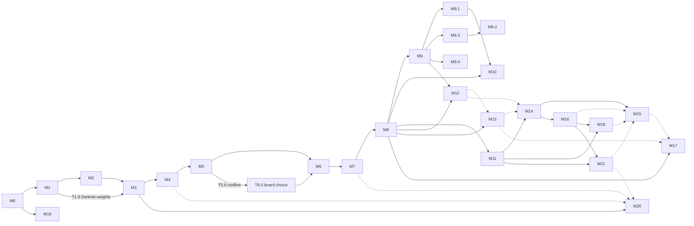

# Work plan

The project follows the six steps of the roadmap of §10.5 of the
[specification](../../yolo-embarque-de-zero.md), split into milestones.

| Milestone | Subject | Checkable output |
|---|---|---|
| [M0](M0-infrastructure.md) | Infrastructure | `make test` passes, MAC count consistent with §3 |
| [M1](M1-briques-numpy.md) | NumPy building blocks (§4) | Tiny-YOLOv2/v3 in forward and backward passes, gradcheck green |
| [M2](M2-cibles-perte-entrainement.md) | Targets, loss, training (§5-§7) | one image overfitted; VOC fine-tuning |
| [M3](M3-inference-evaluation.md) | Inference and evaluation (§8) | **float reference mAP** |
| [M4](M4-quantification.md) | Quantization, integer model (§9) | integer mAP + `model/` export |
| [M5](M5-golden-cpp.md) | C++ golden model (§10.2) | 0 differences with the Python dumps |
| [M6](M6-accelerateur-hls.md) | HLS accelerator (§10.2-§10.3) | C-sim and co-sim == golden |
| [M7](M7-integration-soc.md) | SoC integration | output on the board == golden |
| [M8](M8-mesures.md) | Measurements (§10.4) | `results/benchmarks.csv`, mAP at the 3 stages |
| [M9](M9-extensions.md) | Extensions (optional) | index of the directions |
| [M9.1](M9.1-postproc-materiel.md) | Hardware post-processing | FPGA boxes == integer golden |
| [M9.2](M9.2-req-yolo.md) | REQ-YOLO (ADMM, powers of 2) | mAP and DSP against INT8 |
| [M9.3](M9.3-quant-4bits.md) | 4-bit quantization | 4-bit mAP against INT8 |
| [M9.4](M9.4-streaming.md) | Streaming architecture | head == golden, latency against the single engine |
| [M10](M10-ameliorations.md) | Improvements (optional) | Tiny-YOLOv2 ≤ 45 ms in C-sim, == golden |
| [M11](M11-jeux-de-donnees.md) | Other datasets (optional) | float / integer / FPGA mAP beyond VOC |
| [M12](M12-profils-pc.md) | Test profiles on the PC (before the board) | each evaluation has an R/M/N profile, a criterion and a decision |
| [M13](M13-figures.md) | Figures (optional) | `make figures` regenerates the figures of the architecture, the results, the project tracking and the reimplemented maths |
| [M14](M14-notebooks.md) | Notebooks (optional) | `make notebooks` generates an inference, a training and a sweep (batch × subset) notebook per model × dataset, runnable locally and on Colab |
| [M15](M15-campagne-entrainement.md) | Training campaign (optional) | full-split mAP of the fine-tuned models, dataset by dataset (VOC, VisDrone, then KITTI, FLIR, ExDark, CrowdHuman) |
| [M16](M16-presentation-jeux.md) | Dataset presentation (optional) | `make notebooks` generates a presentation and statistical analysis notebook per dataset (classes, box sizes, density, anchors, images); summary in [stats-jeux.md](stats-jeux.md) |
| [M17](M17-article.md) | Article (optional) | `make article` regenerates the numbers, tables, figures and milestone status of a paper-style article ([docs/article/](../article/)); `--check` in `make ci` |
| [M18](M18-jeux-drone.md) | Drone and thermal datasets (optional) | AU-AIR, DroneVehicle, HIT-UAV and UAVDT preprocessed, loaded and given their notebooks (stats, out-of-domain, fine-tuning) |
| [M19](M19-english.md) | Switch to English (optional) | docs, specification, generated text and code comments in English, with a language check in `make ci`; new content in English from 2026-10-07 |
| [M20](M20-webcam.md) | Live webcam demo (optional) | `make webcam`: pick a model, live camera image, continuous capture + inference, boxes and classes drawn on screen |
| [M21](M21-asl-alphabet.md) | ASL Alphabet (optional) | hand pseudo-boxes for a classification dataset (`tools/prep_datasets.py asl`), loader and notebooks (stats, fine-tuning, sweep, inference); a sign-letter model for the webcam demo |

Datasets outside git (export to Google Drive, local or Colab access):
[donnees-drive.md](donnees-drive.md). Training on a Colab kernel from VS Code (who
starts, who follows): [colab-vscode.md](colab-vscode.md).

## Dependencies



- **T1.9 → M3 shortcut**: with the pre-trained Darknet weights, the reference mAP is
  available without waiting for a full training in NumPy. M2 can move forward in parallel
  with M3.
- **Choice of the board (T6.0)**: the only blocking decision before the hardware; it
  depends on the roofline tool (T5.6). M0 to M5 are independent of the board.

## Task format

```markdown
### T1.2 — Title
- **Spec**: §4.1 · **Depends on**: T1.1 · **Size**: S | M | L
- **Deliverables**: files created
- **Acceptance**: measurable criterion
- **Notes**: pitfalls, choices outside the base
```

Indicative sizes: **S** ≤ ½ day, **M** 1-3 days, **L** a week or more.

## Progress

Tick `[x]` in the title of the task when the acceptance criterion is met, and report the
progress per milestone here.

| Milestone | Tasks | Done |
|---|---|---|
| M0 | 6 | 6 |
| M1 | 9 | 8 |
| M2 | 9 | 8 |
| M3 | 4 | 4 |
| M4 | 7 | 7 (T4.6 not applicable) |
| M5 | 6 | 6 |
| M6 | 6 | 1 (T6.0-T6.3 in C-sim; synthesis and co-sim waiting for Vitis) |
| M7 | 4 | 0 (T7.1-T7.4 written and checked on the PC, sim backend; board and Vivado pending) |
| M8 | 3 | 0 (T8.1-T8.3 tooled; C-sim projection and FPGA mAP in C-sim = integer (55.66, 4,952 identical images); board measurements pending) |
| M9 | 1 (T9.5) | 0 |
| M9.1 | 3 | 2 (T9.1.3 checked in sim; board pending) |
| M9.2 | 4 | 3 (T9.2.3: ADMM not converged, to revisit) |
| M9.3 | 5 | 5 (short QAT: 36.4 mAP; synthesis pending) |
| M9.4 | 3 | 3 (estimates; synthesis pending) |
| M10 | 13 (+ pointer T10.12) | 0 |
| M12 | 11 | 0 |
| M11 | 8 (+ pointer T11.8) | 0 |
| M13 | 54 | 54 (data pending: Vitis syntheses for T13.24, `make test-durations` for T13.30) |
| M14 | 12 | 5 (the other 7 implemented; tier N runs, the Colab trial and the trainings remain) |
| M15 | 16 | 1 (T15.3; T15.1 and T15.2 ready for Colab; VisDrone T15.8, T15.10, T15.15, T15.16: tooling ready) |
| M16 | 19 | 17 (T16.13 COCO and T16.14 KITTI: data missing from the PC) |
| M17 | 21 | 17 (T17.0-T17.16: tools, CI and first draft, in English; refs check, v0 procedure, board switch and frozen version remain) |
| M18 | 11 | 8 (data ready, loaders, 24 notebooks generated; executed stats, Drive, fine-tunings remain) |
| M19 | 12 | 5 (T19.0-T19.4: rules, specification, docs, milestones and hand-written results in English; generators, code text, tests and the CI check remain) |
| M20 | 10 | 9 (`make webcam` live on the PC, 4 models measured; T20.9 board plan projected, waiting for M8) |
| M21 | 12 | 6 (pseudo-boxes, loader, 4 notebooks generated; detection rate 87.5 % below target; stats run, Drive, fine-tuning, webcam remain) |
