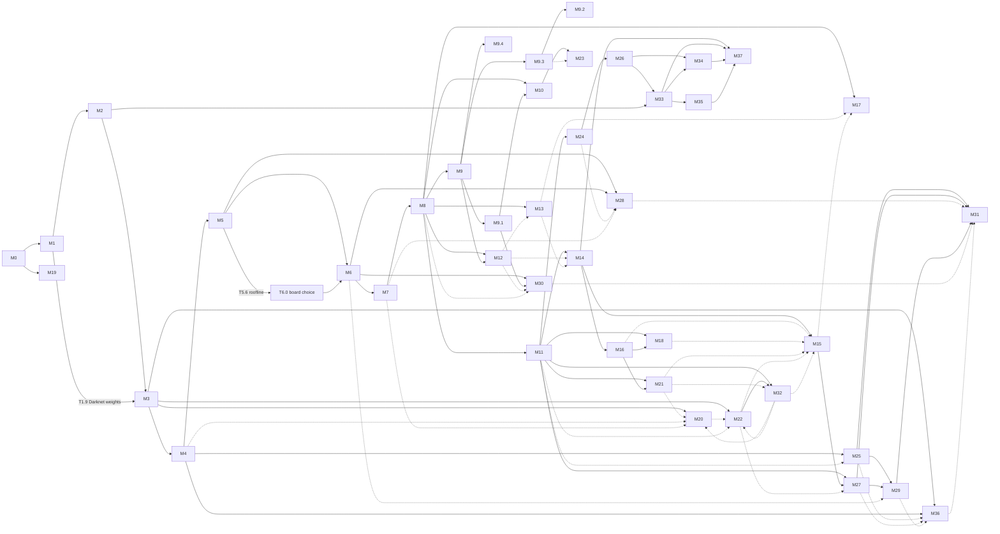

# Work plan

The project follows the six steps of the roadmap of §10.5 of the
[specification](../../yolo-embarque-de-zero.md), split into milestones.

| Milestone | Subject | Checkable output |
|---|---|---|
| [M0](M0-infrastructure.md) | Infrastructure | `make test` passes, MAC count consistent with §3 |
| [M1](M1-briques-numpy.md) | NumPy building blocks (§4) | Tiny-YOLOv2/v3 in forward and backward passes, gradcheck green |
| [M2](M2-cibles-perte-entrainement.md) | Targets, loss, training (§5-§7) | one image overfitted; VOC fine-tuning |
| [M3](M3-inference-evaluation.md) | Inference and evaluation (§8) | **float reference mAP** |
| [M4](M4-quantification.md) | Quantization, integer model (§9) | integer mAP + `model/` export |
| [M5](M5-golden-cpp.md) | C++ golden model (§10.2) | 0 differences with the Python dumps |
| [M6](M6-accelerateur-hls.md) | HLS accelerator (§10.2-§10.3) | C-sim and co-sim == golden |
| [M7](M7-integration-soc.md) | SoC integration | output on the board == golden |
| [M8](M8-mesures.md) | Measurements (§10.4) | `results/benchmarks.csv`, mAP at the 3 stages |
| [M9](M9-extensions.md) | Extensions (optional) | index of the directions |
| [M9.1](M9.1-postproc-materiel.md) | Hardware post-processing | FPGA boxes == integer golden |
| [M9.2](M9.2-req-yolo.md) | REQ-YOLO (ADMM, powers of 2) | mAP and DSP against INT8 |
| [M9.3](M9.3-quant-4bits.md) | 4-bit quantization | 4-bit mAP against INT8 |
| [M9.4](M9.4-streaming.md) | Streaming architecture | head == golden, latency against the single engine |
| [M10](M10-ameliorations.md) | Improvements (optional) | Tiny-YOLOv2 ≤ 45 ms in C-sim, == golden |
| [M11](M11-jeux-de-donnees.md) | Other datasets (optional) | float / integer / FPGA mAP beyond VOC |
| [M12](M12-profils-pc.md) | Test profiles on the PC (before the board) | each evaluation has an R/M/N profile, a criterion and a decision |
| [M13](M13-figures.md) | Figures (optional) | `make figures` regenerates the figures of the architecture, the results, the project tracking and the reimplemented maths |
| [M14](M14-notebooks.md) | Notebooks (optional) | `make notebooks` generates an inference, a training and a sweep (batch × subset) notebook per model × dataset, runnable locally and on Colab |
| [M15](M15-campagne-entrainement.md) | Training campaign (optional) | full-split mAP of the fine-tuned models, dataset by dataset (VOC, VisDrone, then KITTI, FLIR, ExDark, CrowdHuman) |
| [M16](M16-presentation-jeux.md) | Dataset presentation (optional) | `make notebooks` generates a presentation and statistical analysis notebook per dataset (classes, box sizes, density, anchors, images); summary in [stats-jeux.md](stats-jeux.md) |
| [M17](M17-article.md) | Article (optional) | `make article` regenerates the numbers, tables, figures and milestone status of a paper-style article ([docs/article/](../article/)); `--check` in `make ci` |
| [M18](M18-jeux-drone.md) | Drone and thermal datasets (optional) | AU-AIR, DroneVehicle, HIT-UAV and UAVDT preprocessed, loaded and given their notebooks (stats, out-of-domain, fine-tuning) |
| [M19](M19-english.md) | Switch to English (optional) | docs, specification, generated text and code comments in English, with a language check in `make ci`; new content in English from 2026-10-07 |
| [M20](M20-webcam.md) | Live webcam demo (optional) | `make webcam`: pick a model, live camera image, continuous capture + inference, boxes and classes drawn on screen |
| [M21](M21-asl-alphabet.md) | ASL Alphabet (optional) | hand pseudo-boxes for a classification dataset (`tools/prep_datasets.py asl`), loader and notebooks (stats, fine-tuning, sweep, inference); a sign-letter model for the webcam demo |
| [M22](M22-autolabel.md) | Photo auto-labelling (optional) | `make autolabel`: drag & drop a photo or a folder, open-vocabulary boxes, manual correction, YOLO txt labels to download |
| [M23](M23-dsp-packing.md) | Two MACs per DSP (optional) | packed int8 products in the kernel, C-sim == golden; new compute bound; Winograd study |
| [M24](M24-yolov4-tiny.md) | YOLOv4-tiny (optional) | grouped routes; float / integer / C-sim COCO mAP of a third network |
| [M25](M25-dependability.md) | Dependability (optional) | fault-injection campaign, exact int32 ABFT checksum (Python, golden, HLS), out-of-distribution monitor |
| [M26](M26-recent-models.md) | Recent models (optional) | YOLOv7-tiny, YOLOv5n, YOLOv8n on the chain; comparison table |
| [M27](M27-safety-metrics.md) | Safety metrics for person detection (optional) | recall at fixed FPPI, miss rate per height and occlusion, degraded conditions, dreaded event per hour, at the three stages |
| [M28](M28-equivalence.md) | Model ↔ circuit equivalence (optional) | equivalence matrix per layer and stage, exhaustive and SMT-proved scalar kernels, traceability table checked in CI |
| [M29](M29-runtime-monitors.md) | Runtime monitors (optional) | monitors compared on missed persons, conformal threshold, temporal vote, integer monitor in C-sim == golden, fallback logic |
| [M30](M30-latency-bound.md) | Latency bound and determinism (optional) | static cycle bound of the accelerator, reached in simulation; p99.9, maximum and jitter on the board |
| [M31](M31-assurance-case.md) | Assurance case (optional) | ODD, requirements, objectives → evidence map, failure-rate budget, assurance argument checked in CI |
| [M32](M32-trashnet-pets.md) | TrashNet and Oxford-IIIT Pet (optional) | two classification-style sets turned into detection sets: TrashNet boxes from the M22 labeller, Pet whole-body boxes from the trimaps (and the M22 labeller scored against them); loaders, notebooks, fine-tuning, webcam |
| [M33](M33-yolov5n.md) | YOLOv5n without PyTorch (optional) | torch-free `.pt` reader; C3 / SPPF in forward and backward; v5 targets, CIoU loss and training recipe; float, fine-tuned and integer mAP |
| [M34](M34-yolov7-tiny.md) | YOLOv7-tiny without PyTorch (optional) | backward of the ELAN 4-source routes and stride-1 pools; v5 / OTA loss on the Darknet graph; COCO mAP, VOC fine-tuning, integer chain |
| [M35](M35-yolov8n.md) | YOLOv8n without PyTorch (optional) | C2f, decoupled head and DFL in forward and backward; task-aligned assigner, BCE + CIoU + DFL loss; training and integer DFL |
| [M36](M36-explanation.md) | Decision explanation (optional) | why a box is detected or a person missed: gradient, perturbation and exact integer attributions at the three stages, miss causes, concepts, training recorder and CKA, `make explain` viewer, on-chip CAM |
| [M37](M37-notebooks-recent-models.md) | Notebooks of the recent models (optional) | COCO and VOC notebooks of YOLOv5n, YOLOv7-tiny and YOLOv8n: COCO inference, VOC out-of-domain inference, fine-tuning and fine-tuned inference, from the M14 generator |

Work that needs Vitis/Vivado or the KV260, not available yet, is put aside milestone by
milestone in [deferred/](deferred/README.md), with the order in which to pick it up; the
milestone files keep the PC part and a **Deferred** pointer.

Long computations still open (training, full-split mAP, C-sim passes, sweeps, labelling,
campaigns, large transfers), with their commands and estimated durations:
[long-runs.md](long-runs.md).

Datasets outside git (export to Google Drive, local or Colab access):
[donnees-drive.md](donnees-drive.md). Training on a Colab kernel from VS Code (who
starts, who follows): [colab-vscode.md](colab-vscode.md).

## Dependencies



- **M27-M31 (safety)**: tasks drawn from the thesis state of the art (ARCYS, 2026-10): the
  six gaps between YOLO on FPGA and ML safety. M25 gains T25.6-T25.8 for the same reason.

### Where the safety tasks run (M25, M27-M31)

Each task of these milestones has a **Runs on** field. **PC** = Python, C++ golden model
and HLS C-sim compiled with gcc (`make csim-gcc`), no Xilinx tool. **PC + Vitis** = HLS
synthesis or co-sim (resources, exact cycles). **Board** = KV260 with the bitstream (M7).

| Milestone | PC only | PC, Vitis for the exact cost | Board |
|---|---|---|---|
| M25 | T25.0, T25.1, T25.2, T25.5, T25.6, T25.7, T25.8 | T25.3, T25.4 | — |
| M27 | T27.0-T27.6 (T27.6 waits for the ARCYS images) | — | — |
| M28 | T28.1, T28.2, T28.3, T28.4, T28.6 | T28.0 (co-sim row) | T28.5 (and the board row of T28.0) |
| M29 | T29.0, T29.1, T29.2, T29.3, T29.5 (`sw-sim`) | T29.4 | final check of T29.5 |
| M30 | T30.0 | T30.1 (co-sim cycles) | T30.2, T30.3 |
| M31 | T31.0-T31.5 | — | — |

"PC, Vitis for the exact cost": the function and its byte-for-byte check run on the PC; only
the LUT / DSP / BRAM numbers or the co-sim cycles need Vitis (`perf_model` gives an
estimate in the meantime). The Vitis and board parts of these tasks are in
[deferred/](deferred/README.md).

- **T1.9 → M3 shortcut**: with the pre-trained Darknet weights, the reference mAP is
  available without waiting for a full training in NumPy. M2 can move forward in parallel
  with M3.
- **Choice of the board (T6.0)**: the only blocking decision before the hardware; it
  depends on the roofline tool (T5.6). M0 to M5 are independent of the board.

## Task format

```markdown
### T1.2 — Title
- **Spec**: §4.1 · **Depends on**: T1.1 · **Runs on**: PC | PC + Vitis | board · **Size**: S | M | L
- **Deliverables**: files created
- **Acceptance**: measurable criterion
- **Notes**: pitfalls, choices outside the base
- **Deferred** (Vitis | Vivado | board): [deferred/M1](deferred/M1-….md) — what waits for the hardware
```

**Deferred** is present only when part of the task needs Vitis, Vivado or the board: that
part is written in [deferred/](deferred/README.md), never in a **Remaining** field (rule in
[conventions.md](../conventions.md#deferred-work-board-vitis)).

Indicative sizes: **S** ≤ ½ day, **M** 1-3 days, **L** a week or more.

## Progress

Tick `[x]` in the title of the task when the acceptance criterion is met, and report the
progress per milestone here.

| Milestone | Tasks | Done |
|---|---|---|
| M0 | 6 | 6 |
| M1 | 9 | 8 |
| M2 | 9 | 8 |
| M3 | 4 | 4 |
| M4 | 7 | 7 (T4.6 not applicable) |
| M5 | 6 | 6 |
| M6 | 6 | 1 (T6.0-T6.3 in C-sim; synthesis and co-sim waiting for Vitis) |
| M7 | 4 | 0 (T7.1-T7.4 written and checked on the PC, sim backend; board and Vivado pending) |
| M8 | 3 | 0 (T8.1-T8.3 tooled; C-sim projection and FPGA mAP in C-sim = integer (55.66, 4,952 identical images); board measurements pending) |
| M9 | 1 (T9.5) | 0 |
| M9.1 | 3 | 2 (T9.1.3 checked in sim; board pending) |
| M9.2 | 4 | 3 (T9.2.3: ADMM not converged, to revisit) |
| M9.3 | 6 | 5 (short QAT: 36.4 mAP; synthesis pending; T9.3.6 long QAT open) |
| M9.4 | 3 | 3 (estimates; synthesis pending) |
| M10 | 14 (+ pointer T10.12) | 0 |
| M12 | 11 | 0 |
| M11 | 8 (+ pointer T11.8) | 1 (T11.0 generic adapter) |
| M13 | 60 | 60 (data pending: Vitis syntheses for T13.24, `make test-durations` for T13.30) |
| M14 | 12 | 8 (T14.5, T14.6, T14.8, T14.9 open: out-of-domain, training, Colab GPU, smoke run) |
| M15 | 16 | 1 (T15.3; T15.1 and T15.2 ready for Colab; VisDrone T15.8, T15.10, T15.15, T15.16: tooling ready) |
| M16 | 20 | 18 (T16.13 COCO: data on the PC since M24, notebook to run; T16.14 KITTI: data missing) |
| M17 | 21 | 17 (T17.0-T17.16: tools, CI and first draft, in English; v2 follows M23-M26, v3 adds the safety evidence of M28 and M30; refs check, v0 procedure, board switch and frozen version remain) |
| M18 | 11 | 9 (data ready, loaders, 24 notebooks generated, uploaded to the Drive; executed stats, fine-tunings remain) |
| M19 | 12 | 5 (T19.0-T19.4: rules, specification, docs, milestones and hand-written results in English; generators, code text, tests and the CI check remain) |
| M20 | 10 | 9 (`make webcam` live on the PC, 4 models measured; T20.9 board plan projected, waiting for M8) |
| M21 | 12 | 6 (pseudo-boxes, loader, 4 notebooks generated; detection rate 87.5 % below target; stats run, Drive, fine-tuning, webcam remain) |
| M22 | 12 | 11 (`make autolabel`: Grounding DINO / OWLv2 / Tiny-YOLO labellers, Image and Folder tabs, headless batch, VOC and per-domain measurement: usable at ground level and in low light, not on aerial images; datasets to label ranked; T22.9 closing the loop remains) |
| M23 | 6 | 6 (C-sim == golden; projections; synthesis and board pending) |
| M24 | 7 | 5 (float / integer COCO AP, golden and C-sim == dumps, notebooks; full C-sim pass and VOC fine-tuning to run from the notebooks; integer −1.3 AP50, QAT open) |
| M25 | 9 | 5 (T25.0 injector, T25.2 ABFT Python and golden, T25.5 OOD monitor; T25.3 ABFT lane in the HLS kernel (C-sim == golden, +24 DSP projected) and T25.7 HLS buffer faults (2,200 flips; requantized tile and single-`to` input tiles are the blind spots); T25.1 campaign to run) |
| M26 | 6 | 2 (T26.1 offline converter: YOLOv5n / v8n NumPy == torch to 2·10⁻⁷; T26.2 integer SiLU table, Python == golden == HLS; T26.0 YOLOv7-tiny in progress) |
| M27 | 7 | 0 |
| M28 | 7 | 6 (T28.0 matrix: per layer, fake-quant → integer ≤ 1 LSB, integer == golden == C-sim byte for byte on 20 images × 3 nets, co-sim and board rows pending; T28.1 Python == golden == HLS on 105.6 M swept accumulators, int32 leaky overflow found and fixed; T28.2 95 SMT obligations proved with z3; T28.3 traceability in `make ci`; T28.4 tool-chain risks and tool qualification; T28.6 NMS == golden, capacity and overflow properties hold, the unsorted NMS depends on the order of the cells) |
| M29 | 6 | 1 (T29.0 six monitors on integer features: max score best on ExDark, activation patterns on FLIR; T29.1-T29.3 wait for M27) |
| M30 | 4 | 1 (T30.0 static bound: v2 frame 92 ms, watchdog 116 ms; the uncapped NMS of sigmoid heads dominates v3 / v4; T30.1 C-sim adversarial post-processing ≤ bound; co-sim and board pending) |
| M31 | 6 | 0 |
| M32 | 14 | 3 (T32.4, T32.5: Oxford-IIIT Pet downloaded, whole-body boxes from the trimaps; T32.8 datasheets; TrashNet labelling, loaders, notebooks and fine-tuning open) |
| M33 | 9 | 7 (T33.0-T33.6: torch-free `.pt` reader bit-exact on the official v5n / v8n, YAML parser, C3 / SPPF blocks with gradchecks, trainable YOLOv5n == torch to 4·10⁻¹⁴, v5 decoding and evaluation (COCO 28.1 AP at 640, published 28.0), targets, loss equal to the torch `ComputeLoss` to 6·10⁻¹⁷; T33.7 recipe written, waiting for the VOC run (≈ 6 CPU days); T33.8 integer chain open) |
| M34 | 6 | 2 (T34.0 layer table and weights, T34.1 route / stride-1 pool backward; T34.2 COCO 34.3 AP at 416 against the published 35.2, gap open; T34.3 OTA loss and T34.4 training written, waiting for a torch OTA reference and the VOC run (≈ 10 CPU days); T34.5 open) |
| M35 | 8 | 5 (T35.0-T35.2, T35.4, T35.5: `yolov8n.pt` described from its YAML (8.74 GFLOPs), C2f and DFL head with gradchecks, network == torch to 1.7·10⁻¹³, decoded boxes == torch, TAL and BCE + CIoU + DFL loss == Ultralytics (5·10⁻⁷); T35.3 COCO mAP and T35.6 VOC run waiting on CPU runs; T35.7 waits for T33.8) |
| M36 | 12 | 2 (T36.0 explanation target, `backward(keep=)`; T36.3 exact integer split on 12,080 neurons, z⁺ LRP conserving through the integer chain; T36.1-T36.9 code and tests written, reduced runs open) |
| M37 | 7 | 1 |
