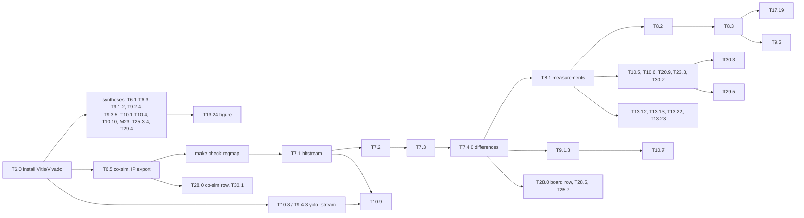

# Deferred work: board and Xilinx tools

The development machine has neither the Xilinx tools nor the KV260. Everything that can be
checked without them stays in the milestone files ([../README.md](../README.md)): Python,
golden C++, HLS C-sim with gcc (`make csim-gcc`), the ARM software on the `sim` backend
(`make sw-sim`), `perf_model` estimates. This folder gathers the rest, milestone by
milestone, with the same file names, so it can be picked up as soon as the tools or the
board are available.

## Conditions

| Label | What it needs | Typical commands |
|---|---|---|
| **Vitis** | Vitis HLS: synthesis, co-sim, IP export, generated header `xyolo_conv_hw.h` | `make hls-synth`, `hls-cosim`, `hls-export BOARD=kv260`, `hls-report`, `check-regmap` |
| **Vivado** | Vivado (+ `dtc`): block design, bitstream, timing, power estimate, overlay | `make vivado-build`, `make fpga-firmware` |
| **Board** | KV260 with the bitstream: run, times on the A53, power (INA260), long measurements | `make sw-board`, `run_compare --uio`, `yolo_bench`; [protocole.md](../../../results/protocole.md), `hw/boards/kv260/README.md` |

Colab GPU runs, missing datasets, the camera and external documents are **not** deferred
here: they stay in their milestone files.

## Bring-up order



The first useful step on a machine with Vitis is `make csim` (Vitis C-sim must equal
`make csim-gcc`), then `make hls-synth`.

## Index

| Milestone | Task | Condition | Item | Done |
|---|---|---|---|---|
| [M6](M6-accelerateur-hls.md) | T6.0 | Vitis, Vivado | installation | [ ] |
| | T6.1 | Vitis | II = 1 in synthesis | [ ] |
| | T6.2 | Vitis | co-sim, real cycles | [ ] |
| | T6.3 | Vitis | DSP of `store_tile` | [ ] |
| | T6.5 | Vitis | synthesis, co-sim of one image, timing, IP export | [ ] |
| [M7](M7-integration-soc.md) | T7.1 | Vivado | bitstream, timing at 200 MHz | [ ] |
| | T7.2 | Board, Vitis | `check-regmap`, isolated layer == dump | [ ] |
| | T7.3 | Board | post-processing time on the A53 | [ ] |
| | T7.4 | Board | 0 differences, demo | [ ] |
| [M8](M8-mesures.md) | T8.1 | Board, Vivado | perf, power, resources | [ ] |
| | T8.2 | Board | FPGA stage of the mAP | [ ] |
| | T8.3 | Board | report on measurements | [ ] |
| [M9](M9-extensions.md) | T9.5 | Board | online learning | [ ] |
| [M9.1](M9.1-postproc-materiel.md) | T9.1.2 | Vitis | synthesis of `yolo_post` | [ ] |
| | T9.1.3 | Vitis, Vivado, Board | integration on the board | [ ] |
| [M9.2](M9.2-req-yolo.md) | T9.2.4 | Vitis | synthesis of the shift PE | [ ] |
| [M9.3](M9.3-quant-4bits.md) | T9.3.5 | Vitis | synthesis of the 4-bit costs | [ ] |
| [M9.4](M9.4-streaming.md) | T9.4.3 | Vitis | synthesis and co-sim of `yolo_stream` | [ ] |
| [M10](M10-ameliorations.md) | T10.1 | Vitis | 64-bit ports: synthesis, WSTRB, II | [ ] |
| | T10.2 | Vitis | DSP and frequency of requant ×8 | [ ] |
| | T10.3 | Vitis | trim: synthesis check | [ ] |
| | T10.4 | Vitis | BRAM of the 14 × 14 buffers | [ ] |
| | T10.5 | Board | pipeline throughput | [ ] |
| | T10.6 | Board | cached DMA buffer | [ ] |
| | T10.7 | Vitis, Board | offsets, ARM time of the chaining | [ ] |
| | T10.8 | Vitis | `yolo_stream` synthesis and co-sim | [ ] |
| | T10.9 | Vitis, Vivado, Board | streaming on the board | [ ] |
| | T10.10 | Vitis | packed loader synthesis | [ ] |
| [M13](M13-figures.md) | T13.24 | Vitis | solid resource bars | [ ] |
| | T13.12-13, T13.22-23 | Board | board stage of the figures | [ ] |
| [M17](M17-article.md) | T17.19 | Board | projection → measurement | [ ] |
| [M20](M20-webcam.md) | T20.9 | Board | webcam on the KV260 | [ ] |
| [M23](M23-dsp-packing.md) | T23.2 | Vitis | packed PE synthesis, Tm 64 or Tn 32 | [ ] |
| | T23.3 | Vivado, Board | packed PE measured | [ ] |
| [M25](M25-dependability.md) | T25.3 | Vitis | ABFT lane cost, `ABFT_ERR` offsets (`check-regmap`) | [ ] |
| | T25.4 | Vitis | protection costs | [ ] |
| | T25.7 | Vivado, Board | configuration-memory upsets | [ ] |
| [M28](M28-equivalence.md) | T28.0 | Vitis, Board | co-sim and board rows | [ ] |
| | T28.5 | Board | equivalence on the board | [ ] |
| [M29](M29-runtime-monitors.md) | T29.4 | Vitis | monitor cost | [ ] |
| | T29.5 | Board | fallback final check | [ ] |
| [M30](M30-latency-bound.md) | T30.1 | Vitis | co-sim cycles | [ ] |
| | T30.2 | Board | end-to-end latency, p99.9 | [ ] |
| | T30.3 | Board | non-determinism on the PS | [ ] |
| [M36](M36-explanation.md) | T36.10 | Vitis | on-chip CAM cost | [ ] |
| | T36.10 | Board | CAM read on the board | [ ] |

## Keeping this folder up to date

The rule is in [conventions.md](../../conventions.md#deferred-work-board-vitis):

1. A new task, or a new feature of an existing task, whose acceptance needs Vitis, Vivado
   or the board in whole or in part, gets `Runs on: PC + Vitis | board`. Its PC part stays
   in the milestone file.
2. The hardware part is written here, in `MXX-<same name as the milestone>.md` (create the
   file if needed), in the entry format below. The milestone file gets a
   `- **Deferred** (<conditions>): [deferred/MXX](deferred/MXX-….md) — <task>.` line in
   place of a **Remaining** that needs the hardware. Add a row to the index.
3. When an item is done on the hardware: tick it here and in the index, write the result in
   the **Done** of the milestone task, remove its **Deferred** line, tick the task if its
   acceptance is met, and update the Progress table of [../README.md](../README.md).

Entry format:

```markdown
### [ ] T7.1 — Short title
- **Condition**: Vitis | Vivado | Board · **Needs first**: T6.5
- **Done on the PC**: one line, what is already checked without the hardware
- **To do**: steps and exact commands
- **Acceptance**: measurable criterion (when it differs from the parent task)
- **Unlocks**: tasks waiting for this item
```
