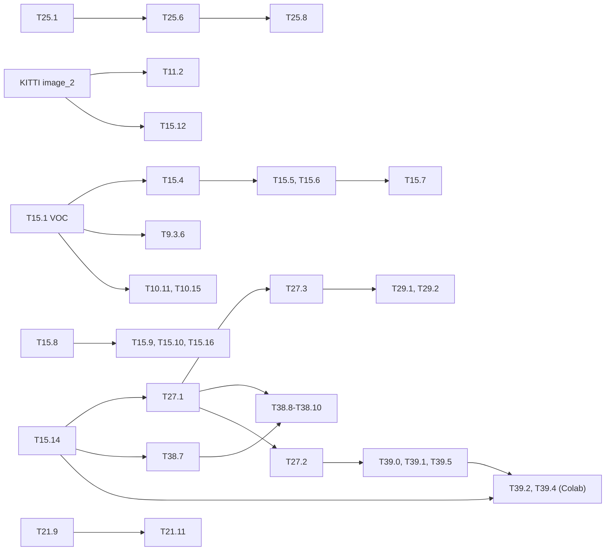

# Long runs still to do

Every computation of more than a few minutes that is still open in the milestone files
(training, full-split mAP, C-sim passes, sweeps, labelling, campaigns, large transfers),
with its command, its prerequisites and a duration, so the runs can be scheduled: nights on
the PC, Colab sessions. State on 2026-10-28.

- Out of scope: what needs Vitis, Vivado or the KV260, listed in
  [deferred/](deferred/README.md).
- Tiers as in [M12](M12-profils-pc.md#cost-tiers): **R** < 5 min, **M** < 1 h, **N**
  several hours.
- **Estimate**: a value stated in the milestone file (with its source), or computed from
  the reference speeds below and marked *(est.)*, with the arithmetic in the **Basis**
  column. "unmeasured" means no speed exists to compute it from.
- When a run is done, fold the result into the task's **Done** and remove its row here.

## Running now (started 2026-10-28 evening)

Long runs in `systemd --user` units (logs in `build/longruns/`). ETA from the progress at
22:37, on a shared CPU (22 cores, every unit pinned with `taskset`).

| Unit | Task | Steps | Progress at 22:37 | ETA |
|---|---|---|---|---|
| `t25-8` | [T25.8](M25-dependability.md) | `fault_campaign.py temporal --net tiny-yolov4-coco`, MOT17 train (PREWID done) | started 00:36 | ≈ 01:40 |
| `t11-1` | [T11.1](M11-jeux-de-donnees.md) | `coco-int` (done: int AP 16.20), `coco-calib`, `coco-fpga` (C-sim 5,000) | `coco-calib` done (int AP 16.21), `coco-fpga` running | ≈ 03:00 *(est.: C-sim 5,000 × ≈ 15 s / 6 cores)* |
| `t26-0` | [T26.0](M26-recent-models.md) | v7-tiny `make_inputs`, float + int COCO, C-sim 5,000, `map_stades` | started ≈ 23:00 | ≈ 04:00 *(C-sim 5,000 × 18 s / 6 cores ≈ 4.2 h)* |
| `t36-5ch` | [T36.5](M36-explanation.md) | `explain.py misses --dataset crowdhuman` (500 images × 3 networks) | waits for `t11-1` | ≈ 04:00 |
| `t15-10` | [T15.10](M15-campagne-entrainement.md) | VisDrone val mAP of `b16-sall`, with and without `--no-ignore` | waits for `t36-5ch` | ≈ 04:15 |
| `t25-6ch` | [T25.6](M25-dependability.md) | `--criterion person` layer and bit grids, CrowdHuman val 500, Tiny-YOLOv2 VOC (no CrowdHuman weights yet) | started 23:22 | ≈ 08:30 *(VOC run 6 h at 14 jobs; here 10 jobs, crowded images)* |
| `t36-run` | [T36.1](M36-explanation.md), [T36.2](M36-explanation.md), [T36.4](M36-explanation.md) | `explain.py sanity`, `stages`, `evaluate` (4 jobs: the 6-job run hit the 14 GB cap) | `sanity` restarted at 22:26 | sanity ≈ 00:30, stages ≈ 03:30, evaluate ≈ 11:30 *(est. scaled from 12-16 jobs to 4)* |

## Reference speeds

| Measurement | Value | Source |
|---|---|---|
| PC CPU training, Tiny-YOLOv2/v3, 416, batch 8 | plain fine-tuning ≈ 3.6 s/iteration, ≈ 0.45 s/image (T2.7); QAT and ADMM ≈ 5.3 s/iteration, ≈ 0.66 s/image (600 it: QAT 3,189 s, ADMM 3,157 s in the `seconds` column) | `build/train/{qat-w4a4,admm-mixed6}/loss.csv`, [M12](M12-profils-pc.md) |
| PC CPU training, pruned models, 300 it | r30 8.2, r50 7.8, r70 2.8 s/iteration | `build/m10/prune/*/train/loss.csv` |
| Colab T4 training, Tiny-YOLOv3, multi-scale 320-608 | batch 8: 0.20-0.31 s/it; 16: 0.35-0.59 (CrowdHuman long run, 6,000 it: 0.63 s/it, 3,789 s); 32: 0.66-1.17 (VisDrone slowest) | `build/notebooks/*/runs/*/loss.csv` |
| Colab T4, 6,000 iterations at batch 32 | ≈ 1 h 45; ×2.1 per iteration at 608, ×4 at 832 | [M15](M15-campagne-entrainement.md) T15.4, T15.9 |
| PC evaluation, VOC2007 test (4,952) | float ≈ 170 ms/image (≈ 15 min), int ≈ 120 ms/image (≈ 10 min), float + int 150-300 ms/image (12-25 min), 66 ms/image with 16 jobs | [M12](M12-profils-pc.md), [M14](M14-notebooks.md), `build/eval/*.log` |
| PC evaluation, ExDark test (2,563) | float + int 94-106 ms/image with 16 jobs (≈ 4.5 min per network) | `build/longruns/T11.3-base.log`, 2026-10-27 |
| PC evaluation, COCO val2017 (5,000) | v3-tiny float 60 ms/image, v4-tiny float 42-51 ms/image, v4-tiny float + int 124 ms/image; `--preset v5`, 5 jobs: v7-tiny 113 ms/image at 416, 192 at 640, v5n 58 at 416 (one process: 453 ms/image at 640) | `build/m24/coco*/*.log`, `build/eval/logs/*-v5-*.log` |
| PC CPU training, YOLOv5 recipe, 640, batch 16 | YOLOv5n 16.9 s/batch, YOLOv7-tiny (OTA) 29.0 s/batch | `tools/train_v5.py --iters 6`, 2026-10-22 |
| Colab CPU evaluation | ≈ 0.27 s/image: VOC test ≈ 22 min, VisDrone val ≈ 2.5 min, KITTI val ≈ 7 min | [M15](M15-campagne-entrainement.md) |
| Calibration, 500 images | 1-2.5 min | `build/quant/calib*.log` |
| C-sim `yolo_bench` | VOC 4,952 images ≈ 40 min (22 threads), i.e. ≈ 0.5 s/image; COCO 5,000 with v4-tiny ≈ 1.5 h (18 cores) | [M12](M12-profils-pc.md), [M24](M24-yolov4-tiny.md) |
| Grounding DINO tiny, PC CPU | ≈ 5 s/image with 1-2 prompts (5.2 s on Pet, 2026-10-27); 3 processes × 6 threads: 8-15 s/image per process, 4-5 s/image of throughput | [M22](M22-autolabel.md), [M32](M32-trashnet-pets.md) |
| Fault campaign, 500 images, 16 jobs (10 jobs on a shared CPU: 60-130 s, 9.1 h for the 393 runs of T25.1) | ≈ 50 s per run | `build/m25/faults/log.txt` |
| Drive transfers | pull: CrowdHuman 10.5 GiB in 4 min 24 s (≈ 40 MiB/s), then extraction; push: `pets.tar` 761 MiB in 14 min with rclone retries (3.7 GiB sent), `trashnet.tar` 47 MiB in 17 s | `build/longruns/{ch-pull,T32.11*}.log`, 2026-10-28 |
| PC evaluation, COCO val2017, more networks | v3-tiny float + int 394 ms/image with 6 jobs (5,000 in 34 min); YOLOv8n at 640, `--preset v8`, 4 jobs: 438-474 ms/image (≈ 4.6 GB per process: 6 processes overflow 22 GB) | `build/longruns/T11.1-coco-int.log`, `T35.3-640.log`, 2026-10-28 |
| C-sim `yolo_bench`, YOLOv7-tiny | 18 s per image on one core (`ACC_NO_APINT`, 416) | `build/m26/v7-smoke`, 2026-10-28 |

Unmeasured: training and evaluation speed of YOLOv8n; training speed of YOLOv5n and
YOLOv7-tiny is in the table above (T33.7); YOLOv4-tiny training on the T4 (taken as
Tiny-YOLOv3, the CPU smoke runs are within 10 %); QAT on the GPU; the gain of the local
GPU (T12.11-e).

## PC, CPU (NumPy)

| Task | Run | Data | Estimate | Basis | Waits for |
|---|---|---|---|---|---|
| [T12.2](M12-profils-pc.md) a-e | `tools/m12.sh map-c` first, then `map-a`, `map-b`, `map-d`, `map-e` | VOC07 test, subsets 100 / 500 / 1,000 / all | ≈ 1.5-2 h *(est.)* | map-c: 6,552 images × 2 models × 0.12 s ≈ 26 min; map-b full split ≈ 25 min; map-d 9 × (calib 2 min + eval 500 1-2 min) ≈ 30 min; a, e ≈ 10 min each | — |
| [T12.4](M12-profils-pc.md) | `tools/m12.sh ptq`, then `tools/m12.sh ptq-full <v1> <v2>` | VOC 500, then 4,952 | ≈ 30 min + ≈ 20 min *(est.)* | 8 × (calib 1.5 min + 500 × 0.15 s); 2 × 4,952 × 0.12 s | — |
| [T12.5](M12-profils-pc.md) | `tools/m12.sh qat ref \| lr3e-4 \| lr1e-3 \| it300 \| it2000 \| b16 \| nosteps` | VOC | ≈ 8-10 h *(est.)*, two nights | 5 runs × 600 it × 5.8 s ≈ 4.8 h; it300 ≈ 30 min; it2000 ≈ 3.2 h; b16 ≈ 2× a 600 run ≈ 1.9 h | — |
| [T12.6](M12-profils-pc.md), [T9.2.3](M9.2-req-yolo.md) | `tools/m12.sh admm ref \| A \| B \| C \| D \| E` | VOC | ≈ 4 h | stated in M12 (≈ 50 min per 600 it, measured 5.7 s/it) | — |
| [T12.7](M12-profils-pc.md) | `tools/m12.sh hwpp`; long version `RANDOM_HEADS=100000` (`tb_post`) | VOC | M (≈ 30 min *(est.)*) + one night | tier M stated; night run stated | — |
| [T12.9](M12-profils-pc.md) | `tools/m12.sh sim` (100 and 500 images, `ACC_NO_APINT`, `--hw-post`) | VOC | ≈ 30 min *(est.)* | ≈ 1,500 C-sim images × 0.5 s, tier M | — |
| [T12.10](M12-profils-pc.md) | `tools/m12.sh repetition` (`COUNT=100`) | — | M | stated | — |
| [T12.11](M12-profils-pc.md) | `make test-py`, `make test-slow-gpu`, speed on the RTX 1000 Ada | — | unmeasured | — | NVIDIA driver, `pip install cupy-cuda12x` |
| [T13.30](M13-figures.md) | `make test-durations` (whole suite, slow tests included) | — | N | stated | — |
| [T11.1](M11-jeux-de-donnees.md) | `tools/m11.sh coco-int`, `coco-calib` | COCO val2017 5,000 + calib2017 500 | ≈ 30 min *(est.)* | 5,000 × 0.12-0.3 s + calibration | — |
| [T11.2](M11-jeux-de-donnees.md), [T14.5](M14-notebooks.md) | `HD_SETS=kitti tools/m11.sh hors-domaine` (VOC, ExDark, VisDrone done and compared with the notebooks 2026-10-27) | KITTI val 1,496; VOC and COCO weights; float and int | ≈ 15 min *(est.)* | 1,496 images × 4 passes × 0.15 s (VisDrone measured: 155 ms/image, 16 jobs) | `data/kitti` image_2 |
| [T11.6](M11-jeux-de-donnees.md) | `tools/m11.sh crowdhuman` (`int`, `int-hwpp`, capacities 256 and 1,024) | CrowdHuman val 4,370 | ≈ 35-45 min *(est.)* | 4 × 4,370 × 0.12-0.15 s | — (`data/crowdhuman` on the PC) |
| [T36.1](M36-explanation.md) | `tools/explain.py sanity --jobs 12` | VOC07 test, 20 images × 3 networks | ≈ 40 min *(est.)* | per image 5 methods × 4 networks (original + 3 randomizations); IG 2 × 130 passes, SmoothGrad 50, at ≈ 0.3 s/pass | — |
| [T36.2](M36-explanation.md) | `tools/explain.py stages --jobs 12` | VOC07 test, 20 images × 3 networks; golden on 5 | ≈ 1 h *(est.)* | per image D-RISE 300 + occlusion 145 inferences, float 0.28 s and int 0.6 s each (measured 2026-10-22, one thread); golden 100 masks × 2.7 s on 5 images | `build/golden/golden_run`, `model/<net>/` |
| [T36.4](M36-explanation.md) | `tools/explain.py evaluate --jobs 16`; full size `--n 500` | VOC07 test, 50 images × 3 networks (full 500) | ≈ 2 h *(est.)*, full ≈ 20 h | 14 method × stage pairs ≈ 600 s per image | — |
| [T36.5](M36-explanation.md) | `tools/explain.py misses` on CrowdHuman val, the T27.3 sets and ExDark (VOC done 2026-10-27) | CrowdHuman val 4,370, T27.3 sets, ExDark | ≈ 30 min *(est.)* | VOC 500 images × 3 networks took 3 min with 12 jobs | T27.3 |
| [T16.14](M16-presentation-jeux.md) | `notebooks/kitti/kitti_stats.ipynb` | KITTI 5,985 + 1,496 | unmeasured, R-M | — | KITTI `image_2` download |
| [T22.9](M22-autolabel.md) | capture 300-500 photos, label with GD at 0.55, check 100, then M15 fine-tuning | own photos | ≈ 40 min of labelling + 1 h capture + 1-2 h review | stated | — |
| [T25.6](M25-dependability.md) | `tools/m25.sh person` with a CrowdHuman net and set (VOC person class done on 2026-10-28) | CrowdHuman | ≈ 6 h on the PC (measured on VOC, 500 images, 14 jobs) | same grids as T25.1 | — |
| [T25.8](M25-dependability.md) | faults injected on video, temporal coherence | video | unmeasured | — | T29.3 (T25.6 critical faults known on VOC) |
| [T27.1](M27-safety-metrics.md) float, int | `tools/person_safety.py infer --dataset crowdhuman --split val` for tiny-yolov3-crowdhuman, v3-coco, v4-coco, then `report --write` | CrowdHuman val 4,370 | ≈ 25 min *(est.)* | float + int 0.11 s/image with 20 jobs (measured on PREWID, 2026-10-26): 3 × 4,370 × 0.11 s | — (CrowdHuman weights `build/notebooks/crowdhuman/tiny-yolov3-crowdhuman/runs/long-416/final.weights`, 2026-10-28) |
| [T27.3](M27-safety-metrics.md) | `tools/person_safety.py infer --degrade all`, then `degrade-report --write`; ExDark `--dataset exdark` | CrowdHuman val, ExDark test | ≈ 2.5 h *(est.)* | 18 × 4,370 × 0.11 s (float + int, 20 jobs, measured on PREWID) | T27.1 |
| [T38.8-T38.10](M38-prewid.md) float, int | the M27 commands with `--net <T38.7 cfg> --weights <ckpt>` (`person_safety.py infer`, `--degrade all`, grayscale variant, `dreaded_event.py`) | PREWID test 592, lab 3,000 | ≈ 30 min *(est.)* | measured 2026-10-26 with v4-tiny: test 592 + lab 3,000 + 18 degradations × 592 in ≈ 25 min (float + int, 0.11 s/image, 20 jobs) | T38.7 |
| [T39.0, T39.1](M39-failure-prediction.md) CrowdHuman | `tools/failure_labels.py label --net <crowdhuman cfg> --weights … --calib … --set crowdhuman:val --conf <T27.2>` (PREWID `test`, `lab` and COCO done 2026-10-27 at 0.0953); then `tools/failure_labels.py report`, `tools/failure_prediction.py fit` and `eval --write`, `tools/ood_monitor.py compare --labels … --failure … --write` | CrowdHuman val 4,370, PREWID test 592, COCO val2017 ≈ 2,700 person images | ≈ 15-20 min *(est.)* | labels measured 2026-10-26: 0.11 s/image (500 COCO in 55 s, 592 PREWID in 70 s, 12 jobs); head fit ≈ 10 s | T27.2 |
| [T39.5](M39-failure-prediction.md) | `tools/failure_prediction.py stages --labels … --check --write` | same sets | ≈ 1 min | g++ build + scoring, measured | T39.0 at T27.2 |
| [T29.1](M29-runtime-monitors.md), [T29.2](M29-runtime-monitors.md) CrowdHuman | monitors on CrowdHuman val, T27.3 sets, ExDark; `person_safety.py conformal --dataset crowdhuman` (PREWID done 2026-10-27) | — | unmeasured, ≈ 1 h *(est.)* | reuses the T27 outputs | T27.2, T27.3 |
| [T41.1](M41-safe-unsafe-behaviours.md) calibration | labeller on every frame of 20 clips (dense reference), then the sampling settings | 20 clips at 24 fps | unmeasured, ≈ 3-6 h *(est.)* | clip length unknown; at 10 s per clip: 20 × 240 frames × 4-5 s of throughput ≈ 6 h | T41.0 |
| [T41.3](M41-safe-unsafe-behaviours.md) | `python tools/autolabel.py --folder data/safe_unsafe/frames --classes person --resume …` | 691 clips after sampling | unmeasured, ≈ 10-15 h *(est.)* | assumed ≈ 15 kept frames per clip: ≈ 10,000 × 4-5 s of throughput (3 processes); to recompute from T41.1 | T41.1, T41.2 |
| [T42.3](M42-soda.md), [T43.2](M43-construction-ppe.md) | completeness check, labeller on 100 test images each | SODA, Construction-PPE | ≈ 20 min *(est.)* | 2 × 100 × 5-7 s | T42.2, T43.1 |
| [T33.7](M33-yolov5n.md) | `tools/train_v5.py --net yolov5n-voc --init coco --epochs 30 --out build/train/yolov5n-voc`, then `tools/eval_voc.py --net yolov5n-voc --weights build/train/yolov5n-voc/final.npz --preset v5 --dataset voc` | VOC07+12 trainval 16,551 | ≈ 4.9 h per epoch, ≈ 6 days for 30 epochs *(est.)* | measured 16.9 s per batch of 16 at 640 (step only, 6 workers loading in parallel); 16,551 / 16 = 1,034 batches per epoch; `--size 416` ≈ ×0.42, `--device gpu` unmeasured | — |
| [T34.4](M34-yolov7-tiny.md) | `tools/train_v5.py --net tiny-yolov7-voc --init coco --epochs 30 --out build/train/tiny-yolov7-voc`, then `tools/eval_voc.py --net build/train/tiny-yolov7-voc/net.cfg --weights …/final.weights --preset v5 --dataset voc` | VOC07+12 trainval 16,551 | ≈ 8.3 h per epoch, ≈ 10 days for 30 epochs *(est.)* | measured 29.0 s per batch of 16 at 640, OTA loss included; 1,034 batches per epoch; `--size 416` ≈ ×0.42, `--device gpu` unmeasured | — |
| [T35.6](M35-yolov8n.md) | `tools/train_v5.py --net yolov8n-voc --init coco --epochs 30 --out build/train/yolov8n-voc` (AdamW of `optimizer=auto`, mosaic off for the last 10 epochs), then `tools/eval_voc.py --net yolov8n-voc --weights build/train/yolov8n-voc/final.npz --preset v8 --dataset voc` | VOC07+12 trainval 16,551 | ≈ 9.5 h per epoch, ≈ 12 days for 30 epochs *(est.)* | the T33.7 measure (16.9 s per batch of 16 at 640) × 4.37 / 2.23 GMAC; the TAL and DFL loss not measured; `--size 416` ≈ ×0.42 | — |
| [T33.6](M33-yolov5n.md), [T34.3](M34-yolov7-tiny.md), [T35.4, T35.5](M35-yolov8n.md) | **done** 2026-10-22: throwaway script (not in the repo) in a scratchpad venv (CPU torch 2.14, ultralytics 8.4.184, yolov5 clone for `ComputeLoss`) → `weights/m33/yolov5n_loss.npz`, `yolov8n_heads.npz`, `yolov8n_loss.npz` (2 COCO images at 320, 21 boxes) | 3 + 2 images | ≈ 1 min | measured | — |
| [T26.0](M26-recent-models.md), [T26.3, T26.4](M26-recent-models.md) float, int | calibration, float and integer COCO mAP (v5n, v8n at letterbox 640 and 416) | COCO val2017 5,000 | ≈ 15 min per model and size *(est.)* | v4-tiny float + int 621 s for 5,000; scaled by MACs | float done (T33.4, T35.3); integer: code still open (s_mid calibration of the SiLU tables, integer C3, SPPF, DFL; T26.3) |

## PC, C-sim (gcc)

These share the CPU with the table above: one at a time, at night.

| Task | Run | Data | Estimate | Basis | Waits for |
|---|---|---|---|---|---|
| [T12.9](M12-profils-pc.md) | `make bench-sim` | VOC 4,952 | ≈ 40 min | stated | — |
| [T11.1](M11-jeux-de-donnees.md) | `tools/m11.sh coco-fpga` | COCO 5,000 | ≈ 45 min *(est.)* | Tiny-YOLOv3 ≈ VOC v2 rate, 5,000 × 0.5 s | `coco-int` |
| [T11.6](M11-jeux-de-donnees.md) | `tools/m11.sh crowdhuman-cycles` (`N=200`) | CrowdHuman | ≈ 5 min *(est.)* | 200 × 0.5 s + build | — |
| [T26.0](M26-recent-models.md) | YOLOv7-tiny C-sim stage | COCO 5,000 | ≈ 1.5 h *(est.)* | 2.89 GMAC, close to v4-tiny | calibration |
| [T26.3, T26.4](M26-recent-models.md) | YOLOv5n, YOLOv8n golden and C-sim | COCO 5,000 | ≈ 1 h + 2 h *(est.)* | ≈ 2.3 and 4.4 GMAC at 640 against v4-tiny | T26.1, T26.2 |
| [T27.1](M27-safety-metrics.md) C-sim column | `make_inputs.py --split val --subset 100`, `bench_sim.sh` with `EXTRA="--conf 0.001"`, `person_safety.py csim` | CrowdHuman val, 100 frames with persons | ≈ 3 min *(est.)* | 100 PREWID frames took ≈ 3 min (v4, 10 jobs, 2026-10-26) | T27.1 |

## Colab (GPU training, CPU evaluation)

| Task | Run | Data | Estimate | Basis | Waits for |
|---|---|---|---|---|---|
| [T15.1](M15-campagne-entrainement.md) | `_infer` notebooks, `SUBSET=0`, `COMPARE=True`, `INT8=False` (regenerate with `python -m tools.notebooks <ds>/tiny-yolov3-<ds>_infer --force`) | VOC, KITTI (VisDrone done 2026-10-06) | VOC ≈ 3 h 40 (10 runs: the 6 of the grid and the 4 seed runs of T15.2, done 2026-10-28), KITTI ≈ 40 min | stated | VOC: — ; KITTI: `image_2` on the Drive |
| [T15.4](M15-campagne-entrainement.md), [T2.9](M2-cibles-perte-entrainement.md) | VOC long run: batch 32, 6,000 it, `--burn-in 200 --steps 4800,5400 --scales 0.1,0.1`, `SAVE_EVERY=500` | VOC07+12 | ≈ 1 h 45 GPU + ≈ 22 min eval; + ≈ 4 h to extend to 20,000 *(est.)* | stated; 14,000 it × 1 s | T15.1 |
| [T15.5](M15-campagne-entrainement.md) | LR {5e-4, 1e-3, 2e-3} × burn-in {100, 500} | VOC | ≈ 1 h GPU | stated | code: `LRS` / `BURN_INS`, `run_name` |
| [T15.6](M15-campagne-entrainement.md) | batch 64 against batch 32 | VOC | ≈ 20 min at 600 it, ≈ 3.5 h at 6,000 *(est.)* | ≈ 2 s/it at batch 64 | T15.4 |
| [T15.7](M15-campagne-entrainement.md) | `_infer`, `INT8=True` on the selected run | VOC test | ≈ 30 min *(est.)* | 4,952 × 0.27 s + int | T15.4-T15.6 |
| [T15.8](M15-campagne-entrainement.md), [T11.5](M11-jeux-de-donnees.md) | `visdrone/tiny-yolov3-visdrone_train`, 6,000 it, batch 16, `OUT=…/runs/long-416` | VisDrone 6,471 / 548 | ≈ 1 h 45 GPU | stated | — |
| [T15.9](M15-campagne-entrainement.md) | `tools/m11.sh visdrone-size` first; long runs at 608 and 832 | VisDrone | ≈ 10 min, then ≈ 3.7 h and ≈ 7 h | stated (×2.1, ×4) | T15.8 |
| [T15.10](M15-campagne-entrainement.md) | mAP with and without `--no-ignore` | VisDrone val | ≈ 5 min *(est.)* | 2 × 2.5 min | T15.8 |
| [T15.11](M15-campagne-entrainement.md) | `NET=tiny-yolov2 tools/m11.sh visdrone-prep \| visdrone-train`, same iterations | VisDrone | ≈ 1 h 45 GPU | stated | — |
| [T15.16](M15-campagne-entrainement.md) | `_train`, `CROP=640` → `long-416-crop640`, then `_infer` with `TILES=640` | VisDrone | ≈ 1 h 45 + ≈ 20 min *(est.)* | ≈ 7 passes × 548 × 0.27 s | T15.8 |
| [T15.12](M15-campagne-entrainement.md), [T11.4](M11-jeux-de-donnees.md), [T14.6](M14-notebooks.md), [T14.8](M14-notebooks.md) | long runs at 416 letterbox and 640×192 (kill and resume once for T14.8); sweep `SIZE='640x192'`; rerun the 416 sweep with Run All | KITTI 5,985 / 1,496 | ≈ 3 h long runs + 2 × 1 h sweeps + 7 min per eval *(est.)* | 6,000 it ≈ 1 h 45 at 416, ≈ 0.7× at 640×192; sweep 6 × 10 min stated | — |
| [T15.13](M15-campagne-entrainement.md), [T11.7](M11-jeux-de-donnees.md) | 3-channel sweep, `COMPARE` of `b8-sall`, `b16-sall`; long runs `CH=1` and 3 channels; full-split AP | FLIR 10,742 / 1,144 | ≈ 1 h + 10 min + 3.5 h + 10 min *(est.)* | sweep 6 runs, 2 × 1 h 45, 1,144 × 0.27 s | — (FLIR on the Drive since 2026-10-07) |
| [T15.14](M15-campagne-entrainement.md) | full-split mAP of COCO and VOC weights (fine-tuned `long-416` done 2026-10-28: AP50 30.44); `b16-sall` inference; `tools/m11.sh crowdhuman` person recall | ExDark, CrowdHuman val 4,370 | ≈ 2 h CPU *(est.)* | 3 weights × (≈ 2,500 + 4,370) × 0.27 s + one pass | — |
| [T9.3.6](M9.3-quant-4bits.md) | long 4-bit QAT: several epochs at 4 bits, 8→6→4 ramp, float baseline; full VOC07 test mAP | VOC07+12 | ≈ 5 h *(est.)* | ≈ 10 min per epoch (16,551 × 0.033 s) × 3 variants × 10 epochs; QAT speed on GPU unmeasured | T15.1 |
| [T10.10](M10-ameliorations.md) | per-layer QAT (mixed precision) | VOC | unmeasured, ≈ 1-2 h *(est.)* | — | — |
| [T10.11, T10.15](M10-ameliorations.md) | long fine-tune of the r30, r50, r70 exports (`tools/prune_study.sh`), full VOC07 mAP | VOC | ≈ 5 h + ≈ 1 h *(est.)* | 3 × 6,000 it × 1 s; 3 × 22 min | T15.1 |
| [T18.10](M18-jeux-drone.md) | `_infer` with VOC and COCO weights, `_sweep`, `_train` | auair, dronevehicle, hituav, uavdt (subsample frames) | ≈ 14 h *(est.)* | per dataset: sweep 1 h + long run 1 h 45 + evals ≤ 45 min | — |
| [T21.9](M21-asl-alphabet.md) | `tools/m11.sh asl-prep`, `_sweep` and `_train`; mAP on val 6,538 and the 28 test images | ASL | ≈ 3.5 h *(est.)* | sweep 1 h + long 1 h 45 + 6,538 × 0.27 s | — |
| [T21.11](M21-asl-alphabet.md) | `SIZE=224x224 tools/m11.sh asl-prep`, `asl-train` | ASL | ≈ 1 h *(est.)* | 3.4× fewer MACs than 416 + eval | T21.9 |
| [T24.6](M24-yolov4-tiny.md) | `notebooks/<ds>/tiny-yolov4-<ds>_{sweep,train,infer}.ipynb` with `INT8` and `HW` stages | the 11 `TRAINABLE` datasets | ≈ 30-35 h *(est.)* | per dataset ≈ 3 h (sweep, long run, evals); C-sim stage on the PC | — |
| [M24](M24-yolov4-tiny.md) QAT | QAT of v4-tiny (integer model loses 1.3 AP50) | COCO | unmeasured | — | — |
| [T32.12](M32-trashnet-pets.md) | `tools/m11.sh trashnet-prep`, `_sweep` and `_train` for TrashNet and Pet | TrashNet ≈ 1,770 train, Pet 3,302 | ≈ 6 h *(est.)* | 2 × (sweep 1 h + long 1 h 45 + evals) | — (data on the Drive 2026-10-28) |
| [T38.7](M38-prewid.md) | `notebooks/prewid/tiny-yolov3-prewid_{sweep,train}.ipynb` (`prewid-prep` done): from COCO and from CrowdHuman, then leave-one-camera-out × 4 and `lab` added to training | PREWID 2,821 train | ≈ 12 h *(est.)* | sweep 1 h + 3 long runs × 1 h 45 + 4 LOCO × 1 h 20 + evals (test 592, lab 3,000 at 46 ms/image, 8 jobs) | — (CrowdHuman weights 2026-10-28) |
| [T41.8](M41-safe-unsafe-behaviours.md), [T42.6](M42-soda.md), [T43.5](M43-construction-ppe.md) | `tools/m11.sh <dataset>-prep`, `_train` notebook per dataset, then the cross-domain evaluations on PREWID test | Safe and Unsafe (T41.3 count), SODA ≈ 14,000 train *(est.)*, Construction-PPE ≈ 1,000 train | ≈ 8-10 h GPU *(est.)* | 3 × (long run 1 h 45 + evals); SODA longer at full split | T41.6, T42.4, T43.3 |
| [T39.2](M39-failure-prediction.md) | `tools/train.py --net <crowdhuman cfg> --dataset crowdhuman --init <crowdhuman final.weights> --failure --failure-conf <T27.2> [--failure-freeze-after K] --out build/m39/joint`, then `tools/failure_labels.py label --checkpoint build/m39/joint/checkpoint.npz …` and `tools/failure_prediction.py eval --joint build/m39/joint/checkpoint.npz --write`, `kgfp_baseline.py metric --joint …` | CrowdHuman train 15,000 | ≈ 3-4 h GPU *(est.)* | fine-tune length of T15.14; labels recomputed per batch: one decode + NMS per image; CPU smoke run with the term 4 s/it at batch 4 (2026-10-26) | T39.1 at T27.2 |
| [T39.4](M39-failure-prediction.md) | `tools/train.py … --label-smoothing 0.1` fine-tune of the same detector | CrowdHuman train | ≈ 2 h GPU *(est.)* | optional: the COCO fine-tune was run on the PC on 2026-10-28 (T39.4 done); this row repeats it on a person detector | — |
| [T19.5](M19-english.md) | re-execute the notebooks after the template translation: stats, `analyse_balayages`, sweeps | every dataset | ≈ 1 h GPU per sweep *(est.)*, stats on the PC | sweep 6 runs × 10 min | do not run `python -m tools.notebooks all` before M26 is settled (M32) |

## Transfers

| Task | Transfer | Size | Estimate | Waits for |
|---|---|---|---|---|
| [T16.14](M16-presentation-jeux.md), T11.2, T11.4 | finish KITTI `training/image_2` (`data/kitti/data_object_image_2.zip.part` incomplete) | ≈ 12 GB | unmeasured | — |
| [T15.13](M15-campagne-entrainement.md) | FLIR to the Drive from Colab | 12 GB | unmeasured | — |

## Totals and order

Rough sums of the estimates above (unmeasured rows not counted):

| Machine | Total | Largest items |
|---|---|---|
| PC CPU | ≈ 43 h + 2 nights (T12.7 long, T13.30) | T12.5 QAT grid ≈ 9 h, T25.1 + T25.6 ≈ 10 h, T12.6 ≈ 4 h, T27.3 ≈ 1.5-7 h |
| PC C-sim | ≈ 10.5 h | T26.x ≈ 4.5 h, T27.1 ≈ 2.5 h |
| Colab | ≈ 125-135 h | T24.6 ≈ 33 h, T18.10 ≈ 14 h, T38.7 ≈ 12 h, T15.9 ≈ 11 h, T39.2 + T39.4 fine-tunes ≈ 5-6 h |

Suggested order, unblockers first:

