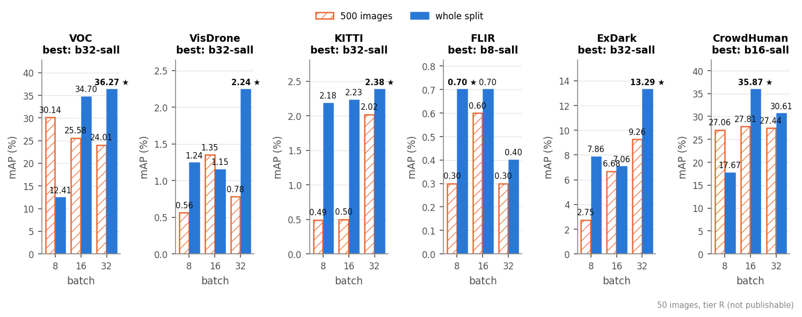
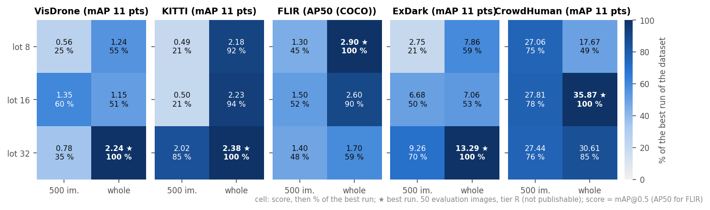
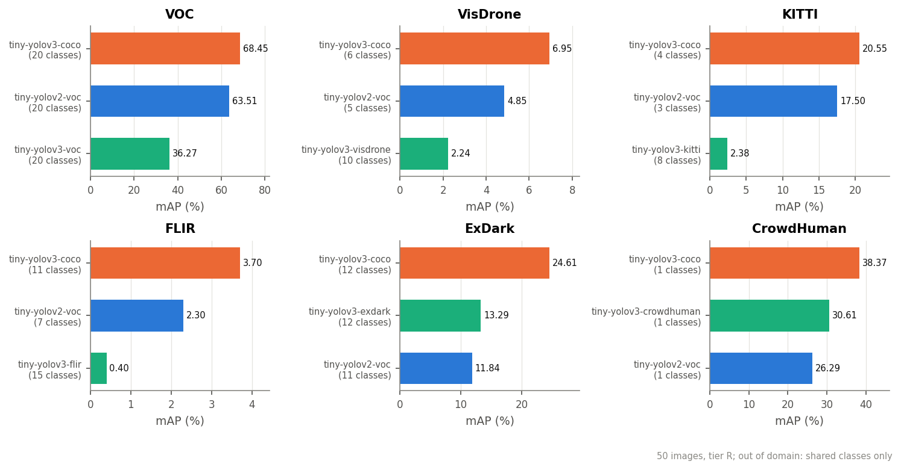
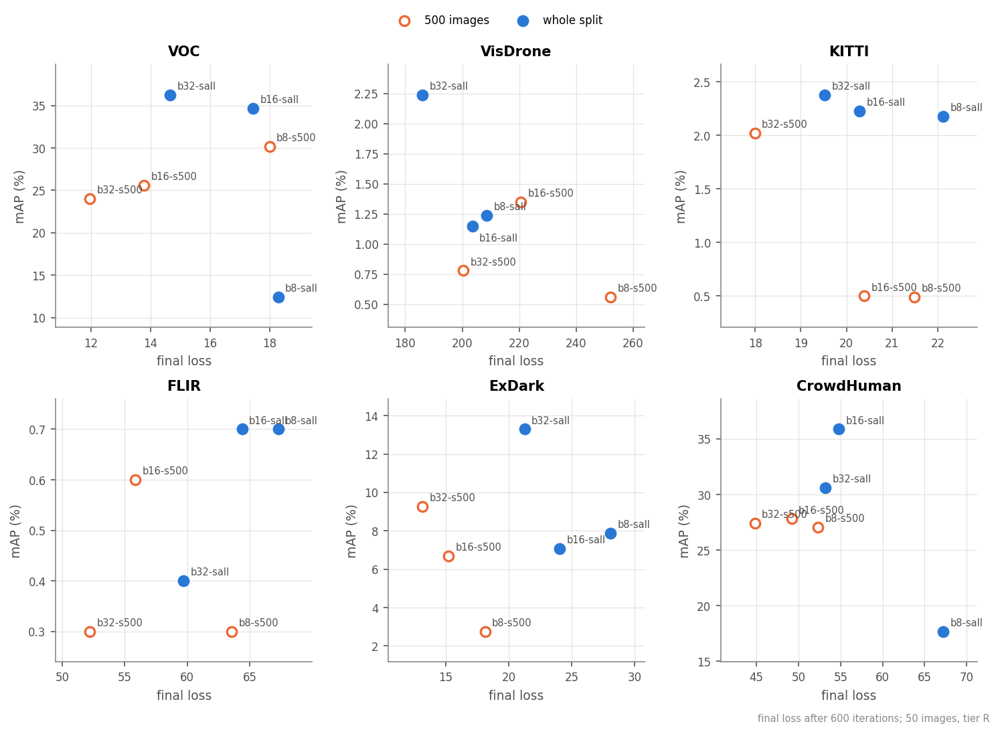

# Sweep and inference results (VOC, VisDrone, KITTI, FLIR, ExDark, CrowdHuman)

First runs of the `_sweep` (T14.10) and `_infer` (T14.3, T14.11) notebooks of
`notebooks/<dataset>/` (VOC, VisDrone, KITTI, FLIR, ExDark, CrowdHuman), on a Colab GPU
runtime ([colab-vscode.md](colab-vscode.md)), revision `1a967f4` (KITTI inferences:
`9a76534`; FLIR sweep: `4e47dbc`; FLIR inferences: `1723925` for the published weights,
`29a058a` for the fine-tuned run; ExDark and CrowdHuman sweeps and inferences:
`35e949b`). The runs are in `build/notebooks/<dataset>/<model>/runs/` and on the Drive
(`<DRIVE_DIR>/runs/`, [donnees-drive.md](donnees-drive.md)).

The executed notebooks are versioned with their outputs (rule of
[M14](M14-notebooks.md#rules)); all the tables and curves below can be reread there:

| dataset | sweep | inference |
|---|---|---|
| VOC | [tiny-yolov3-voc_sweep](../../notebooks/voc/tiny-yolov3-voc_sweep.ipynb) | [tiny-yolov3-voc](../../notebooks/voc/tiny-yolov3-voc_infer.ipynb), [tiny-yolov3-coco](../../notebooks/voc/tiny-yolov3-coco_infer.ipynb), [tiny-yolov2-voc](../../notebooks/voc/tiny-yolov2-voc_infer.ipynb) |
| VisDrone | [tiny-yolov3-visdrone_sweep](../../notebooks/visdrone/tiny-yolov3-visdrone_sweep.ipynb) | [tiny-yolov3-visdrone](../../notebooks/visdrone/tiny-yolov3-visdrone_infer.ipynb), [tiny-yolov3-coco](../../notebooks/visdrone/tiny-yolov3-coco_infer.ipynb), [tiny-yolov2-voc](../../notebooks/visdrone/tiny-yolov2-voc_infer.ipynb) |
| KITTI | [tiny-yolov3-kitti_sweep](../../notebooks/kitti/tiny-yolov3-kitti_sweep.ipynb) | [tiny-yolov3-kitti](../../notebooks/kitti/tiny-yolov3-kitti_infer.ipynb), [tiny-yolov3-coco](../../notebooks/kitti/tiny-yolov3-coco_infer.ipynb), [tiny-yolov2-voc](../../notebooks/kitti/tiny-yolov2-voc_infer.ipynb) |
| FLIR | [tiny-yolov3-flir_sweep](../../notebooks/flir/tiny-yolov3-flir_sweep.ipynb) | [tiny-yolov3-flir](../../notebooks/flir/tiny-yolov3-flir_infer.ipynb), [tiny-yolov3-coco](../../notebooks/flir/tiny-yolov3-coco_infer.ipynb), [tiny-yolov2-voc](../../notebooks/flir/tiny-yolov2-voc_infer.ipynb) |
| ExDark | [tiny-yolov3-exdark_sweep](../../notebooks/exdark/tiny-yolov3-exdark_sweep.ipynb) | [tiny-yolov3-exdark](../../notebooks/exdark/tiny-yolov3-exdark_infer.ipynb), [tiny-yolov3-coco](../../notebooks/exdark/tiny-yolov3-coco_infer.ipynb), [tiny-yolov2-voc](../../notebooks/exdark/tiny-yolov2-voc_infer.ipynb) |
| CrowdHuman | [tiny-yolov3-crowdhuman_sweep](../../notebooks/crowdhuman/tiny-yolov3-crowdhuman_sweep.ipynb) | [tiny-yolov3-crowdhuman](../../notebooks/crowdhuman/tiny-yolov3-crowdhuman_infer.ipynb), [tiny-yolov3-coco](../../notebooks/crowdhuman/tiny-yolov3-coco_infer.ipynb), [tiny-yolov2-voc](../../notebooks/crowdhuman/tiny-yolov2-voc_infer.ipynb) |

Figures: `python -m tools.figures balayage` (T13.53) rereads the tables of this file and
rewrites the PNGs of [figures/resultats/](figures/resultats/). The cross-dataset analysis
of the six datasets (grids, rankings, effects of the batch and of the subset, epochs, loss
curves and components, AP per class, published weights, cost) is in
[notebooks/analyse_balayages.ipynb](../../notebooks/analyse_balayages.ipynb): it rereads
the outputs of the `_sweep` and `_infer` notebooks directly
(`tools/notebooks/balayages.py`, figures `python -m tools.figures balayages`). All the
figures of the repository are shown in
[notebooks/figures_live.ipynb](../../notebooks/figures_live.ipynb), without running
anything.

The sweep and inference tables below are read by `tools/article.py`,
`tools/figures/resultats.py` and `tools/notebooks/balayages.py`; their headers, their
cells and the `### Balayage …` headings stay in French until those readers are translated
(M19, T19.6).

## Conditions

| | |
|---|---|
| tier | **R**: mAP on the first 50 images (`SUBSET = 50`) |
| evaluation | evaluation split of the dataset (VOC2007 test, val for the others), 416×416 `stretch` (Pillow), conf 0.005, NMS 0.45; 11-point AP, except FLIR: COCO metric (AP@[.5:.95], 101 points) |
| training | 600 iterations per run, LR 0.001 (not adjusted to the batch), burn-in 500, multi-scale 320-608, COCO init (`weights/yolov3-tiny.weights`), `--device gpu` |
| grid | `BATCHES = [8, 16, 32]` × `TRAIN_SUBSETS = [500, 0]` (first 500 images, or the whole split) |

These mAPs **rank** the runs; they are **not publishable** (rules of
[M12](M12-profils-pc.md#rules)) and do not go into `results/`. With 50 images, a class can
have only one or two instances: its AP jumps between 0 and 100. Order of magnitude of the
bias: Tiny-YOLOv2 VOC gets 63.51 on these 50 images against **56.30** on the full split
([results/map_float.md](../../results/map_float.md)).

The notebook [voc/tiny-yolov2-voc_infer](../../notebooks/voc/tiny-yolov2-voc_infer.ipynb)
is now set to the full split (`SUBSET = 0`, `INT8 = True`, T14.3 and T14.4): it gave back
56.30 (float) and 55.66 (integer) on Colab on 2026-10-07, but its outputs were not kept;
it is versioned without outputs until the next run. The 63.51 below comes from the first
run (revision `1a967f4`).

## Overview



Each panel has its own scale: VOC tops out at 36.27, VisDrone at 2.24, KITTI at 2.38, FLIR
at 0.7 (AP@[.5:.95], which does not compare with the 11-point APs of the other datasets),
ExDark at 13.29 and CrowdHuman at 35.87.

Comparison between datasets (score relative to the best run of each dataset, rankings,
effects of the batch and of the subset):
[notebooks/analyse_balayages.ipynb](../../notebooks/analyse_balayages.ipynb).



## VOC

### Sweep `tiny-yolov3-voc` (16,551 training images, VOC07+12)

| run | batch | images | epochs | final loss | mAP (50 images) |
|---|---|---|---|---|---|
| **b32-sall** | 32 | all | 1.16 | 14.66 | **36.27** |
| b16-sall | 16 | all | 0.58 | 17.45 | 34.70 |
| b8-s500 | 8 | 500 | 9.60 | 18.00 | 30.14 |
| b16-s500 | 16 | 500 | 19.20 | 13.78 | 25.58 |
| b32-s500 | 32 | 500 | 38.40 | 11.95 | 24.01 |
| b8-sall | 8 | all | 0.29 | 18.29 | 12.41 |

Duration: about 10 min per batch-32 run on the Colab GPU (624 s for b32-sall).

### Noise of a run (T15.2, Colab 2026-10-28, rev. `70058a0`)

Same cells rerun with `--seed 1` and `--seed 2` (reinitialised heads, batch draws,
multiscale), same 50 images:

| cell | seed 0 | seed 1 | seed 2 | mean ± sd (ddof 1) |
|---|---|---|---|---|
| `b16-sall` | 34.70 | 32.11 | 34.24 | 33.68 ± 1.38 |
| `b32-sall` | 36.27 | 28.98 | 39.92 | 35.06 ± 5.57 |

Up to 11 points between two seeds of `b32-sall`: the gaps of the table above between the
`sall` runs are within the noise of a 600-iteration run on 50 images. Full-split values below.

### Full split (T15.1, 4,952 images, Colab on 2026-10-29)

`voc/tiny-yolov3-voc_infer` with `SUBSET = 0`, `COMPARE = True` (VOC2007 test, 416×416
stretch, conf 0.005, NMS 0.45, 11-point AP):

| run | mAP (50 images) | rank | mAP (full split) | rank |
|---|---|---|---|---|
| **b32-sall** | 36.27 | 1 | **26.60** | 1 |
| b16-sall | 34.70 | 2 | 22.19 | 2 |
| b32-s500 | 24.01 | 5 | 18.46 | 3 |
| b8-s500 | 30.14 | 3 | 16.22 | 4 |
| b16-s500 | 25.58 | 4 | 15.60 | 5 |
| b8-sall | 12.41 | 6 | 12.02 | 6 |

Spearman ρ = 0.83: on VOC the 50-image ranking mostly holds (unlike VisDrone), `b32-sall`
stays first. Seeds (T15.2): `b16-sall` 22.19 / 18.51 / 24.94 (21.88 ± 3.23), `b32-sall`
26.60 / 21.35 / 31.65 (26.53 ± 5.15): gaps under ≈ 5 points are noise. AP of `b32-sall`:
person 54.6, cat 45.2, train 39.1, horse 37.5, car 36.1; sheep 9.4, bottle 10.6, boat
12.8, pottedplant 13.2. Still 30 points under Tiny-YOLOv2 VOC (56.30): 600 iterations
(1.16 epochs) are not a training; the long run is T15.4.

### Inference on the same 50 images

| model | weights | classes evaluated | mAP |
|---|---|---|---|
| `tiny-yolov3-coco` | Darknet COCO (`yolov3-tiny.weights`) | 20 (via `MAPPINGS`) | **68.45** |
| `tiny-yolov2-voc` | Darknet VOC (`yolov2-tiny-voc.weights`) | 20 | 63.51 |
| `tiny-yolov3-voc` | run `b32-sall` | 20 | 36.27 |

AP of the `b32-sall` run: aeroplane and bicycle 100, cat 75.6, bus 59.1, tvmonitor 54.5,
bird 50.6, person 47.2; bottle and sofa 0, boat 1.8, cow 2.1, pottedplant 1.3.

## VisDrone

### Sweep `tiny-yolov3-visdrone` (cfg `build/m11/cfg/tiny-yolov3-visdrone.cfg`, 10 classes, 6,471 images)

| run | batch | images | epochs | final loss | mAP (50 images) |
|---|---|---|---|---|---|
| **b32-sall** | 32 | all | 2.97 | 185.96 | **2.24** |
| b16-s500 | 16 | 500 | 19.20 | 220.65 | 1.35 |
| b8-sall | 8 | all | 0.74 | 208.68 | 1.24 |
| b16-sall | 16 | all | 1.48 | 203.54 | 1.15 |
| b32-s500 | 32 | 500 | 38.40 | 200.33 | 0.78 |
| b8-s500 | 8 | 500 | 9.60 | 252.11 | 0.56 |

Only the `car` class takes off (AP 17.4 for b32-sall); van 2.0, truck 1.7, the others
under 0.5. Losses from 186 to 252: no run converged.

### Full split (T15.1, 548 images, Colab on 2026-10-06, rev. `17b4a47`)

| run | mAP (50 images) | mAP (full split) | full split, letterbox (T15.15) |
|---|---|---|---|
| **b16-sall** | 1.15 | **2.61** | 2.27 |
| b8-sall | 1.24 | 1.70 | 1.87 |
| b16-s500 | 1.35 | 1.46 | 1.62 |
| b32-sall | 2.24 | 1.37 | **3.24** |
| b32-s500 | 0.78 | 1.12 | 2.52 |
| b8-s500 | 0.56 | 0.59 | 0.99 |

Last column (T15.15, PC, 2026-10-28, ignored regions excluded): the evaluation in the
training geometry. Recomputed in stretch with the same code, the runs give back the second
column within 0.01.

The 50-image ranking does not hold: `b32-sall` drops from 1st to 4th, `b16-sall` rises
from 4th to 1st. All the gaps stay under 1.5 points, at the noise level expected for runs
that have not converged. For `b32-sall`, `car` drops to 10.0 and the other classes stay
under 1. These mAPs still count the detections in the ignored regions as false (before
T15.10).

### Long run `long-416` (T15.8, Colab on 2026-10-29, rev. `70058a0`)

6,000 iterations at batch 16 (≈ 15 epochs), stretch at training and evaluation, burn-in
200, LR 1e-3 then ×0.1 at 4,800 and 5,400; full val (548 images, ignored regions
excluded):

| class | AP | | class | AP |
|---|---|---|---|---|
| car | 19.6 | | bus | 9.7 |
| van | 10.1 | | pedestrian | 6.1 |
| truck | 9.9 | | motor | 3.0 |
| people | 9.8 | | awning-tricycle | 2.3 |
| tricycle | 2.1 | | bicycle | 0.7 |

mAP **7.32**, ×2.8 the best sweep run (2.61); final loss 132 (sweep: 186 to 252). `car`
passes the out-of-domain COCO weights on the same split (18.3). Small and thin classes
(bicycle, motor, tricycles) stay under 3: the input size (T15.9) and the crops (T15.16)
are the next levers.

### Diagnosis and next steps (M15, T15.8, T15.10, T15.15, T15.16)

- **Different resizing**: training was in letterbox, evaluation in stretch; at evaluation,
  the objects are 1.3 to 1.8 times taller → `train.py --resize`.
- **Runs too short**: 600 iterations, 500 of them in the LR ramp → long run of 6,000
  iterations.
- **Tiny objects**: 97 % under 32² px at 416, 52.6 % under 8 px of height in letterbox,
  32 % of the targets lost by collision
  ([stats](../../notebooks/visdrone/visdrone_stats.ipynb)) → tiles at 416 (`--crop`,
  `--tiles`) against a 608 input.
- **Ignored regions** counted as false detections → excluded from the mAP by default
  (`eval_voc.py --no-ignore` for the old computation).

Procedure in [M15](M15-campagne-entrainement.md#c-visdrone).

### Out-of-domain inference (T11.2) on the same 50 images

| model | classes evaluated | mAP |
|---|---|---|
| `tiny-yolov3-coco` | 6 (person, bicycle, car, motorbike, bus, truck) | 6.95 |
| `tiny-yolov2-voc` | 5 (person, bicycle, car, motorbike, bus) | 4.85 |
| `tiny-yolov3-visdrone` `b32-sall` | 10 | 2.24 |

The out-of-domain mAPs cover the classes that have an equivalent (`MAPPINGS`: pedestrian
and people → person, van → car, motor → motorbike; tricycle and awning-tricycle ignored):
they do not compare directly with the 10-class mAP. Per class, `car` is at 21.5 for COCO
against 17.4 for the fine-tuned run.

## KITTI

### Sweep `tiny-yolov3-kitti` (cfg `build/m11/cfg/tiny-yolov3-kitti.cfg`, 8 classes, 5,985 images)

| run | batch | images | epochs | final loss | mAP (50 images) |
|---|---|---|---|---|---|
| **b32-sall** | 32 | all | 3.21 | 19.52 | **2.38** |
| b16-sall | 16 | all | 1.60 | 20.29 | 2.23 |
| b8-sall | 8 | all | 0.80 | 22.12 | 2.18 |
| b32-s500 | 32 | 500 | 38.40 | 17.99 | 2.02 |
| b16-s500 | 16 | 500 | 19.20 | 20.39 | 0.50 |
| b8-s500 | 8 | 500 | 9.60 | 21.49 | 0.49 |

Same ranking as on VOC and VisDrone: `b32-sall` first, the runs on the whole split ahead
of those on 500 images. The first four are within 0.4 point, within the noise at 50
images. Only `Car` takes off (AP 16.8 for b32-sall); Truck and Pedestrian 1.1, the other
classes at 0. Duration: ≈ 10 min per batch-32 run (604 s for b32-sall).

The KITTI images (1242×375) are squashed to 416×416 by `stretch`: the objects lose two
thirds of their relative height. This is the argument for the 640×192 input of T11.4
([M15, T15.12](M15-campagne-entrainement.md)).

### Out-of-domain inference (T11.2) on the same 50 images

| model | classes evaluated | mAP |
|---|---|---|
| `tiny-yolov3-coco` | 4 (person, car, train, truck) | 20.55 |
| `tiny-yolov2-voc` | 3 (car, person, train) | 17.50 |
| `tiny-yolov3-kitti` `b32-sall` | 8 | 2.38 |

Mappings (`MAPPINGS`): Car and Van → car, Pedestrian and Person_sitting → person, Tram →
train, Truck → truck (COCO only); Cyclist and Misc ignored. Per class, `car` is at 49.7 for
COCO and 29.6 for Tiny-YOLOv2 VOC, against 16.8 for the fine-tuned run.



## FLIR

### Sweep `tiny-yolov3-flir` (cfg `build/m11/cfg/tiny-yolov3-flir-c1.cfg`, 15 classes, 1 channel, 10,742 images)

| run | batch | images | epochs | final loss | mAP AP@[.5:.95] (50 images) | AP50 |
|---|---|---|---|---|---|---|
| **b8-sall** | 8 | all | 0.45 | 67.27 | **0.7** | 2.9 |
| **b16-sall** | 16 | all | 0.89 | 64.38 | **0.7** | 2.6 |
| b16-s500 | 16 | 500 | 19.20 | 55.84 | 0.6 | 1.5 |
| b32-sall | 32 | all | 1.79 | 59.68 | 0.4 | 1.7 |
| b32-s500 | 32 | 500 | 38.40 | 52.19 | 0.3 | 1.4 |
| b8-s500 | 8 | 500 | 9.60 | 63.55 | 0.3 | 1.3 |

No run learns: AP50 at most 2.9, all the gaps are within the noise at 50 images, and the
ranking of the other datasets (`b32-sall` first) does not hold. Per class, only person
(AP50 11.6 for b8-sall, 2.9 for b16-sall), bike (7.9 and 9.8) and car (3.2 and 6.6) get
off zero; 7 of the 15 classes have no instance in these 50 images (AP -100 in the table
of `eval_voc.py`). Final losses from 52 to 67, three times those of KITTI.

Only the heads are reinitialised (layers 15 and 22); L00 comes from the COCO weights,
summed over the RGB channels. Yet the network sees thermal images, far from the COCO
domain, and 600 iterations (fewer than two epochs) are not enough to adapt it. Duration:
≈ 10 min per batch-32 run (577 s for b32-sall), as on the other datasets.

### Inference on the same 50 images

| model | classes evaluated | mAP AP@[.5:.95] | AP50 |
|---|---|---|---|
| `tiny-yolov3-coco` | 11 (5 present: person, bicycle, car, traffic light, fire hydrant) | **3.7** | 9.9 |
| `tiny-yolov2-voc` | 7 (3 present: person, bicycle, car) | 2.3 | 8.3 |
| `tiny-yolov3-flir` `b32-sall` | 15 (8 present) | 0.4 | 1.7 |

The published weights run in RGB on the thermal image (the same channel three times); the
fine-tuned run takes one channel. Mappings (`MAPPINGS`): bike → bicycle, motor →
motorbike, light → traffic light and hydrant → fire hydrant (COCO only); sign, stroller,
scooter and other vehicle ignored. Per class, in AP50: bicycle 23.1 for COCO and 22.7 for
Tiny-YOLOv2 VOC; car 12.7 for COCO, 1.9 for VOC, 1.6 for the fine-tuned run; person 7.6
for COCO, 0.2 for VOC, 8.1 for the fine-tuned run, its only class at the level of the
published weights. The published weights only detect the large objects well (APl 49.0 for
COCO, 11.9 for VOC, 5.5 for the fine-tuned run).

The inference notebook takes the most recent run (`RUN = None`), here `b32-sall`, and
gets back exactly the measurement of the sweep (0.4 and 1.7). The single-channel cfg was
rebuilt from the anchor table of the run (`env.restore_cfg`, fresh Colab runtime without
`build/m11/cfg/`): the same cfg as in training. The two runs at the top of the sweep
(`b8-sall`, `b16-sall`) are not evaluated here (`RUN = 'b8-sall'` or `COMPARE = True`).

## ExDark

### Sweep `tiny-yolov3-exdark` (cfg `build/m11/cfg/tiny-yolov3-exdark.cfg`, 12 classes, 3,000 images)

| run | batch | images | epochs | final loss | mAP (50 images) |
|---|---|---|---|---|---|
| **b32-sall** | 32 | all | 6.40 | 21.25 | **13.29** |
| b32-s500 | 32 | 500 | 38.40 | 13.13 | 9.26 |
| b8-sall | 8 | all | 1.60 | 28.09 | 7.86 |
| b16-sall | 16 | all | 3.20 | 24.04 | 7.06 |
| b16-s500 | 16 | 500 | 19.20 | 15.23 | 6.68 |
| b8-s500 | 8 | 500 | 9.60 | 18.11 | 2.75 |

Night and low-light images, a small training split (3,000 images): at batch 32, 600
iterations already make 6.4 epochs. `b32-sall` is first, as on VOC, VisDrone and KITTI,
4 points ahead of `b32-s500`. The k-means anchors gain almost nothing over Darknet's (mean
IoU 0.615 against 0.609). AP of `b32-sall`: Boat 55.3, Bus 36.4, People 23.7, Bicycle
19.6, Chair 18.5, Car 5.7; Bottle, Cat, Cup, Dog and Table at 0. Duration: 427 s for
`b32-sall`.

### Inference on the same 50 images

| model | weights | classes evaluated | mAP |
|---|---|---|---|
| `tiny-yolov3-coco` | Darknet COCO (`yolov3-tiny.weights`) | 12 | **24.61** |
| `tiny-yolov3-exdark` | run `b32-sall` | 12 | 13.29 |
| `tiny-yolov2-voc` | Darknet VOC (`yolov2-tiny-voc.weights`) | 11 (sans cup) | 11.84 |

Mappings (`MAPPINGS`): People → person, Table → diningtable, the other classes under their
own name; Cup does not exist in VOC. The fine-tuned run beats Tiny-YOLOv2 VOC but stays
below the COCO weights, which see people (51.4) and bicycles (40.2) well in the dark. The
inference notebook gets back exactly the measurement of the sweep (13.29).

## CrowdHuman

### Sweep `tiny-yolov3-crowdhuman` (cfg `build/m11/cfg/tiny-yolov3-crowdhuman.cfg`, 1 class, 15,000 images)

| run | batch | images | epochs | final loss | mAP (50 images) |
|---|---|---|---|---|---|
| **b16-sall** | 16 | all | 0.64 | 54.77 | **35.87** |
| b32-sall | 32 | all | 1.28 | 53.17 | 30.61 |
| b16-s500 | 16 | 500 | 19.20 | 49.17 | 27.81 |
| b32-s500 | 32 | 500 | 38.40 | 44.79 | 27.44 |
| b8-s500 | 8 | 500 | 9.60 | 52.35 | 27.06 |
| b8-sall | 8 | all | 0.32 | 67.22 | 17.67 |

A single class (`person`), dense crowds: the only dataset where the fine-tuned run gets
close to the published weights. `b16-sall` moves ahead of `b32-sall` (5 points, within the
noise at 50 images); the three runs on 500 images are within 0.8 point; `b8-sall` (0.32
epoch) is last, like `b8-sall` on VOC (burn-in over 500 of the 600 iterations, an LR that
only reaches its value at the end). The k-means anchors are much smaller than Darknet's
(`6,16 … 136,227` against `10,14 … 344,319`) and cover them better (mean IoU 0.68 against
0.53): many small people. Duration: 444 s for `b32-sall`.

### Inference on the same 50 images

| model | weights | classes evaluated | mAP |
|---|---|---|---|
| `tiny-yolov3-coco` | Darknet COCO (`yolov3-tiny.weights`) | 1 (person) | **38.37** |
| `tiny-yolov3-crowdhuman` | run `b32-sall` | 1 | 30.61 |
| `tiny-yolov2-voc` | Darknet VOC (`yolov2-tiny-voc.weights`) | 1 (person) | 26.29 |

The inference notebook takes the most recent run (`RUN = None`), here `b32-sall`, and gets
back exactly the measurement of the sweep (30.61). The best run of the sweep, `b16-sall`
(35.87), is 2.5 points from the COCO weights and 9.6 above Tiny-YOLOv2 VOC; it is not
evaluated here (`RUN = 'b16-sall'` or `COMPARE = True`). The question specific to the
dataset remains ([T11.6](M11-jeux-de-donnees.md)): recall of `person` and overflow of the
256 slots of the NMS on the densest images.

## Best parameters

**Batch 32 on the whole training split (`b32-sall`)**, on VOC, VisDrone, KITTI and ExDark;
second on CrowdHuman, 5 points behind `b16-sall` (within the noise at 50 images). FLIR
separates no run, and all stay below the out-of-domain COCO weights (see above). Over the
six datasets, `b32-sall` reaches on average 91 % of the best run of each dataset; the whole
split beats 500 images in 15 cases out of 18 (dataset × batch)
([analyse_balayages](../../notebooks/analyse_balayages.ipynb)). It is the default run of
the inference notebooks (`RUN = None` takes the most recent, here `b32-sall`).

```
python tools/train.py --net tiny-yolov3-voc --init coco --iters 600 --batch 32 \
    --lr 0.001 --burn-in 500 --multiscale --workers 4 --device gpu \
    --out build/notebooks/voc/tiny-yolov3-voc/runs/b32-sall
python tools/train.py --net build/m11/cfg/tiny-yolov3-visdrone.cfg --dataset visdrone \
    --init coco --iters 600 --batch 32 --lr 0.001 --burn-in 500 --multiscale \
    --workers 4 --device gpu --out build/notebooks/visdrone/tiny-yolov3-visdrone/runs/b32-sall
python tools/train.py --net build/m11/cfg/tiny-yolov3-kitti.cfg --dataset kitti \
    --init coco --iters 600 --batch 32 --lr 0.001 --burn-in 500 --multiscale \
    --workers 4 --device gpu --out build/notebooks/kitti/tiny-yolov3-kitti/runs/b32-sall
```

What the grid shows:

- **The whole split rather than 500 images.** On VOC, the `s500` runs make 10 to 38 epochs
  over the same 500 images and overfit: `b32-s500` has the lowest final loss (11.95) but an
  mAP of 24.01, against 36.27 for `b32-sall` (a gap of 12 points at batch 32, 9 points at
  batch 16). Only batch 8 is an exception, see the next point.
- **A large batch.** At 600 iterations, the batch sets the number of images seen.
  `b8-sall` (0.29 epoch) is the worst VOC run, and `b8-sall` (0.32 epoch) the worst of
  CrowdHuman: the burn-in takes up 500 of the 600 iterations, the LR only reaches its value
  at the end and the gradient of a batch of 8 is noisy.
- **Small gaps between the two best.** `b32-sall` and `b16-sall` (1.6 points on VOC, 0.15
  on KITTI) cannot be told apart on 50 images; on VisDrone, all the runs except `b32-sall`
  stay within the noise (0.6 to 1.4).



On VOC, the runs on 500 images (hollow marks) have the lowest losses and the lowest mAPs:
they overfit.

## Limitations and next steps

Planned runs and improvements: [M15](M15-campagne-entrainement.md).

- **Training too short.** The 600-iteration fine-tuning starts from the COCO weights,
  which get 68.45 on VOC with the mapping table, and falls to 36.27: the 20-class heads
  start from scratch and have only seen one epoch. Over the six datasets, the best
  fine-tuned run stays below the out-of-domain COCO weights; CrowdHuman is the closest
  (35.87 against 38.37, a single class), ExDark halfway (13.29 against 24.61).
- **Directions**, in order:
  1. lengthen `ITERS` on the selected configuration (batch 32, whole split; tier N); the
     example of `tools/train.py` for VOC is at 20,000 iterations;
  2. shorten `BURN_IN` (100 to 200) or adjust the LR to the batch for short runs;
  3. VisDrone: a larger input (`SIZE`, e.g. `608` or non-square) for the small objects,
     with the k-means anchors recomputed at that size; KITTI: input
     `SIZE = '640x192'`.
- **Confirm the ranking** on the full split: `_infer` notebook with `COMPARE = True` and
  `SUBSET = 0` (tier N), then the integer part (`INT8 = True`, T14.4) on the selected run.
- FLIR: the sweep ran but does not learn (AP50 ≤ 2.9), far from the out-of-domain COCO
  weights (AP 3.7, AP50 9.9), which keep the original RGB L00. Before a long run, compare
  with 3 channels (`CHANNELS = None`), to find out whether the L00 summed onto one channel
  costs the difference ([M15, T15.13](M15-campagne-entrainement.md)).
- ExDark and CrowdHuman: full split (tier N) and, for CrowdHuman, the inference of
  `b16-sall` (`COMPARE = True` in `tiny-yolov3-crowdhuman_infer`)
  ([M15, T15.14](M15-campagne-entrainement.md)).

## Harvesting the runs

Since the revision after `35e949b`, each `tools/train.py` or `tools/eval_voc.py` command
started by a notebook on Colab writes a `summary.json` in its output folder and copies it
to the Drive as soon as it ends (`colab.autosync`), evaluations and `_infer` notebooks
included. On the PC, `make harvest` brings back logs, summaries, tables and figures
(without weights) into `build/notebooks/`; the analysis notebook picks up there the runs
without a log in their notebook (VisDrone: 4 runs from a previous session). Details:
[colab-vscode.md](colab-vscode.md#session-disconnect).
