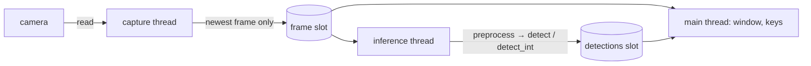

# Live webcam demo (`tools/webcam.py`)

A desktop program that opens the webcam, runs Tiny-YOLO on the live image and draws the
boxes, class names and scores on screen. It is the live counterpart of `tools/detect.py`
(still images) and uses the same pipeline: `preprocess` → `detect` (float) or
`detect_int` (integer model) → drawing. It runs on the PC with the NumPy models. Running
it on the KV260 is a later step (see [M20](tasks/M20-webcam.md), T20.9).

Task list, acceptance criteria and measurements: [tasks/M20-webcam.md](tasks/M20-webcam.md).

## 1. Install

From the repository root:

```bash
pip install -e "python[webcam]"     # numpy, opencv-python, pillow
make get-weights                    # Darknet weights in weights/ (float models), once
make export                         # integer models in model/ (int: models), optional
```

On a machine without a display, install `opencv-python-headless` instead of
`opencv-python` and always pass `--no-window`.

On Linux the user must be able to read `/dev/video*`. On a desktop session the device
ACL usually allows it (`ls -l /dev/video0` ends with `+`). Otherwise add the user to the
`video` group (`sudo usermod -aG video $USER`, then log in again).

## 2. Check the camera and the models

```bash
python tools/webcam.py --list
```

Example output on the development PC:

```
Cameras:
  /dev/video0: 640x480 at 30 FPS
  /dev/video1: does not open
Models:
  tiny-yolov2-voc        Tiny-YOLOv2 float, VOC (20)
  tiny-yolov3-coco       Tiny-YOLOv3 float, COCO (80)
  tiny-yolov4-coco       YOLOv4-tiny float, COCO (80)
  int:tiny-yolov2-voc    Tiny-YOLOv2 integer (M4), VOC (20)
  int:tiny-yolov3-coco   Tiny-YOLOv3 integer (M4), COCO (80)
  int:tiny-yolov4-coco   YOLOv4-tiny integer (M24), COCO (80)
```

A UVC camera often shows two nodes. The second one carries metadata only and "does not
open": this is normal. A model whose files are missing is listed with the missing path.
`--list` exits with an error when no camera opens.

## 3. Run

```bash
make webcam                         # = python tools/webcam.py: model menu, camera 0
```

Without `--model`, a numbered menu of the available models is printed; Enter picks the
first one. Common commands:

```bash
python tools/webcam.py --model tiny-yolov2-voc                 # VOC classes, fastest
python tools/webcam.py --model tiny-yolov3-coco                # COCO classes (80)
python tools/webcam.py --model int:tiny-yolov2-voc             # integer model: the FPGA's boxes
python tools/webcam.py --model tiny-yolov3-coco --sync         # image and boxes always match
python tools/webcam.py --camera 2 --resolution 1280x720        # another camera, HD capture
python tools/webcam.py --conf 0.4                              # fewer, surer boxes
```

### Models

| `--model` | Network | Files read | Classes |
|---|---|---|---|
| `tiny-yolov2-voc` | Tiny-YOLOv2, float | `weights/yolov2-tiny-voc.weights` | VOC (20) |
| `tiny-yolov3-coco` | Tiny-YOLOv3, float | `weights/yolov3-tiny.weights` | COCO (80) |
| `tiny-yolov4-coco` | YOLOv4-tiny, float (M24) | `weights/yolov4-tiny.weights` | COCO (80) |
| `int:tiny-yolov2-voc` | Tiny-YOLOv2, integer (M4) | `model/tiny-yolov2-voc/` | VOC (20) |
| `int:tiny-yolov3-coco` | Tiny-YOLOv3, integer (M4) | `model/tiny-yolov3-coco/` | COCO (80) |
| `int:tiny-yolov4-coco` | YOLOv4-tiny, integer (M24) | `model/tiny-yolov4-coco/` | COCO (80) |
| `ckpt:<path>.npz` | fine-tuned network (M15, M18) | checkpoint + `--cfg` | `--dataset` |

The integer models are the bit-exact `f64` emulation of M4. They show the boxes the FPGA
will give, not its speed, and are slower than the float ones on the PC.

A fine-tuned network is loaded from its `Trainer` checkpoint and its cfg. The cfg and the
dataset are the `net` and `dataset` fields of the `run.json` next to the checkpoint:

```bash
python tools/webcam.py \
    --model ckpt:<run>/checkpoint.npz \
    --cfg build/m11/cfg/tiny-yolov3-visdrone.cfg --dataset visdrone
```

A 1-channel network (FLIR, HIT-UAV) gets a grey image. QAT and ADMM checkpoints store a
fused network and are refused with a message.

### Keys

| Key | Action |
|---|---|
| `q` / `Esc` | quit (the camera is released) |
| `Space` | pause / resume |
| `m` | next model of the menu, loaded without closing the window |
| `+` / `-` | confidence threshold ± 0.05 (from the next inference) |
| `s` | save the displayed image to `build/webcam/snapshot_NNNNN.jpg` (or `--save`) |
| `d` | show / hide the boxes |

Closing the window with the mouse also quits.

### What the window shows

The camera image at the camera's own frame rate, the boxes of the last finished
inference in the per-class colours of `tools/detect.py`, and an overlay in the top left
corner:

```
tiny-yolov2-voc  conf 0.25
display 20.0 FPS  inference  4.8 FPS
latency  207 ms  frame 812  lag 3 frames
```

- **display**: camera frames shown per second;
- **inference**: inferences per second;
- **latency**: time of the last inference (colour conversion, letterbox, forward pass,
  decoding, NMS);
- **frame / lag**: id of the analysed frame and, in live mode, how many camera frames
  were captured since then.

### Live and sync modes

- **live** (default): the image is live, the boxes are those of the last inference. On a
  moving object they can be up to one inference (≈ 200 ms) late.
- **`--sync`**: the window shows the exact frame that was analysed, with its boxes. The
  image updates at the inference rate (≈ 5 FPS), but image and boxes always match. Use it
  for screenshots and to judge the model.

## 4. Without a camera or without a display

```bash
# video file, single image or image folder instead of the camera
python tools/webcam.py --source clip.mp4
python tools/webcam.py --source data/VOCdevkit/VOC2007/JPEGImages/000004.jpg --sync

# headless: annotated frames written to disk, one line per inference on the terminal
python tools/webcam.py --source images/ --no-window --save build/webcam/ --max-frames 5

# timed run with a summary (used for the measurements of M20)
python tools/webcam.py --model tiny-yolov2-voc --seconds 20
```

With a file source no frame is dropped: one frame is read per inference, so a short
clip is played at the inference rate. `--save DIR` writes every analysed frame as
`DIR/frame_NNNNN.jpg`. At the end the program prints a summary:

```
95 inferences, 4.8 inferences/s, latency 207 ms (p90 250), capture 20.0 FPS, display 20.1 FPS
```

## 5. All options

| Option | Default | Meaning |
|---|---|---|
| `--model` | menu | model of the table above |
| `--cfg` | — | cfg of a `ckpt:` model |
| `--dataset` | from the class count | class names of a fine-tuned model |
| `--camera N` | 0 | `/dev/videoN` |
| `--source PATH` | — | video, image or image folder instead of a camera |
| `--resolution WxH` | camera default | capture size; MJPG is requested from 1280×720 |
| `--conf`, `--iou` | 0.25, 0.45 | detection thresholds (`docs/conventions.md`) |
| `--sync` | off | show the analysed frame with its boxes |
| `--no-window` | off | no OpenCV window |
| `--save DIR` | — | write every analysed frame |
| `--max-frames N` | — | stop after N inferences |
| `--seconds S` | — | stop after S seconds |
| `--blas-threads N` | cores − 2 | BLAS threads of the inference |
| `--list` | — | list cameras and models, then quit |

## 6. Measured performance (PC)

Intel Core Ultra 7 155H, 20 BLAS threads, built-in camera at 640×480 delivering 20 FPS
(2026-10-11):

| Model | Display FPS | Inference FPS | Latency mean (p90) |
|---|---|---|---|
| `tiny-yolov2-voc` | 20.1 | 4.8 | 207 ms (250) |
| `tiny-yolov3-coco` | 20.0 | 4.9 | 206 ms (240) |
| `int:tiny-yolov2-voc` | 20.0 | 2.8 | 356 ms (428) |
| `int:tiny-yolov3-coco` | 19.8 | 2.8 | 358 ms (415) |

The display always follows the camera; only `--sync` drops to the inference rate.

## 7. How it works

Inference (≈ 200 ms) is much slower than capture (≈ 33 ms at 30 FPS). In one sequential
loop the display would freeze and the camera buffer would fill with old frames. The
program therefore runs three parts that share only the **latest** frame:



| Part | Code | Role |
|---|---|---|
| `LatestSlot` | `tools/webcam.py` | one item, overwritten on each `put`; readers see only the newest |
| capture thread | `CameraSource`, `Demo.capture_loop` | V4L2 capture, buffer of one frame |
| inference thread | `Demo.inference_loop` | BGR → RGB → PIL, `Model.infer`, model switch, `--save` |
| main thread | `_window_loop` | `imshow`, overlay, keys (OpenCV wants its window there) |
| registry | `MENU`, `available`, `load_model` | `--model` → `Model(names, size, channels, infer)` |
| drawing | `draw_cv`, `draw_overlay` | OpenCV; pixel boxes from `pixel_boxes` of `tools/detect.py` |

NumPy releases the GIL inside BLAS, so threads are enough. `--blas-threads` keeps cores
free for capture and display. A file source (`FileSource`) is read by the inference
thread itself, one frame per inference. `cv2` is imported by `tools/` only, never by
`python/yolo/`.

Tests: `python/tests/test_webcam.py` (registry, slot, checkpoint loading, drawing,
headless run); the OpenCV tests are skipped when `cv2` is missing.

## 8. Troubleshooting

| Symptom | Cause and fix |
|---|---|
| `OpenCV is missing` | `pip install -e "python[webcam]"` |
| `camera 0 does not open` | wrong index (`--list`), camera used by another program, or no read access to `/dev/video0` (group `video`) |
| `no camera opens` with `--list` | same as above; on a VM or a container the device must be passed through |
| `no model` | `make get-weights` (float) or `make export` (integer) |
| `... does not match the cfg` | wrong `--cfg` for the checkpoint, or a QAT / ADMM checkpoint |
| display below 30 FPS | the camera delivers less: auto exposure lowers the rate in dim light (the summary prints the capture FPS) |
| window error from Qt (`could not connect to display`) | no display: use `--no-window`, or `opencv-python-headless` |
| `QFontDatabase: Cannot find font directory` | harmless warning of the Qt build of OpenCV |
| boxes late on moving objects | expected in live mode (one inference); use `--sync` |
| PC slow while the demo runs | lower `--blas-threads` |
