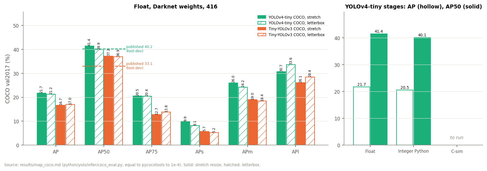

# COCO val2017 AP (T11.1, T24.2, T24.5, T33.4, T34.2)

COCO val2017 (5,000 images, 36,781 objects), Darknet weights, 416×416 input, confidence
threshold 0.005, per-class NMS 0.45, COCO metric (101-point interpolation, `iscrowd`
ignored; `python/yolo/infer/coco_eval.py`, equal to pycocotools to 1e-4,
`python/tests/test_coco_eval.py`).

```
tools/get_datasets.sh coco
python tools/eval_voc.py --net tiny-yolov4-coco --weights weights/yolov4-tiny.weights \
    --dataset coco --resize stretch            # also --resize letterbox, and tiny-yolov3-coco
tools/m11.sh coco-v4                           # YOLOv4-tiny: float, integer, C-sim
```

Notebook: [coco/tiny-yolov4-coco_infer.ipynb](../notebooks/coco/tiny-yolov4-coco_infer.ipynb) (`INT8 = True` for the
integer stage, `HW = True` for export, golden and C-sim; `SUBSET = 0` for the full split).

## Float



Figure: `python -m tools.figures map_coco` (T13.57), read from the tables below.

| Network | Preprocessing | AP | AP50 | AP75 | APs | APm | APl | AR100 |
|---|---|---|---|---|---|---|---|---|
| **YOLOv4-tiny** (`tiny-yolov4-coco`) | **stretch** | **21.7** | **41.4** | 20.5 | 9.9 | 26.0 | 30.7 | 35.6 |
| YOLOv4-tiny | letterbox | 21.2 | 39.9 | 20.4 | 8.1 | 24.2 | 33.6 | 33.6 |
| Tiny-YOLOv3 (`tiny-yolov3-coco`) | stretch | 16.7 | 37.2 | 12.7 | 5.7 | 19.0 | 26.1 | 29.7 |
| Tiny-YOLOv3 | letterbox | 17.0 | 36.9 | 13.8 | 5.2 | 18.4 | 28.4 | 29.1 |

Published values (AP50, COCO test-dev, 416): **YOLOv4-tiny 40.2**
([AlexeyAB/darknet README](https://github.com/AlexeyAB/darknet), `yolov4-tiny.cfg` row),
**Tiny-YOLOv3 33.1** ([pjreddie.com/darknet/yolo](https://pjreddie.com/darknet/yolo/)).

### Explaining the gaps

- **Preprocessing**: `yolov4-tiny.cfg` has no `letter_box=1`, so AlexeyAB's Darknet resizes
  without keeping the aspect ratio. `stretch` is therefore the reference for YOLOv4-tiny
  (+1.5 AP50 over letterbox), as it is for Tiny-YOLOv2 ([map_float.md](map_float.md)). For
  Tiny-YOLOv3 both are within 0.3 point.
- **YOLOv4-tiny, +1.2 AP50 over the published value**: val2017 against test-dev, a
  different image set. AlexeyAB trained on train2017, so val2017 is a clean split.
- **Tiny-YOLOv3, +4.1 AP50**: the pjreddie weights were trained on the COCO 2014
  `trainvalno5k` split, and val2017 is drawn from the 2014 images. Part of val2017 was
  probably seen in training, which makes this value optimistic. The overlap was not
  measured: the `5k.part` list of the Darknet scripts is no longer online. The published 33.1
  stays the external reference; the comparison between the two networks on val2017 is
  biased in favour of Tiny-YOLOv3.

## YOLOv5n and YOLOv7-tiny, YOLOv5 protocol (T33.4, T34.2)

Protocol of the published values of these networks: the Ultralytics letterbox to a square
input (gray 114, `letterbox_params_v5`), confidence 0.001, class-aware multi-label NMS at
IoU 0.65, at most 300 detections per image; same COCO metric as above. Weights: the
official `yolov5n.pt` (v7.0, read without torch, T33.0) and the Darknet
`yolov7-tiny.weights` (AlexeyAB).

```
python tools/eval_voc.py --net yolov5n-coco --dataset coco --preset v5 --size 640
python tools/eval_voc.py --net tiny-yolov7-coco --weights weights/yolov7-tiny.weights \
    --dataset coco --preset v5 --size 416 --jobs 5 --blas-threads 4
```

| Model | Input | AP | AP50 | AP75 | APs | APm | APl | AR100 | Published AP / AP50 |
|---|---|---|---|---|---|---|---|---|---|
| **YOLOv7-tiny** (`tiny-yolov7-coco`) | 640 | **34.8** | **52.9** | 37.3 | 19.0 | 40.0 | 45.3 | 56.3 | — (leaky not published at 640) |
| YOLOv7-tiny | 416 | 34.3 | 51.6 | 36.0 | 13.8 | 36.7 | 53.8 | 53.2 | 35.2 / 52.8 |
| YOLOv5n (`yolov5n-coco`) | 640 | 28.1 | 45.6 | 29.5 | 14.0 | 32.0 | 36.7 | 49.0 | 28.0 / 45.7 |
| YOLOv5n | 416 | 25.3 | 41.4 | 26.3 | 8.7 | 26.8 | 40.5 | 44.5 | — |

Published: YOLOv5n from the Ultralytics README (val2017, 640); YOLOv7-tiny (leaky) from the
YOLOv7 paper, arXiv 2207.02696, Table 1 (val2017, 416). The 38.7 AP at 640 of the paper is
YOLOv7-tiny-SiLU, another network.

- **YOLOv5n**: within 0.1 point of both published values; the decoding, letterbox and
  NMS of T33.4 reproduce the reference evaluation.
- **YOLOv7-tiny, −0.9 AP at 416**: the same pipeline as YOLOv5n, so the gap is not in
  the decoding. Two differences remain, neither measured: the Darknet weights are a
  conversion of the PyTorch `yolov7-tiny.pt` evaluated in the paper; and the paper's
  `test.py` uses rectangular batches (letterbox to the smallest multiple of 32, pad 0.5)
  where this evaluation uses a square letterbox.

## YOLOv4-tiny: float, integer, FPGA C-sim (T24.5)

`stretch` preprocessing. The integer model uses the calibration on 500 COCO train2017
images ([calibration_tiny-yolov4-coco.md](calibration_tiny-yolov4-coco.md)). The C-sim
stage is the HLS kernel in C simulation behind the ARM driver (`yolo_bench`, backend
`sim`), on the same int8 inputs as the integer model. The full C-sim pass (about 1.5 h on
18 cores) is to be run from the notebook; a smoke run of the notebook on the first 10 images
gave detections identical to the integer model on all of them.

| Stage | AP | AP50 | AP75 | APs | APm | APl | Equality with the integer model |
|---|---|---|---|---|---|---|---|
| Float (fused BN, NumPy float32) | 21.7 | 41.4 | 20.5 | 9.9 | 26.0 | 30.7 | — |
| Integer Python (`IntNetwork`, bit-exact) | 20.5 | 40.1 | 18.8 | 8.6 | 24.4 | 29.0 | reference |
| FPGA, C-sim | *to run* | | | | | | 10 / 10 images identical (smoke run, first 10 images) |

**Integer vs float: −1.2 AP, −1.3 AP50**, above the 1-point target of T24.5. QAT (as in
[M9.3](../docs/tasks/M9.3-quant-4bits.md), T9.3.6) is left as follow-up. On 200 images, fake-quantizing
the two heads alone costs nothing (45.5 and 45.7 AP50 against 45.5 in float), so the loss
is spread over the backbone. A head scale above 1/8 would reduce the 1 % clipping of L29 but
overflows the exponential table of the post-processing (`yolo.quant.lut`).
